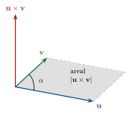

<!-- video: kommer (videoer/flervariabel-kalkulus/00-01-vektorer-og-vektorproduktet) -->
{fig-alt="Video kommer"}

<!-- tillegg: Claude -->
Nesten alt i flervariabel analyse skrives med vektorer: punkter i rommet, retninger, hastigheter, normaler til flater og vektorfelt. Her samler vi notasjonen vi bruker, og de to produktene som gjør vektorer så nyttige: skalarproduktet, som måler vinkler, og vektorproduktet, som lager en normalvektor.

## Rommet $\mathbb{R}^n$

::: {.callout-note title="Definisjon: Vektorrommet $\mathbb{R}^n$"}
For et naturlig tall $n$ er $\mathbb{R}^n$ mengden av alle ordnede lister med $n$ reelle tall:
$$
\mathbb{R}^n = \{(v_1, v_2, \dots, v_n) : v_1, \dots, v_n \in \mathbb{R}\}
$$
Elementene kalles vektorer, og tallene $v_i$ er komponentene.
:::

Vektorer skrives med fet skrift, $\mathbf{u}, \mathbf{v}, \mathbf{w}$. Det samme gjør funksjoner som har vektorer som verdier, for eksempel et vektorfelt $\mathbf{F}(x, y)$. En funksjon med tall som verdier skrives uten fet skrift, $f(x, y)$.

For å spare plass skriver vi ofte vektorer som rader, $\mathbf{v} = (v_1, v_2, v_3)$. Når vi ganger med matriser, trenger vi dem som kolonner. Overgangen er transponering:
$$
(v_1, v_2, v_3)^{\top} = \begin{pmatrix} v_1 \\ v_2 \\ v_3 \end{pmatrix}
$$

I planet og rommet bruker vi standardbasisen
$$
\mathbf{i} = (1, 0, 0), \qquad \mathbf{j} = (0, 1, 0), \qquad \mathbf{k} = (0, 0, 1),
$$
så $(3, -1, 2) = 3\mathbf{i} - \mathbf{j} + 2\mathbf{k}$. I planet er $\mathbf{i} = (1, 0)$ og $\mathbf{j} = (0, 1)$.

## Lengde og skalarprodukt

Lengden (normen) av en vektor er $|\mathbf{v}| = \sqrt{v_1^2 + v_2^2 + \dots + v_n^2}$, Pytagoras i $n$ dimensjoner.

::: {.callout-note title="Definisjon: Skalarprodukt"}
For $\mathbf{u} = (u_1, \dots, u_n)$ og $\mathbf{v} = (v_1, \dots, v_n)$ er
$$
\mathbf{u}\cdot\mathbf{v} = u_1v_1 + u_2v_2 + \dots + u_nv_n = \sum_{i=1}^{n} u_iv_i
$$
:::

Skalarproduktet er et tall. Geometrisk er
$$
\mathbf{u}\cdot\mathbf{v} = |\mathbf{u}|\,|\mathbf{v}|\cos\alpha,
$$
der $\alpha$ er vinkelen mellom vektorene. Det gir oss tre ting vi bruker hele tiden:

::: {.kort}
- **Vinkel** $\cos\alpha = \dfrac{\mathbf{u}\cdot\mathbf{v}}{|\mathbf{u}|\,|\mathbf{v}|}$.
- **Vinkelrett** $\mathbf{u}\perp\mathbf{v}$ nøyaktig når $\mathbf{u}\cdot\mathbf{v} = 0$.
- **Lengde** $\mathbf{v}\cdot\mathbf{v} = |\mathbf{v}|^2$.
:::

## Determinanter

Vektorproduktet regnes ut som en determinant, så vi tar dem først. For en $2\times 2$-matrise er
$$
\begin{vmatrix} a & b \\ c & d \end{vmatrix} = ad - bc .
$$
En $3\times 3$-determinant kan vi **utvikle langs første rad**: hvert element ganges med $2\times 2$-determinanten vi får ved å stryke elementets rad og kolonne, med fortegnene $+, -, +$:
$$
\begin{vmatrix} a_{1} & a_{2} & a_{3} \\ b_{1} & b_{2} & b_{3} \\ c_{1} & c_{2} & c_{3} \end{vmatrix}
= a_1\begin{vmatrix} b_2 & b_3 \\ c_2 & c_3 \end{vmatrix}
- a_2\begin{vmatrix} b_1 & b_3 \\ c_1 & c_3 \end{vmatrix}
+ a_3\begin{vmatrix} b_1 & b_2 \\ c_1 & c_2 \end{vmatrix}
$$

## Vektorproduktet

::: {.callout-note title="Definisjon: Vektorprodukt (kryssprodukt)"}
For $\mathbf{a} = (a_1, a_2, a_3)$ og $\mathbf{b} = (b_1, b_2, b_3)$ i $\mathbb{R}^3$ er
$$
\mathbf{a}\times\mathbf{b} =
\begin{vmatrix} \mathbf{i} & \mathbf{j} & \mathbf{k} \\ a_1 & a_2 & a_3 \\ b_1 & b_2 & b_3 \end{vmatrix}
= (a_2b_3 - a_3b_2)\,\mathbf{i} - (a_1b_3 - a_3b_1)\,\mathbf{j} + (a_1b_2 - a_2b_1)\,\mathbf{k}
$$
:::

{.tikz-fig style="width:420px" fig-alt="To vektorer u og v ut fra samme punkt med vinkelen alfa mellom seg, og parallellogrammet de spenner ut skravert. Vektoren u kryss v peker rett opp fra punktet, vinkelrett på begge."}

Vektorproduktet er en vektor, ikke et tall, og har en tydelig geometri:

::: {.kort}
- **Retning** $\mathbf{a}\times\mathbf{b}$ står vinkelrett på både $\mathbf{a}$ og $\mathbf{b}$, med retning etter høyrehåndsregelen.
- **Lengde** $|\mathbf{a}\times\mathbf{b}| = |\mathbf{a}|\,|\mathbf{b}|\sin\alpha$, arealet av parallellogrammet $\mathbf{a}$ og $\mathbf{b}$ spenner ut.
- **Rekkefølge** $\mathbf{b}\times\mathbf{a} = -\,\mathbf{a}\times\mathbf{b}$, og $\mathbf{a}\times\mathbf{a} = \mathbf{0}$.
:::

Vektorproduktet finnes egentlig bare i $\mathbb{R}^3$. Plane vektorer kan vi likevel krysse ved å legge til en null: $(a, b)$ blir $(a, b, 0)$. Svaret peker da langs $z$-aksen og er bestemt av ett tall, $\mathbf{u}\times\mathbf{v} = (u_1v_2 - u_2v_1)\,\mathbf{k}$.

::: {.eksempel}
**Eksempel: En normalvektor og et areal.** La $\mathbf{a} = (2, 1, 0)$ og $\mathbf{b} = (0, 3, 1)$. Finn $\mathbf{a}\times\mathbf{b}$, kontroller at den står vinkelrett på begge, og finn arealet av parallellogrammet.

::: {.losning}
Vi utvikler langs første rad:
$$
\mathbf{a}\times\mathbf{b} =
\begin{vmatrix} \mathbf{i} & \mathbf{j} & \mathbf{k} \\ 2 & 1 & 0 \\ 0 & 3 & 1 \end{vmatrix}
= (1\cdot 1 - 0\cdot 3)\,\mathbf{i} - (2\cdot 1 - 0\cdot 0)\,\mathbf{j} + (2\cdot 3 - 1\cdot 0)\,\mathbf{k} = (1, -2, 6)
$$
Kontroll med skalarproduktet:
$$
(1, -2, 6)\cdot(2, 1, 0) = 2 - 2 + 0 = 0, \qquad (1, -2, 6)\cdot(0, 3, 1) = 0 - 6 + 6 = 0 . \checkmark
$$
Arealet er lengden av vektorproduktet:
$$
A = |(1, -2, 6)| = \sqrt{1 + 4 + 36} = \sqrt{41} \approx \underline{\underline{6.40}}
$$
:::
:::

## Prøv selv

NumPy har begge produktene innebygd. Endre vektorene og se at vektorproduktet alltid står vinkelrett på begge.

```{.python .kjor}
import numpy as np

a = np.array([2, 1, 0])
b = np.array([0, 3, 1])

c = np.cross(a, b)
print("a x b =", c)
print("(a x b) . a =", np.dot(c, a))
print("(a x b) . b =", np.dot(c, b))
print(f"areal = |a x b| = {np.linalg.norm(c):.3f}")

vinkel = np.degrees(np.arccos(np.dot(a, b) / (np.linalg.norm(a) * np.linalg.norm(b))))
print(f"vinkel mellom a og b: {vinkel:.1f} grader")
```

:::: {.oppgaver}

::: {.oppgave tittel="Vinkel med skalarproduktet"}
Finn vinkelen mellom $\mathbf{u} = (1, 2, 2)$ og $\mathbf{v} = (2, 0, -1)$.

::: {.losning}
$$
\mathbf{u}\cdot\mathbf{v} = 2 + 0 - 2 = 0
$$
Skalarproduktet er null, så vektorene står vinkelrett på hverandre: $\alpha = \underline{\underline{90^\circ}}$.
:::
:::

::: {.oppgave tittel="Et vektorprodukt"}
Regn ut $(1, 0, 2)\times(3, 1, -1)$.

::: {.losning}
$$
\begin{vmatrix} \mathbf{i} & \mathbf{j} & \mathbf{k} \\ 1 & 0 & 2 \\ 3 & 1 & -1 \end{vmatrix}
= (0\cdot(-1) - 2\cdot 1)\,\mathbf{i} - (1\cdot(-1) - 2\cdot 3)\,\mathbf{j} + (1\cdot 1 - 0\cdot 3)\,\mathbf{k}
= \underline{\underline{(-2,\ 7,\ 1)}}
$$
Kontroll: $(-2, 7, 1)\cdot(1, 0, 2) = 0$ og $(-2, 7, 1)\cdot(3, 1, -1) = -6 + 7 - 1 = 0$.
:::
:::

::: {.oppgave tittel="Arealet av en trekant"}
Finn arealet av trekanten med hjørner $A = (1, 0, 0)$, $B = (0, 2, 0)$ og $C = (0, 0, 3)$.

::: {.losning}
Trekanten er halvparten av parallellogrammet utspent av $\overrightarrow{AB} = (-1, 2, 0)$ og $\overrightarrow{AC} = (-1, 0, 3)$:
$$
\overrightarrow{AB}\times\overrightarrow{AC} = (2\cdot 3 - 0\cdot 0,\ -((-1)\cdot 3 - 0\cdot(-1)),\ (-1)\cdot 0 - 2\cdot(-1)) = (6, 3, 2)
$$
$$
A = \tfrac12\,|(6, 3, 2)| = \tfrac12\sqrt{36 + 9 + 4} = \tfrac12\cdot 7 = \underline{\underline{3.5}}
$$
:::
:::

::: {.oppgave tittel="Plane vektorer" niva="Middels"}
Regn ut $\mathbf{u}\times\mathbf{v}$ for de plane vektorene $\mathbf{u} = (3, 1)$ og $\mathbf{v} = (1, 2)$, og tolk svaret. Hva skjer om du bytter rekkefølge?

::: {.losning}
Vi legger til $z = 0$: $\mathbf{u} = (3, 1, 0)$ og $\mathbf{v} = (1, 2, 0)$. Da er
$$
\mathbf{u}\times\mathbf{v} = (3\cdot 2 - 1\cdot 1)\,\mathbf{k} = \underline{\underline{5\,\mathbf{k}}}
$$
Parallellogrammet har areal $5$, og vektoren peker opp ($+\mathbf{k}$) fordi vi dreier mot klokka fra $\mathbf{u}$ til $\mathbf{v}$. Bytter vi rekkefølge, får vi $\mathbf{v}\times\mathbf{u} = -5\,\mathbf{k}$: samme areal, motsatt retning.
:::
:::

::: {.oppgave tittel="Volum av et parallellepiped" niva="Utfordrende"}
Volumet av parallellepipedet utspent av $\mathbf{a}$, $\mathbf{b}$ og $\mathbf{c}$ er $V = |(\mathbf{a}\times\mathbf{b})\cdot\mathbf{c}|$: grunnflaten $|\mathbf{a}\times\mathbf{b}|$ ganger høyden, som er komponenten av $\mathbf{c}$ langs normalen. Finn volumet når $\mathbf{a} = (2, 1, 0)$, $\mathbf{b} = (0, 3, 1)$ og $\mathbf{c} = (1, 1, 4)$.

::: {.losning}
Fra eksemplet er $\mathbf{a}\times\mathbf{b} = (1, -2, 6)$. Da er
$$
(\mathbf{a}\times\mathbf{b})\cdot\mathbf{c} = 1 - 2 + 24 = 23, \qquad V = \underline{\underline{23}}
$$
Det samme tallet er determinanten med $\mathbf{a}$, $\mathbf{b}$ og $\mathbf{c}$ som rader:
$$
\begin{vmatrix} 2 & 1 & 0 \\ 0 & 3 & 1 \\ 1 & 1 & 4 \end{vmatrix} = 2(12 - 1) - 1(0 - 1) + 0 = 23 .
$$
:::
:::

::::
