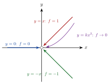

<!-- video: kommer (videoer/flervariabel-kalkulus/00-02-kontinuitet) -->
{fig-alt="Video kommer"}

<!-- tillegg: Claude -->
For en funksjon av én variabel kan vi bare nærme oss et punkt fra to sider, fra venstre og fra høyre. I planet kan vi komme inn fra uendelig mange retninger, langs rette linjer, parabler eller spiraler. Det gjør grenseverdier og kontinuitet litt mer krevende i flere variabler, og det er grunnen til at vi må være presise.

## Grenseverdi og kontinuitet

Vi skriver punkter i $\mathbb{R}^n$ som $\mathbf{x} = (x_1, \dots, x_n)$ og avstanden mellom to punkter som $|\mathbf{x} - \mathbf{a}|$.

::: {.callout-note title="Definisjon: Kontinuitet"}
En funksjon $f$ av $n$ variabler er **kontinuerlig** i punktet $\mathbf{a}$ dersom
$$
\lim_{\mathbf{x}\to\mathbf{a}} f(\mathbf{x}) = f(\mathbf{a}).
$$
Presist: For hver $\varepsilon > 0$ finnes en $\delta > 0$ slik at $|f(\mathbf{x}) - f(\mathbf{a})| < \varepsilon$ for alle $\mathbf{x}$ med $|\mathbf{x} - \mathbf{a}| < \delta$.
:::

Kravet $|\mathbf{x} - \mathbf{a}| < \delta$ handler om en hel liten disk rundt $\mathbf{a}$, ikke om én bestemt retning. Grensen må altså bli den samme **uansett hvilken vei** $\mathbf{x}$ tar inn mot $\mathbf{a}$.

Heldigvis er de fleste funksjonene vi møter, kontinuerlige der de er definert: polynomer, $\sin$, $\cos$, $\mathrm{e}^x$, og summer, produkter og sammensetninger av slike. Brøker er kontinuerlige der nevneren ikke er null. Det er nettopp i slike punkter, der en formel bryter sammen, at vi må passe på.

## Ulike veier gir ulike grenser

{.tikz-fig style="width:460px" fig-alt="Koordinatsystem med origo som en åpen sirkel. Fire veier fører inn mot origo: langs x-aksen der f er null, langs linjen y lik x der f er 1, langs y lik minus x der f er minus 1, og langs en parabel y lik k x i andre der f går mot null."}

::: {.eksempel}
**Eksempel: En grense som ikke finnes.** Undersøk om
$$
f(x, y) = \begin{cases} \dfrac{2xy}{x^2 + y^2}, & (x, y) \ne (0, 0) \\[2mm] 0, & (x, y) = (0, 0) \end{cases}
$$
er kontinuerlig i origo.

::: {.losning}
Vi nærmer oss origo langs to rette linjer.

Langs $x$-aksen er $y = 0$, og $f(x, 0) = \dfrac{0}{x^2} = 0$ for alle $x \ne 0$. Grensen langs denne veien er $0$.

Langs linjen $y = x$ er
$$
f(x, x) = \frac{2x^2}{x^2 + x^2} = 1 \quad\text{for alle } x \ne 0 .
$$
Grensen langs denne veien er $1$.

To veier gir to ulike grenser, så $\lim_{(x,y)\to(0,0)} f(x, y)$ **finnes ikke**, og $f$ er ikke kontinuerlig i origo, uansett hvilken verdi vi gir $f(0, 0)$.
:::
:::

::: {.callout-warning title="Samme grense langs mange linjer er ikke nok"}
Å finne to veier med ulike grenser **beviser** at grensen ikke finnes. Det motsatte går ikke: Selv om alle rette linjer gir samme grense, kan en krum vei gi noe annet. Se oppgaven «Alle linjer er enige» nedenfor.
:::

## Hvordan vise at en grense finnes?

For å vise at grensen finnes, må vi få kontroll over *alle* veier på en gang. Et godt triks er å bytte til polarkoordinater, $x = r\cos\theta$ og $y = r\sin\theta$. Da betyr $(x, y)\to(0, 0)$ det samme som $r\to 0$, uansett $\theta$.

::: {.eksempel}
**Eksempel: En grense som finnes.** Vis at
$$
\lim_{(x,y)\to(0,0)} \frac{x^2y}{x^2 + y^2} = 0 .
$$

::: {.losning}
Med polarkoordinater er $x^2 + y^2 = r^2$ og $x^2y = r^3\cos^2\theta\sin\theta$, så
$$
\left|\frac{x^2y}{x^2 + y^2}\right| = \frac{r^3\,|\cos^2\theta\sin\theta|}{r^2} = r\,|\cos^2\theta\sin\theta| \le r .
$$
Uttrykket er altså høyst $r$, som går mot $0$ når $r\to 0$, uansett hvilken vei vi kommer fra. Grensen er $\underline{\underline{0}}$.
:::
:::

## Prøv selv

Programmet regner ut funksjonsverdier nær origo langs flere veier. Bytt funksjon og se om veiene er enige.

```{.python .kjor}
import numpy as np

def f(x, y):
    return 2 * x * y / (x**2 + y**2)

veier = {
    "y = 0":    lambda t: (t, 0 * t),
    "y = x":    lambda t: (t, t),
    "y = -x":   lambda t: (t, -t),
    "y = x^2":  lambda t: (t, t**2),
}

for navn, vei in veier.items():
    verdier = [f(*vei(t)) for t in (0.1, 0.01, 0.001)]
    print(f"{navn:8s}", "  ".join(f"{v:8.4f}" for v in verdier))
```

:::: {.oppgaver}

::: {.oppgave tittel="Finnes grensen?"}
Avgjør om grensen finnes:
$$
\lim_{(x,y)\to(0,0)} \frac{x^2 - y^2}{x^2 + y^2}
$$

::: {.losning}
Langs $x$-aksen ($y = 0$) er uttrykket $\dfrac{x^2}{x^2} = 1$. Langs $y$-aksen ($x = 0$) er det $\dfrac{-y^2}{y^2} = -1$. To veier gir ulike grenser, så grensen **finnes ikke**.
:::
:::

::: {.oppgave tittel="Kontinuerlig der den er definert"}
Hvor er $g(x, y) = \dfrac{\mathrm{e}^{xy}}{x - y}$ kontinuerlig?

::: {.losning}
Teller og nevner er kontinuerlige overalt, og brøken er kontinuerlig der nevneren ikke er null. $g$ er altså kontinuerlig overalt **unntatt på linjen $y = x$**, der den ikke er definert.
:::
:::

::: {.oppgave tittel="Grense med polarkoordinater" niva="Middels"}
Vis at $\displaystyle\lim_{(x,y)\to(0,0)} \frac{x^3 + y^3}{x^2 + y^2} = 0$.

::: {.losning}
Med $x = r\cos\theta$, $y = r\sin\theta$:
$$
\left|\frac{x^3 + y^3}{x^2 + y^2}\right| = \frac{r^3\,|\cos^3\theta + \sin^3\theta|}{r^2} = r\,|\cos^3\theta + \sin^3\theta| \le 2r ,
$$
siden $|\cos^3\theta| \le 1$ og $|\sin^3\theta| \le 1$. Når $r\to 0$, går dette mot $0$ for alle $\theta$, så grensen er $\underline{\underline{0}}$.
:::
:::

::: {.oppgave tittel="Alle linjer er enige" niva="Utfordrende"}
La $f(x, y) = \dfrac{x^2y}{x^4 + y^2}$ for $(x, y) \ne (0, 0)$.

a) Vis at $f \to 0$ langs alle rette linjer $y = kx$ inn mot origo, og langs $y$-aksen.

b) Vis at $f \to \frac12$ langs parabelen $y = x^2$. Hva betyr det?

::: {.losning}
a) Langs $y = kx$ er
$$
f(x, kx) = \frac{kx^3}{x^4 + k^2x^2} = \frac{kx}{x^2 + k^2} \to \frac{0}{k^2} = 0 \quad (k \ne 0),
$$
og for $k = 0$ er $f = 0$. Langs $y$-aksen er $x = 0$ og $f = 0$. Alle linjer gir altså grensen $0$.

b) Langs $y = x^2$ er
$$
f(x, x^2) = \frac{x^4}{x^4 + x^4} = \frac12 .
$$
Parabelen gir en annen grense enn linjene, så $\lim_{(x,y)\to(0,0)} f(x, y)$ **finnes ikke**. Det viser at det ikke holder å sjekke rette linjer.
:::
:::

::::
