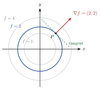

<!-- video: kommer (videoer/flervariabel-kalkulus/00-04-nivakurver-og-gradient) -->
{fig-alt="Video kommer"}

<!-- tillegg: Claude -->
Et turkart viser et tredimensjonalt landskap på et flatt ark med høydekurver: linjer der høyden over havet er den samme. Tette kurver betyr bratt terreng, og den bratteste veien opp går rett på tvers av kurvene. Den samme ideen gir oss en måte å tegne funksjoner av to variabler på, og fører rett til gradienten.

## Nivåkurver

Grafen til $z = f(x, y)$ er en flate i rommet. Den er ofte vanskelig å tegne, men nivåkurvene ligger i planet.

::: {.callout-note title="Definisjon: Nivåkurve"}
Nivåkurven til $f(x, y)$ for verdien $c$ er mengden
$$
\{(x, y) : f(x, y) = c\}.
$$
Geometrisk skjærer vi flaten $z = f(x, y)$ med det vannrette planet $z = c$ og legger skjæringskurven ned i $xy$-planet.
:::

Tegner vi nivåkurvene for jevnt fordelte verdier $c$, får vi et **konturplott**, akkurat som høydekurvene på et kart. For en funksjon av tre variabler, $f(x, y, z) = c$, får vi **nivåflater** i stedet.

::: {.eksempel}
**Eksempel: Ellipser.** Beskriv nivåkurvene til $f(x, y) = x^2 + 4y^2$.

::: {.losning}
$f(x, y) = c$ gir $x^2 + 4y^2 = c$. For $c < 0$ finnes ingen punkter, og for $c = 0$ bare origo. For $c > 0$ deler vi på $c$:
$$
\frac{x^2}{c} + \frac{y^2}{c/4} = 1,
$$
en ellipse med halvakser $\sqrt{c}$ langs $x$-aksen og $\frac12\sqrt{c}$ langs $y$-aksen. Nivåkurvene er altså ellipser rundt origo, dobbelt så lange i $x$-retning som i $y$-retning. Flaten stiger raskere i $y$-retning.
:::
:::

## Gradienten står vinkelrett på nivåkurvene

::: {.callout-note title="Definisjon: Gradient"}
Gradienten til $f(x, y)$ er vektoren av partiellderiverte,
$$
\nabla f = \left(\frac{\partial f}{\partial x},\ \frac{\partial f}{\partial y}\right) = (f_x,\ f_y),
$$
og tilsvarende $\nabla f = (f_x, f_y, f_z)$ i tre variabler.
:::

Hvorfor står den vinkelrett på nivåkurvene? La $\mathbf{r}(t) = (x(t), y(t))$ være en parametrisering av nivåkurven $f(x, y) = c$. Da er
$$
f\big(x(t), y(t)\big) = c \quad\text{for alle } t .
$$
Vi deriverer begge sider med hensyn på $t$. Kjerneregelen for flere variabler sier at endringen av $f$ langs kurven er bidraget fra $x$-retningen pluss bidraget fra $y$-retningen:
$$
f_x\,x'(t) + f_y\,y'(t) = 0 \quad\Longleftrightarrow\quad \nabla f\cdot\mathbf{r}'(t) = 0 .
$$
Vektoren $\mathbf{r}'(t)$ peker langs kurven, altså i tangentretningen. Skalarproduktet er null, så:

::: {.callout-important title="Gradienten og nivåkurvene"}
I hvert punkt der $\nabla f \ne \mathbf{0}$, står gradienten $\nabla f$ vinkelrett på nivåkurven gjennom punktet. Den peker i retningen der $f$ vokser raskest, og lengden $|\nabla f|$ er hvor raskt $f$ vokser i den retningen.
:::

Den siste delen tar vi på tro her: Går vi i en retning som danner vinkelen $\alpha$ med $\nabla f$, endrer $f$ seg med farten $|\nabla f|\cos\alpha$ per lengdeenhet, og det er størst når $\alpha = 0$.

{.tikz-fig style="width:440px" fig-alt="Konsentriske sirkler om origo, nivåkurvene f lik 1, 2 og 4 for f lik x i andre pluss y i andre. Sirkelen f lik 2 er uthevet. I punktet P lik 1, 1 på den sirkelen peker gradienten 2, 2 rett ut fra sentrum, og en stiplet tangent står vinkelrett på den."}

::: {.eksempel}
**Eksempel: Gradient og tangent.** La $f(x, y) = x^2 + y^2$ og $P = (1, 1)$. Finn gradienten i $P$ og en retningsvektor for tangenten til nivåkurven gjennom $P$.

::: {.losning}
$f(1, 1) = 2$, så $P$ ligger på sirkelen $x^2 + y^2 = 2$. Gradienten er
$$
\nabla f = (2x,\ 2y), \qquad \nabla f(1, 1) = (2,\ 2).
$$
Den peker rett ut fra sentrum av sirkelen, slik figuren viser. En tangentvektor $\mathbf{t} = (a, b)$ må oppfylle $\nabla f\cdot\mathbf{t} = 2a + 2b = 0$, for eksempel $\mathbf{t} = (1, -1)$. Tangenten til en sirkel står vinkelrett på radien, så dette stemmer med det vi vet fra geometrien.
:::
:::

## Prøv selv

Programmet regner ut gradienten numerisk i noen punkter på ellipsen $x^2 + 4y^2 = 8$ og sjekker at den står vinkelrett på tangenten. Bytt funksjon eller punkter.

```{.python .kjor}
import numpy as np

def f(x, y):
    return x**2 + 4 * y**2

def gradient(x, y, h=1e-6):
    return np.array([(f(x + h, y) - f(x - h, y)) / (2 * h),
                     (f(x, y + h) - f(x, y - h)) / (2 * h)])

# ellipsen x^2 + 4y^2 = 8 parametrisert: x = sqrt(8) cos t, y = sqrt(2) sin t
for t in (0.3, 1.0, 2.5):
    x, y = np.sqrt(8) * np.cos(t), np.sqrt(2) * np.sin(t)
    tangent = np.array([-np.sqrt(8) * np.sin(t), np.sqrt(2) * np.cos(t)])   # r'(t)
    g = gradient(x, y)
    print(f"({x:5.2f}, {y:5.2f}):  grad = ({g[0]:6.2f}, {g[1]:6.2f}),  grad . r' = {g @ tangent:.1e}")
```

:::: {.oppgaver}

::: {.oppgave tittel="Rette nivåkurver"}
Beskriv nivåkurvene til $f(x, y) = 2x - y$. Hva er gradienten, og hvordan ligger den i forhold til nivåkurvene?

::: {.losning}
$2x - y = c$ gir $y = 2x - c$: parallelle rette linjer med stigningstall $2$. Gradienten er $\nabla f = (2, -1)$, den samme overalt. En retningsvektor for linjene er $(1, 2)$, og $(2, -1)\cdot(1, 2) = 0$, så gradienten står vinkelrett på alle nivåkurvene.
:::
:::

::: {.oppgave tittel="Hyperbler"}
Skisser nivåkurvene $f = -1$, $f = 0$ og $f = 1$ for $f(x, y) = xy$, og finn $\nabla f(2, \tfrac12)$.

::: {.losning}
$xy = 1$ og $xy = -1$ er hyperbler, i henholdsvis første og tredje og i andre og fjerde kvadrant. $xy = 0$ er de to aksene. Gradienten er $\nabla f = (y, x)$, så $\nabla f(2, \tfrac12) = \underline{\underline{(\tfrac12,\ 2)}}$. Punktet ligger på $xy = 1$, og gradienten peker bort fra origo, mot større verdier av $xy$.
:::
:::

::: {.oppgave tittel="Bratteste vei" niva="Middels"}
Høyden i et terreng er $h(x, y) = 200 - 0.01x^2 - 0.04y^2$ meter, med $x$ og $y$ i meter.

a) I hvilken retning stiger terrenget brattest i punktet $(50, 25)$?

b) Hvor bratt er det der, målt som stigning per meter?

::: {.losning}
a)
$$
\nabla h = (-0.02x,\ -0.08y), \qquad \nabla h(50, 25) = (-1.0,\ -2.0)
$$
Terrenget stiger brattest i retningen $(-1, -2)$, altså innover mot toppen i origo.

b) Stigningen er
$$
|\nabla h| = \sqrt{1.0^2 + 2.0^2} = \sqrt{5} \approx \underline{\underline{2.2}},
$$
det vil si omtrent $2.2\ \mathrm{m}$ stigning per meter i den retningen.
:::
:::

::: {.oppgave tittel="Normal til en nivåflate" niva="Utfordrende"}
Kula $x^2 + y^2 + z^2 = 9$ er nivåflaten $f = 9$ til $f(x, y, z) = x^2 + y^2 + z^2$. Bruk gradienten til å finne en normalvektor til kula i punktet $(1, 2, 2)$, og forklar hvorfor svaret er rimelig.

::: {.losning}
Samme argument som i planet: Gradienten står vinkelrett på hver kurve som ligger på nivåflaten, og dermed på hele flaten.
$$
\nabla f = (2x,\ 2y,\ 2z), \qquad \nabla f(1, 2, 2) = \underline{\underline{(2,\ 4,\ 4)}}
$$
Den er parallell med stedvektoren $(1, 2, 2)$, altså radien. Normalen til en kule går gjennom sentrum, så svaret er rimelig.
:::
:::

::::
