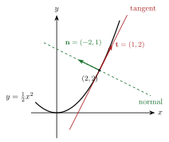

<!-- video: kommer (videoer/flervariabel-kalkulus/00-05-tangenter-og-normaler) -->
{fig-alt="Video kommer"}

<!-- tillegg: Claude -->
Tangenten er den rette linjen som ligner mest på en kurve i et punkt. Normalen står vinkelrett på den. Her repeterer vi begge for grafer $y = f(x)$, men vi skriver dem med vektorer. Da ser vi at normalen kommer rett ut av skalarproduktet, og den samme ideen gir senere normalvektorer til flater og tangentplan.

## Tangentlinjen

Er $f$ deriverbar i $x_0$, er $f'(x_0)$ stigningstallet til tangenten i punktet $(x_0, f(x_0))$. Ettpunktsformelen gir:

::: {.callout-important title="Tangentlinjen til $y = f(x)$ i $x = x_0$"}
$$
y = f(x_0) + f'(x_0)\,(x - x_0)
$$
En retningsvektor for tangenten er $\mathbf{t} = (1,\ f'(x_0))$: Øker $x$ med $1$, øker $y$ med $f'(x_0)$ langs tangenten.
:::

## Normallinjen med skalarproduktet

Normalen går gjennom samme punkt og står vinkelrett på tangenten. Vi leter etter en retningsvektor $\mathbf{n} = (a, b)$ med
$$
\mathbf{t}\cdot\mathbf{n} = 1\cdot a + f'(x_0)\cdot b = 0 .
$$
Med $b = 1$ blir $a = -f'(x_0)$, altså $\mathbf{n} = (-f'(x_0),\ 1)$. Stigningstallet er $\dfrac{b}{a} = -\dfrac{1}{f'(x_0)}$ (når $f'(x_0) \ne 0$):

::: {.callout-important title="Normallinjen til $y = f(x)$ i $x = x_0$"}
$$
y = f(x_0) - \frac{1}{f'(x_0)}\,(x - x_0), \qquad f'(x_0) \ne 0
$$
Er $f'(x_0) = 0$, er tangenten vannrett og normalen loddrett: $x = x_0$.
:::

Regelen «stigningstallene ganget med hverandre blir $-1$» er altså bare skalarproduktet $\mathbf{t}\cdot\mathbf{n} = 0$ skrevet på en annen måte.

{.tikz-fig style="width:420px" fig-alt="Parabelen y lik en halv x i andre med tangenten i punktet 2, 2 og den stiplede normalen. Tangentvektoren 1, 2 peker langs tangenten, og normalvektoren minus 2, 1 står vinkelrett på den."}

::: {.eksempel}
**Eksempel: Tangent og normal til en parabel.** Finn tangenten og normalen til $y = \tfrac12 x^2$ i punktet der $x_0 = 2$.

::: {.losning}
::: {.steg}
1. **Punktet:** $f(2) = \tfrac12\cdot 4 = 2$, så punktet er $(2, 2)$.
2. **Stigningstallet:** $f'(x) = x$, så $f'(2) = 2$.
3. **Tangenten:** $y = 2 + 2(x - 2) = 2x - 2$, med retningsvektor $\mathbf{t} = (1, 2)$.
4. **Normalen:** $\mathbf{n} = (-2, 1)$ gir stigningstall $-\tfrac12$, så $y = 2 - \tfrac12(x - 2) = -\tfrac12 x + 3$.
:::

Kontroll: $\mathbf{t}\cdot\mathbf{n} = 1\cdot(-2) + 2\cdot 1 = 0$. ✓
:::
:::

## Et blikk fremover

Grafen $y = f(x)$ er nivåkurven $F(x, y) = 0$ for $F(x, y) = f(x) - y$. Gradienten er
$$
\nabla F = (f'(x),\ -1),
$$
som er parallell med $\mathbf{n} = (-f'(x), 1)$, bare med motsatt fortegn. Normalen til en kurve er altså gradienten, akkurat som vi så for [nivåkurver](04-nivakurver-og-gradient.qmd). I tre dimensjoner gir den samme ideen normalvektoren til en flate, og dermed tangentplanet.

## Prøv selv

Programmet finner tangent og normal for en funksjon i et valgt punkt, med numerisk derivert. Prøv andre funksjoner og punkter.

```{.python .kjor}
import numpy as np

def f(x):
    return 0.5 * x**2

x0 = 2.0
h = 1e-6
df = (f(x0 + h) - f(x0 - h)) / (2 * h)     # numerisk derivert
y0 = f(x0)

print(f"punkt: ({x0}, {y0:.4f}),  f'(x0) = {df:.4f}")
print(f"tangent: y = {y0:.4f} + {df:.4f}(x - {x0})")
if abs(df) > 1e-12:
    print(f"normal:  y = {y0:.4f} - {1/df:.4f}(x - {x0})")
else:
    print(f"normal:  x = {x0}")
t, n = np.array([1, df]), np.array([-df, 1])
print("t . n =", t @ n)
```

:::: {.oppgaver}

::: {.oppgave tittel="En tangent"}
Finn tangenten til $y = \sqrt{x}$ i $x_0 = 4$.

::: {.losning}
$f(4) = 2$ og $f'(x) = \dfrac{1}{2\sqrt{x}}$, så $f'(4) = \tfrac14$.
$$
y = 2 + \tfrac14(x - 4) = \underline{\underline{\tfrac14 x + 1}}
$$
:::
:::

::: {.oppgave tittel="En normal"}
Finn normalen til $y = \mathrm{e}^{x}$ i $x_0 = 0$, og en retningsvektor for den.

::: {.losning}
$f(0) = 1$ og $f'(0) = 1$. Normalen har stigningstall $-1$:
$$
y = 1 - (x - 0) = \underline{\underline{1 - x}}
$$
En retningsvektor er $\mathbf{n} = (-f'(0), 1) = (-1, 1)$.
:::
:::

::: {.oppgave tittel="Vannrett tangent" niva="Middels"}
I hvilke punkter har $y = x^3 - 3x$ vannrett tangent? Hva er normalen der?

::: {.losning}
$f'(x) = 3x^2 - 3 = 0$ gir $x = \pm 1$. Punktene er $(1, -2)$ og $(-1, 2)$. Tangentene er vannrette, $y = -2$ og $y = 2$, så normalene er loddrette: $\underline{\underline{x = 1}}$ og $\underline{\underline{x = -1}}$.
:::
:::

::: {.oppgave tittel="Normal gjennom et gitt punkt" niva="Utfordrende"}
Finn punktet på parabelen $y = x^2$ der normalen går gjennom punktet $(0, \tfrac{3}{2})$, med $x > 0$.

::: {.losning}
I punktet $(a, a^2)$ er $f'(a) = 2a$, og normalen er
$$
y = a^2 - \frac{1}{2a}(x - a).
$$
Den skal gå gjennom $(0, \tfrac32)$:
$$
\frac32 = a^2 - \frac{1}{2a}(0 - a) = a^2 + \frac12 \quad\Longrightarrow\quad a^2 = 1 .
$$
Med $a > 0$ er $a = 1$, og punktet er $\underline{\underline{(1,\ 1)}}$. Kontroll: Normalen $y = 1 - \tfrac12(x - 1)$ gir $y = \tfrac32$ for $x = 0$. ✓
:::
:::

::::
