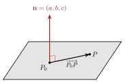

<!-- video: kommer (videoer/flervariabel-kalkulus/00-06-linjer-og-plan) -->
{fig-alt="Video kommer"}

<!-- tillegg: Claude -->
Å **parametrisere** betyr å beskrive punktene i en mengde som verdiene til en funksjon av én eller flere parametere. Videre parametriserer vi kurver og flater hele tiden, når vi regner ut linjeintegraler, flateintegraler og fluks. Her starter vi med de enkleste tilfellene: rette linjer og plan.

## Parametrisering av et linjestykke

La $P$ og $Q$ være to punkter med stedvektorer $\mathbf{p}$ og $\mathbf{q}$. Vi lar en parameter $t$ gå fra $0$ til $1$ og går en andel $t$ av veien fra $P$ mot $Q$:

::: {.callout-note title="Definisjon: Linjestykket fra $P$ til $Q$"}
$$
\mathbf{r}(t) = \mathbf{p} + t\,(\mathbf{q} - \mathbf{p}), \qquad 0 \le t \le 1 .
$$
Med retningsvektoren $\mathbf{d} = \mathbf{q} - \mathbf{p}$ er $\mathbf{r}(t) = \mathbf{p} + t\,\mathbf{d}$.
:::

Vi ser at $\mathbf{r}(0) = \mathbf{p}$ og $\mathbf{r}(1) = \mathbf{q}$, og for $0 < t < 1$ ligger punktet mellom $P$ og $Q$. Lar vi $t$ gå over alle reelle tall, får vi hele den uendelige linjen gjennom $P$ og $Q$.

Den deriverte er $\mathbf{r}'(t) = \mathbf{d}$. Tenker vi på $t$ som tid, er $\mathbf{d}$ fartsvektoren: Den peker langs linjen, og lengden $|\mathbf{d}|$ er hvor fort vi beveger oss. Det er nøyaktig rollen stigningstallet har for $y = a + bx$, men parameterformen virker også for loddrette linjer og i alle dimensjoner.

::: {.eksempel}
**Eksempel: Et linjestykke i rommet.** Parametriser linjestykket fra $P = (-1, 2, 0)$ til $Q = (3, 0, 4)$, og finn midtpunktet.

::: {.losning}
$\mathbf{d} = \mathbf{q} - \mathbf{p} = (4, -2, 4)$, så
$$
\mathbf{r}(t) = (-1, 2, 0) + t\,(4, -2, 4) = (-1 + 4t,\ 2 - 2t,\ 4t), \qquad 0 \le t \le 1 .
$$
Kontroll: $\mathbf{r}(0) = (-1, 2, 0) = P$ og $\mathbf{r}(1) = (3, 0, 4) = Q$. ✓

Midtpunktet er $\mathbf{r}(\tfrac12) = (1, 1, 2)$, som er gjennomsnittet av koordinatene til $P$ og $Q$.
:::
:::

## Planlikningen

Et plan er bestemt av ett punkt $P_0 = (x_0, y_0, z_0)$ i planet og en **normalvektor** $\mathbf{n} = (a, b, c)$ som står vinkelrett på planet. Er $P = (x, y, z)$ et annet punkt i planet, ligger vektoren $\overrightarrow{P_0P}$ i planet og står derfor vinkelrett på $\mathbf{n}$.

{.tikz-fig style="width:440px" fig-alt="Et skravert plan med punktet P null og et annet punkt P. Vektoren fra P null til P ligger i planet, og normalvektoren n lik a, b, c står rett opp fra P null, vinkelrett på planet."}

::: {.callout-important title="Likningen for et plan"}
Planet gjennom $P_0 = (x_0, y_0, z_0)$ med normalvektor $\mathbf{n} = (a, b, c)$ er alle punkter $(x, y, z)$ med
$$
\mathbf{n}\cdot\overrightarrow{P_0P} = a(x - x_0) + b(y - y_0) + c(z - z_0) = 0,
$$
eller på formen $ax + by + cz = d$ med $d = ax_0 + by_0 + cz_0$.
:::

Koeffisientene foran $x$, $y$ og $z$ er altså normalvektoren. Fra $2x - y + 3z = 7$ kan vi lese av $\mathbf{n} = (2, -1, 3)$ direkte.

Ofte kjenner vi ikke normalen, men tre punkter i planet. Da gir to vektorer i planet en normal via vektorproduktet, som står vinkelrett på begge:

::: {.eksempel}
**Eksempel: Planet gjennom tre punkter.** Finn likningen for planet gjennom $A = (1, 2, 0)$, $B = (3, 0, 1)$ og $C = (0, 1, 2)$.

::: {.losning}
::: {.steg}
1. **To vektorer i planet:** $\mathbf{u} = \overrightarrow{AB} = (2, -2, 1)$ og $\mathbf{v} = \overrightarrow{AC} = (-1, -1, 2)$.
2. **Normalvektor:** $\mathbf{u}\times\mathbf{v} = \big((-2)\cdot 2 - 1\cdot(-1),\ -(2\cdot 2 - 1\cdot(-1)),\ 2\cdot(-1) - (-2)\cdot(-1)\big) = (-3, -5, -4)$. Vi kan like gjerne bruke $\mathbf{n} = (3, 5, 4)$.
3. **Likningen:** Med $P_0 = A$ er $3(x - 1) + 5(y - 2) + 4(z - 0) = 0$, altså $3x + 5y + 4z = 13$.
:::

Kontroll: $B$ gir $9 + 0 + 4 = 13$ og $C$ gir $0 + 5 + 8 = 13$. ✓
:::
:::

## Prøv selv

Programmet finner planet gjennom tre punkter og sjekker at alle tre oppfyller likningen. Hva skjer om du velger tre punkter på samme linje?

```{.python .kjor}
import numpy as np

A = np.array([1, 2, 0])
B = np.array([3, 0, 1])
C = np.array([0, 1, 2])

n = np.cross(B - A, C - A)
d = n @ A
print(f"planet: {n[0]}x + {n[1]}y + {n[2]}z = {d}")
for navn, P in (("A", A), ("B", B), ("C", C)):
    print(navn, "gir", n @ P)
```

:::: {.oppgaver}

::: {.oppgave tittel="Parametriser"}
Parametriser linjestykket fra $(2, 5)$ til $(2, -1)$. Hvorfor ville $y = ax + b$ ikke virket her?

::: {.losning}
$\mathbf{d} = (2, -1) - (2, 5) = (0, -6)$, så
$$
\mathbf{r}(t) = (2,\ 5 - 6t), \qquad 0 \le t \le 1 .
$$
Linjestykket er loddrett ($x = 2$ hele veien), og en loddrett linje har ikke noe stigningstall. Parameterformen har ikke det problemet.
:::
:::

::: {.oppgave tittel="Plan fra punkt og normal"}
Finn likningen for planet gjennom $(1, -1, 2)$ som står vinkelrett på vektoren $(4, 0, -1)$.

::: {.losning}
$$
4(x - 1) + 0\cdot(y + 1) - (z - 2) = 0 \quad\Longleftrightarrow\quad \underline{\underline{4x - z = 2}}
$$
$y$ forsvinner fordi normalen ikke har noen $y$-komponent: Planet er parallelt med $y$-aksen.
:::
:::

::: {.oppgave tittel="Linje møter plan" niva="Middels"}
Linjen $\mathbf{r}(t) = (1, 0, 2) + t\,(2, 1, -1)$ skjærer planet $x + y + z = 6$. Finn skjæringspunktet.

::: {.losning}
Vi setter koordinatene $x = 1 + 2t$, $y = t$, $z = 2 - t$ inn i likningen:
$$
(1 + 2t) + t + (2 - t) = 3 + 2t = 6 \quad\Longrightarrow\quad t = \tfrac32 .
$$
Skjæringspunktet er $\mathbf{r}(\tfrac32) = \underline{\underline{(4,\ 1.5,\ 0.5)}}$. Kontroll: $4 + 1.5 + 0.5 = 6$. ✓
:::
:::

::: {.oppgave tittel="Avstand fra punkt til plan" niva="Utfordrende"}
Avstanden fra et punkt $Q$ til planet $ax + by + cz = d$ er
$$
D = \frac{|ax_Q + by_Q + cz_Q - d|}{\sqrt{a^2 + b^2 + c^2}} .
$$

a) Forklar formelen med skalarproduktet.

b) Finn avstanden fra $Q = (2, 1, 3)$ til planet $2x - y + 2z = 4$.

::: {.losning}
a) Velg et punkt $P_0$ i planet. Avstanden er lengden av komponenten av $\overrightarrow{P_0Q}$ langs normalen:
$$
D = \frac{|\mathbf{n}\cdot\overrightarrow{P_0Q}|}{|\mathbf{n}|} .
$$
Siden $\mathbf{n}\cdot\mathbf{p}_0 = d$, er $\mathbf{n}\cdot\overrightarrow{P_0Q} = \mathbf{n}\cdot\mathbf{q} - d = ax_Q + by_Q + cz_Q - d$.

b)
$$
D = \frac{|2\cdot 2 - 1 + 2\cdot 3 - 4|}{\sqrt{4 + 1 + 4}} = \frac{5}{3} \approx \underline{\underline{1.67}}
$$
:::
:::

::::
