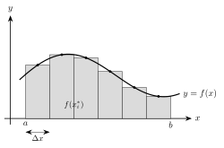

<!-- video: kommer (videoer/flervariabel-kalkulus/00-07-integrasjon) -->
{fig-alt="Video kommer"}

<!-- tillegg: Claude -->
Dobbelt- og trippelintegraler bygger direkte på integralet i én variabel, både på ideen bak det og på regneteknikkene. Ideen er at integralet er en grense av summer, og den samme ideen gir volum, masse og fluks senere. Regneteknikkene trenger vi fordi et dobbeltintegral regnes ut som to vanlige integraler etter hverandre.

## Riemann-summer

Vi vil finne arealet mellom grafen til en kontinuerlig funksjon $f \ge 0$ og $x$-aksen fra $x = a$ til $x = b$. Vi deler $[a, b]$ i $n$ delintervaller med bredde $\Delta x = \dfrac{b - a}{n}$, velger et punkt $x_i^*$ i hvert av dem, og lager rektangler med høyde $f(x_i^*)$.

{.tikz-fig style="width:500px" fig-alt="Grafen til en positiv funksjon over intervallet fra a til b, delt i seks like brede rektangler med bredde Delta x. Høyden til hvert rektangel er funksjonsverdien i midtpunktet, markert med en prikk på grafen."}

Summen av rektangelarealene,
$$
\sum_{i=1}^{n} f(x_i^*)\,\Delta x,
$$
kalles en **Riemann-sum**. Den er et anslag på arealet, og anslaget blir bedre jo flere og smalere rektangler vi bruker.

::: {.callout-note title="Definisjon: Bestemt integral"}
For en kontinuerlig funksjon $f$ på $[a, b]$ er
$$
\int_a^b f(x)\,\mathrm{d}x = \lim_{n\to\infty} \sum_{i=1}^{n} f(x_i^*)\,\Delta x .
$$
:::

Er $f$ negativ noen steder, teller arealet under $x$-aksen negativt. Integralet er da en *nettosum*, ikke et areal.

## Fundamentalteoremet

Grensen av summer er sjelden praktisk å regne ut. I stedet bruker vi en antiderivert.

::: {.callout-important title="Analysens fundamentalteorem"}
Er $f$ kontinuerlig på $[a, b]$ og $F' = f$, er
$$
\int_a^b f(x)\,\mathrm{d}x = \Big[F(x)\Big]_a^b = F(b) - F(a).
$$
:::

Integralet er lineært, $\int (f + g)\,\mathrm{d}x = \int f\,\mathrm{d}x + \int g\,\mathrm{d}x$ og $\int k f\,\mathrm{d}x = k\int f\,\mathrm{d}x$, og de grunnleggende antideriverte er de deriverte lest baklengs:

::: {.graa}
$$
\int x^n\,\mathrm{d}x = \frac{x^{n+1}}{n + 1} + C\ \ (n \ne -1), \qquad \int \frac{1}{x}\,\mathrm{d}x = \ln|x| + C, \qquad \int \mathrm{e}^{x}\,\mathrm{d}x = \mathrm{e}^{x} + C,
$$
$$
\int \sin x\,\mathrm{d}x = -\cos x + C, \qquad \int \cos x\,\mathrm{d}x = \sin x + C .
$$
:::

::: {.eksempel}
**Eksempel: Riemann-sum og eksakt svar.** Regn ut $\displaystyle\int_0^2 (x^2 + 1)\,\mathrm{d}x$ eksakt, og sammenlign med Riemann-summen med midtpunktene i fire delintervaller.

::: {.losning}
Med fundamentalteoremet:
$$
\int_0^2 (x^2 + 1)\,\mathrm{d}x = \Big[\tfrac13 x^3 + x\Big]_0^2 = \tfrac83 + 2 = \tfrac{14}{3} \approx 4.667 .
$$
Med fire delintervaller er $\Delta x = 0.5$ og midtpunktene $0.25,\ 0.75,\ 1.25,\ 1.75$:
$$
\big(f(0.25) + f(0.75) + f(1.25) + f(1.75)\big)\cdot 0.5 = (1.0625 + 1.5625 + 2.5625 + 4.0625)\cdot 0.5 = 4.625 .
$$
Feilen er $4.625 - 4.667 \approx -0.042$, allerede under $1\ \%$.
:::
:::

## To teknikker vi trenger videre

Mange integraler i flere variabler ender opp med en av disse to teknikkene i det indre eller ytre integralet.

::: {.callout-important title="Delvis integrasjon"}
$$
\int u\,v'\,\mathrm{d}x = u\,v - \int u'\,v\,\mathrm{d}x
$$
Velg $u$ som blir enklere når den deriveres, og $v'$ som er lett å integrere.
:::

::: {.callout-important title="Substitusjon"}
Med $u = g(x)$ og $\mathrm{d}u = g'(x)\,\mathrm{d}x$:
$$
\int f\big(g(x)\big)\,g'(x)\,\mathrm{d}x = \int f(u)\,\mathrm{d}u .
$$
I et bestemt integral bytter vi også grensene: $x = a$ blir $u = g(a)$, og $x = b$ blir $u = g(b)$.
:::

::: {.eksempel}
**Eksempel: Én av hver.** Regn ut
$$
\text{a)}\ \int_0^1 x\,\mathrm{e}^{x}\,\mathrm{d}x \qquad \text{b)}\ \int_0^{\sqrt{3}} x\sqrt{1 + x^2}\,\mathrm{d}x
$$

::: {.losning}
a) Delvis integrasjon med $u = x$ og $v' = \mathrm{e}^{x}$, så $u' = 1$ og $v = \mathrm{e}^{x}$:
$$
\int_0^1 x\,\mathrm{e}^{x}\,\mathrm{d}x = \Big[x\,\mathrm{e}^{x}\Big]_0^1 - \int_0^1 \mathrm{e}^{x}\,\mathrm{d}x = \mathrm{e} - (\mathrm{e} - 1) = \underline{\underline{1}}
$$

b) Substitusjon med $u = 1 + x^2$, $\mathrm{d}u = 2x\,\mathrm{d}x$. Grensene blir $u = 1$ og $u = 4$:
$$
\int_0^{\sqrt{3}} x\sqrt{1 + x^2}\,\mathrm{d}x = \frac12\int_1^4 \sqrt{u}\,\mathrm{d}u = \frac12\Big[\tfrac23 u^{3/2}\Big]_1^4 = \frac13(8 - 1) = \underline{\underline{\tfrac73}}
$$
:::
:::

## Videre: summer over flater

Et dobbeltintegral følger nøyaktig samme oppskrift: Del et område i planet i små rektangler med areal $\Delta A$, gang hvert med en funksjonsverdi, summer, og la oppdelingen bli uendelig fin. Se [dobbeltintegraler over rektangler](../01-dobbeltintegraler/01-dobbeltintegraler-over-rektangler.qmd).

## Prøv selv

Programmet regner ut Riemann-summen med midtpunkter for økende $n$. Hvor mye mindre blir feilen hver gang $n$ dobles?

```{.python .kjor}
import numpy as np

def f(x):
    return x**2 + 1

a, b = 0, 2
eksakt = 14 / 3
for n in (4, 8, 16, 32):
    dx = (b - a) / n
    midt = a + (np.arange(n) + 0.5) * dx
    S = np.sum(f(midt)) * dx
    print(f"n = {n:3d}:  sum = {S:.6f},  feil = {S - eksakt:.2e}")
```

:::: {.oppgaver}

::: {.oppgave tittel="Med fundamentalteoremet"}
Regn ut $\displaystyle\int_0^{\pi} \sin x\,\mathrm{d}x$.

::: {.losning}
$$
\Big[-\cos x\Big]_0^{\pi} = -\cos\pi + \cos 0 = 1 + 1 = \underline{\underline{2}}
$$
:::
:::

::: {.oppgave tittel="Riemann-sum for hånd"}
Bruk midtpunktene i fire like delintervaller til å anslå $\displaystyle\int_0^{\pi} \sin x\,\mathrm{d}x$, og sammenlign med svaret over.

::: {.losning}
$\Delta x = \frac{\pi}{4}$, og midtpunktene er $\frac{\pi}{8}, \frac{3\pi}{8}, \frac{5\pi}{8}, \frac{7\pi}{8}$:
$$
\frac{\pi}{4}\left(\sin\tfrac{\pi}{8} + \sin\tfrac{3\pi}{8} + \sin\tfrac{5\pi}{8} + \sin\tfrac{7\pi}{8}\right) = \frac{\pi}{4}\cdot 2\,(0.3827 + 0.9239) \approx \underline{\underline{2.052}}
$$
Feilen er omtrent $0.05$, eller $2.6\ \%$.
:::
:::

::: {.oppgave tittel="Delvis integrasjon" niva="Middels"}
Regn ut $\displaystyle\int_1^{\mathrm{e}} x\ln x\,\mathrm{d}x$.

::: {.losning}
Velg $u = \ln x$ (blir enklere derivert) og $v' = x$, så $u' = \frac1x$ og $v = \frac12 x^2$:
$$
\int_1^{\mathrm{e}} x\ln x\,\mathrm{d}x = \Big[\tfrac12 x^2\ln x\Big]_1^{\mathrm{e}} - \int_1^{\mathrm{e}} \tfrac12 x\,\mathrm{d}x = \frac{\mathrm{e}^2}{2} - \frac14(\mathrm{e}^2 - 1) = \underline{\underline{\frac{\mathrm{e}^2 + 1}{4}}} \approx 2.097
$$
:::
:::

::: {.oppgave tittel="Substitusjon" niva="Middels"}
Regn ut $\displaystyle\int_0^{\pi/2} \sin^2 x\,\cos x\,\mathrm{d}x$.

::: {.losning}
Med $u = \sin x$ er $\mathrm{d}u = \cos x\,\mathrm{d}x$, og grensene blir $u = 0$ og $u = 1$:
$$
\int_0^1 u^2\,\mathrm{d}u = \Big[\tfrac13 u^3\Big]_0^1 = \underline{\underline{\tfrac13}}
$$
:::
:::

::: {.oppgave tittel="Et integral med en ekstra variabel" niva="Utfordrende"}
I et dobbeltintegral regner vi ut det indre integralet med den andre variabelen som konstant. Regn ut
$$
\int_0^{1} y\,\mathrm{e}^{xy}\,\mathrm{d}x \quad\text{og}\quad \int x\,\mathrm{e}^{xy}\,\mathrm{d}x ,
$$
der $y$ er en konstant ($y \ne 0$ i det andre).

::: {.losning}
I det første er $y\,\mathrm{e}^{xy}$ den deriverte av $\mathrm{e}^{xy}$ med hensyn på $x$:
$$
\int_0^{1} y\,\mathrm{e}^{xy}\,\mathrm{d}x = \Big[\mathrm{e}^{xy}\Big]_{x=0}^{x=1} = \underline{\underline{\mathrm{e}^{y} - 1}}
$$
Det andre krever delvis integrasjon med $u = x$ og $v' = \mathrm{e}^{xy}$, så $v = \frac1y\,\mathrm{e}^{xy}$:
$$
\int x\,\mathrm{e}^{xy}\,\mathrm{d}x = \frac{x}{y}\,\mathrm{e}^{xy} - \int \frac1y\,\mathrm{e}^{xy}\,\mathrm{d}x = \underline{\underline{\left(\frac{x}{y} - \frac{1}{y^2}\right)\mathrm{e}^{xy} + C(y)}}
$$
«Konstanten» kan avhenge av $y$, fordi den bare er konstant med hensyn på $x$.
:::
:::

::::
