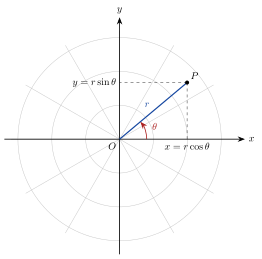

<!-- video: kommer (videoer/flervariabel-kalkulus/00-08-polarkoordinater) -->
{fig-alt="Video kommer"}

<!-- tillegg: Claude -->
En radar oppgir ikke «$3\ \mathrm{km}$ øst og $4\ \mathrm{km}$ nord», men «$5\ \mathrm{km}$ unna i retning $53^\circ$». Det er polarkoordinater: avstand og vinkel. For alt som er rundt, som disker, ringer, sektorer og spiraler, er polarkoordinater mye enklere enn $x$ og $y$. Videre bruker vi dem til dobbeltintegraler over sirkulære områder, og utvidet til sylinder- og kulekoordinater i tre dimensjoner.

## Avstand og vinkel

::: {.callout-note title="Definisjon: Polarkoordinater"}
Et punkt $P$ i planet har polarkoordinatene $[r, \theta]$, der

- $r$ er avstanden fra origo $O$ til $P$, og
- $\theta$ er vinkelen fra den positive $x$-aksen til linjestykket $OP$, målt mot klokka.
:::

{.tikz-fig style="width:440px" fig-alt="Et koordinatsystem med et polart rutenett av sirkler og stråler. Punktet P ligger i avstand r fra origo, i vinkelen theta fra den positive x-aksen. Stiplede linjer viser at x er r cosinus theta og y er r sinus theta."}

Fra trekanten i figuren leser vi av sammenhengen med kartesiske koordinater:

::: {.callout-important title="Fra polar til kartesisk og tilbake"}
$$
x = r\cos\theta, \qquad y = r\sin\theta,
$$
$$
r = \sqrt{x^2 + y^2}, \qquad \tan\theta = \frac{y}{x} .
$$
:::

::: {.callout-warning title="Pass på kvadranten"}
Likningen $\tan\theta = \frac{y}{x}$ har to løsninger mellom $0$ og $2\pi$, og kalkulatorens $\arctan$ gir bare den mellom $-\frac{\pi}{2}$ og $\frac{\pi}{2}$. Se alltid på fortegnene til $x$ og $y$ for å finne riktig kvadrant. Er $x < 0$, må vi legge til $\pi$.
:::

Polarkoordinater er heller ikke entydige: $[r, \theta]$ og $[r, \theta + 2\pi]$ er samme punkt. Vi velger derfor vanligvis $r \ge 0$ og $0 \le \theta < 2\pi$. Origo har $r = 0$ og en hvilken som helst vinkel.

::: {.eksempel}
**Eksempel: Begge veier.** a) Gjør $(-1, \sqrt3)$ om til polarkoordinater. b) Gjør $[4, \tfrac{7\pi}{6}]$ om til kartesiske koordinater.

::: {.losning}
a) $r = \sqrt{1 + 3} = 2$. Videre er $\tan\theta = \frac{\sqrt3}{-1} = -\sqrt3$. Kalkulatoren gir $-\frac{\pi}{3}$, men punktet har $x < 0$ og $y > 0$ og ligger i andre kvadrant. Vi legger til $\pi$: $\theta = \frac{2\pi}{3}$. Punktet er $[2, \tfrac{2\pi}{3}]$.

b)
$$
x = 4\cos\tfrac{7\pi}{6} = 4\cdot\left(-\tfrac{\sqrt3}{2}\right) = -2\sqrt3 \approx -3.46, \qquad y = 4\sin\tfrac{7\pi}{6} = 4\cdot\left(-\tfrac12\right) = -2 .
$$
:::
:::

## Kurver i polarkoordinater

Noen kurver har mye enklere likninger i polarkoordinater:

::: {.kort}
- **Sirkel om origo** $r = R$ (i stedet for $x^2 + y^2 = R^2$).
- **Stråle fra origo** $\theta = \theta_0$.
- **Sirkel gjennom origo** $r = 2a\cos\theta$, en sirkel med sentrum i $(a, 0)$ og radius $a$.
- **Disk og ring** $0 \le r \le R$, eller $R_1 \le r \le R_2$, med $0 \le \theta \le 2\pi$.
:::

::: {.eksempel}
**Eksempel: En sirkel gjennom origo.** Vis at $r = 2a\cos\theta$ er en sirkel med sentrum $(a, 0)$ og radius $a$.

::: {.losning}
Vi ganger med $r$ og bruker $r^2 = x^2 + y^2$ og $r\cos\theta = x$:
$$
r^2 = 2a\,r\cos\theta \quad\Longrightarrow\quad x^2 + y^2 = 2ax \quad\Longrightarrow\quad (x - a)^2 + y^2 = a^2 .
$$
Det siste steget er å fullføre kvadratet: $x^2 - 2ax = (x - a)^2 - a^2$.
:::
:::

Når vi integrerer i polarkoordinater, er et lite område ikke $\Delta x\,\Delta y$, men omtrent $r\,\Delta r\,\Delta\theta$. Det er temaet for [dobbeltintegraler i polarkoordinater](../01-dobbeltintegraler/03-polarkoordinater.qmd).

## Prøv selv

NumPy har `arctan2(y, x)`, som tar hensyn til kvadranten. Sammenlign med vanlig `arctan(y/x)` for punkter i alle fire kvadranter.

```{.python .kjor}
import numpy as np

punkter = [(1, 1), (-1, np.sqrt(3)), (-2, -2), (3, -1)]
for x, y in punkter:
    r = np.hypot(x, y)
    theta = np.arctan2(y, x) % (2 * np.pi)           # riktig kvadrant, 0 <= theta < 2 pi
    feil = np.arctan(y / x)                           # bare -pi/2 til pi/2
    print(f"({x:5.2f}, {y:5.2f}):  r = {r:.3f},  theta = {np.degrees(theta):6.1f} grader"
          f"   (arctan(y/x) gir {np.degrees(feil):6.1f})")
```

:::: {.oppgaver}

::: {.oppgave tittel="Til polarkoordinater"}
Gjør $(-3, -3)$ om til polarkoordinater.

::: {.losning}
$r = \sqrt{9 + 9} = 3\sqrt2 \approx 4.24$. Videre er $\tan\theta = 1$, og punktet ligger i tredje kvadrant, så $\theta = \frac{\pi}{4} + \pi = \frac{5\pi}{4}$. Punktet er $\underline{\underline{[3\sqrt2,\ \tfrac{5\pi}{4}]}}$.
:::
:::

::: {.oppgave tittel="Til kartesiske koordinater"}
Gjør $[6, \tfrac{5\pi}{6}]$ om til kartesiske koordinater.

::: {.losning}
$$
x = 6\cos\tfrac{5\pi}{6} = -3\sqrt3 \approx -5.20, \qquad y = 6\sin\tfrac{5\pi}{6} = 3 .
$$
Punktet er $\underline{\underline{(-3\sqrt3,\ 3)}}$.
:::
:::

::: {.oppgave tittel="Hvilken kurve?" niva="Middels"}
Skriv $r = 4\sin\theta$ i kartesiske koordinater, og beskriv kurven.

::: {.losning}
Gang med $r$: $r^2 = 4r\sin\theta$, altså $x^2 + y^2 = 4y$. Fullfør kvadratet:
$$
x^2 + (y - 2)^2 = 4 .
$$
Det er en **sirkel med sentrum $(0, 2)$ og radius $2$**, som går gjennom origo.
:::
:::

::: {.oppgave tittel="Et område i polarkoordinater" niva="Utfordrende"}
Beskriv i polarkoordinater området i første kvadrant som ligger mellom sirklene $x^2 + y^2 = 1$ og $x^2 + y^2 = 9$, og under linjen $y = x$. Finn arealet.

::: {.losning}
Mellom sirklene er $1 \le r \le 3$. I første kvadrant og under $y = x$ er $0 \le \theta \le \frac{\pi}{4}$. Området er altså
$$
\{[r, \theta] : 1 \le r \le 3,\ 0 \le \theta \le \tfrac{\pi}{4}\},
$$
en åttendedel av ringen mellom sirklene. Ringen har areal $\pi(3^2 - 1^2) = 8\pi$, så arealet er
$$
\frac{8\pi}{8} = \underline{\underline{\pi}} \approx 3.14 .
$$
:::
:::

::::
