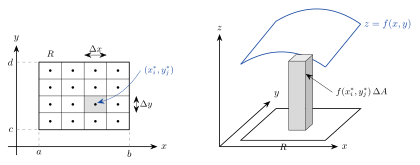

<!-- video: kommer (videoer/flervariabel-kalkulus/01-01-dobbeltintegraler-over-rektangler) -->
{fig-alt="Video kommer"}

<!-- tillegg: Claude -->
Et vanlig integral $\int_a^b f(x)\,\mathrm{d}x$ summerer opp en funksjon langs et intervall og gir arealet under en kurve. Mange størrelser varierer i to retninger: snødybden på et flatt tak, tykkelsen på en metallplate, nedbøren over et nedbørfelt. Vil vi finne hvor mye snø som ligger på taket, må vi summere over en *flate*. Det er dette **dobbeltintegralet** gjør. Vi begynner med det enkleste området, et rektangel.

## Fra Riemann-sum til dobbeltintegral

La $f(x, y)$ være definert på rektangelet $R = [a, b] \times [c, d]$, altså alle punkter med $a \le x \le b$ og $c \le y \le d$. Vi deler $[a, b]$ i $n$ like deler med bredde $\Delta x$ og $[c, d]$ i $m$ like deler med bredde $\Delta y$. Da er $R$ delt i $nm$ små rektangler med areal $\Delta A = \Delta x\,\Delta y$. I hvert lite rektangel velger vi et punkt $(x_i^*, y_j^*)$.

{.tikz-fig style="width:680px" fig-alt="Til venstre: rektangelet R mellom x lik a og b og y lik c og d, delt i fire ganger fire små rektangler med bredde Delta x og høyde Delta y, med et punkt i midten av hvert. Ett lite rektangel er skravert, og punktet i det er merket x i stjerne, y j stjerne. Til høyre: rektangelet R i xy-planet med flaten z lik f av x og y over, og en søyle fra planet opp mot flaten med volum f av x i stjerne, y j stjerne ganger Delta A."}

Er $f \ge 0$, er $f(x_i^*, y_j^*)\,\Delta A$ volumet av en søyle med grunnflate $\Delta A$ og høyde $f(x_i^*, y_j^*)$. Summen av alle søylene,
$$
\sum_{i=1}^{n}\sum_{j=1}^{m} f(x_i^*, y_j^*)\,\Delta A,
$$
er en **Riemann-sum**. Den er et anslag på volumet mellom $R$ og flaten $z = f(x, y)$. Jo finere vi deler opp, desto bedre blir anslaget.

::: {.callout-note title="Definisjon: Dobbeltintegral over et rektangel"}
Dobbeltintegralet av $f$ over $R$ er grensen av Riemann-summene når oppdelingen blir uendelig fin:
$$
\iint_R f(x, y)\,\mathrm{d}A = \lim_{n,\,m\to\infty}\ \sum_{i=1}^{n}\sum_{j=1}^{m} f(x_i^*, y_j^*)\,\Delta A
$$
Grensen finnes når $f$ er kontinuerlig på $R$, og den avhenger ikke av hvilke punkter $(x_i^*, y_j^*)$ vi velger.
:::

Er $f \ge 0$, er dobbeltintegralet **volumet** under flaten. Er $f$ negativ noen steder, teller volumet under $xy$-planet negativt, akkurat som areal under $x$-aksen for vanlige integraler. Med $f = 1$ får vi arealet av $R$: $\iint_R 1\,\mathrm{d}A = (b - a)(d - c)$.

## Itererte integraler

Definisjonen er grei å forstå, men tungvint å regne med. Heldigvis kan et dobbeltintegral regnes ut som to vanlige integraler etter hverandre.

Hold $x$ fast og integrer $f(x, y)$ med hensyn på $y$ fra $c$ til $d$. Resultatet,
$$
A(x) = \int_c^d f(x, y)\,\mathrm{d}y,
$$
er arealet av et snitt gjennom volumet, parallelt med $yz$-planet. Volumet får vi ved å summere snittene langs $x$-aksen, slik vi finner volumet av et brød ved å legge sammen skivene:
$$
V = \int_a^b A(x)\,\mathrm{d}x = \int_a^b\left(\int_c^d f(x, y)\,\mathrm{d}y\right)\mathrm{d}x
$$
Dette kalles et **iterert integral**. Vi kunne like gjerne skåret skivene den andre veien, med $y$ fast.

::: {.callout-important title="Fubinis setning"}
Er $f$ kontinuerlig på rektangelet $R = [a, b] \times [c, d]$, er
$$
\iint_R f(x, y)\,\mathrm{d}A = \int_a^b\!\!\int_c^d f(x, y)\,\mathrm{d}y\,\mathrm{d}x = \int_c^d\!\!\int_a^b f(x, y)\,\mathrm{d}x\,\mathrm{d}y
$$
Rekkefølgen spiller ingen rolle for svaret. Det innerste integralet regnes ut først, og den andre variabelen behandles da som en konstant.
:::

::: {.eksempel}
**Eksempel: Begge rekkefølger.** Regn ut $\displaystyle\iint_R (x + 2y)\,\mathrm{d}A$ der $R = [0, 2] \times [1, 3]$, på begge måter.

::: {.losning}
**Først $y$, så $x$.** Med $x$ fast er $x$ en konstant:
$$
\int_1^3 (x + 2y)\,\mathrm{d}y = \Big[\,xy + y^2\,\Big]_{y=1}^{y=3} = (3x + 9) - (x + 1) = 2x + 8
$$
$$
\int_0^2 (2x + 8)\,\mathrm{d}x = \Big[\,x^2 + 8x\,\Big]_0^2 = 4 + 16 = 20
$$

**Først $x$, så $y$.** Med $y$ fast:
$$
\int_0^2 (x + 2y)\,\mathrm{d}x = \Big[\,\tfrac12 x^2 + 2xy\,\Big]_{x=0}^{x=2} = 2 + 4y
$$
$$
\int_1^3 (2 + 4y)\,\mathrm{d}y = \Big[\,2y + 2y^2\,\Big]_1^3 = (6 + 18) - (2 + 2) = 20
$$

Begge rekkefølgene gir $\underline{\underline{20}}$, som Fubinis setning lover.
:::
:::

## Når integranden er et produkt

Kan $f$ skrives som $f(x, y) = g(x)\,h(y)$, er $h(y)$ en konstant i det indre integralet over $x$ og kan settes utenfor. Da faller dobbeltintegralet over et rektangel fra hverandre i to vanlige integraler:

::: {.graa}
$$
\iint_{[a,b]\times[c,d]} g(x)\,h(y)\,\mathrm{d}A = \left(\int_a^b g(x)\,\mathrm{d}x\right)\left(\int_c^d h(y)\,\mathrm{d}y\right)
$$
:::

Dette gjelder bare over rektangler, der grensene er konstanter.

::: {.eksempel}
**Eksempel: Et produkt.** Regn ut $\displaystyle\iint_R x^2\sin y\,\mathrm{d}A$ der $R = [0, 1] \times [0, \pi]$.

::: {.losning}
$$
\iint_R x^2\sin y\,\mathrm{d}A = \left(\int_0^1 x^2\,\mathrm{d}x\right)\left(\int_0^\pi \sin y\,\mathrm{d}y\right) = \frac13\cdot\Big[-\cos y\Big]_0^\pi = \frac13\cdot 2 = \underline{\underline{\frac23}}
$$
:::
:::

## Volum under en flate

::: {.eksempel}
**Eksempel: Under en paraboloide.** Finn volumet av legemet som ligger under flaten $z = 4 - x^2 - y^2$ og over kvadratet $R = [0, 1] \times [0, 1]$.

::: {.losning}
På $R$ er $x^2 + y^2 \le 2$, så $z \ge 2 > 0$. Flaten ligger altså over hele $R$, og volumet er dobbeltintegralet:
$$
\int_0^1 (4 - x^2 - y^2)\,\mathrm{d}x = \Big[\,4x - \tfrac13 x^3 - xy^2\,\Big]_0^1 = \frac{11}{3} - y^2
$$
$$
V = \int_0^1 \left(\frac{11}{3} - y^2\right)\mathrm{d}y = \frac{11}{3} - \frac13 = \underline{\underline{\frac{10}{3}}}
$$
:::
:::

## Velg en lur rekkefølge

Svaret er det samme, men arbeidet kan være svært ulikt. Se på integranden og spør: Hvilken variabel er det lettest å integrere med hensyn på først?

::: {.eksempel}
**Eksempel: Den ene veien er lett.** Regn ut $\displaystyle\iint_R y\,\mathrm{e}^{xy}\,\mathrm{d}A$ der $R = [0, 1] \times [0, 1]$.

::: {.losning}
Integrerer vi med hensyn på $y$ først, trenger vi delvis integrasjon. Integrerer vi med hensyn på $x$ først, er $y$ en konstant, og $y\,\mathrm{e}^{xy}$ er den deriverte av $\mathrm{e}^{xy}$ med hensyn på $x$:
$$
\int_0^1 y\,\mathrm{e}^{xy}\,\mathrm{d}x = \Big[\,\mathrm{e}^{xy}\,\Big]_{x=0}^{x=1} = \mathrm{e}^{y} - 1
$$
$$
\int_0^1 (\mathrm{e}^{y} - 1)\,\mathrm{d}y = \Big[\,\mathrm{e}^{y} - y\,\Big]_0^1 = (\mathrm{e} - 1) - 1 = \underline{\underline{\mathrm{e} - 2}} \approx 0.718
$$
:::
:::

## Prøv selv

Programmet regner ut en Riemann-sum med midtpunktene i $n \times n$ rektangler og sammenligner med det eksakte svaret fra eksemplet over. Øk `n` og trykk **Kjør**. Hvor mye mindre blir feilen når du dobler `n`? Prøv også en annen funksjon.

```{.python .kjor}
import numpy as np

def f(x, y):
    return y * np.exp(x * y)

a, b, c, d = 0, 1, 0, 1
n = 4                                   # antall delintervaller i hver retning

dx, dy = (b - a) / n, (d - c) / n
x = a + (np.arange(n) + 0.5) * dx       # midtpunkter i x
y = c + (np.arange(n) + 0.5) * dy       # midtpunkter i y
X, Y = np.meshgrid(x, y)

riemann = np.sum(f(X, Y)) * dx * dy
eksakt = np.e - 2
print(f"Riemann-sum med {n} x {n} rektangler: {riemann:.6f}")
print(f"Eksakt verdi:                       {eksakt:.6f}")
print(f"Feil:                               {riemann - eksakt:.2e}")
```

Mer om numerisk integrasjon i to dimensjoner finner du under *numerisk beregning av dobbeltintegraler*.

:::: {.oppgaver}

::: {.oppgave tittel="Et første dobbeltintegral"}
Regn ut $\displaystyle\iint_R 6x^2y\,\mathrm{d}A$ der $R = [0, 1] \times [0, 2]$.

::: {.losning}
Vi integrerer med hensyn på $x$ først:
$$
\int_0^1 6x^2y\,\mathrm{d}x = \Big[\,2x^3y\,\Big]_{x=0}^{x=1} = 2y
\qquad
\int_0^2 2y\,\mathrm{d}y = \Big[\,y^2\,\Big]_0^2 = \underline{\underline{4}}
$$
Integranden er et produkt, så vi kunne også regnet $6\left(\int_0^1 x^2\,\mathrm{d}x\right)\left(\int_0^2 y\,\mathrm{d}y\right) = 6\cdot\frac13\cdot 2 = 4$.
:::
:::

::: {.oppgave tittel="Riemann-sum for hånd"}
La $f(x, y) = x^2 + y$ og $R = [0, 2] \times [0, 2]$.

a) Del $R$ i $2 \times 2$ kvadrater og regn ut Riemann-summen med midtpunktene.

b) Regn ut dobbeltintegralet eksakt og finn feilen i a).

::: {.losning}
a) Kvadratene har sider $1$, så $\Delta A = 1$. Midtpunktene har $x, y \in \{0.5,\ 1.5\}$:
$$
\begin{aligned}
f(0.5, 0.5) &= 0.75, & f(0.5, 1.5) &= 1.75,\\
f(1.5, 0.5) &= 2.75, & f(1.5, 1.5) &= 3.75.
\end{aligned}
$$
Riemann-summen er $(0.75 + 1.75 + 2.75 + 3.75)\cdot 1 = \underline{\underline{9}}$.

b)
$$
\int_0^2 (x^2 + y)\,\mathrm{d}x = \frac83 + 2y
\qquad
\int_0^2 \left(\frac83 + 2y\right)\mathrm{d}y = \frac{16}{3} + 4 = \underline{\underline{\frac{28}{3}}} \approx 9.333
$$
Feilen er $9 - \frac{28}{3} = -\frac13 \approx -0.33$. Midtpunktene gir eksakt svar for leddet $y$, som er lineært. Hele feilen kommer fra $x^2$, som krummer.
:::
:::

::: {.oppgave tittel="Volum under et skrått tak"}
Finn volumet under flaten $z = 1 + xy$ over kvadratet $R = [0, 2] \times [0, 2]$.

::: {.losning}
$f > 0$ på hele $R$, så volumet er
$$
V = \iint_R (1 + xy)\,\mathrm{d}A = \iint_R 1\,\mathrm{d}A + \left(\int_0^2 x\,\mathrm{d}x\right)\left(\int_0^2 y\,\mathrm{d}y\right) = 4 + 2\cdot 2 = \underline{\underline{8}}
$$
Det første leddet er arealet av $R$.
:::
:::

::: {.oppgave tittel="Velg rekkefølge" niva="Middels"}
Regn ut $\displaystyle\iint_R x\cos(xy)\,\mathrm{d}A$ der $R = [0, 1] \times [0, \tfrac{\pi}{2}]$. Hvilken rekkefølge lønner seg?

::: {.losning}
Integrerer vi med hensyn på $y$ først, er $x$ konstant, og $x\cos(xy)$ er den deriverte av $\sin(xy)$ med hensyn på $y$:
$$
\int_0^{\pi/2} x\cos(xy)\,\mathrm{d}y = \Big[\,\sin(xy)\,\Big]_{y=0}^{y=\pi/2} = \sin\!\left(\frac{\pi x}{2}\right)
$$
$$
\int_0^1 \sin\!\left(\frac{\pi x}{2}\right)\mathrm{d}x = \Big[-\frac{2}{\pi}\cos\!\left(\frac{\pi x}{2}\right)\Big]_0^1 = -\frac{2}{\pi}(0 - 1) = \underline{\underline{\frac{2}{\pi}}} \approx 0.637
$$
Den andre rekkefølgen krever delvis integrasjon i $x$ og blir mye tyngre.
:::
:::

::: {.oppgave tittel="Middelverdi over et kvadrat" niva="Utfordrende"}
Middelverdien av $f$ over $R$ er $\bar f = \dfrac{1}{A(R)}\displaystyle\iint_R f\,\mathrm{d}A$, der $A(R)$ er arealet av $R$. En tynn plate dekker kvadratet $R = [0, \pi] \times [0, \pi]$ (lengder i dm), og temperaturen over omgivelsene er $T(x, y) = T_0\sin x\,\sin y$.

a) Finn middeltemperaturen over omgivelsene uttrykt ved $T_0$.

b) Hvor stor brøkdel av maksimaltemperaturen er dette?

::: {.losning}
a) Integranden er et produkt, og $\int_0^\pi \sin x\,\mathrm{d}x = 2$:
$$
\iint_R T_0\sin x\,\sin y\,\mathrm{d}A = T_0\left(\int_0^\pi \sin x\,\mathrm{d}x\right)\left(\int_0^\pi \sin y\,\mathrm{d}y\right) = 4\,T_0
$$
Arealet er $A(R) = \pi^2$, så
$$
\bar T = \frac{4\,T_0}{\pi^2} = \underline{\underline{0.405\,T_0}}
$$

b) Maksimaltemperaturen er $T_0$ (i midten, der $\sin x = \sin y = 1$). Middelverdien er altså omtrent $41\ \%$ av maksimum. Til sammenligning er middelverdien av $\sin x$ på $[0, \pi]$ lik $\frac{2}{\pi} \approx 64\ \%$, og i to dimensjoner ganges to slike faktorer: $\left(\frac{2}{\pi}\right)^2 = \frac{4}{\pi^2}$.
:::
:::

::::
