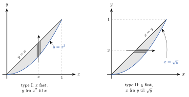
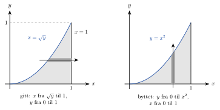

<!-- video: kommer (videoer/flervariabel-kalkulus/01-02-generelle-omrader) -->
{fig-alt="Video kommer"}

<!-- tillegg: Claude -->
Få ting i virkeligheten er rektangulære. En trekantet stålplate, et tverrsnitt av en bjelke, en innsjø på et kart: Vil vi finne masse, areal eller volum, må vi integrere over et område med buede eller skrå kanter. Idéen er den samme som over et rektangel, men grensene i det indre integralet blir **funksjoner** i stedet for tall. Det vanskelige er ikke å integrere, men å finne grensene. Det gjør vi best med en skisse.

## Hva betyr integralet over et vilkårlig område?

La $D$ være et begrenset område i planet. Vi legger et rektangel $R$ rundt $D$ og lar funksjonen være null utenfor $D$:
$$
F(x, y) = \begin{cases} f(x, y), & (x, y) \text{ i } D \\ 0, & (x, y) \text{ utenfor } D \end{cases}
\qquad\qquad
\iint_D f(x, y)\,\mathrm{d}A = \iint_R F(x, y)\,\mathrm{d}A
$$
Punktene utenfor $D$ bidrar altså ingenting til Riemann-summen. Denne definisjonen er nyttig å ha i bakhodet (den er også en grei måte å regne numerisk på), men for hånd regner vi som før med itererte integraler. Spørsmålet er bare hvilke grenser de skal ha.

## Type I: vertikale striper

Se på området mellom linja $y = x$ og parabelen $y = x^2$ for $0 \le x \le 1$. Velg en $x$ og tegn en tynn, loddrett stripe gjennom området. Stripen starter på den nederste kurven, $y = x^2$, og slutter på den øverste, $y = x$. Grensene for $y$ avhenger altså av hvor stripen står. Deretter lar vi stripen vandre fra $x = 0$ til $x = 1$, og de grensene er tall.

{.tikz-fig style="width:640px" fig-alt="To like figurer av området mellom linja y lik x og parabelen y lik x i andre, fra origo til punktet (1, 1). Til venstre går en loddrett stripe ved en fast x fra parabelen opp til linja: type I, y fra x i andre til x. Til høyre går en vannrett stripe ved en fast y fra linja ut til parabelen, som nå er skrevet x lik kvadratroten av y: type II, x fra y til kvadratroten av y."}

::: {.callout-note title="Definisjon: Område av type I"}
Et område er av **type I** når det kan skrives
$$
D = \{(x, y) : a \le x \le b,\ \ g_1(x) \le y \le g_2(x)\},
$$
altså området mellom to grafer $y = g_1(x)$ (under) og $y = g_2(x)$ (over). Da er
$$
\iint_D f(x, y)\,\mathrm{d}A = \int_a^b\!\!\int_{g_1(x)}^{g_2(x)} f(x, y)\,\mathrm{d}y\,\mathrm{d}x
$$
:::

Det indre integralet summerer langs én loddrett stripe (med $x$ fast). Det ytre summerer stripene fra venstre til høyre, akkurat som skivene i et brød.

## Type II: vannrette striper

Samme område kan skjæres den andre veien. Velg en $y$ og tegn en vannrett stripe. Den starter på linja og slutter på parabelen. For å få grensene som funksjoner av $y$ løser vi likningene for $x$: linja blir $x = y$, og parabelen blir $x = \sqrt{y}$ (vi er i første kvadrant). Stripen går altså fra $x = y$ til $x = \sqrt{y}$, og $y$ går fra $0$ til $1$.

::: {.callout-note title="Definisjon: Område av type II"}
Et område er av **type II** når det kan skrives
$$
D = \{(x, y) : c \le y \le d,\ \ h_1(y) \le x \le h_2(y)\},
$$
altså området mellom to kurver $x = h_1(y)$ (til venstre) og $x = h_2(y)$ (til høyre). Da er
$$
\iint_D f(x, y)\,\mathrm{d}A = \int_c^d\!\!\int_{h_1(y)}^{h_2(y)} f(x, y)\,\mathrm{d}x\,\mathrm{d}y
$$
:::

Mange områder er av begge typer, som området i figuren. Da kan vi velge den rekkefølgen som gir lettest regning.

## Grenser fra en skisse

::: {.steg}
1. **Skisser området.** Tegn kurvene og finn skjæringspunktene. Merk hvilket område som menes.
2. **Velg retning på stripen.** Loddrett stripe gir $\mathrm{d}y$ innerst, vannrett stripe gir $\mathrm{d}x$ innerst.
3. **Indre grenser.** Følg stripen i positiv retning. Kurven der den går *inn* i området, er nedre grense; kurven der den går *ut*, er øvre grense. Skriv dem som funksjoner av den ytre variabelen.
4. **Ytre grenser.** Hvor langt kan stripen flytte seg og fortsatt treffe området? Disse grensene er alltid tall.
5. **Sjekk.** Går stripen inn eller ut gjennom forskjellige kurver i ulike deler av området, må området deles opp (se *egenskaper* lenger ned), eller du bør velge den andre retningen.
:::

::: {.callout-warning title="Ytre grenser er tall"}
Etter at begge integralene er regnet ut, skal svaret være et tall. Står det en variabel i de ytre grensene, er noe galt. De indre grensene kan inneholde den ytre variabelen, aldri omvendt.
:::

::: {.eksempel}
**Eksempel: Begge veier.** Regn ut $\displaystyle\iint_D xy\,\mathrm{d}A$ der $D$ er området mellom $y = x$ og $y = x^2$, på begge måter.

::: {.losning}
Kurvene skjærer hverandre der $x^2 = x$, altså i $x = 0$ og $x = 1$. Mellom dem ligger linja over parabelen (for eksempel er $0.5 > 0.25$).

**Type I** (loddrett stripe, $y$ fra $x^2$ til $x$):
$$
\int_{x^2}^{x} xy\,\mathrm{d}y = x\Big[\,\tfrac12 y^2\,\Big]_{y=x^2}^{y=x} = \frac{x}{2}\left(x^2 - x^4\right) = \frac{x^3 - x^5}{2}
$$
$$
\int_0^1 \frac{x^3 - x^5}{2}\,\mathrm{d}x = \frac12\left(\frac14 - \frac16\right) = \frac12\cdot\frac{1}{12} = \frac{1}{24}
$$

**Type II** (vannrett stripe, $x$ fra $y$ til $\sqrt{y}$):
$$
\int_{y}^{\sqrt{y}} xy\,\mathrm{d}x = y\Big[\,\tfrac12 x^2\,\Big]_{x=y}^{x=\sqrt{y}} = \frac{y}{2}\left(y - y^2\right) = \frac{y^2 - y^3}{2}
$$
$$
\int_0^1 \frac{y^2 - y^3}{2}\,\mathrm{d}y = \frac12\left(\frac13 - \frac14\right) = \frac12\cdot\frac{1}{12} = \frac{1}{24}
$$

Begge veier gir $\underline{\underline{\dfrac{1}{24}}} \approx 0.0417$.
:::
:::

## Å bytte integrasjonsrekkefølge

Noen ganger er integralet gitt i en rekkefølge der det indre integralet ikke kan regnes ut for hånd. Funksjoner som $\mathrm{e}^{x^2}$, $\mathrm{e}^{x^3}$ og $\dfrac{\sin y}{y}$ har ingen antiderivert som kan skrives med vanlige funksjoner. Da kan det hjelpe å bytte rekkefølge. Grensene kan ikke bare byttes om: vi må gå veien om en skisse av området.

::: {.eksempel}
**Eksempel: Umulig den ene veien.** Regn ut
$$
I = \int_0^1\!\!\int_{\sqrt{y}}^{1} \mathrm{e}^{x^3}\,\mathrm{d}x\,\mathrm{d}y
$$

::: {.losning}
Det indre integralet $\int \mathrm{e}^{x^3}\,\mathrm{d}x$ kan ikke regnes ut med vanlige funksjoner. Vi bytter rekkefølge.

**Les av området.** Grensene sier: $0 \le y \le 1$, og for hver $y$ går $x$ fra $\sqrt{y}$ til $1$. Den venstre kanten $x = \sqrt{y}$ er den samme kurven som $y = x^2$, og den høyre kanten er $x = 1$. Området ligger altså under parabelen $y = x^2$ og over $x$-aksen, for $0 \le x \le 1$.

{.tikz-fig style="width:600px" fig-alt="Området under parabelen y lik x i andre fra x lik 0 til x lik 1. Til venstre er det skåret med en vannrett stripe fra parabelen x lik kvadratroten av y ut til linja x lik 1, slik integralet er gitt. Til høyre er det skåret med en loddrett stripe fra x-aksen opp til parabelen, etter at rekkefølgen er byttet."}

**Skjær den andre veien.** En loddrett stripe ved fast $x$ går fra $y = 0$ opp til $y = x^2$, og $x$ går fra $0$ til $1$:
$$
I = \int_0^1\!\!\int_0^{x^2} \mathrm{e}^{x^3}\,\mathrm{d}y\,\mathrm{d}x
$$
Nå er $\mathrm{e}^{x^3}$ en konstant i det indre integralet:
$$
\int_0^{x^2} \mathrm{e}^{x^3}\,\mathrm{d}y = x^2\,\mathrm{e}^{x^3}
$$
Faktoren $x^2$ er nesten den deriverte av $x^3$. Med $u = x^3$, $\mathrm{d}u = 3x^2\,\mathrm{d}x$:
$$
I = \int_0^1 x^2\,\mathrm{e}^{x^3}\,\mathrm{d}x = \Big[\,\tfrac13\,\mathrm{e}^{x^3}\,\Big]_0^1 = \underline{\underline{\frac{\mathrm{e} - 1}{3}}} \approx 0.573
$$
:::
:::

Legg merke til hvorfor det virket: Lengden på den nye stripen, $x^2$, ble en faktor foran $\mathrm{e}^{x^3}$, og det var nettopp den faktoren som manglet for å kunne integrere. Slike oppgaver er ofte laget slik, men idéen er nyttig også ellers: Ser det indre integralet håpløst ut, prøv den andre rekkefølgen.

## Areal som dobbeltintegral

Med $f = 1$ blir hver søyle like høy som én, og volumet er tallmessig lik grunnflaten. Derfor er

::: {.graa}
$$
A(D) = \iint_D 1\,\mathrm{d}A
$$
:::

For et område av type I gir det indre integralet bare lengden av stripen, $\int_{g_1(x)}^{g_2(x)} 1\,\mathrm{d}y = g_2(x) - g_1(x)$, og vi står igjen med den kjente formelen for areal mellom to grafer, $\int_a^b \big(g_2(x) - g_1(x)\big)\,\mathrm{d}x$. Dobbeltintegralet gir altså ikke noe nytt for arealer, men det gjør det lett å velge vannrette striper når det passer bedre.

## Egenskaper

Dobbeltintegralet over generelle områder har de samme regnereglene som vanlige integraler.

::: {.callout-important title="Regneregler for dobbeltintegraler"}
- **Linearitet:** $\displaystyle\iint_D (\alpha f + \beta g)\,\mathrm{d}A = \alpha\iint_D f\,\mathrm{d}A + \beta\iint_D g\,\mathrm{d}A$ for konstanter $\alpha$ og $\beta$.
- **Additivitet:** Er $D = D_1 \cup D_2$ der $D_1$ og $D_2$ bare møtes langs en kant, er
$$
\iint_D f\,\mathrm{d}A = \iint_{D_1} f\,\mathrm{d}A + \iint_{D_2} f\,\mathrm{d}A
$$
- **Sammenligning:** Er $f \le g$ på $D$, er $\displaystyle\iint_D f\,\mathrm{d}A \le \iint_D g\,\mathrm{d}A$. Spesielt gir $m \le f \le M$ at $m\,A(D) \le \displaystyle\iint_D f\,\mathrm{d}A \le M\,A(D)$.
:::

Additiviteten er det som redder oss når et område ikke er av den typen vi ønsker: Vi deler det i biter som er det, og legger sammen. Sammenligningsregelen er en billig kontroll av svaret: Integralet må ligge mellom minste og største verdi av $f$ ganget med arealet.

::: {.eksempel}
**Eksempel: Én bit eller to.** Finn arealet av området mellom parabelen $x = y^2$ og linja $x = y + 2$.

::: {.losning}
**Skisse.** Parabelen $x = y^2$ ligger på siden med åpning mot høyre. Skjæringspunktene: $y^2 = y + 2$ gir $y^2 - y - 2 = (y - 2)(y + 1) = 0$, altså $y = -1$ og $y = 2$, med punktene $(1, -1)$ og $(4, 2)$. Mellom dem ligger linja til høyre for parabelen (for $y = 0$: $2 > 0$).

**Vannrette striper (type II).** Hver stripe går fra parabelen til linja:
$$
A = \int_{-1}^{2}\!\!\int_{y^2}^{y+2} 1\,\mathrm{d}x\,\mathrm{d}y = \int_{-1}^{2} \left(y + 2 - y^2\right)\mathrm{d}y = \Big[\,\tfrac12 y^2 + 2y - \tfrac13 y^3\,\Big]_{-1}^{2}
$$
$$
A = \left(2 + 4 - \frac83\right) - \left(\frac12 - 2 + \frac13\right) = \frac{10}{3} + \frac{7}{6} = \underline{\underline{\frac92}}
$$

**Loddrette striper (type I) – for sammenligning.** For $0 \le x \le 1$ går en loddrett stripe fra den nedre grenen av parabelen, $y = -\sqrt{x}$, til den øvre, $y = \sqrt{x}$. For $1 \le x \le 4$ går den fra linja $y = x - 2$ til $y = \sqrt{x}$. Nedre kant skifter kurve i $x = 1$, så vi må dele området i to og bruke additiviteten:
$$
A = \int_0^1 2\sqrt{x}\,\mathrm{d}x + \int_1^4 \left(\sqrt{x} - x + 2\right)\mathrm{d}x = \frac43 + \left[\tfrac23 x^{3/2} - \tfrac12 x^2 + 2x\right]_1^4 = \frac43 + \frac{19}{6} = \frac92
$$
Samme svar, men dobbelt så mye arbeid. Velg retningen der stripen alltid går inn og ut gjennom de samme to kurvene.
:::
:::

## Masse av en plate

En tynn plate har ofte en tetthet som varierer, for eksempel fordi den er tykkere i den ene enden. Med **flatetettheten** $\sigma(x, y)$ (masse per areal, i $\mathrm{kg/m^2}$) har et lite stykke med areal $\Delta A$ massen $\sigma\,\Delta A$, og hele platen har massen
$$
m = \iint_D \sigma(x, y)\,\mathrm{d}A
$$
Mer om masse, tyngdepunkt og middelverdi står under *masse, tyngdepunkt og middelverdi*.

::: {.eksempel}
**Eksempel: Trekantet plate.** En tynn plate har form som en rettvinklet trekant med hjørner i $(0, 0)$, $(0.30\ \mathrm{m}, 0)$ og $(0, 0.20\ \mathrm{m})$. Platen blir tykkere oppover, og flatetettheten er $\sigma(x, y) = \sigma_0 + k\,y$ med $\sigma_0 = 4.0\ \mathrm{kg/m^2}$ og $k = 20\ \mathrm{kg/m^3}$. Finn massen.

::: {.losning}
**Skisse og grenser.** Hypotenusen går gjennom $(0.30, 0)$ og $(0, 0.20)$, altså $\dfrac{x}{0.30} + \dfrac{y}{0.20} = 1$, eller $x = 0.30 - 1.5\,y$. Tettheten avhenger bare av $y$, så vi bruker vannrette striper: $0 \le y \le 0.20$ og $0 \le x \le 0.30 - 1.5\,y$ (lengder i meter).

**Indre integral.** Med $y$ fast er $\sigma$ konstant langs stripen:
$$
\int_0^{0.30 - 1.5y} (4.0 + 20\,y)\,\mathrm{d}x = (4.0 + 20\,y)(0.30 - 1.5\,y) = 1.2 - 30\,y^2
$$
(Leddene med $y$ i første potens, $-6y$ og $+6y$, faller bort.)

**Ytre integral.**
$$
m = \int_0^{0.20} \left(1.2 - 30\,y^2\right)\mathrm{d}y = \Big[\,1.2\,y - 10\,y^3\,\Big]_0^{0.20} = 0.24 - 0.08 = \underline{\underline{0.16\ \mathrm{kg}}}
$$

**Kontroll.** Arealet er $\tfrac12\cdot 0.30\cdot 0.20 = 0.030\ \mathrm{m^2}$, og $\sigma$ ligger mellom $4.0$ og $8.0\ \mathrm{kg/m^2}$. Sammenligningsregelen gir $0.12\ \mathrm{kg} \le m \le 0.24\ \mathrm{kg}$. Svaret ligger nær den nedre grensen, som det skal: det meste av platen ligger nede, der den er tynn.
:::
:::

## Prøv selv

Programmet kontrollerer integralet der vi byttet rekkefølge, på tre måter: `dblquad` med grensene slik de var gitt, `dblquad` med byttet rekkefølge, og en enkel Riemann-sum der funksjonen settes lik null utenfor området (definisjonen øverst på siden). Øk `n` og trykk **Kjør**. Prøv også et annet område eller en annen funksjon, for eksempel $\mathrm{e}^{x^2}$.

```{.python .kjor}
import numpy as np
from scipy import integrate

def f(x, y):
    return np.exp(x**3)

# dblquad(func, a, b, nedre, øvre) integrerer func(indre, ytre):
# den YTRE variabelen går fra a til b, den indre mellom nedre(ytre) og øvre(ytre).

# 1) Slik integralet er gitt: x fra sqrt(y) til 1 (innerst), y fra 0 til 1
I1, _ = integrate.dblquad(lambda x, y: f(x, y), 0, 1, lambda y: np.sqrt(y), lambda y: 1)

# 2) Byttet rekkefølge: y fra 0 til x^2 (innerst), x fra 0 til 1
I2, _ = integrate.dblquad(lambda y, x: f(x, y), 0, 1, lambda x: 0, lambda x: x**2)

# 3) Riemann-sum over kvadratet [0, 1] x [0, 1], med f = 0 utenfor området
n = 200
h = 1 / n
x = (np.arange(n) + 0.5) * h          # midtpunkter
X, Y = np.meshgrid(x, x)
i_D = Y <= X**2                       # True for punktene som ligger i området
I3 = np.sum(np.where(i_D, f(X, Y), 0)) * h * h

print(f"Gitt rekkefølge:  {I1:.6f}")
print(f"Byttet:           {I2:.6f}")
print(f"Riemann, n = {n}: {I3:.6f}")
print(f"Eksakt (e-1)/3:   {(np.e - 1) / 3:.6f}")
```

Riemann-summen med «null utenfor» konvergerer langsomt, fordi rutene som kutter randen enten telles helt med eller ikke i det hele tatt. Bedre metoder står under *numerisk beregning av dobbeltintegraler*.

:::: {.oppgaver}

::: {.oppgave tittel="Sett opp grensene begge veier"}
Området $D$ er avgrenset av $y = \sqrt{x}$, $y = 0$ og $x = 4$. Skriv $\displaystyle\iint_D x\,\mathrm{d}A$ som iterert integral på begge måter, og regn ut begge.

::: {.losning}
Kurven $y = \sqrt{x}$ treffer linja $x = 4$ i $(4, 2)$. Området ligger mellom $x$-aksen og kurven, for $0 \le x \le 4$.

**Type I.** Loddrett stripe fra $y = 0$ til $y = \sqrt{x}$:
$$
\int_0^4\!\!\int_0^{\sqrt{x}} x\,\mathrm{d}y\,\mathrm{d}x = \int_0^4 x\sqrt{x}\,\mathrm{d}x = \Big[\,\tfrac25 x^{5/2}\,\Big]_0^4 = \frac25\cdot 32 = \frac{64}{5}
$$

**Type II.** Kurven skrevet som funksjon av $y$ er $x = y^2$. En vannrett stripe går fra kurven ut til $x = 4$, og $y$ går fra $0$ til $2$:
$$
\int_0^2\!\!\int_{y^2}^{4} x\,\mathrm{d}x\,\mathrm{d}y = \int_0^2 \frac{16 - y^4}{2}\,\mathrm{d}y = \frac12\left(32 - \frac{32}{5}\right) = \frac{64}{5}
$$

Begge gir $\underline{\underline{\dfrac{64}{5} = 12.8}}$.
:::
:::

::: {.oppgave tittel="Areal mellom to parabler"}
Bruk et dobbeltintegral til å finne arealet av området mellom $y = x^2$ og $y = 2 - x^2$.

::: {.losning}
Skjæringspunktene: $x^2 = 2 - x^2$ gir $x^2 = 1$, altså $x = \pm 1$. Mellom dem ligger $y = 2 - x^2$ øverst (for $x = 0$: $2 > 0$). Med loddrette striper:
$$
A = \int_{-1}^{1}\!\!\int_{x^2}^{2 - x^2} 1\,\mathrm{d}y\,\mathrm{d}x = \int_{-1}^{1} \left(2 - 2x^2\right)\mathrm{d}x = \Big[\,2x - \tfrac23 x^3\,\Big]_{-1}^{1} = \frac43 - \left(-\frac43\right) = \underline{\underline{\frac83}}
$$
:::
:::

::: {.oppgave tittel="Bytt rekkefølge" niva="Middels"}
Regn ut
$$
\int_0^2\!\!\int_{y/2}^{1} \mathrm{e}^{x^2}\,\mathrm{d}x\,\mathrm{d}y
$$
ved å bytte integrasjonsrekkefølge. Skisser området først.

::: {.losning}
**Området.** $0 \le y \le 2$, og $x$ går fra linja $x = y/2$ (altså $y = 2x$) til $x = 1$. Området er trekanten med hjørner i $(0, 0)$, $(1, 0)$ og $(1, 2)$: under linja $y = 2x$ og over $x$-aksen, for $0 \le x \le 1$.

**Byttet rekkefølge.** En loddrett stripe går fra $y = 0$ til $y = 2x$:
$$
\int_0^1\!\!\int_0^{2x} \mathrm{e}^{x^2}\,\mathrm{d}y\,\mathrm{d}x = \int_0^1 2x\,\mathrm{e}^{x^2}\,\mathrm{d}x = \Big[\,\mathrm{e}^{x^2}\,\Big]_0^1 = \underline{\underline{\mathrm{e} - 1}} \approx 1.72
$$
I den gitte rekkefølgen er det indre integralet $\int \mathrm{e}^{x^2}\,\mathrm{d}x$, som ikke kan skrives med vanlige funksjoner.
:::
:::

::: {.oppgave tittel="Et integral med sin y / y" niva="Middels"}
Regn ut
$$
\int_0^{\pi}\!\!\int_x^{\pi} \frac{\sin y}{y}\,\mathrm{d}y\,\mathrm{d}x
$$

::: {.losning}
$\dfrac{\sin y}{y}$ har ingen antiderivert som kan skrives med vanlige funksjoner, så vi bytter rekkefølge.

**Området.** $0 \le x \le \pi$ og $x \le y \le \pi$: trekanten over linja $y = x$ og under $y = \pi$, med hjørner i $(0, 0)$, $(0, \pi)$ og $(\pi, \pi)$.

**Vannrette striper.** For fast $y$ går $x$ fra $0$ til $y$, og $y$ går fra $0$ til $\pi$:
$$
\int_0^{\pi}\!\!\int_0^{y} \frac{\sin y}{y}\,\mathrm{d}x\,\mathrm{d}y = \int_0^{\pi} y\cdot\frac{\sin y}{y}\,\mathrm{d}y = \int_0^{\pi} \sin y\,\mathrm{d}y = \Big[-\cos y\Big]_0^{\pi} = \underline{\underline{2}}
$$
Lengden av stripen, $y$, forkorter mot nevneren.
:::
:::

::: {.oppgave tittel="Del opp eller snu" niva="Utfordrende"}
La $D$ være trekanten med hjørner i $(0, 0)$, $(2, 0)$ og $(1, 1)$.

a) Regn ut $\displaystyle\iint_D (x + y)\,\mathrm{d}A$ med vannrette striper.

b) Regn ut det samme med loddrette striper. Hvorfor må området deles i to?

c) Kontroller svaret med sammenligningsregelen.

::: {.losning}
Sidene er $y = 0$, $y = x$ (fra $(0, 0)$ til $(1, 1)$) og $y = 2 - x$ (fra $(1, 1)$ til $(2, 0)$).

a) En vannrett stripe ved fast $y$ går fra $x = y$ til $x = 2 - y$, og $0 \le y \le 1$:
$$
\int_y^{2-y} (x + y)\,\mathrm{d}x = \Big[\,\tfrac12 x^2 + xy\,\Big]_{x=y}^{x=2-y} = \frac{(2 - y)^2 - y^2}{2} + y(2 - 2y) = 2 - 2y + 2y - 2y^2 = 2 - 2y^2
$$
$$
\int_0^1 \left(2 - 2y^2\right)\mathrm{d}y = 2 - \frac23 = \underline{\underline{\frac43}}
$$

b) En loddrett stripe går fra $y = 0$ og opp til $y = x$ når $x \le 1$, men opp til $y = 2 - x$ når $x \ge 1$. Den øvre kanten skifter kurve i $x = 1$, så vi deler i $D_1$ ($0 \le x \le 1$) og $D_2$ ($1 \le x \le 2$):
$$
\iint_{D_1} (x + y)\,\mathrm{d}A = \int_0^1 \left(x\cdot x + \tfrac12 x^2\right)\mathrm{d}x = \int_0^1 \tfrac32 x^2\,\mathrm{d}x = \frac12
$$
$$
\iint_{D_2} (x + y)\,\mathrm{d}A = \int_1^2 \left(x(2 - x) + \tfrac12 (2 - x)^2\right)\mathrm{d}x
$$
Med $u = 2 - x$ (så $x = 2 - u$, og $u$ går fra $1$ til $0$):
$$
\int_0^1 \left((2 - u)\,u + \tfrac12 u^2\right)\mathrm{d}u = \int_0^1 \left(2u - \tfrac12 u^2\right)\mathrm{d}u = 1 - \frac16 = \frac56
$$
Additiviteten gir $\dfrac12 + \dfrac56 = \dfrac43$, som i a).

c) Arealet er $\tfrac12\cdot 2\cdot 1 = 1$. På trekanten er $x + y$ minst $0$ (i origo) og høyst $2$ (i $(2, 0)$ og $(1, 1)$). Integralet må derfor ligge mellom $0$ og $2$, og $\tfrac43 \approx 1.33$ gjør det.
:::
:::

::::
