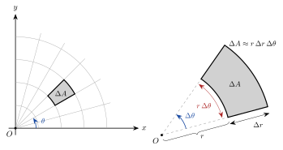
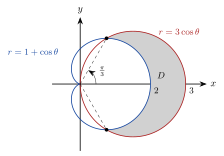

<!-- video: kommer (videoer/flervariabel-kalkulus/01-03-polarkoordinater) -->
{fig-alt="Video kommer"}

<!-- tillegg: Claude -->
Prøv å finne volumet under flaten $z = 4 - x^2 - y^2$ over sirkelskiven $x^2 + y^2 \le 4$ i kartesiske koordinater. Grensene blir $-\sqrt{4 - x^2} \le y \le \sqrt{4 - x^2}$, og det indre integralet gir uttrykk med $(4 - x^2)^{3/2}$ som er tunge å integrere videre. Problemet er at vi beskriver en *rund* skive med et *rett* rutenett. Både skiven og flaten er symmetriske om origo, og da er det naturlig å beskrive punktene med avstand og vinkel i stedet. Det er det polarkoordinater gjør.

## Polarkoordinater

Et punkt i planet kan angis med avstanden $r$ til origo og vinkelen $\theta$ fra den positive $x$-aksen, målt mot klokka. Sammenhengen med de kartesiske koordinatene er

::: {.graa}
$$
x = r\cos\theta, \qquad y = r\sin\theta, \qquad x^2 + y^2 = r^2
$$
:::

Vi lar $r \ge 0$. Vinkelen kan velges i et intervall med lengde $2\pi$, for eksempel $0 \le \theta \le 2\pi$ eller $-\pi \le \theta \le \pi$. Uttrykket $x^2 + y^2$ er bare $r^2$, og det er grunnen til at polarkoordinater gjør så mye arbeid for oss: integrander som $\mathrm{e}^{-(x^2 + y^2)}$ eller $\sqrt{4 - x^2 - y^2}$ blir funksjoner av én variabel.

Områdene som er enklest å beskrive, er **polare rektangler**:
$$
R = \{(r, \theta) : a \le r \le b,\ \alpha \le \theta \le \beta\}
$$
Med $a = 0$ og $\beta - \alpha = 2\pi$ er det en hel sirkelskive. Med $a > 0$ er det en ring, og med $\beta - \alpha < 2\pi$ er det en sektor eller en bit av en ring. I $(r, \theta)$-planet er alle disse vanlige rektangler, med konstante grenser.

## Hvorfor $\mathrm{d}A = r\,\mathrm{d}r\,\mathrm{d}\theta$

I kartesiske koordinater deler vi området i små rektangler med areal $\Delta x\,\Delta y$. I polarkoordinater deler vi det med sirkelbuer ($r$ konstant) og stråler ut fra origo ($\theta$ konstant). Bitene blir små polare rektangler.

{.tikz-fig style="width:680px" fig-alt="Til venstre: første kvadrant med sirkelbuer med radius 1, 2, 3 og 4 og stråler fra origo for hver femtende grad. Ett lite felt mellom to buer og to stråler er skravert og merket Delta A, og vinkelen theta er merket fra x-aksen. Til høyre: det samme feltet forstørret. Avstanden fra origo til den indre buen er r, bredden i radiell retning er Delta r, vinkelen mellom strålene er Delta theta, og den indre buen har lengde r ganger Delta theta. Arealet er merket Delta A omtrent lik r Delta r Delta theta."}

Feltet er nesten et rektangel. Den ene siden går radielt og har lengde $\Delta r$. Den andre siden er en sirkelbue med radius $r$ og vinkel $\Delta\theta$, og en bue har lengde radius ganger vinkel (i radianer): $r\,\Delta\theta$. Dermed er
$$
\Delta A \approx \Delta r \cdot r\,\Delta\theta = r\,\Delta r\,\Delta\theta
$$

Faktoren $r$ er det viktige. To felt med samme $\Delta r$ og $\Delta\theta$ har *ikke* samme areal: feltet langt ute er bredere enn feltet nær origo, fordi buene blir lengre jo større radien er. Uten faktoren $r$ ville vi talt felt nær origo like mye som felt langt ute.

::: {.callout-tip title="Arealet kan regnes ut eksakt"}
Feltet mellom radiene $r_1$ og $r_2$ og vinkelen $\Delta\theta$ er differansen mellom to sektorer:
$$
\Delta A = \tfrac12 r_2^2\,\Delta\theta - \tfrac12 r_1^2\,\Delta\theta = \frac{r_1 + r_2}{2}\,(r_2 - r_1)\,\Delta\theta = \bar r\,\Delta r\,\Delta\theta
$$
der $\bar r$ er middelradien. Formelen $r\,\Delta r\,\Delta\theta$ er altså eksakt når $r$ måles midt i feltet.
:::

Når feltene blir uendelig små, går Riemann-summen $\sum f(r_i\cos\theta_j, r_i\sin\theta_j)\,r_i\,\Delta r\,\Delta\theta$ over i et dobbeltintegral:

::: {.callout-important title="Dobbeltintegral i polarkoordinater"}
Er $f$ kontinuerlig på det polare rektangelet $R$ gitt ved $0 \le a \le r \le b$ og $\alpha \le \theta \le \beta$, der $\beta - \alpha \le 2\pi$, er
$$
\iint_R f(x, y)\,\mathrm{d}A = \int_\alpha^\beta\!\!\int_a^b f(r\cos\theta,\ r\sin\theta)\,r\,\mathrm{d}r\,\mathrm{d}\theta
$$
Husk faktoren $r$. Den er den vanligste feilen i slike utregninger.
:::

Faktoren $r$ er et spesialtilfelle av jacobideterminanten, som styrer alle variabelbytter i dobbeltintegraler. Det generelle bildet står på siden [Variabelbytte og jacobideterminanten](04-variabelbytte.qmd).

::: {.eksempel}
**Eksempel: Volum under en paraboloide.** Finn volumet av legemet under flaten $z = 4 - x^2 - y^2$ og over $xy$-planet.

::: {.losning}
Flaten skjærer $xy$-planet der $4 - x^2 - y^2 = 0$, altså langs sirkelen $r = 2$. Legemet står derfor over skiven $0 \le r \le 2$, $0 \le \theta \le 2\pi$, og der er $z = 4 - r^2 \ge 0$. Integranden avhenger bare av $r$, så integralet faller fra hverandre:
$$
V = \int_0^{2\pi}\!\!\int_0^2 (4 - r^2)\,r\,\mathrm{d}r\,\mathrm{d}\theta
= \left(\int_0^{2\pi}\mathrm{d}\theta\right)\left(\int_0^2 (4r - r^3)\,\mathrm{d}r\right)
= 2\pi\Big[\,2r^2 - \tfrac14 r^4\,\Big]_0^2
$$
$$
V = 2\pi\,(8 - 4) = \underline{\underline{8\pi}} \approx 25.1
$$
**Kontroll:** En sylinder med samme grunnflate ($4\pi$) og høyde $4$ har volum $16\pi$. Paraboloiden fyller nøyaktig halvparten, som er et kjent resultat for slike «skåler».
:::
:::

## Områder mellom polare kurver

Ikke alle runde områder er polare rektangler. På samme måte som i kartesiske koordinater, der grensene for $y$ kan avhenge av $x$ (se [dobbeltintegraler over generelle områder](02-generelle-omrader.qmd)), kan grensene for $r$ avhenge av $\theta$. Er området
$$
D = \{(r, \theta) : \alpha \le \theta \le \beta,\ h_1(\theta) \le r \le h_2(\theta)\},
$$
er
$$
\iint_D f\,\mathrm{d}A = \int_\alpha^\beta\!\!\int_{h_1(\theta)}^{h_2(\theta)} f(r\cos\theta,\ r\sin\theta)\,r\,\mathrm{d}r\,\mathrm{d}\theta
$$
Det indre integralet går langs en stråle ut fra origo: fra der strålen går inn i området ($r = h_1$) til der den går ut ($r = h_2$). Med $f = 1$ får vi arealet:
$$
A(D) = \int_\alpha^\beta\!\!\int_{h_1}^{h_2} r\,\mathrm{d}r\,\mathrm{d}\theta = \int_\alpha^\beta \tfrac12\left(h_2(\theta)^2 - h_1(\theta)^2\right)\mathrm{d}\theta
$$
Med $h_1 = 0$ er dette den kjente formelen $A = \frac12\int r^2\,\mathrm{d}\theta$ for arealet innenfor en polar kurve.

::: {.steg}
1. **Skisser området** og tegn noen stråler ut fra origo gjennom det.
2. **Finn vinkelgrensene** $\alpha$ og $\beta$: de ytterste strålene som treffer området. Skjæringspunkter mellom kurver gir ofte vinklene.
3. **Finn radiusgrensene** langs en stråle: hvor går den inn i området, og hvor går den ut?
4. **Sett inn** $x = r\cos\theta$, $y = r\sin\theta$ og husk faktoren $r$. Integrer først over $r$.
:::

::: {.eksempel}
**Eksempel: Mellom en sirkel og en kardioide.** Kurven $r = 1 + \cos\theta$ er en **kardioide** (hjertekurve), og $r = 3\cos\theta$ er en sirkel med sentrum i $(1.5, 0)$ og radius $1.5$. Finn arealet av området $D$ som ligger innenfor sirkelen, men utenfor kardioiden.

::: {.losning}
{.tikz-fig style="width:380px" fig-alt="Kardioiden r lik 1 pluss cosinus theta, som går gjennom origo og punktet (2, 0), og sirkelen r lik 3 cosinus theta, som går gjennom origo og punktet (3, 0). Kurvene skjærer hverandre i to punkter ved vinklene pluss og minus pi tredjedeler. Området D mellom dem, innenfor sirkelen og utenfor kardioiden, er skravert. Stiplede stråler går fra origo til skjæringspunktene."}

**Vinkelgrenser.** Kurvene skjærer hverandre der $3\cos\theta = 1 + \cos\theta$, altså $\cos\theta = \frac12$ og $\theta = \pm\frac{\pi}{3}$. Mellom disse vinklene ligger sirkelen utenfor kardioiden (prøv $\theta = 0$: $3 > 2$).

**Radiusgrenser.** En stråle med vinkel $\theta$ går inn i $D$ når den krysser kardioiden og ut når den krysser sirkelen: $1 + \cos\theta \le r \le 3\cos\theta$.

**Integralet.**
$$
A = \int_{-\pi/3}^{\pi/3}\!\!\int_{1 + \cos\theta}^{3\cos\theta} r\,\mathrm{d}r\,\mathrm{d}\theta
= \frac12\int_{-\pi/3}^{\pi/3}\left(9\cos^2\theta - (1 + \cos\theta)^2\right)\mathrm{d}\theta
= \frac12\int_{-\pi/3}^{\pi/3}\left(8\cos^2\theta - 2\cos\theta - 1\right)\mathrm{d}\theta
$$
Med $\cos^2\theta = \frac12(1 + \cos 2\theta)$ og $\sin\frac{\pi}{3} = \frac{\sqrt3}{2}$, $\sin\frac{2\pi}{3} = \frac{\sqrt3}{2}$:
$$
\int_{-\pi/3}^{\pi/3} 8\cos^2\theta\,\mathrm{d}\theta = \Big[\,4\theta + 2\sin 2\theta\,\Big]_{-\pi/3}^{\pi/3} = \frac{8\pi}{3} + 2\sqrt3
$$
$$
\int_{-\pi/3}^{\pi/3} 2\cos\theta\,\mathrm{d}\theta = \Big[\,2\sin\theta\,\Big]_{-\pi/3}^{\pi/3} = 2\sqrt3,
\qquad
\int_{-\pi/3}^{\pi/3} 1\,\mathrm{d}\theta = \frac{2\pi}{3}
$$
$$
A = \frac12\left(\frac{8\pi}{3} + 2\sqrt3 - 2\sqrt3 - \frac{2\pi}{3}\right) = \frac12\cdot 2\pi = \underline{\underline{\pi}} \approx 3.14
$$
**Kontroll:** Hele sirkelen har areal $\pi\cdot 1.5^2 \approx 7.07$, og $D$ er tydelig mindre enn halvparten av den på figuren.
:::
:::

## Masse av en skive med radial tetthet

I fysikk og teknikk er tettheten ofte bare avhengig av avstanden fra sentrum: en støpt skive som er tettere i kanten, en roterende plate, et lag støv rundt en kilde. Er flatetettheten $\sigma(r)$ (masse per areal, $\mathrm{kg/m^2}$), har et lite felt massen $\sigma(r)\,\mathrm{d}A$, og hele skiven har massen
$$
M = \iint_D \sigma\,\mathrm{d}A = \int_0^{2\pi}\!\!\int_0^R \sigma(r)\,r\,\mathrm{d}r\,\mathrm{d}\theta = 2\pi\int_0^R \sigma(r)\,r\,\mathrm{d}r
$$
Faktoren $2\pi r\,\mathrm{d}r$ er arealet av en tynn ring med radius $r$ og bredde $\mathrm{d}r$. Vi summerer altså masser av ringer. Flere anvendelser, som tyngdepunkt og middelverdi, står på siden [Masse, tyngdepunkt og middelverdi](05-anvendelser.qmd).

::: {.eksempel}
**Eksempel: Skive som er tyngst i kanten.** En sirkulær skive har radius $R = 0.15\ \mathrm{m}$ og flatetetthet
$$
\sigma(r) = \sigma_0\left(1 + \frac{r^2}{R^2}\right), \qquad \sigma_0 = 4.0\ \mathrm{kg/m^2}.
$$
Finn massen av skiven.

::: {.losning}
$$
M = 2\pi\int_0^R \sigma_0\left(1 + \frac{r^2}{R^2}\right) r\,\mathrm{d}r
= 2\pi\sigma_0\Big[\,\tfrac12 r^2 + \frac{r^4}{4R^2}\,\Big]_0^R
= 2\pi\sigma_0\left(\frac{R^2}{2} + \frac{R^2}{4}\right) = \frac32\,\pi\sigma_0 R^2
$$
$$
M = 1.5\cdot\pi\cdot 4.0\ \mathrm{kg/m^2}\cdot (0.15\ \mathrm{m})^2 = \underline{\underline{0.42\ \mathrm{kg}}}
$$
**Kontroll:** Tettheten går fra $\sigma_0$ i midten til $2\sigma_0$ i kanten. Svaret er $1.5$ ganger massen av en skive med konstant tetthet $\sigma_0$. Det er rimelig: mesteparten av arealet ligger langt ute, der tettheten er størst, så middeltettheten ($1.5\,\sigma_0$) ligger over middelverdien langs radien, som er $\frac43\sigma_0$.
:::
:::

## Høydepunktet: Gauss-integralet

Funksjonen $\mathrm{e}^{-x^2}$ er overalt i fysikk og statistikk: normalfordelingen, diffusjon, varmeledning, kvantemekanikkens grunntilstand. Men den har ingen antiderivert som kan skrives med elementære funksjoner, så integralet
$$
I = \int_{-\infty}^{\infty} \mathrm{e}^{-x^2}\,\mathrm{d}x
$$
kan ikke regnes ut på vanlig måte. Trikset er å gå opp én dimensjon. Vi ganger $I$ med seg selv og kaller integrasjonsvariabelen $y$ i den ene faktoren:
$$
I^2 = \left(\int_{-\infty}^{\infty} \mathrm{e}^{-x^2}\,\mathrm{d}x\right)\left(\int_{-\infty}^{\infty} \mathrm{e}^{-y^2}\,\mathrm{d}y\right) = \iint_{\mathbb{R}^2} \mathrm{e}^{-(x^2 + y^2)}\,\mathrm{d}A
$$
Produktet av to enkeltintegraler er et dobbeltintegral over hele planet. Og $x^2 + y^2 = r^2$, så i polarkoordinater blir det plutselig lett, fordi faktoren $r$ er nøyaktig det som trengs for substitusjonen $u = r^2$:
$$
I^2 = \int_0^{2\pi}\!\!\int_0^{\infty} \mathrm{e}^{-r^2}\,r\,\mathrm{d}r\,\mathrm{d}\theta
= 2\pi\Big[-\tfrac12\,\mathrm{e}^{-r^2}\Big]_0^{\infty}
= 2\pi\cdot\tfrac12 = \pi
$$
Siden $I > 0$, er

::: {.callout-important title="Gauss-integralet"}
$$
\int_{-\infty}^{\infty} \mathrm{e}^{-x^2}\,\mathrm{d}x = \sqrt{\pi}
$$
:::

Integralene her er uegentlige, så vi bør sjekke at det er lov. Over en skive med radius $R$ gir samme utregning $\pi\left(1 - \mathrm{e}^{-R^2}\right)$. Kvadratet $[-R, R]^2$ ligger mellom skiven med radius $R$ og skiven med radius $\sqrt2\,R$, og integranden er positiv. Derfor ligger integralet over kvadratet, som er $\left(\int_{-R}^{R}\mathrm{e}^{-x^2}\,\mathrm{d}x\right)^2$, mellom $\pi(1 - \mathrm{e}^{-R^2})$ og $\pi(1 - \mathrm{e}^{-2R^2})$. Begge går mot $\pi$ når $R \to \infty$.

Med substitusjonen $x = u/(\sqrt2\,s)$ følger normeringen av normalfordelingen: $\displaystyle\int_{-\infty}^{\infty} \mathrm{e}^{-u^2/(2s^2)}\,\mathrm{d}u = s\sqrt{2\pi}$. Det er derfor tallet $\sqrt{2\pi}$ står i formelen for normalfordelingen.

## Prøv selv: kontroll med `dblquad`

`scipy.integrate.dblquad(f, a, b, g, h)` regner ut $\int_a^b\int_{g(x)}^{h(x)} f(y, x)\,\mathrm{d}y\,\mathrm{d}x$. Legg merke til at funksjonen tar den *indre* variabelen først. I polarkoordinater er den ytre variabelen $\theta$ og den indre $r$, så vi skriver `f(r, theta)` og tar med faktoren `r` selv. Programmet kontrollerer eksemplene over. Endre radien `R` i Gauss-integralet og se hvor fort svaret nærmer seg $\pi$. Ta bort faktoren `r` og se hvor galt det går.

```{.python .kjor}
import numpy as np
from scipy.integrate import dblquad

def polar(f, theta1, theta2, r1, r2):
    """Integralet av f(x, y) over theta1 < theta < theta2, r1(theta) < r < r2(theta)."""
    integrand = lambda r, th: f(r * np.cos(th), r * np.sin(th)) * r   # husk faktoren r
    verdi, feil = dblquad(integrand, theta1, theta2, r1, r2)
    return verdi

# Volum under paraboloiden z = 4 - x^2 - y^2
V = polar(lambda x, y: 4 - x**2 - y**2, 0, 2 * np.pi, 0, 2)
print(f"Paraboloide:       {V:.6f}   (eksakt 8 pi = {8 * np.pi:.6f})")

# Areal mellom kardioiden r = 1 + cos(theta) og sirkelen r = 3 cos(theta)
A = polar(lambda x, y: 1.0, -np.pi / 3, np.pi / 3,
          lambda th: 1 + np.cos(th), lambda th: 3 * np.cos(th))
print(f"Kardioide/sirkel:  {A:.6f}   (eksakt pi = {np.pi:.6f})")

# Masse av skiven med sigma = sigma0 (1 + r^2 / R^2)
sigma0, Rs = 4.0, 0.15
M = polar(lambda x, y: sigma0 * (1 + (x**2 + y**2) / Rs**2), 0, 2 * np.pi, 0, Rs)
print(f"Masse:             {M:.6f} kg")

# Gauss: integralet av exp(-(x^2 + y^2)) over skiven med radius R
R = 3.0
G = polar(lambda x, y: np.exp(-(x**2 + y**2)), 0, 2 * np.pi, 0, R)
print(f"Gauss, R = {R}:     {G:.6f}   (pi = {np.pi:.6f}, kvadratrot: {np.sqrt(G):.6f})")
```

:::: {.oppgaver}

::: {.oppgave tittel="Over en ring"}
Regn ut $\displaystyle\iint_D (x^2 + y^2)\,\mathrm{d}A$ der $D$ er ringen $1 \le x^2 + y^2 \le 4$.

::: {.losning}
Ringen er det polare rektangelet $1 \le r \le 2$, $0 \le \theta \le 2\pi$, og $x^2 + y^2 = r^2$:
$$
\int_0^{2\pi}\!\!\int_1^2 r^2\cdot r\,\mathrm{d}r\,\mathrm{d}\theta = 2\pi\Big[\,\tfrac14 r^4\,\Big]_1^2 = 2\pi\cdot\frac{16 - 1}{4} = \underline{\underline{\frac{15\pi}{2}}} \approx 23.6
$$
:::
:::

::: {.oppgave tittel="Halv skive"}
Regn ut $\displaystyle\iint_D y\,\mathrm{d}A$ der $D$ er den øvre halvdelen av enhetsskiven, $x^2 + y^2 \le 1$, $y \ge 0$.

::: {.losning}
Den øvre halvskiven er $0 \le r \le 1$, $0 \le \theta \le \pi$, og $y = r\sin\theta$:
$$
\int_0^{\pi}\!\!\int_0^1 r\sin\theta\cdot r\,\mathrm{d}r\,\mathrm{d}\theta
= \left(\int_0^\pi \sin\theta\,\mathrm{d}\theta\right)\left(\int_0^1 r^2\,\mathrm{d}r\right)
= 2\cdot\frac13 = \underline{\underline{\frac23}}
$$
Deler vi på arealet $\frac{\pi}{2}$, får vi $\bar y = \frac{4}{3\pi} \approx 0.42$, som er høyden til tyngdepunktet av halvskiven.
:::
:::

::: {.oppgave tittel="Bytt til polarkoordinater" niva="Middels"}
Regn ut
$$
\int_{-1}^{1}\!\int_0^{\sqrt{1 - x^2}} \mathrm{e}^{x^2 + y^2}\,\mathrm{d}y\,\mathrm{d}x
$$
ved å skissere området og bytte til polarkoordinater.

::: {.losning}
For hver $x$ mellom $-1$ og $1$ går $y$ fra $0$ til den øvre halvsirkelen $y = \sqrt{1 - x^2}$. Området er altså den øvre halvdelen av enhetsskiven: $0 \le r \le 1$, $0 \le \theta \le \pi$. I kartesiske koordinater har $\mathrm{e}^{x^2 + y^2}$ ingen elementær antiderivert i $y$, men i polarkoordinater gir faktoren $r$ substitusjonen $u = r^2$:
$$
\int_0^{\pi}\!\!\int_0^1 \mathrm{e}^{r^2}\,r\,\mathrm{d}r\,\mathrm{d}\theta
= \pi\Big[\,\tfrac12\,\mathrm{e}^{r^2}\,\Big]_0^1
= \underline{\underline{\frac{\pi}{2}(\mathrm{e} - 1)}} \approx 2.70
$$
:::
:::

::: {.oppgave tittel="Volumet av en kule" niva="Middels"}
Vis at en kule med radius $a$ har volum $\frac43\pi a^3$. Bruk at den øvre halvkula ligger under flaten $z = \sqrt{a^2 - x^2 - y^2}$ over skiven $x^2 + y^2 \le a^2$.

::: {.losning}
Hele kula har dobbelt så stort volum som den øvre halvdelen:
$$
V = 2\int_0^{2\pi}\!\!\int_0^a \sqrt{a^2 - r^2}\;r\,\mathrm{d}r\,\mathrm{d}\theta
$$
Med $u = a^2 - r^2$ er $\mathrm{d}u = -2r\,\mathrm{d}r$, og $u$ går fra $a^2$ til $0$:
$$
\int_0^a \sqrt{a^2 - r^2}\;r\,\mathrm{d}r = \frac12\int_0^{a^2} \sqrt{u}\,\mathrm{d}u = \frac12\cdot\frac23\,a^3 = \frac{a^3}{3}
$$
$$
V = 2\cdot 2\pi\cdot\frac{a^3}{3} = \underline{\underline{\frac43\pi a^3}}
$$
:::
:::

::: {.oppgave tittel="Normalfordelingen" niva="Middels"}
Bruk Gauss-integralet til å vise at $\displaystyle\int_{-\infty}^{\infty} \mathrm{e}^{-x^2/2}\,\mathrm{d}x = \sqrt{2\pi}$.

::: {.losning}
Sett $x = \sqrt2\,u$. Da er $\mathrm{d}x = \sqrt2\,\mathrm{d}u$ og $x^2/2 = u^2$, og grensene er fortsatt $\pm\infty$:
$$
\int_{-\infty}^{\infty} \mathrm{e}^{-x^2/2}\,\mathrm{d}x = \sqrt2\int_{-\infty}^{\infty} \mathrm{e}^{-u^2}\,\mathrm{d}u = \sqrt2\cdot\sqrt\pi = \underline{\underline{\sqrt{2\pi}}} \approx 2.507
$$
Derfor står $\frac{1}{\sqrt{2\pi}}$ foran $\mathrm{e}^{-x^2/2}$ i standard normalfordeling: da blir det totale arealet under kurven $1$.
:::
:::

::: {.oppgave tittel="Plate med avtagende tetthet" niva="Utfordrende"}
En tynn, sirkulær plate har radius $R = 0.30\ \mathrm{m}$. Flatetettheten avtar utover som
$$
\sigma(r) = \sigma_0\,\mathrm{e}^{-r/R}, \qquad \sigma_0 = 2.5\ \mathrm{kg/m^2}.
$$

a) Finn massen av platen.

b) Finn middeltettheten (massen delt på arealet), og sammenlign med tettheten i sentrum og i kanten.

::: {.losning}
a) Tettheten avhenger bare av $r$:
$$
M = 2\pi\sigma_0\int_0^R r\,\mathrm{e}^{-r/R}\,\mathrm{d}r
$$
Delvis integrasjon med $u = r$ og $v' = \mathrm{e}^{-r/R}$, $v = -R\,\mathrm{e}^{-r/R}$:
$$
\int_0^R r\,\mathrm{e}^{-r/R}\,\mathrm{d}r = \Big[-rR\,\mathrm{e}^{-r/R}\Big]_0^R + R\int_0^R \mathrm{e}^{-r/R}\,\mathrm{d}r
= -R^2\mathrm{e}^{-1} + R^2\left(1 - \mathrm{e}^{-1}\right) = R^2\left(1 - \frac{2}{\mathrm{e}}\right)
$$
$$
M = 2\pi\sigma_0 R^2\left(1 - \frac{2}{\mathrm{e}}\right) = 2\pi\cdot 2.5\ \mathrm{kg/m^2}\cdot(0.30\ \mathrm{m})^2\cdot 0.2642 = \underline{\underline{0.37\ \mathrm{kg}}}
$$

b)
$$
\bar\sigma = \frac{M}{\pi R^2} = 2\sigma_0\left(1 - \frac{2}{\mathrm{e}}\right) = 0.528\,\sigma_0 = \underline{\underline{1.3\ \mathrm{kg/m^2}}}
$$
I sentrum er tettheten $2.5\ \mathrm{kg/m^2}$, og i kanten er den $\sigma_0\,\mathrm{e}^{-1} = 0.92\ \mathrm{kg/m^2}$. Middeltettheten ligger nærmere kantverdien enn sentrumsverdien, fordi mesteparten av arealet ligger langt ute.
:::
:::

::::
