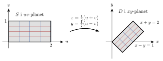
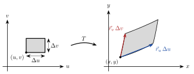
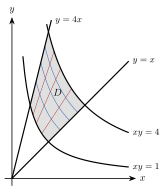

<!-- video: kommer (videoer/flervariabel-kalkulus/01-04-variabelbytte) -->
{fig-alt="Video kommer"}

<!-- tillegg: Claude -->
I envariabelanalysen er substitusjon et av de viktigste verktøyene: Med $u = g(x)$ blir $\mathrm{d}u = g'(x)\,\mathrm{d}x$, og et vanskelig integral blir et enkelt. I to variabler trenger vi det samme, men av to grunner. Integranden kan bli enklere, slik den gjorde med polarkoordinater. Og *området* kan bli enklere: Et skjevt parallellogram eller et område mellom to hyperbler kan bli et vanlig rektangel med konstante grenser. Spørsmålet er hva som erstatter faktoren $g'(x)$. Svaret er jacobideterminanten, og den forteller hvor mye byttet strekker eller krymper arealer.

## Transformasjoner av planet

Et variabelbytte er en **transformasjon** $T$ som sender et punkt $(u, v)$ i et $uv$-plan til et punkt $(x, y)$ i $xy$-planet:
$$
x = x(u, v), \qquad y = y(u, v)
$$
Et område $S$ i $uv$-planet sendes til et område $D = T(S)$ i $xy$-planet. Linjene $u = \text{konst.}$ og $v = \text{konst.}$ blir kurver i $xy$-planet, så et rett rutenett blir et nytt rutenett som kan være skjevt eller krumt. Polarkoordinatene er et eksempel: $x = r\cos\theta$, $y = r\sin\theta$ sender et rektangel i $r\theta$-planet til en ring eller en sektor.

{.tikz-fig style="width:600px" fig-alt="Til venstre et rektangel S i uv-planet med 0 ≤ u ≤ 2 og 0 ≤ v ≤ 1, delt inn i et rutenett. En pil merket x = (u+v)/2, y = (u−v)/2 peker til høyre, der det samme rutenettet er blitt et rotert rektangel D i xy-planet med hjørner i (0, 0), (1, 1), (1.5, 0.5) og (0.5, −0.5). Sidene ligger på linjene x + y = 0, x + y = 2, x − y = 0 og x − y = 1."}

Figuren viser byttet $x = \tfrac12(u + v)$, $y = \tfrac12(u - v)$. Rektangelet $0 \le u \le 2$, $0 \le v \le 1$ blir et kvadrat som er dreid $45^\circ$. Rutene har fått en annen form, og de er blitt mindre. Det er den endringen vi må holde regnskap med.

## Hvordan små arealer endres

Se på en liten rute i $uv$-planet med hjørne i $(u, v)$ og sider $\Delta u$ og $\Delta v$. Når vi går $\Delta u$ i $u$-retning, flytter bildepunktet seg omtrent
$$
\vec r_u\,\Delta u = \left[\frac{\partial x}{\partial u},\ \frac{\partial y}{\partial u}\right]\Delta u
$$
og når vi går $\Delta v$ i $v$-retning, flytter det seg omtrent $\vec r_v\,\Delta v = \left[\frac{\partial x}{\partial v},\ \frac{\partial y}{\partial v}\right]\Delta v$. Dette er lineær tilnærming, den samme ideen som ligger bak tangentplanet. Den lille ruta blir derfor nesten et parallellogram utspent av disse to vektorene.

{.tikz-fig style="width:560px" fig-alt="Til venstre en liten rute i uv-planet med hjørne i (u, v) og sider Delta u og Delta v. En pil merket T går til høyre, der ruta er blitt et krumt firkantet felt i xy-planet. Fra hjørnet (x, y) går to vektorer langs sidene, merket r_u Delta u og r_v Delta v."}

Arealet av et parallellogram utspent av $[a_1, a_2]$ og $[b_1, b_2]$ er absoluttverdien av determinanten $a_1 b_2 - a_2 b_1$ (det er lengden av vektorproduktet, se [vektorer og vektorproduktet](../00-verktoy/01-vektorer-og-vektorproduktet.qmd)). Dermed er
$$
\Delta A \approx \left|\frac{\partial x}{\partial u}\frac{\partial y}{\partial v} - \frac{\partial x}{\partial v}\frac{\partial y}{\partial u}\right|\Delta u\,\Delta v
$$

::: {.callout-note title="Definisjon: Jacobideterminanten"}
For transformasjonen $x = x(u, v)$, $y = y(u, v)$ er **jacobideterminanten**
$$
\frac{\partial(x, y)}{\partial(u, v)} =
\begin{vmatrix}
\dfrac{\partial x}{\partial u} & \dfrac{\partial x}{\partial v}\\[8pt]
\dfrac{\partial y}{\partial u} & \dfrac{\partial y}{\partial v}
\end{vmatrix}
= \frac{\partial x}{\partial u}\frac{\partial y}{\partial v} - \frac{\partial x}{\partial v}\frac{\partial y}{\partial u}
$$
Absoluttverdien er den lokale skaleringsfaktoren for areal: $\mathrm{d}A = \left|\dfrac{\partial(x, y)}{\partial(u, v)}\right|\mathrm{d}u\,\mathrm{d}v$.
:::

Fortegnet til determinanten sier om byttet speilvender planet (negativt) eller ikke (positivt). For arealer er det bare størrelsen som teller, og derfor står det absoluttverdi i formelen. Det er forskjellen fra envariabelsubstitusjon, der fortegnet ivaretas av at grensene byttes om.

Når rutene blir uendelig små, går Riemann-summen over i et integral, akkurat som da vi innførte $r\,\mathrm{d}r\,\mathrm{d}\theta$:

::: {.callout-important title="Variabelbytte i dobbeltintegraler"}
La $T$ være en transformasjon med kontinuerlige partiellderiverte som sender $S$ én-til-én på $D$ (unntatt eventuelt på randen), og la $f$ være kontinuerlig på $D$. Da er
$$
\iint_D f(x, y)\,\mathrm{d}A = \iint_S f\big(x(u, v),\ y(u, v)\big)\left|\frac{\partial(x, y)}{\partial(u, v)}\right|\mathrm{d}u\,\mathrm{d}v
$$
:::

### Polarkoordinater er et spesialtilfelle

Med $x = r\cos\theta$ og $y = r\sin\theta$ er
$$
\frac{\partial(x, y)}{\partial(r, \theta)} =
\begin{vmatrix}
\cos\theta & -r\sin\theta\\
\sin\theta & r\cos\theta
\end{vmatrix}
= r\cos^2\theta + r\sin^2\theta = r
$$
Faktoren $r$ i $\mathrm{d}A = r\,\mathrm{d}r\,\mathrm{d}\theta$ fra [dobbeltintegraler i polarkoordinater](03-polarkoordinater.qmd) er altså jacobideterminanten. Den geometriske forklaringen der, at feltene blir bredere lenger ute, er den samme som parallellogrammet over.

## Lineære bytter

Er byttet lineært, $x = au + bv$ og $y = cu + dv$, er alle partiellderiverte konstanter, og
$$
\frac{\partial(x, y)}{\partial(u, v)} = ad - bc
$$
Alle ruter skaleres da med samme faktor $|ad - bc|$. Et rektangel blir et parallellogram, og arealet ganges med $|ad - bc|$. Lineære bytter passer derfor for områder avgrenset av to par parallelle linjer.

Ofte er det lettest å velge $u$ og $v$ som uttrykkene i likningene for linjene, altså $u$ og $v$ som funksjoner av $x$ og $y$. Da trenger vi ikke løse for $x$ og $y$, for de to jacobideterminantene er hverandres inverse:

::: {.graa}
$$
\frac{\partial(x, y)}{\partial(u, v)} = \frac{1}{\dfrac{\partial(u, v)}{\partial(x, y)}}
$$
:::

Det er rimelig: Strekker det ene byttet arealer med en faktor $k$, må byttet tilbake krympe dem med $1/k$.

::: {.eksempel}
**Eksempel: Et dreid kvadrat.** La $D$ være området avgrenset av linjene $x + y = 0$, $x + y = 2$, $x - y = 0$ og $x - y = 1$ (figuren over). Regn ut
$$
\iint_D (x - y)\,\mathrm{e}^{x + y}\,\mathrm{d}A
$$

::: {.losning}
I $xy$-koordinater må området deles i tre biter, fordi venstre og høyre side skifter i hjørnene. Linjene og integranden peker i stedet på byttet
$$
u = x + y, \qquad v = x - y
$$
Da er $S$ rektangelet $0 \le u \le 2$, $0 \le v \le 1$, og integranden blir $v\,\mathrm{e}^{u}$.

Jacobideterminanten for $(u, v)$ med hensyn på $(x, y)$ er
$$
\frac{\partial(u, v)}{\partial(x, y)} = \begin{vmatrix} 1 & 1 \\ 1 & -1 \end{vmatrix} = -1 - 1 = -2
\quad\implies\quad
\left|\frac{\partial(x, y)}{\partial(u, v)}\right| = \frac{1}{2}
$$
Det stemmer med figuren: Rektangelet har areal $2$, og kvadratet har sider $\sqrt2/2$ og $\sqrt2$, altså areal $1$.

Integralet blir et produkt av to enkle integraler:
$$
\iint_D (x - y)\,\mathrm{e}^{x + y}\,\mathrm{d}A = \int_0^1\!\!\int_0^2 v\,\mathrm{e}^{u}\cdot\frac12\,\mathrm{d}u\,\mathrm{d}v = \frac12\left(\int_0^2 \mathrm{e}^{u}\,\mathrm{d}u\right)\left(\int_0^1 v\,\mathrm{d}v\right) = \frac12\,(\mathrm{e}^2 - 1)\cdot\frac12
$$
$$
= \underline{\underline{\frac{\mathrm{e}^2 - 1}{4}}} \approx 1.597
$$
:::
:::

## Ellipser

En ellipse $\dfrac{x^2}{a^2} + \dfrac{y^2}{b^2} \le 1$ er en sirkel som er strukket med faktoren $a$ i $x$-retning og $b$ i $y$-retning. Byttet $x = au$, $y = bv$ sender enhetssirkelen $u^2 + v^2 \le 1$ til ellipsen, og
$$
\frac{\partial(x, y)}{\partial(u, v)} = \begin{vmatrix} a & 0 \\ 0 & b \end{vmatrix} = ab
$$
Arealet av ellipsen er derfor $ab$ ganger arealet av enhetssirkelen:
$$
A = \iint_{u^2 + v^2 \le 1} ab\,\mathrm{d}u\,\mathrm{d}v = ab\cdot\pi = \underline{\underline{\pi ab}}
$$
Med $a = b$ får vi $\pi a^2$, som det skal være.

Vil vi integrere en funksjon over ellipsen, kan vi gjøre begge byttene på en gang: **elliptiske koordinater** $x = ar\cos\theta$, $y = br\sin\theta$ med $0 \le r \le 1$ og $0 \le \theta \le 2\pi$. Jacobideterminanten er produktet av de to faktorene, $ab\cdot r = abr$.

::: {.eksempel}
**Eksempel: Et integral over en ellipse.** Regn ut $\displaystyle\iint_E x^2\,\mathrm{d}A$, der $E$ er ellipsen $\dfrac{x^2}{a^2} + \dfrac{y^2}{b^2} \le 1$. (Integralet er treghetsmomentet om $y$-aksen for en tynn elliptisk plate med flatetetthet $1$.)

::: {.losning}
Med $x = ar\cos\theta$, $y = br\sin\theta$ og $\mathrm{d}A = abr\,\mathrm{d}r\,\mathrm{d}\theta$:
$$
\iint_E x^2\,\mathrm{d}A = \int_0^{2\pi}\!\!\int_0^1 a^2r^2\cos^2\theta\cdot abr\,\mathrm{d}r\,\mathrm{d}\theta = a^3b\left(\int_0^1 r^3\,\mathrm{d}r\right)\left(\int_0^{2\pi}\cos^2\theta\,\mathrm{d}\theta\right) = a^3b\cdot\frac14\cdot\pi
$$
$$
= \underline{\underline{\frac{\pi a^3 b}{4}}}
$$
**Kontroll:** For en sirkel, $a = b = R$, gir det $\pi R^4/4$. Det er det kjente treghetsmomentet om en diameter for en sirkelskive med tetthet $1$.
:::
:::

## Et bytte som ikke er lineært

Områder som er avgrenset av to familier av kurver, kan ofte rettes ut ved å la kurvefamiliene bli koordinatlinjer.

{.tikz-fig style="width:360px" fig-alt="Første kvadrant med hyperblene xy = 1 og xy = 4 og linjene y = x og y = 4x. Området D mellom dem er skravert, med hjørner i (1, 1), (2, 2), (1, 4) og (1/2, 2). Inne i D er det tegnet flere hyperbler xy = konstant og flere stråler y/x = konstant, som danner et krumt rutenett."}

::: {.eksempel}
**Eksempel: Mellom to hyperbler.** Finn arealet av området $D$ i første kvadrant mellom hyperblene $xy = 1$ og $xy = 4$ og linjene $y = x$ og $y = 4x$.

::: {.losning}
Kantene er nivåkurver for $xy$ og for $y/x$. Vi velger derfor
$$
u = xy, \qquad v = \frac{y}{x}
$$
Da er $D$ rektangelet $1 \le u \le 4$, $1 \le v \le 4$. Jacobideterminanten med hensyn på $(x, y)$ er
$$
\frac{\partial(u, v)}{\partial(x, y)} = \begin{vmatrix} y & x \\[2pt] -\dfrac{y}{x^2} & \dfrac{1}{x} \end{vmatrix} = \frac{y}{x} + \frac{y}{x} = 2\frac{y}{x} = 2v
$$
Den er positiv i hele området, så $\left|\dfrac{\partial(x, y)}{\partial(u, v)}\right| = \dfrac{1}{2v}$. Arealet er integralet av $1$:
$$
A = \iint_D 1\,\mathrm{d}A = \int_1^4\!\!\int_1^4 \frac{1}{2v}\,\mathrm{d}u\,\mathrm{d}v = 3\cdot\frac12\Big[\ln v\Big]_1^4 = \frac32\ln 4 = \underline{\underline{3\ln 2}} \approx 2.079
$$
Vi trengte aldri å løse for $x$ og $y$. (Gjør du det, får du $x = \sqrt{u/v}$ og $y = \sqrt{uv}$, og jacobideterminanten $1/(2v)$ direkte.)
:::
:::

::: {.callout-tip title="Slik velger du et bytte"}
::: {.steg}
1. Se på randkurvene. Kan de skrives som $g(x, y) = \text{konst.}$ og $h(x, y) = \text{konst.}$? Prøv $u = g$ og $v = h$.
2. Se på integranden. Inneholder den et uttrykk som går igjen, for eksempel $x + y$ eller $x^2 + y^2$? Det er en god kandidat for $u$.
3. Regn ut jacobideterminanten, enten $\partial(x, y)/\partial(u, v)$ direkte eller som $1/\big(\partial(u, v)/\partial(x, y)\big)$, og uttrykk den med $u$ og $v$.
4. Skriv opp de nye grensene og kontroller at byttet er én-til-én på området.
:::
:::

## Prøv selv

Programmet tegner hvordan rutenettet i $uv$-planet sendes til $xy$-planet, og regner ut arealet av bildet ved å summere $|J|\,\Delta u\,\Delta v$ over små ruter. Jacobideterminanten finner programmet selv med differanser. Endre transformasjonen, for eksempel til `x = u**2 - v**2` og `y = 2*u*v` med grensene 0 til 1, og trykk **Kjør**.

```{.python .kjor}
import numpy as np
import matplotlib.pyplot as plt

# Transformasjon (u, v) -> (x, y) og grensene for u og v
def T(u, v):
    x = np.sqrt(u / v)
    y = np.sqrt(u * v)
    return x, y

u0, u1 = 1, 4
v0, v1 = 1, 4

# Jacobideterminant med sentraldifferanser
def jacobi(u, v, h=1e-6):
    xu = (T(u + h, v)[0] - T(u - h, v)[0]) / (2 * h)
    yu = (T(u + h, v)[1] - T(u - h, v)[1]) / (2 * h)
    xv = (T(u, v + h)[0] - T(u, v - h)[0]) / (2 * h)
    yv = (T(u, v + h)[1] - T(u, v - h)[1]) / (2 * h)
    return xu * yv - xv * yu

n = 400
du, dv = (u1 - u0) / n, (v1 - v0) / n
U, V = np.meshgrid(u0 + (np.arange(n) + 0.5) * du, v0 + (np.arange(n) + 0.5) * dv)
areal = np.sum(np.abs(jacobi(U, V))) * du * dv
print(f"Areal fra jacobideterminanten: {areal:.4f}")

# Tegn rutenettet i xy-planet
for uk in np.linspace(u0, u1, 9):
    v = np.linspace(v0, v1, 100)
    plt.plot(*T(uk + 0 * v, v), "tab:blue", lw=1)
for vk in np.linspace(v0, v1, 9):
    u = np.linspace(u0, u1, 100)
    plt.plot(*T(u, vk + 0 * u), "tab:red", lw=1)
plt.gca().set_aspect("equal")
plt.xlabel("x")
plt.ylabel("y")
plt.title(f"Bildet av rektangelet, areal ≈ {areal:.3f}")
plt.show()
```

Med byttet i programmet skal du få $3\ln 2 \approx 2.0794$, som i eksemplet med hyperblene.

:::: {.oppgaver}

::: {.oppgave tittel="Jacobideterminant for et lineært bytte"}
Gitt byttet $x = 2u + v$, $y = u - 3v$.

a)  Regn ut jacobideterminanten $\dfrac{\partial(x, y)}{\partial(u, v)}$.

b)  Hva er arealet av bildet av enhetskvadratet $0 \le u \le 1$, $0 \le v \le 1$? Hva slags figur er det?

c)  Hva betyr det at determinanten er negativ?

::: {.losning}
**a)**
$$
\frac{\partial(x, y)}{\partial(u, v)} = \begin{vmatrix} 2 & 1 \\ 1 & -3 \end{vmatrix} = 2\cdot(-3) - 1\cdot1 = \underline{\underline{-7}}
$$

**b)** Byttet er lineært, så alle arealer ganges med $|-7| = 7$. Bildet av enhetskvadratet har areal $\underline{\underline{7}}$. Det er et parallellogram utspent av vektorene $[2, 1]$ (bildet av $[1, 0]$) og $[1, -3]$ (bildet av $[0, 1]$).

**c)** Byttet speilvender planet: Går vi rundt kvadratet mot klokka i $uv$-planet, går bildet rundt med klokka i $xy$-planet. For arealet spiller det ingen rolle, og derfor bruker vi absoluttverdien.
:::
:::

::: {.oppgave tittel="Et parallellogram"}
La $D$ være parallellogrammet avgrenset av linjene $x - 2y = 0$, $x - 2y = 4$, $x + y = 1$ og $x + y = 4$. Regn ut
$$
\iint_D (x - 2y)^2\,\mathrm{d}A
$$

::: {.losning}
Vi velger $u = x - 2y$ og $v = x + y$. Da er $S$ rektangelet $0 \le u \le 4$, $1 \le v \le 4$, og integranden er $u^2$.
$$
\frac{\partial(u, v)}{\partial(x, y)} = \begin{vmatrix} 1 & -2 \\ 1 & 1 \end{vmatrix} = 1 + 2 = 3
\quad\implies\quad
\left|\frac{\partial(x, y)}{\partial(u, v)}\right| = \frac13
$$
$$
\iint_D (x - 2y)^2\,\mathrm{d}A = \int_1^4\!\!\int_0^4 u^2\cdot\frac13\,\mathrm{d}u\,\mathrm{d}v = \frac13\cdot\frac{4^3}{3}\cdot(4 - 1) = \underline{\underline{\frac{64}{3}}} \approx 21.3
$$
:::
:::

::: {.oppgave tittel="Elliptisk plate" niva="Middels"}
En tynn plate har form som ellipsen $\dfrac{x^2}{9} + \dfrac{y^2}{4} \le 1$ (lengder i meter) og flatetetthet $1\ \mathrm{kg/m^2}$.

a)  Finn arealet og massen til plata.

b)  Regn ut $\displaystyle\iint_E y^2\,\mathrm{d}A$, treghetsmomentet om $x$-aksen.

c)  Sammenlikn med treghetsmomentet om $y$-aksen. Hvilken akse er det lettest å rotere plata om, og hvorfor er det rimelig?

::: {.losning}
Her er $a = 3\ \mathrm{m}$ og $b = 2\ \mathrm{m}$. Vi bruker $x = 3r\cos\theta$, $y = 2r\sin\theta$ og $\mathrm{d}A = 6r\,\mathrm{d}r\,\mathrm{d}\theta$.

**a)** $A = \pi ab = 6\pi\ \mathrm{m^2} \approx \underline{\underline{18.8\ \mathrm{m^2}}}$. Med tetthet $1\ \mathrm{kg/m^2}$ er massen $\underline{\underline{18.8\ \mathrm{kg}}}$.

**b)**
$$
\iint_E y^2\,\mathrm{d}A = \int_0^{2\pi}\!\!\int_0^1 4r^2\sin^2\theta\cdot6r\,\mathrm{d}r\,\mathrm{d}\theta = 24\cdot\frac14\cdot\pi = 6\pi \approx \underline{\underline{18.8\ \mathrm{kg\,m^2}}}
$$

**c)** Om $y$-aksen er det $\pi a^3b/4 = \pi\cdot27\cdot2/4 = 13.5\pi \approx 42.4\ \mathrm{kg\,m^2}$, altså mer enn dobbelt så mye. Det er lettest å rotere om $x$-aksen, som er den lange aksen. Da ligger massen nærmest aksen, for avstanden fra $x$-aksen er høyst $2\ \mathrm{m}$, mens avstanden fra $y$-aksen er opptil $3\ \mathrm{m}$.
:::
:::

::: {.oppgave tittel="Mellom hyperbler og linjer" niva="Middels"}
La $D$ være området i første kvadrant mellom $xy = 1$, $xy = 3$, $y = x$ og $y = 2x$. Regn ut
$$
\iint_D xy\,\mathrm{d}A
$$

::: {.losning}
Som i eksemplet over velger vi $u = xy$ og $v = y/x$. Da er $1 \le u \le 3$ og $1 \le v \le 2$, og
$$
\frac{\partial(u, v)}{\partial(x, y)} = 2\frac{y}{x} = 2v \quad\implies\quad \left|\frac{\partial(x, y)}{\partial(u, v)}\right| = \frac{1}{2v}
$$
Integranden er $u$:
$$
\iint_D xy\,\mathrm{d}A = \int_1^2\!\!\int_1^3 \frac{u}{2v}\,\mathrm{d}u\,\mathrm{d}v = \frac12\left[\frac{u^2}{2}\right]_1^3\Big[\ln v\Big]_1^2 = \frac12\cdot4\cdot\ln2 = \underline{\underline{2\ln2}} \approx 1.386
$$
:::
:::

::: {.oppgave tittel="Kvadrering av planet" niva="Utfordrende"}
Byttet $x = u^2 - v^2$, $y = 2uv$ sender enhetskvadratet $S$: $0 \le u \le 1$, $0 \le v \le 1$ til et område $D$ i $xy$-planet.

a)  Finn jacobideterminanten. Hvor er den null?

b)  Finn bildet av de fire sidene av kvadratet, og skisser $D$.

c)  Finn arealet av $D$.

d)  Hva skjer hvis vi bruker hele kvadratet $-1 \le u \le 1$, $-1 \le v \le 1$ i stedet? Er byttet da én-til-én, og hva gir arealformelen?

::: {.losning}
**a)**
$$
\frac{\partial(x, y)}{\partial(u, v)} = \begin{vmatrix} 2u & -2v \\ 2v & 2u \end{vmatrix} = 4u^2 + 4v^2 = \underline{\underline{4(u^2 + v^2)}}
$$
Den er null bare i origo, $u = v = 0$. Der krympes små ruter til nesten ingenting.

**b)**
- $v = 0$, $0 \le u \le 1$: $x = u^2$, $y = 0$. Linjestykket fra $(0, 0)$ til $(1, 0)$.
- $u = 0$, $0 \le v \le 1$: $x = -v^2$, $y = 0$. Linjestykket fra $(0, 0)$ til $(-1, 0)$.
- $u = 1$: $x = 1 - v^2$, $y = 2v$. Eliminerer vi $v = y/2$, får vi parabelen $x = 1 - y^2/4$, fra $(1, 0)$ til $(0, 2)$.
- $v = 1$: $x = u^2 - 1$, $y = 2u$, altså parabelen $x = y^2/4 - 1$, fra $(-1, 0)$ til $(0, 2)$.

$D$ er altså området over $x$-aksen mellom de to parablene, en «bue» med topp i $(0, 2)$ og fot fra $x = -1$ til $x = 1$.

**c)**
$$
A = \int_0^1\!\!\int_0^1 4(u^2 + v^2)\,\mathrm{d}u\,\mathrm{d}v = 4\left(\frac13 + \frac13\right) = \underline{\underline{\frac83}} \approx 2.67
$$
**Kontroll** med parablene direkte: For $0 \le y \le 2$ går $x$ fra $y^2/4 - 1$ til $1 - y^2/4$, og $A = \int_0^2 (2 - y^2/2)\,\mathrm{d}y = 4 - \tfrac43 = \tfrac83$.

**d)** Punktene $(u, v)$ og $(-u, -v)$ gir samme $(x, y)$, fordi uttrykkene bare inneholder $u^2$, $v^2$ og $uv$. Begge punktene ligger i det store kvadratet, så byttet er **ikke** én-til-én: Hvert punkt i bildet treffes to ganger. Bildet er $D$ sammen med speilbildet av $D$ om $x$-aksen (fra kvadratene der $u$ og $v$ har motsatt fortegn), og har areal $2\cdot\tfrac83 = \tfrac{16}{3}$. Integralet av jacobideterminanten over det store kvadratet gir derimot
$$
\int_{-1}^1\!\!\int_{-1}^1 4(u^2 + v^2)\,\mathrm{d}u\,\mathrm{d}v = 4\left(\frac43 + \frac43\right) = \frac{32}{3},
$$
dobbelt så mye. Formelen teller hver bit av $D$ én gang for hver gang den blir truffet, og derfor krever vi at byttet er én-til-én.
:::
:::

::::
