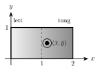
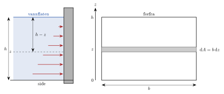

<!-- video: kommer (videoer/flervariabel-kalkulus/01-05-anvendelser) -->
{fig-alt="Video kommer"}

<!-- tillegg: Claude -->
Et dobbeltintegral er en sum av mange små bidrag $f(x, y)\,\Delta A$. Det første vi brukte det til, var volum: $f$ er høyden, og $f\,\Delta A$ er volumet av en tynn stolpe. Men $f$ kan like gjerne være massen per areal i en plate, trykket mot en vegg eller temperaturen i et punkt. Da gir det samme integralet masse, kraft eller en gjennomsnittstemperatur. På denne siden ser vi på de vanligste anvendelsene. Oppskriften er hver gang den samme: *Finn bidraget fra en liten bit $\mathrm{d}A$, og summer.*

## Volum mellom to flater

Ligger et legeme mellom en nedre flate $z = g(x, y)$ og en øvre flate $z = f(x, y)$ over et område $D$, er en tynn stolpe over $\mathrm{d}A$ like høy som avstanden mellom flatene. Volumet er

::: {.graa}
$$
V = \iint_D \big(f(x, y) - g(x, y)\big)\,\mathrm{d}A
$$
:::

Området $D$ er ofte der flatene skjærer hverandre, altså der $f = g$.

::: {.eksempel}
**Eksempel: Mellom to paraboloider.** Finn volumet mellom $z = x^2 + y^2$ og $z = 2 - x^2 - y^2$.

::: {.losning}
Flatene møtes der $x^2 + y^2 = 2 - x^2 - y^2$, altså på sirkelen $x^2 + y^2 = 1$. Inni sirkelen er $2 - x^2 - y^2$ den øverste. Med polarkoordinater er høyden $2 - 2r^2$:
$$
V = \int_0^{2\pi}\!\!\int_0^1 (2 - 2r^2)\,r\,\mathrm{d}r\,\mathrm{d}\theta = 2\pi\Big[\,r^2 - \tfrac12 r^4\,\Big]_0^1 = 2\pi\cdot\tfrac12 = \underline{\underline{\pi}} \approx 3.14
$$
:::
:::

## Middelverdi

Middelverdien av tallene $f_1, f_2, \dots, f_n$ er summen delt på antallet. For en funksjon over et område erstatter vi summen med et integral og antallet med arealet:

::: {.callout-note title="Definisjon: Middelverdi over et område"}
Middelverdien av $f$ over området $D$ med areal $A(D)$ er
$$
\bar f = \frac{1}{A(D)}\iint_D f(x, y)\,\mathrm{d}A
$$
:::

Geometrisk er $\bar f$ høyden av en sylinder med grunnflate $D$ som har samme volum som legemet under grafen. Toppene over $\bar f$ fyller akkurat dalene under.

::: {.eksempel}
**Eksempel: Temperaturen i en plate.** En rektangulær plate dekker $0 \le x \le 2$, $0 \le y \le 1$ (i meter). Temperaturen er $T(x, y) = 20 + 10xy$ i grader celsius. Finn middeltemperaturen.

::: {.losning}
Arealet er $A = 2\ \mathrm{m^2}$, og
$$
\iint_D T\,\mathrm{d}A = \int_0^1\!\!\int_0^2 (20 + 10xy)\,\mathrm{d}x\,\mathrm{d}y = 20\cdot2 + 10\left(\int_0^2 x\,\mathrm{d}x\right)\left(\int_0^1 y\,\mathrm{d}y\right) = 40 + 10\cdot2\cdot\tfrac12 = 50
$$
$$
\bar T = \frac{50}{2} = \underline{\underline{25\ ^\circ\mathrm{C}}}
$$
Temperaturen varierer fra $20\ ^\circ\mathrm{C}$ i hjørnet ved origo til $40\ ^\circ\mathrm{C}$ i hjørnet $(2, 1)$, men den er nær $20\ ^\circ\mathrm{C}$ langs begge aksene og stiger bare raskt nær hjørnet $(2, 1)$. Middelverdien er derfor ikke $30\ ^\circ\mathrm{C}$, som er gjennomsnittet av høyeste og laveste verdi.
:::
:::

## Masse av en plate

En tynn plate har **flatetetthet** $\rho(x, y)$, målt i $\mathrm{kg/m^2}$. En liten bit med areal $\mathrm{d}A$ har massen $\mathrm{d}m = \rho\,\mathrm{d}A$, og hele plata har massen
$$
m = \iint_D \rho(x, y)\,\mathrm{d}A
$$
Er tettheten konstant, blir massen bare $\rho$ ganger arealet. Integralet trengs når plata er tykkere eller tyngre noen steder enn andre.

## Tyngdepunkt

Tyngdepunktet er punktet der plata ville balansert på en nålespiss. Langs én akse er det et veid gjennomsnitt av posisjonene, med massen som vekt:

::: {.callout-important title="Tyngdepunktet til en plate"}
$$
\bar x = \frac{1}{m}\iint_D x\,\rho(x, y)\,\mathrm{d}A, \qquad \bar y = \frac{1}{m}\iint_D y\,\rho(x, y)\,\mathrm{d}A
$$
Integralene $\iint x\rho\,\mathrm{d}A$ og $\iint y\rho\,\mathrm{d}A$ kalles **momentene** om $y$-aksen og $x$-aksen. Er tettheten konstant, faller $\rho$ bort, og tyngdepunktet avhenger bare av formen.
:::

Bruk symmetri når du kan. Er plata og tettheten symmetriske om en linje, ligger tyngdepunktet på linjen, og du slipper å regne ut den koordinaten.

{.tikz-fig style="width:340px" fig-alt="Et rektangel fra x = 0 til x = 2 og fra y = 0 til y = 1, med skyggelegging som blir mørkere mot høyre. Venstre side er merket lett og høyre side tung. Tyngdepunktet er markert litt til høyre for midtlinjen x = 1, ved y = 0.5."}

::: {.eksempel}
**Eksempel: En plate som blir tyngre mot høyre.** En plate dekker $0 \le x \le 2\ \mathrm{m}$, $0 \le y \le 1\ \mathrm{m}$ og har flatetettheten $\rho = (1 + x)\ \mathrm{kg/m^2}$ (med $x$ i meter). Finn massen og tyngdepunktet.

::: {.losning}
Massen:
$$
m = \int_0^1\!\!\int_0^2 (1 + x)\,\mathrm{d}x\,\mathrm{d}y = \Big[\,x + \tfrac12 x^2\,\Big]_0^2 = \underline{\underline{4\ \mathrm{kg}}}
$$
Momentet om $y$-aksen:
$$
\iint_D x\rho\,\mathrm{d}A = \int_0^1\!\!\int_0^2 (x + x^2)\,\mathrm{d}x\,\mathrm{d}y = 2 + \frac83 = \frac{14}{3}\ \mathrm{kg\,m}
\quad\implies\quad
\bar x = \frac{14/3}{4}\ \mathrm{m} = \frac76\ \mathrm{m} \approx \underline{\underline{1.17\ \mathrm{m}}}
$$
Tettheten avhenger ikke av $y$, og plata er symmetrisk om linjen $y = 0.5$. Derfor er $\bar y = \underline{\underline{0.5\ \mathrm{m}}}$.

**Kontroll:** Med konstant tetthet ville tyngdepunktet ligget midt på, ved $x = 1\ \mathrm{m}$. Den høyre halvdelen er tyngst, så tyngdepunktet er flyttet litt mot høyre.
:::
:::

Runde plater regner vi i polarkoordinater.

::: {.eksempel}
**Eksempel: En halvsirkelskive.** Finn tyngdepunktet til en halvsirkelskive $x^2 + y^2 \le R^2$, $y \ge 0$, med konstant tetthet.

::: {.losning}
Skiven er symmetrisk om $y$-aksen, så $\bar x = 0$. Tettheten faller bort, og arealet er $\tfrac12\pi R^2$. Med $y = r\sin\theta$:
$$
\iint_D y\,\mathrm{d}A = \int_0^{\pi}\!\!\int_0^R r\sin\theta\cdot r\,\mathrm{d}r\,\mathrm{d}\theta = \frac{R^3}{3}\Big[-\cos\theta\Big]_0^{\pi} = \frac{2R^3}{3}
$$
$$
\bar y = \frac{2R^3/3}{\pi R^2/2} = \underline{\underline{\frac{4R}{3\pi}}} \approx 0.424\,R
$$
**Kontroll:** Tyngdepunktet ligger under $R/2$, fordi skiven er bredest ved $y = 0$ og har mest areal der.
:::
:::

## Kraften fra vann mot en demning

Trykket i vann øker med dybden: På dybden $d$ under vannflaten er overtrykket $p = \rho_\text{v}\mathrm{g}\,d$, der $\rho_\text{v}$ er massetettheten til vannet. (Her er $\rho_\text{v}$ en vanlig massetetthet i $\mathrm{kg/m^3}$, ikke en flatetetthet.) En stor vertikal vegg får altså lite trykk øverst og mye nederst. Kraften på en liten bit av veggen er trykk ganger areal, $\mathrm{d}F = p\,\mathrm{d}A$, og alle bitene skyver i samme retning, vinkelrett på veggen.

{.tikz-fig style="width:640px" fig-alt="Til venstre: en vertikal demning sett fra siden med vann til venstre opp til høyden h. Piler som viser trykket mot veggen, blir lengre nedover. En stiplet linje i høyden z viser at dybden der er h minus z. Til høyre: veggen sett forfra som et rektangel med bredde b og høyde h, med en tynn vannrett stripe i høyden z merket dA = b dz."}

Legger vi $z$-aksen oppover langs veggen med $z = 0$ ved bunnen og vannflaten ved $z = h$, er dybden $h - z$. For en rektangulær vegg med bredde $b$ er alle punkter i samme høyde utsatt for samme trykk, så vi kan summere en vannrett stripe av gangen:

::: {.graa}
$$
F = \iint_\text{vegg} \rho_\text{v}\mathrm{g}\,(h - z)\,\mathrm{d}A = \int_0^h\!\!\int_0^b \rho_\text{v}\mathrm{g}\,(h - z)\,\mathrm{d}x\,\mathrm{d}z = \rho_\text{v}\mathrm{g}\,b\,\frac{h^2}{2}
$$
:::

Kraften vokser med kvadratet av dybden. Dobbelt så dypt vann gir fire ganger så stor kraft.

::: {.eksempel}
**Eksempel: En demning.** En rektangulær demning er $50\ \mathrm{m}$ bred, og vannet står $20\ \mathrm{m}$ høyt mot den. Bruk $\rho_\text{v} = 1.00\cdot10^3\ \mathrm{kg/m^3}$ og $\mathrm{g} = 9.81\ \mathrm{m/s^2}$. a) Finn kraften fra vannet. b) I hvilken høyde virker kraften, altså hvor er **trykksenteret**?

::: {.losning}
a)
$$
F = \rho_\text{v}\mathrm{g}\,b\,\frac{h^2}{2} = 1.00\cdot10^3\ \mathrm{kg/m^3}\cdot9.81\ \mathrm{m/s^2}\cdot50\ \mathrm{m}\cdot\frac{(20\ \mathrm{m})^2}{2} = 9.81\cdot10^{7}\ \mathrm{N} = \underline{\underline{98.1\ \mathrm{MN}}}
$$

b) Trykksenteret er tyngdepunktet til kraften: et veid gjennomsnitt av høyden, med kraften som vekt.
$$
\bar z = \frac{1}{F}\iint z\,\rho_\text{v}\mathrm{g}\,(h - z)\,\mathrm{d}A = \frac{\rho_\text{v}\mathrm{g}\,b\displaystyle\int_0^h (hz - z^2)\,\mathrm{d}z}{\rho_\text{v}\mathrm{g}\,b\,h^2/2} = \frac{h^3/6}{h^2/2} = \frac{h}{3}
$$
Med $h = 20\ \mathrm{m}$ er $\bar z = \underline{\underline{6.7\ \mathrm{m}}}$ over bunnen. Kraften virker lavere enn midt på veggen, fordi trykket er størst nederst. Det er der demningen må være sterkest.
:::
:::

## Prøv selv

Programmet regner ut massen og tyngdepunktet til en plate med en midtpunktssum over et fint rutenett, og tegner tettheten med tyngdepunktet markert. Plata er gitt som et område inni et rektangel. Endre tettheten eller formen (prøv for eksempel halvsirkelen `(x**2 + y**2 <= 1) & (y >= 0)`), og trykk **Kjør**.

```{.python .kjor}
import numpy as np
import matplotlib.pyplot as plt

# Rektangel som omslutter plata
a, b = 0, 2      # x-grenser
c, d = 0, 1      # y-grenser

def tetthet(x, y):
    return 1 + x                     # kg/m^2

def i_plata(x, y):
    return (x >= 0) & (y >= 0)       # hele rektangelet

n = 600
dx, dy = (b - a) / n, (d - c) / n
X, Y = np.meshgrid(a + (np.arange(n) + 0.5) * dx, c + (np.arange(n) + 0.5) * dy)
rho = np.where(i_plata(X, Y), tetthet(X, Y), 0.0)

m = np.sum(rho) * dx * dy
xs = np.sum(X * rho) * dx * dy / m
ys = np.sum(Y * rho) * dx * dy / m
print(f"Masse:       m = {m:.4f}")
print(f"Tyngdepunkt: ({xs:.4f}, {ys:.4f})")

plt.pcolormesh(X, Y, np.ma.masked_equal(rho, 0), shading="auto", cmap="Greys")
plt.colorbar(label="tetthet")
plt.plot(xs, ys, "o", color="tab:red", markersize=10)
plt.gca().set_aspect("equal")
plt.xlabel("x")
plt.ylabel("y")
plt.show()
```

:::: {.oppgaver}

::: {.oppgave tittel="Middelverdi over en skive"}
Finn middelverdien av $f(x, y) = x^2 + y^2$ over sirkelskiven $x^2 + y^2 \le R^2$. Tolk svaret: Hvor stor er middelverdien av kvadratet av avstanden til sentrum?

::: {.losning}
Arealet er $\pi R^2$. I polarkoordinater er $f = r^2$:
$$
\iint_D (x^2 + y^2)\,\mathrm{d}A = \int_0^{2\pi}\!\!\int_0^R r^2\cdot r\,\mathrm{d}r\,\mathrm{d}\theta = 2\pi\cdot\frac{R^4}{4} = \frac{\pi R^4}{2}
$$
$$
\bar f = \frac{\pi R^4/2}{\pi R^2} = \underline{\underline{\frac{R^2}{2}}}
$$
Middelverdien av avstanden i andre er $R^2/2$, ikke $R^2/4$ som vi kanskje ville gjettet ut fra «midt mellom sentrum og kanten». Det er fordi det meste av arealet ligger langt ute: Ringen mellom $r = R/2$ og $r = R$ har tre fjerdedeler av arealet.
:::
:::

::: {.oppgave tittel="Tyngdepunktet til en trekant"}
Finn tyngdepunktet til trekanten med hjørner i $(0, 0)$, $(1, 0)$ og $(1, 1)$, med konstant tetthet.

::: {.losning}
Trekanten er $0 \le x \le 1$, $0 \le y \le x$, med areal $\tfrac12$.
$$
\iint_D x\,\mathrm{d}A = \int_0^1\!\!\int_0^x x\,\mathrm{d}y\,\mathrm{d}x = \int_0^1 x^2\,\mathrm{d}x = \frac13, \qquad
\iint_D y\,\mathrm{d}A = \int_0^1\!\!\int_0^x y\,\mathrm{d}y\,\mathrm{d}x = \int_0^1 \frac{x^2}{2}\,\mathrm{d}x = \frac16
$$
$$
(\bar x, \bar y) = \left(\frac{1/3}{1/2},\ \frac{1/6}{1/2}\right) = \underline{\underline{\left(\tfrac23,\ \tfrac13\right)}}
$$
**Kontroll:** Det er gjennomsnittet av hjørnene, $\big(\tfrac{0 + 1 + 1}{3}, \tfrac{0 + 0 + 1}{3}\big)$, som gjelder for alle trekanter med konstant tetthet.
:::
:::

::: {.oppgave tittel="Kvart sirkel" niva="Middels"}
En plate med konstant tetthet har form som en kvart sirkelskive, $x^2 + y^2 \le R^2$ med $x \ge 0$ og $y \ge 0$. Finn tyngdepunktet. Sammenlikn med halvsirkelskiven i eksemplet.

::: {.losning}
Plata er symmetrisk om linjen $y = x$, så $\bar x = \bar y$. Arealet er $\tfrac14\pi R^2$.
$$
\iint_D y\,\mathrm{d}A = \int_0^{\pi/2}\!\!\int_0^R r^2\sin\theta\,\mathrm{d}r\,\mathrm{d}\theta = \frac{R^3}{3}\Big[-\cos\theta\Big]_0^{\pi/2} = \frac{R^3}{3}
$$
$$
\bar y = \frac{R^3/3}{\pi R^2/4} = \frac{4R}{3\pi}, \qquad (\bar x, \bar y) = \underline{\underline{\left(\frac{4R}{3\pi},\ \frac{4R}{3\pi}\right)}} \approx (0.424R,\ 0.424R)
$$
Høyden $\bar y$ er den samme som for halvsirkelen. Det er rimelig: Halvsirkelen består av to kvarte sirkler som er speilbilder om $y$-aksen, og begge har tyngdepunktet i høyden $4R/(3\pi)$.
:::
:::

::: {.oppgave tittel="Mellom en paraboloide og et plan" niva="Middels"}
Finn volumet av legemet mellom paraboloiden $z = x^2 + y^2$ og planet $z = 2y$.

::: {.losning}
Flatene møtes der $x^2 + y^2 = 2y$, altså $x^2 + (y - 1)^2 = 1$: en sirkel med sentrum i $(0, 1)$ og radius $1$. Inni sirkelen er planet øverst, så
$$
V = \iint_D \big(2y - x^2 - y^2\big)\,\mathrm{d}A = \iint_D \big(1 - x^2 - (y - 1)^2\big)\,\mathrm{d}A
$$
Vi bruker polarkoordinater med sentrum i $(0, 1)$: $x = r\cos\theta$, $y = 1 + r\sin\theta$. Det er en ren forskyvning, så jacobideterminanten er fortsatt $r$:
$$
V = \int_0^{2\pi}\!\!\int_0^1 (1 - r^2)\,r\,\mathrm{d}r\,\mathrm{d}\theta = 2\pi\left(\frac12 - \frac14\right) = \underline{\underline{\frac{\pi}{2}}} \approx 1.57
$$
:::
:::

::: {.oppgave tittel="En demning som er bredest øverst" niva="Utfordrende"}
En demning har form som et trapes. Den er $40\ \mathrm{m}$ bred ved bunnen og $80\ \mathrm{m}$ bred ved vannflaten, og vannet står $30\ \mathrm{m}$ høyt. Bruk $\rho_\text{v} = 1.00\cdot10^3\ \mathrm{kg/m^3}$ og $\mathrm{g} = 9.81\ \mathrm{m/s^2}$.

a)  Finn bredden $w(z)$ i høyden $z$ over bunnen.

b)  Finn kraften fra vannet på demningen.

c)  Finn høyden til trykksenteret, og sammenlikn med en rektangulær vegg.

::: {.losning}
**a)** Bredden øker lineært fra $40\ \mathrm{m}$ til $80\ \mathrm{m}$ over $30\ \mathrm{m}$:
$$
w(z) = 40\ \mathrm{m} + \frac{40}{30}\,z = \underline{\underline{40\ \mathrm{m} + \tfrac43 z}}
$$

**b)** En vannrett stripe i høyden $z$ har areal $w(z)\,\mathrm{d}z$ og trykket $\rho_\text{v}\mathrm{g}\,(30 - z)$ (med $z$ i meter):
$$
F = \rho_\text{v}\mathrm{g}\int_0^{30} (30 - z)\left(40 + \tfrac43 z\right)\mathrm{d}z
$$
Integralet er
$$
\int_0^{30} (30 - z)\cdot40\,\mathrm{d}z + \frac43\int_0^{30} (30z - z^2)\,\mathrm{d}z = 40\cdot450 + \frac43\,(13500 - 9000) = 18000 + 6000 = 24000\ \mathrm{m^3}
$$
$$
F = 1.00\cdot10^3\ \mathrm{kg/m^3}\cdot9.81\ \mathrm{m/s^2}\cdot24000\ \mathrm{m^3} = 2.35\cdot10^{8}\ \mathrm{N} = \underline{\underline{235\ \mathrm{MN}}}
$$

**c)** Momentet om bunnen er
$$
\rho_\text{v}\mathrm{g}\int_0^{30} z\,(30 - z)\left(40 + \tfrac43 z\right)\mathrm{d}z = \rho_\text{v}\mathrm{g}\left(40\cdot4500 + \tfrac43\cdot67500\right) = \rho_\text{v}\mathrm{g}\cdot270000\ \mathrm{m^4}
$$
$$
\bar z = \frac{270000\ \mathrm{m^4}}{24000\ \mathrm{m^3}} = \underline{\underline{11.3\ \mathrm{m}}}
$$
For en rektangulær vegg ligger trykksenteret i $h/3 = 10\ \mathrm{m}$. Her er veggen bredest øverst, der trykket er lite, og det løfter trykksenteret litt.
:::
:::

::::
