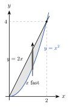

<!-- tillegg: Claude -->
Oppgavene blander alt om dobbeltintegraler: rektangler og generelle områder, valg og bytte av rekkefølge, polarkoordinater, variabelbytte, anvendelser og numerisk integrasjon. I mange av dem er den største utfordringen å se *hvilket* verktøy som passer. Start derfor med en skisse av området, og spør deg selv: Hvilken form har området, og hvilken form har integranden?

::: {.kort}
- **Rektangel, pen integrand:** itererte integraler i den rekkefølgen som gir enklest indre integral.
- **Område mellom kurver:** skisse, og loddrette eller vannrette striper.
- **Håpløst indre integral:** bytt rekkefølge via skissen.
- **Sirkler og $x^2 + y^2$:** polarkoordinater, $\mathrm{d}A = r\,\mathrm{d}r\,\mathrm{d}\theta$.
- **Parallellogram eller skjeve linjer:** lineært variabelbytte og jacobideterminanten.
- **Ingen antiderivert i det hele tatt:** numerisk integrasjon.
:::

Prøv selv før du åpner løsningen.

:::: {.oppgaver}

::: {.oppgave tittel="Hvilket verktøy?" krever="dobbeltintegraler/rektangler, dobbeltintegraler/generelle-omrader, dobbeltintegraler/polarkoordinater, dobbeltintegraler/variabelbytte"}
<!-- tillegg: Claude -->
Du skal ikke regne ut integralene. Avgjør bare hvilken framgangsmåte som passer best, og begrunn svaret.

a)  $\displaystyle\iint_D \mathrm{e}^{-(x^2 + y^2)}\,\mathrm{d}A$, der $D$ er skiven $x^2 + y^2 \le 9$.

b)  $\displaystyle\int_0^1\!\!\int_{y}^{1} \frac{\sin x}{x}\,\mathrm{d}x\,\mathrm{d}y$

c)  $\displaystyle\iint_D (x - y)\,\mathrm{e}^{x + y}\,\mathrm{d}A$, der $D$ er avgrenset av $x + y = 0$, $x + y = 1$, $x - y = 0$ og $x - y = 2$.

d)  $\displaystyle\iint_{[0,1]^2} \cos(x^2 y^3)\,\mathrm{d}A$

:::

::: {.oppgave tittel="Over et rektangel" krever="dobbeltintegraler/rektangler"}
<!-- tillegg: Claude -->
Regn ut $\displaystyle\iint_R (6x^2y + 2)\,\mathrm{d}A$ der $R = [0, 1] \times [0, 2]$.

::: {.fasit}
$8$
:::
:::

::: {.oppgave tittel="Den lure rekkefølgen" krever="dobbeltintegraler/rektangler"}
<!-- tillegg: Claude -->
Regn ut $\displaystyle\iint_R x\cos(xy)\,\mathrm{d}A$ der $R = [0, 1] \times [0, \tfrac{\pi}{2}]$. Hvilken rekkefølge er enklest?

::: {.fasit}
$\frac{2}{\pi}$
:::
:::

::: {.oppgave tittel="Mellom en parabel og en linje" krever="dobbeltintegraler/generelle-omrader"}
<!-- tillegg: Claude -->
La $D$ være området mellom parabelen $y = x^2$ og linja $y = 2x$.

{.tikz-fig style="width:240px" fig-alt="Området mellom parabelen y lik x i andre og linja y lik 2x, fra origo til skjæringspunktet (2, 4). En loddrett stripe ved fast x går fra parabelen opp til linja."}

a)  Sett opp $\displaystyle\iint_D x\,\mathrm{d}A$ med loddrette striper, og regn det ut.

b)  Sett opp det samme integralet med vannrette striper, og kontroller svaret.

c)  Finn arealet av $D$ og $x$-koordinaten $\bar x$ til tyngdepunktet.

::: {.fasit}
a) $\tfrac43$ · c) $\tfrac43$ · c) $1$
:::
:::

::: {.oppgave tittel="Bytt rekkefølge" niva="Middels" krever="dobbeltintegraler/generelle-omrader"}
<!-- tillegg: Claude -->
Regn ut
$$
\int_0^2\!\!\int_{x/2}^{1} \cos(y^2)\,\mathrm{d}y\,\mathrm{d}x
$$
Skisser området først.

::: {.fasit}
$0.841$
:::
:::

::: {.oppgave tittel="Polarkoordinater gjør det enkelt" niva="Middels" krever="dobbeltintegraler/polarkoordinater"}
<!-- tillegg: Claude -->
Regn ut
$$
\iint_D \frac{1}{1 + x^2 + y^2}\,\mathrm{d}A
$$
der $D$ er skiven $x^2 + y^2 \le 4$.

::: {.fasit}
$5.06$
:::
:::

::: {.oppgave tittel="Et skjevt parallellogram" niva="Middels" krever="dobbeltintegraler/variabelbytte"}
<!-- tillegg: Claude -->
La $D$ være parallellogrammet avgrenset av linjene $x + y = 1$, $x + y = 3$, $x - 2y = 0$ og $x - 2y = 3$. Regn ut
$$
\iint_D (x + y)^2\,\mathrm{d}A
$$

::: {.fasit}
$\frac{26}{3}$
:::
:::

::: {.oppgave tittel="Trykket mot en rund luke" niva="Middels" krever="dobbeltintegraler/polarkoordinater, dobbeltintegraler/anvendelser"}
<!-- tillegg: Claude -->
En sirkulær luke med radius $0.50\ \mathrm{m}$ sitter i en loddrett vegg i et vannbasseng. Midten av luka er $3.0\ \mathrm{m}$ under vannflaten. Trykket fra vannet (utover lufttrykket) er $p = \rho\,\mathrm{g}\,d$, der $d$ er dybden. Bruk $\rho = 1.00\cdot10^3\ \mathrm{kg/m^3}$ og $\mathrm{g} = 9.81\ \mathrm{m/s^2}$.

a)  Legg origo i midten av luka med $y$-aksen oppover. Vis at kraften fra vannet er
$$
F = \rho\,\mathrm{g}\iint_D (3.0\ \mathrm{m} - y)\,\mathrm{d}A
$$

b)  Regn ut kraften. Bruk symmetri.

::: {.fasit}
$23\ \mathrm{kN}$
:::
:::

::: {.oppgave tittel="Når ingen antiderivert finnes" niva="Utfordrende" krever="dobbeltintegraler/numerisk"}
<!-- tillegg: Claude -->
Integralet
$$
I = \iint_{[0,1]^2} \sqrt{1 + x^2 + y^2}\,\mathrm{d}A
$$
kan ikke regnes ut enkelt for hånd.

a)  Tilnærm $I$ med midtpunktsregelen og $2 \times 2$ kvadrater for hånd.

b)  Er tilnærmingen for stor eller for liten? Begrunn uten å regne ut $I$.

c)  Bruk programmet under og finn $I$ med fire sikre desimaler. Hvor mye minker feilen hver gang $n$ dobles?

```{.python .kjor}
import numpy as np

f = lambda x, y: np.sqrt(1 + x**2 + y**2)

def midtpunkt(n):
    h = 1 / n
    c = (np.arange(n) + 0.5) * h        # midtpunktene
    X, Y = np.meshgrid(c, c)
    return np.sum(f(X, Y)) * h * h

for n in [2, 4, 8, 16, 32]:
    print(n, midtpunkt(n))
```

::: {.fasit}
a) $1.267$ · c) $1.2808$
:::
:::

::::
