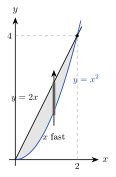

<!-- tillegg: Claude -->
Oppgavene blander alt om dobbeltintegraler: rektangler og generelle områder, valg og bytte av rekkefølge, polarkoordinater, variabelbytte, anvendelser og numerisk integrasjon. I mange av dem er den største utfordringen å se *hvilket* verktøy som passer. Start derfor med en skisse av området, og spør deg selv: Hvilken form har området, og hvilken form har integranden?

::: {.kort}
- **Rektangel, pen integrand:** itererte integraler i den rekkefølgen som gir enklest indre integral.
- **Område mellom kurver:** skisse, og loddrette eller vannrette striper.
- **Håpløst indre integral:** bytt rekkefølge via skissen.
- **Sirkler og $x^2 + y^2$:** polarkoordinater, $\mathrm{d}A = r\,\mathrm{d}r\,\mathrm{d}\theta$.
- **Parallellogram eller skjeve linjer:** lineært variabelbytte og jacobideterminanten.
- **Ingen antiderivert i det hele tatt:** numerisk integrasjon.
:::

Prøv selv før du åpner løsningen.

:::: {.oppgaver}

::: {.oppgave tittel="Hvilket verktøy?"}
<!-- tillegg: Claude -->
Du skal ikke regne ut integralene. Avgjør bare hvilken framgangsmåte som passer best, og begrunn svaret.

a)  $\displaystyle\iint_D \mathrm{e}^{-(x^2 + y^2)}\,\mathrm{d}A$, der $D$ er skiven $x^2 + y^2 \le 9$.

b)  $\displaystyle\int_0^1\!\!\int_{y}^{1} \frac{\sin x}{x}\,\mathrm{d}x\,\mathrm{d}y$

c)  $\displaystyle\iint_D (x - y)\,\mathrm{e}^{x + y}\,\mathrm{d}A$, der $D$ er avgrenset av $x + y = 0$, $x + y = 1$, $x - y = 0$ og $x - y = 2$.

d)  $\displaystyle\iint_{[0,1]^2} \cos(x^2 y^3)\,\mathrm{d}A$

::: {.losning}
**a)** **Polarkoordinater.** Området er en skive og integranden avhenger bare av $x^2 + y^2 = r^2$. Faktoren $r$ fra $\mathrm{d}A = r\,\mathrm{d}r\,\mathrm{d}\theta$ gjør at $r\,\mathrm{e}^{-r^2}$ kan integreres. I kartesiske koordinater finnes ingen antiderivert til $\mathrm{e}^{-x^2}$.

**b)** **Bytt rekkefølge.** $\dfrac{\sin x}{x}$ har ingen antiderivert som kan skrives med vanlige funksjoner. Området er trekanten $0 \le y \le x \le 1$. Med $x$ ytterst blir det indre integralet $\int_0^x \mathrm{d}y = x$, og $x$ forkorter mot nevneren. (Svaret blir $\int_0^1 \sin x\,\mathrm{d}x = 1 - \cos 1$.)

**c)** **Lineært variabelbytte** $u = x + y$, $v = x - y$. Området blir rektangelet $0 \le u \le 1$, $0 \le v \le 2$, og integranden blir $v\,\mathrm{e}^{u}$, et produkt av én funksjon av $u$ og én av $v$.

**d)** **Numerisk.** Området er pent, men $\cos(x^2y^3)$ har ingen antiderivert med vanlige funksjoner i noen av rekkefølgene, og ingen variabelbytte gjør den enkel. Midtpunkts- eller Simpsons regel gir raskt et godt svar.
:::
:::

::: {.oppgave tittel="Over et rektangel"}
<!-- tillegg: Claude -->
Regn ut $\displaystyle\iint_R (6x^2y + 2)\,\mathrm{d}A$ der $R = [0, 1] \times [0, 2]$.

::: {.losning}
Vi integrerer over $x$ først, med $y$ som konstant:
$$
\int_0^1 (6x^2y + 2)\,\mathrm{d}x = \Big[\,2x^3y + 2x\,\Big]_0^1 = 2y + 2
$$
Så over $y$:
$$
\int_0^2 (2y + 2)\,\mathrm{d}y = \Big[\,y^2 + 2y\,\Big]_0^2 = 4 + 4 = \underline{\underline{8}}
$$
Kontroll: Den andre rekkefølgen gir $\int_0^1 \big[3x^2y^2 + 2y\big]_0^2\,\mathrm{d}x = \int_0^1 (12x^2 + 4)\,\mathrm{d}x = 4 + 4 = 8$.
:::
:::

::: {.oppgave tittel="Den lure rekkefølgen"}
<!-- tillegg: Claude -->
Regn ut $\displaystyle\iint_R x\cos(xy)\,\mathrm{d}A$ der $R = [0, 1] \times [0, \tfrac{\pi}{2}]$. Hvilken rekkefølge er enklest?

::: {.losning}
Integrerer vi over $x$ først, må vi bruke delvis integrasjon. Over $y$ først er $x$ en konstant, og $x$ foran cosinus er nettopp den indre deriverte av $xy$ med hensyn på $y$:
$$
\int_0^{\pi/2} x\cos(xy)\,\mathrm{d}y = \Big[\,\sin(xy)\,\Big]_{y=0}^{y=\pi/2} = \sin\!\Big(\frac{\pi x}{2}\Big)
$$
Så over $x$:
$$
\int_0^1 \sin\!\Big(\frac{\pi x}{2}\Big)\,\mathrm{d}x = \Big[-\frac{2}{\pi}\cos\!\Big(\frac{\pi x}{2}\Big)\Big]_0^1 = -\frac{2}{\pi}(0 - 1) = \underline{\underline{\frac{2}{\pi}}} \approx 0.637
$$
:::
:::

::: {.oppgave tittel="Mellom en parabel og en linje"}
<!-- tillegg: Claude -->
La $D$ være området mellom parabelen $y = x^2$ og linja $y = 2x$.

{.tikz-fig style="width:240px" fig-alt="Området mellom parabelen y lik x i andre og linja y lik 2x, fra origo til skjæringspunktet (2, 4). En loddrett stripe ved fast x går fra parabelen opp til linja."}

a)  Sett opp $\displaystyle\iint_D x\,\mathrm{d}A$ med loddrette striper, og regn det ut.

b)  Sett opp det samme integralet med vannrette striper, og kontroller svaret.

c)  Finn arealet av $D$ og $x$-koordinaten $\bar x$ til tyngdepunktet.

::: {.losning}
Kurvene skjærer hverandre der $x^2 = 2x$, altså i $x = 0$ og $x = 2$. Mellom dem ligger linja øverst (for eksempel er $2\cdot1 > 1^2$).

**a)** En loddrett stripe ved fast $x$ går fra $y = x^2$ til $y = 2x$:
$$
\int_0^2\!\!\int_{x^2}^{2x} x\,\mathrm{d}y\,\mathrm{d}x = \int_0^2 x(2x - x^2)\,\mathrm{d}x = \Big[\,\tfrac23x^3 - \tfrac14x^4\,\Big]_0^2 = \tfrac{16}{3} - 4 = \underline{\underline{\tfrac43}}
$$

**b)** Vi løser kurvene for $x$: Linja er $x = y/2$ og parabelen er $x = \sqrt{y}$. En vannrett stripe ved fast $y$ går fra linja til parabelen, og $y$ går fra $0$ til $4$:
$$
\int_0^4\!\!\int_{y/2}^{\sqrt{y}} x\,\mathrm{d}x\,\mathrm{d}y = \int_0^4 \Big(\frac{y}{2} - \frac{y^2}{8}\Big)\mathrm{d}y = \Big[\,\tfrac14y^2 - \tfrac{1}{24}y^3\,\Big]_0^4 = 4 - \tfrac{8}{3} = \tfrac43
$$
Samme svar.

**c)** Arealet er integralet av $1$:
$$
A = \int_0^2 (2x - x^2)\,\mathrm{d}x = 4 - \tfrac83 = \underline{\underline{\tfrac43}}
$$
Tyngdepunktet:
$$
\bar x = \frac{1}{A}\iint_D x\,\mathrm{d}A = \frac{4/3}{4/3} = \underline{\underline{1}}
$$
Høyden på stripen, $2x - x^2 = 1 - (x - 1)^2$, er symmetrisk om $x = 1$. Derfor ligger tyngdepunktet midt mellom $x = 0$ og $x = 2$, selv om selve området ikke er symmetrisk.
:::
:::

::: {.oppgave tittel="Bytt rekkefølge" niva="Middels"}
<!-- tillegg: Claude -->
Regn ut
$$
\int_0^2\!\!\int_{x/2}^{1} \cos(y^2)\,\mathrm{d}y\,\mathrm{d}x
$$
Skisser området først.

::: {.losning}
Det indre integralet $\int\cos(y^2)\,\mathrm{d}y$ kan ikke skrives med vanlige funksjoner, så vi bytter rekkefølge.

**Området.** $0 \le x \le 2$, og $y$ går fra linja $y = x/2$ opp til $y = 1$. Det er trekanten med hjørner i $(0, 0)$, $(0, 1)$ og $(2, 1)$, mellom $y$-aksen og linja $x = 2y$.

**Byttet rekkefølge.** En vannrett stripe ved fast $y$ går fra $x = 0$ til $x = 2y$, og $y$ går fra $0$ til $1$:
$$
\int_0^1\!\!\int_0^{2y} \cos(y^2)\,\mathrm{d}x\,\mathrm{d}y = \int_0^1 2y\cos(y^2)\,\mathrm{d}y
$$
Med $u = y^2$, $\mathrm{d}u = 2y\,\mathrm{d}y$:
$$
\int_0^1 \cos u\,\mathrm{d}u = \sin 1 \approx \underline{\underline{0.841}}
$$
:::
:::

::: {.oppgave tittel="Polarkoordinater gjør det enkelt" niva="Middels"}
<!-- tillegg: Claude -->
Regn ut
$$
\iint_D \frac{1}{1 + x^2 + y^2}\,\mathrm{d}A
$$
der $D$ er skiven $x^2 + y^2 \le 4$.

::: {.losning}
Skiven er $0 \le r \le 2$, $0 \le \theta \le 2\pi$, og $1 + x^2 + y^2 = 1 + r^2$. Husk faktoren $r$:
$$
\int_0^{2\pi}\!\!\int_0^2 \frac{r}{1 + r^2}\,\mathrm{d}r\,\mathrm{d}\theta = 2\pi\Big[\,\tfrac12\ln(1 + r^2)\,\Big]_0^2 = \pi\ln 5 \approx \underline{\underline{5.06}}
$$
Det er faktoren $r$ som gjør integralet mulig: Telleren $r$ er (nesten) den deriverte av nevneren $1 + r^2$.
:::
:::

::: {.oppgave tittel="Et skjevt parallellogram" niva="Middels"}
<!-- tillegg: Claude -->
La $D$ være parallellogrammet avgrenset av linjene $x + y = 1$, $x + y = 3$, $x - 2y = 0$ og $x - 2y = 3$. Regn ut
$$
\iint_D (x + y)^2\,\mathrm{d}A
$$

::: {.losning}
Linjene sier oss hva de nye variablene bør være: $u = x + y$ og $v = x - 2y$. Da blir $D$ rektangelet $1 \le u \le 3$, $0 \le v \le 3$.

**Jacobideterminanten.** Det er enklest å regne ut den omvendte:
$$
\frac{\partial(u, v)}{\partial(x, y)} = \begin{vmatrix} 1 & 1 \\ 1 & -2 \end{vmatrix} = -2 - 1 = -3
\quad\implies\quad
\left|\frac{\partial(x, y)}{\partial(u, v)}\right| = \frac{1}{3}
$$
Altså er $\mathrm{d}A = \tfrac13\,\mathrm{d}u\,\mathrm{d}v$.

**Integralet.**
$$
\iint_D (x + y)^2\,\mathrm{d}A = \int_0^3\!\!\int_1^3 u^2\cdot\frac13\,\mathrm{d}u\,\mathrm{d}v = \frac13\cdot3\cdot\Big[\,\tfrac13u^3\,\Big]_1^3 = \frac{27 - 1}{3} = \underline{\underline{\frac{26}{3}}} \approx 8.67
$$
Kontroll av faktoren: Arealet av $D$ blir $\tfrac13\cdot2\cdot3 = 2$. Hjørnene i $D$ er $(\tfrac23, \tfrac13)$, $(2, 1)$, $(3, 0)$ og $(\tfrac53, -\tfrac23)$, og kryssproduktet av to kantvektorer gir også arealet $2$.
:::
:::

::: {.oppgave tittel="Trykket mot en rund luke" niva="Middels"}
<!-- tillegg: Claude -->
En sirkulær luke med radius $0.50\ \mathrm{m}$ sitter i en loddrett vegg i et vannbasseng. Midten av luka er $3.0\ \mathrm{m}$ under vannflaten. Trykket fra vannet (utover lufttrykket) er $p = \rho\,\mathrm{g}\,d$, der $d$ er dybden. Bruk $\rho = 1.00\cdot10^3\ \mathrm{kg/m^3}$ og $\mathrm{g} = 9.81\ \mathrm{m/s^2}$.

a)  Legg origo i midten av luka med $y$-aksen oppover. Vis at kraften fra vannet er
$$
F = \rho\,\mathrm{g}\iint_D (3.0\ \mathrm{m} - y)\,\mathrm{d}A
$$

b)  Regn ut kraften. Bruk symmetri.

::: {.losning}
**a)** Et lite flatestykke $\mathrm{d}A$ i høyden $y$ over midten ligger på dybden $d = 3.0\ \mathrm{m} - y$. Der er trykket $\rho\,\mathrm{g}\,(3.0\ \mathrm{m} - y)$, og kraften på stykket er trykk ganger areal. Alle disse kreftene står vinkelrett på veggen, altså i samme retning, så vi kan summere størrelsene. Det gir integralet.

**b)** Vi deler integralet i to:
$$
F = \rho\,\mathrm{g}\Big(3.0\ \mathrm{m}\iint_D \mathrm{d}A - \iint_D y\,\mathrm{d}A\Big)
$$
Skiven er symmetrisk om $x$-aksen, så bidragene fra $y > 0$ og $y < 0$ opphever hverandre: $\iint_D y\,\mathrm{d}A = 0$. (I polarkoordinater: $\int_0^{2\pi}\sin\theta\,\mathrm{d}\theta = 0$.) Det første integralet er arealet $\pi(0.50\ \mathrm{m})^2$:
$$
F = 1.00\cdot10^3\ \mathrm{kg/m^3}\cdot9.81\ \mathrm{m/s^2}\cdot3.0\ \mathrm{m}\cdot\pi\,(0.50\ \mathrm{m})^2 = 2.31\cdot10^4\ \mathrm{N} \approx \underline{\underline{23\ \mathrm{kN}}}
$$
Kraften er altså trykket i midten av luka ganger arealet. Det gjelder for alle flater, fordi middeldybden er dybden til tyngdepunktet av flaten.
:::
:::

::: {.oppgave tittel="Når ingen antiderivert finnes" niva="Utfordrende"}
<!-- tillegg: Claude -->
Integralet
$$
I = \iint_{[0,1]^2} \sqrt{1 + x^2 + y^2}\,\mathrm{d}A
$$
kan ikke regnes ut enkelt for hånd.

a)  Tilnærm $I$ med midtpunktsregelen og $2 \times 2$ kvadrater for hånd.

b)  Er tilnærmingen for stor eller for liten? Begrunn uten å regne ut $I$.

c)  Bruk programmet under og finn $I$ med fire sikre desimaler. Hvor mye minker feilen hver gang $n$ dobles?

```{.python .kjor}
import numpy as np

f = lambda x, y: np.sqrt(1 + x**2 + y**2)

def midtpunkt(n):
    h = 1 / n
    c = (np.arange(n) + 0.5) * h        # midtpunktene
    X, Y = np.meshgrid(c, c)
    return np.sum(f(X, Y)) * h * h

for n in [2, 4, 8, 16, 32]:
    print(n, midtpunkt(n))
```

::: {.losning}
**a)** Kvadratene har side $h = 0.5$ og areal $0.25$, med midtpunkter i $(0.25, 0.25)$, $(0.25, 0.75)$, $(0.75, 0.25)$ og $(0.75, 0.75)$:
$$
\begin{aligned}
f(0.25, 0.25) &= \sqrt{1.125} = 1.0607 \\
f(0.25, 0.75) = f(0.75, 0.25) &= \sqrt{1.625} = 1.2748 \\
f(0.75, 0.75) &= \sqrt{2.125} = 1.4577
\end{aligned}
$$
$$
I \approx 0.25\cdot(1.0607 + 2\cdot1.2748 + 1.4577) = \underline{\underline{1.267}}
$$

**b)** Funksjonen $\sqrt{1 + x^2 + y^2}$ krummer oppover (den er konveks, som bunnen av en skål). For en slik funksjon ligger verdien i midtpunktet *under* gjennomsnittet over kvadratet, så midtpunktsregelen gir for **lite**.

**c)** Programmet gir omtrent
$$
1.26698,\quad 1.27735,\quad 1.27993,\quad 1.28057,\quad 1.28074
$$
for $n = 2, 4, 8, 16, 32$. Verdiene øker mot $I \approx \underline{\underline{1.2808}}$ (en presis beregning gir $1.28079$). Feilen er omtrent $0.0138$, $0.0034$, $0.00086$ og $0.00021$, altså cirka **fire ganger mindre** hver gang $n$ dobles. Det passer med at midtpunktsregelen har feil proporsjonal med $h^2$.
:::
:::

::::
