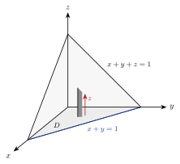

<!-- video: kommer (videoer/flervariabel-kalkulus/02-01-trippelintegraler) -->
{fig-alt="Video kommer"}

<!-- tillegg: Claude -->
Hvor tung er en snøfonn? Snøen er løs øverst og pakket hardt nederst, så du kan ikke bare gange volumet med én tetthet. Du må dele fonnen opp i små biter, gange volumet av hver bit med tettheten akkurat der, og summere. Det er et **trippelintegral**. Idéen er den samme som for dobbeltintegraler, bare med én dimensjon til: Vi summerer over et område i rommet i stedet for i planet.

## Fra Riemann-sum til trippelintegral

La $f(x, y, z)$ være en funksjon på en boks $B = [a, b] \times [c, d] \times [p, q]$. Vi deler boksen i mange små bokser med volum $\Delta V = \Delta x\,\Delta y\,\Delta z$, velger et punkt $(x_i, y_j, z_k)$ i hver, og summerer:
$$
\sum_{i}\sum_{j}\sum_{k} f(x_i, y_j, z_k)\,\Delta V
$$
Når boksene blir uendelig små, går summen mot **trippelintegralet**:

::: {.callout-note title="Definisjon: Trippelintegral"}
$$
\iiint_B f(x, y, z)\,\mathrm{d}V = \lim_{\Delta V \to 0}\ \sum_{i, j, k} f(x_i, y_j, z_k)\,\Delta V
$$
:::

Grafen til $f$ ligger i fire dimensjoner, så vi kan ikke tegne integralet som et volum under en flate. Tenk heller på $f$ som en **tetthet**: Er $f$ massen per volum, er $f\,\Delta V$ massen av en liten boks, og integralet er den totale massen. To spesialtilfeller er verdt å huske:

::: {.kort}
- **$f = 1$ gir volum.** $\iiint_E 1\,\mathrm{d}V$ er volumet av $E$.
- **$f = \rho$ gir masse.** Med tettheten $\rho(x, y, z)$ er $\iiint_E \rho\,\mathrm{d}V$ massen av legemet.
:::

## Itererte integraler over en boks

Akkurat som i planet regner vi ut integralet ett lag om gangen, med de andre variablene holdt fast. Over en boks kan rekkefølgen velges fritt; det finnes seks muligheter, og alle gir samme svar:
$$
\iiint_B f\,\mathrm{d}V = \int_a^b\!\!\int_c^d\!\!\int_p^q f(x, y, z)\,\mathrm{d}z\,\mathrm{d}y\,\mathrm{d}x
$$
Det innerste integralet regnes først, med $x$ og $y$ som konstanter.

::: {.eksempel}
**Eksempel: Over en boks.** Regn ut $\displaystyle\iiint_B xyz^2\,\mathrm{d}V$ der $B = [0, 1] \times [0, 2] \times [0, 3]$.

::: {.losning}
Integranden er et produkt av én funksjon av hver variabel, og grensene er konstanter. Da deler integralet seg i tre enkle integraler:
$$
\iiint_B xyz^2\,\mathrm{d}V = \int_0^1 x\,\mathrm{d}x\cdot\int_0^2 y\,\mathrm{d}y\cdot\int_0^3 z^2\,\mathrm{d}z = \frac12\cdot2\cdot9 = \underline{\underline{9}}
$$
Gjør vi det lag for lag, får vi det samme: $\int_0^3 xyz^2\,\mathrm{d}z = 9xy$, så $\int_0^2 9xy\,\mathrm{d}y = 18x$, og $\int_0^1 18x\,\mathrm{d}x = 9$.
:::
:::

## Områder mellom to flater

De fleste legemer er ikke bokser. Et område $E$ kalles **$z$-enkelt** hvis det ligger mellom en nedre flate $z = u_1(x, y)$ og en øvre flate $z = u_2(x, y)$ over et område $D$ i $xy$-planet. $D$ er «skyggen» av legemet når lyset kommer rett ovenfra.

Da regner vi i to trinn: Først summerer vi langs en loddrett stav fra bunnen til toppen, og så summerer vi stavene over $D$ med et dobbeltintegral:

::: {.graa}
$$
\iiint_E f\,\mathrm{d}V = \iint_D \left[\int_{u_1(x,y)}^{u_2(x,y)} f(x, y, z)\,\mathrm{d}z\right]\mathrm{d}A
$$
:::

::: {.steg}
1. Finn bunnflaten og toppflaten. De gir grensene for $z$.
2. Finn skyggen $D$ i $xy$-planet. Ofte er det der toppflaten og bunnflaten møtes.
3. Sett opp dobbeltintegralet over $D$ som før, med loddrette eller vannrette striper.
:::

{.tikz-fig style="width:380px" fig-alt="Tetraederet avgrenset av koordinatplanene og planet x + y + z = 1. Grunnflaten er trekanten D i xy-planet under linja x + y = 1. En loddrett stav står i et punkt i D og går fra z lik 0 opp til planet."}

::: {.eksempel}
**Eksempel: Tetraederet.** Finn volumet av tetraederet $E$ som avgrenses av koordinatplanene og planet $x + y + z = 1$.

::: {.losning}
**Grensene for $z$.** Bunnen er $z = 0$ og toppen er planet $z = 1 - x - y$.

**Skyggen $D$.** Toppen møter bunnen der $1 - x - y = 0$, altså langs linja $x + y = 1$. Skyggen er trekanten $0 \le x \le 1$, $0 \le y \le 1 - x$.

**Integralet.**
$$
V = \int_0^1\!\!\int_0^{1-x}\!\!\int_0^{1-x-y} \mathrm{d}z\,\mathrm{d}y\,\mathrm{d}x = \int_0^1\!\!\int_0^{1-x} (1 - x - y)\,\mathrm{d}y\,\mathrm{d}x
$$
Med $s = 1 - x$ er det indre integralet $\int_0^{s} (s - y)\,\mathrm{d}y = \tfrac12 s^2$:
$$
V = \int_0^1 \tfrac12(1 - x)^2\,\mathrm{d}x = \Big[-\tfrac16(1 - x)^3\Big]_0^1 = \underline{\underline{\tfrac16}}
$$
Det stemmer med formelen for en pyramide: $\tfrac13\cdot\text{grunnflate}\cdot\text{høyde} = \tfrac13\cdot\tfrac12\cdot1 = \tfrac16$.
:::
:::

::: {.eksempel}
**Eksempel: Kuttet sylinder.** Legemet $E$ avgrenses av den parabolske sylinderen $y = x^2$ og planene $z = 0$ og $y + z = 1$. Finn volumet.

::: {.losning}
**Grensene for $z$.** Bunnen er $z = 0$, toppen er planet $z = 1 - y$.

**Skyggen $D$.** Sylinderflaten $y = x^2$ står loddrett og avgrenser legemet sidelengs. Toppen når bunnen der $y = 1$. Skyggen er området mellom parabelen $y = x^2$ og linja $y = 1$, altså $-1 \le x \le 1$, $x^2 \le y \le 1$.

**Integralet.**
$$
V = \int_{-1}^{1}\!\!\int_{x^2}^{1}(1 - y)\,\mathrm{d}y\,\mathrm{d}x = \int_{-1}^{1}\Big(\tfrac12 - x^2 + \tfrac12x^4\Big)\mathrm{d}x = 1 - \tfrac23 + \tfrac15 = \underline{\underline{\tfrac{8}{15}}}
$$
:::
:::

### Andre retninger

Noen ganger er det enklere å la stavene gå vannrett. Et område er **$x$-enkelt** hvis det ligger mellom to flater $x = u_1(y, z)$ og $x = u_2(y, z)$ over en skygge i $yz$-planet, og **$y$-enkelt** hvis det ligger mellom $y = u_1(x, z)$ og $y = u_2(x, z)$ over en skygge i $xz$-planet. Velg den retningen som gir den enkleste skyggen og de enkleste grensene. Et legeme formet som en skål som ligger på siden, $y \ge x^2 + z^2$, er for eksempel $y$-enkelt med en sirkelskive som skygge (se oppgavene).

## Masse og tyngdepunkt

Med tettheten $\rho(x, y, z)$ er massen og tyngdepunktet $(\bar x, \bar y, \bar z)$

::: {.graa}
$$
m = \iiint_E \rho\,\mathrm{d}V, \qquad
\bar x = \frac{1}{m}\iiint_E x\,\rho\,\mathrm{d}V, \quad
\bar y = \frac{1}{m}\iiint_E y\,\rho\,\mathrm{d}V, \quad
\bar z = \frac{1}{m}\iiint_E z\,\rho\,\mathrm{d}V
$$
:::

Tyngdepunktet er et vektet gjennomsnitt av posisjonene, der hver liten bit teller med sin masse. Er tettheten konstant, forkortes den bort, og tyngdepunktet bestemmes bare av formen.

::: {.eksempel}
**Eksempel: En kloss som er tyngst nederst.** En kubisk kloss har side $a = 0.10\ \mathrm{m}$ og står med bunnen i $z = 0$. Materialet er tettest nederst, med $\rho = \rho_0 - kz$, der $\rho_0 = 3.0\cdot10^3\ \mathrm{kg/m^3}$ og $k = 1.0\cdot10^4\ \mathrm{kg/m^4}$. Finn massen og høyden $\bar z$ til tyngdepunktet.

::: {.losning}
Tettheten avhenger bare av $z$, så integralet over $x$ og $y$ gir bare grunnflaten $a^2$:
$$
m = \int_0^a\!\!\int_0^a\!\!\int_0^a (\rho_0 - kz)\,\mathrm{d}z\,\mathrm{d}y\,\mathrm{d}x = a^2\Big(\rho_0 a - \tfrac12 k a^2\Big)
$$
$$
m = (0.10\ \mathrm{m})^2\Big(3.0\cdot10^3\ \mathrm{kg/m^3}\cdot0.10\ \mathrm{m} - \tfrac12\cdot1.0\cdot10^4\ \mathrm{kg/m^4}\cdot(0.10\ \mathrm{m})^2\Big) = 0.010\ \mathrm{m^2}\cdot250\ \mathrm{kg/m^2} = \underline{\underline{2.5\ \mathrm{kg}}}
$$
Momentet om bunnen:
$$
\iiint z\rho\,\mathrm{d}V = a^2\Big(\tfrac12\rho_0 a^2 - \tfrac13 k a^3\Big) = 0.010\ \mathrm{m^2}\cdot(15 - 3.33)\ \mathrm{kg/m} = 0.117\ \mathrm{kg\,m}
$$
$$
\bar z = \frac{0.117\ \mathrm{kg\,m}}{2.5\ \mathrm{kg}} = 0.0467\ \mathrm{m} \approx \underline{\underline{4.7\ \mathrm{cm}}}
$$
Tyngdepunktet ligger litt under midten ($5.0\ \mathrm{cm}$), slik det skal når klossen er tyngst nederst. Av symmetri er $\bar x = \bar y = 5.0\ \mathrm{cm}$.
:::
:::

## Prøv selv: kontroll med `tplquad`

`scipy` regner ut trippelintegraler numerisk med `tplquad`. Legg merke til rekkefølgen: Funksjonen tar argumentene i rekkefølgen $(z, y, x)$, altså innerst først, og grensene gis utenfra og inn. Programmet kontrollerer tetraederet og klossen. Endre tettheten i klossen og se hvordan tyngdepunktet flytter seg.

```{.python .kjor}
from scipy.integrate import tplquad

# Tetraederet: 0 <= x <= 1, 0 <= y <= 1 - x, 0 <= z <= 1 - x - y
V, feil = tplquad(lambda z, y, x: 1,
                  0, 1,
                  lambda x: 0, lambda x: 1 - x,
                  lambda x, y: 0, lambda x, y: 1 - x - y)
print("Volum av tetraederet:", V, " (eksakt 1/6 =", 1/6, ")")

# Klossen med tetthet rho = rho0 - k z
a, rho0, k = 0.10, 3.0e3, 1.0e4
rho = lambda z: rho0 - k * z
m, _  = tplquad(lambda z, y, x: rho(z),     0, a, 0, a, 0, a)
Mz, _ = tplquad(lambda z, y, x: z * rho(z), 0, a, 0, a, 0, a)
print(f"Masse: {m:.3f} kg,  tyngdepunkt: z = {100*Mz/m:.2f} cm")
```

:::: {.oppgaver}

::: {.oppgave tittel="Over en boks"}
<!-- tillegg: Claude -->
Regn ut $\displaystyle\iiint_B (x + y + z)\,\mathrm{d}V$ der $B = [0, 1] \times [0, 1] \times [0, 2]$.

::: {.losning}
Vi deler integralet i tre ledd. Boksen har volum $1\cdot1\cdot2 = 2$.
$$
\iiint_B x\,\mathrm{d}V = \int_0^1 x\,\mathrm{d}x\cdot1\cdot2 = \tfrac12\cdot2 = 1, \qquad
\iiint_B y\,\mathrm{d}V = 1, \qquad
\iiint_B z\,\mathrm{d}V = 1\cdot1\cdot\int_0^2 z\,\mathrm{d}z = 2
$$
Til sammen $1 + 1 + 2 = \underline{\underline{4}}$.

Kontroll: Middelverdien av $x + y + z$ over boksen er $\tfrac12 + \tfrac12 + 1 = 2$, og middelverdi ganger volum er $2\cdot2 = 4$.
:::
:::

::: {.oppgave tittel="Et skjevt tetraeder"}
<!-- tillegg: Claude -->
Tetraederet $E$ har hjørner i $(0, 0, 0)$, $(2, 0, 0)$, $(0, 3, 0)$ og $(0, 0, 6)$.

a)  Vis at det skrå sideplanet er $\dfrac{x}{2} + \dfrac{y}{3} + \dfrac{z}{6} = 1$.

b)  Sett opp volumet som et trippelintegral og regn det ut.

::: {.losning}
**a)** Planet skjærer aksene i $x = 2$, $y = 3$ og $z = 6$. Setter vi inn $(2, 0, 0)$, $(0, 3, 0)$ og $(0, 0, 6)$ i likningen, får vi $1$ hver gang, og en lineær likning bestemmes av tre punkter.

**b)** Toppen er $z = 6\big(1 - \tfrac{x}{2} - \tfrac{y}{3}\big) = 6 - 3x - 2y$. Skyggen er trekanten under linja $\tfrac{x}{2} + \tfrac{y}{3} = 1$, altså $0 \le x \le 2$, $0 \le y \le 3 - \tfrac32 x$:
$$
V = \int_0^2\!\!\int_0^{3 - 3x/2}\!\!\int_0^{6 - 3x - 2y} \mathrm{d}z\,\mathrm{d}y\,\mathrm{d}x = \int_0^2\!\!\int_0^{3 - 3x/2}(6 - 3x - 2y)\,\mathrm{d}y\,\mathrm{d}x
$$
Med $s = 3 - \tfrac32x$ er $6 - 3x = 2s$, og det indre integralet er $\int_0^s (2s - 2y)\,\mathrm{d}y = s^2$:
$$
V = \int_0^2 \Big(3 - \tfrac32x\Big)^2\mathrm{d}x = \Big[-\tfrac29\Big(3 - \tfrac32x\Big)^3\Big]_0^2 = \tfrac29\cdot27 = \underline{\underline{6}}
$$
Kontroll med pyramideformelen: $\tfrac13\cdot\big(\tfrac12\cdot2\cdot3\big)\cdot6 = 6$.
:::
:::

::: {.oppgave tittel="Under en buet takflate" niva="Middels"}
<!-- tillegg: Claude -->
Legemet $E$ ligger mellom $z = 0$ og den parabolske sylinderflaten $z = 1 - x^2$, og mellom planene $y = 0$ og $y = 2$ (som et buet tak over en gang).

a)  Finn volumet.

b)  Finn tyngdepunktet når tettheten er konstant.

::: {.losning}
**a)** Toppen møter bunnen der $x = \pm1$. Skyggen er rektangelet $-1 \le x \le 1$, $0 \le y \le 2$:
$$
V = \int_{-1}^{1}\!\!\int_0^2\!\!\int_0^{1 - x^2}\mathrm{d}z\,\mathrm{d}y\,\mathrm{d}x = 2\int_{-1}^{1}(1 - x^2)\,\mathrm{d}x = 2\cdot\tfrac43 = \underline{\underline{\tfrac83}}
$$

**b)** Av symmetri er $\bar x = 0$ (speiling i $x = 0$) og $\bar y = 1$ (midt mellom endeveggene). For $\bar z$:
$$
\iiint_E z\,\mathrm{d}V = \int_{-1}^{1}\!\!\int_0^2 \tfrac12(1 - x^2)^2\,\mathrm{d}y\,\mathrm{d}x = \int_{-1}^{1}(1 - 2x^2 + x^4)\,\mathrm{d}x = 2 - \tfrac43 + \tfrac25 = \tfrac{16}{15}
$$
$$
\bar z = \frac{16/15}{8/3} = \tfrac25
$$
Tyngdepunktet er $\underline{\underline{(0,\ 1,\ \tfrac25)}}$. Det ligger lavere enn midt i høyden ($\tfrac12$), fordi legemet er bredest nederst.
:::
:::

::: {.oppgave tittel="Skål som ligger på siden" niva="Middels"}
<!-- tillegg: Claude -->
Legemet $E$ avgrenses av paraboloiden $y = x^2 + z^2$ og planet $y = 4$.

a)  Forklar hvorfor det lønner seg å se på $E$ som $y$-enkelt.

b)  Finn volumet. (Du kan bruke polarkoordinater i $xz$-planet.)

::: {.losning}
**a)** Paraboloiden åpner seg langs $y$-aksen. For hver $(x, z)$ går $y$ fra paraboloiden $y = x^2 + z^2$ til planet $y = 4$. Skyggen i $xz$-planet er der de møtes: $x^2 + z^2 \le 4$, en sirkelskive med radius $2$. Ser vi på $E$ som $z$-enkelt, får vi to flater oppe og nede ($z = \pm\sqrt{y - x^2}$) og en mer kronglete skygge.

**b)**
$$
V = \iint_{x^2 + z^2 \le 4} \big(4 - x^2 - z^2\big)\,\mathrm{d}A
$$
Med polarkoordinater $x = r\cos\theta$, $z = r\sin\theta$:
$$
V = \int_0^{2\pi}\!\!\int_0^2 (4 - r^2)\,r\,\mathrm{d}r\,\mathrm{d}\theta = 2\pi\Big[\,2r^2 - \tfrac14r^4\,\Big]_0^2 = 2\pi(8 - 4) = \underline{\underline{8\pi}} \approx 25.1
$$
:::
:::

::: {.oppgave tittel="Snøfonnen" niva="Utfordrende"}
<!-- tillegg: Claude -->
En snøfonn ligger over rektangelet $0 \le x \le L$, $0 \le y \le W$ med $L = 4.0\ \mathrm{m}$ og $W = 2.0\ \mathrm{m}$. Den er høyest ved $x = 0$ og avtar jevnt mot $x = L$, slik at overflaten er $z = h\big(1 - \tfrac{x}{L}\big)$ med $h = 1.5\ \mathrm{m}$. Snøen pakkes sammen av vekten over, så tettheten øker med dybden under toppen av fonnen:
$$
\rho = \rho_1 + k\,(h - z), \qquad \rho_1 = 200\ \mathrm{kg/m^3}, \quad k = 100\ \mathrm{kg/m^4}
$$

a)  Finn volumet av fonnen.

b)  Finn massen.

c)  Finn middeltettheten, og sammenlikn med tettheten i midten av fonnen.

::: {.losning}
**a)** Fonnen er et prisme med trekantet tverrsnitt: $V = \tfrac12 hL\cdot W = \tfrac12\cdot1.5\ \mathrm{m}\cdot4.0\ \mathrm{m}\cdot2.0\ \mathrm{m} = \underline{\underline{6.0\ \mathrm{m^3}}}$.

**b)** La $H(x) = h\big(1 - \tfrac{x}{L}\big)$ være høyden. Det innerste integralet langs en loddrett stav er
$$
\int_0^{H}\big(\rho_1 + k(h - z)\big)\,\mathrm{d}z = \rho_1 H + k\Big(hH - \tfrac12H^2\Big)
$$
Integranden avhenger ikke av $y$, så integralet over $y$ gir faktoren $W$. Over $x$ trenger vi
$$
\int_0^L H\,\mathrm{d}x = \tfrac12 hL, \qquad \int_0^L H^2\,\mathrm{d}x = h^2\int_0^L\Big(1 - \tfrac{x}{L}\Big)^2\mathrm{d}x = \tfrac13h^2L
$$
Dermed er
$$
m = W\Big[\rho_1\cdot\tfrac12hL + k\Big(h\cdot\tfrac12hL - \tfrac12\cdot\tfrac13h^2L\Big)\Big] = W\Big[\tfrac12\rho_1 hL + \tfrac13kh^2L\Big]
$$
$$
m = 2.0\ \mathrm{m}\cdot\big[600\ \mathrm{kg/m} + 300\ \mathrm{kg/m}\big] = 1.8\cdot10^3\ \mathrm{kg} = \underline{\underline{1.8\ \mathrm{t}}}
$$

**c)** Middeltettheten er $m/V = 1.8\cdot10^3\ \mathrm{kg}/6.0\ \mathrm{m^3} = \underline{\underline{3.0\cdot10^2\ \mathrm{kg/m^3}}}$. Midt i fonnens høyeste del, $z = h/2$, er tettheten $\rho_1 + k\,h/2 = 275\ \mathrm{kg/m^3}$. Middeltettheten er større, fordi mye av snøen ligger lavt, der den er hardest pakket.
:::
:::

::::
