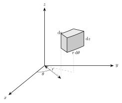

<!-- video: kommer (videoer/flervariabel-kalkulus/02-02-sylinderkoordinater) -->
{fig-alt="Video kommer"}

<!-- tillegg: Claude -->
Et rør, en boks hermetikk, en trakt, en kjegle med is: Mange legemer er symmetriske om en akse. Beskriver vi dem med $x$, $y$ og $z$, får vi kvadratrøtter som $\sqrt{1 - x^2}$ i grensene og stygge integraler. Men vi kjenner allerede løsningen fra planet: [polarkoordinater](../01-dobbeltintegraler/03-polarkoordinater.qmd). **Sylinderkoordinater** er polarkoordinater i $xy$-planet, med $z$-aksen tatt med som den er.

## Koordinatene

Et punkt i rommet beskrives med tre tall $(r, \theta, z)$:

::: {.kort}
- **$r$** Avstanden fra $z$-aksen (ikke fra origo). $r \ge 0$.
- **$\theta$** Vinkelen fra den positive $x$-aksen, målt i $xy$-planet. Vanligvis $0 \le \theta < 2\pi$.
- **$z$** Høyden, den samme som før.
:::

::: {.graa}
$$
x = r\cos\theta, \qquad y = r\sin\theta, \qquad z = z, \qquad\qquad r^2 = x^2 + y^2, \qquad \tan\theta = \frac{y}{x}
$$
:::

Navnet kommer av at flaten $r = \text{konstant}$ er en sylinder om $z$-aksen. Flaten $\theta = \text{konstant}$ er et halvplan som står loddrett ut fra aksen, og $z = \text{konstant}$ er et vannrett plan. Noen vanlige flater blir svært enkle:

| Flate | Kartesisk | Sylindrisk |
|---|---|---|
| Sylinder med radius $a$ | $x^2 + y^2 = a^2$ | $r = a$ |
| Kjegle med spissen i origo | $z = \sqrt{x^2 + y^2}$ | $z = r$ |
| Paraboloide | $z = x^2 + y^2$ | $z = r^2$ |
| Kule med radius $a$ | $x^2 + y^2 + z^2 = a^2$ | $r^2 + z^2 = a^2$ |

## Volumelementet $\mathrm{d}V = r\,\mathrm{d}z\,\mathrm{d}r\,\mathrm{d}\theta$

Når vi deler rommet opp med små endringer $\mathrm{d}r$, $\mathrm{d}\theta$ og $\mathrm{d}z$, får vi små klosser som er buet, ikke rette. Klossen har tre kanter:

{.tikz-fig style="width:420px" fig-alt="En liten buet kloss i sylinderkoordinater, i avstanden r fra z-aksen og ved vinkelen theta. Klossen har kanten dr i radiell retning, den buede kanten r dtheta langs sirkelen, og den loddrette kanten dz."}

::: {.kort}
- **Radielt** Kanten er $\mathrm{d}r$.
- **Langs sirkelen** En bue med radius $r$ og vinkel $\mathrm{d}\theta$ har lengden $r\,\mathrm{d}\theta$.
- **Loddrett** Kanten er $\mathrm{d}z$.
:::

Klossen er så liten at den nesten er en rettvinklet boks, så volumet er produktet av kantene:

::: {.callout-important title="Trippelintegral i sylinderkoordinater"}
$$
\iiint_E f(x, y, z)\,\mathrm{d}V = \iiint f(r\cos\theta,\ r\sin\theta,\ z)\; r\,\mathrm{d}z\,\mathrm{d}r\,\mathrm{d}\theta
$$
:::

Faktoren $r$ er den samme som i polarkoordinater, og av samme grunn: Klosser langt fra aksen er større enn klosser nær aksen, selv om $\mathrm{d}r$, $\mathrm{d}\theta$ og $\mathrm{d}z$ er like. Den er også jacobideterminanten fra [variabelbytte](../01-dobbeltintegraler/04-variabelbytte.qmd). **Glem aldri $r$-en.** Det er den vanligste feilen.

::: {.callout-tip title="Når lønner det seg?"}
Bruk sylinderkoordinater når legemet er symmetrisk om en akse (sylindre, kjegler, paraboloider, rør), eller når uttrykket $x^2 + y^2$ dukker opp i integranden eller grensene. Er aksen ikke $z$-aksen, gir du aksene nye navn, så den blir det.
:::

## Fremgangsmåte

Oppskriften er den samme som for kartesiske koordinater: først $z$ langs en loddrett stav, så skyggen $D$ i $xy$-planet, nå i polarkoordinater.

::: {.steg}
1. **Grensene for $z$:** Skriv bunnflaten og toppflaten med $r$ og $\theta$: $u_1(r, \theta) \le z \le u_2(r, \theta)$.
2. **Skyggen $D$:** Finn hvor toppen og bunnen møtes, og beskriv skyggen med $r$ og $\theta$.
3. **Integranden:** Bytt ut $x$ og $y$, og gang med $r$.
:::

::: {.eksempel}
**Eksempel: Kjegla.** Finn volumet av kjegla som avgrenses av $z = \sqrt{x^2 + y^2}$ og planet $z = 2$.

::: {.losning}
**Grensene for $z$.** Bunnen er kjeglen $z = r$, toppen er planet $z = 2$.

**Skyggen.** De møtes der $r = 2$. Skyggen er sirkelskiven $0 \le r \le 2$, $0 \le \theta \le 2\pi$.

**Integralet.**
$$
V = \int_0^{2\pi}\!\!\int_0^2\!\!\int_r^2 r\,\mathrm{d}z\,\mathrm{d}r\,\mathrm{d}\theta = \int_0^{2\pi}\!\!\int_0^2 (2 - r)\,r\,\mathrm{d}r\,\mathrm{d}\theta = 2\pi\Big[r^2 - \tfrac13 r^3\Big]_0^2 = 2\pi\Big(4 - \tfrac83\Big) = \underline{\underline{\tfrac{8\pi}{3}}}
$$
Kontroll med kjegleformelen: $\tfrac13\pi R^2 h = \tfrac13\pi\cdot 4\cdot 2 = \tfrac{8\pi}{3}$.
:::
:::

::: {.eksempel}
**Eksempel: Tyngdepunktet i kjegla.** Finn tyngdepunktet i kjegla over når tettheten er konstant.

::: {.losning}
Kjegla er symmetrisk om $z$-aksen, så $\bar x = \bar y = 0$. Vi trenger momentet om $xy$-planet:
$$
\iiint_E z\,\mathrm{d}V = \int_0^{2\pi}\!\!\int_0^2\!\!\int_r^2 z\,r\,\mathrm{d}z\,\mathrm{d}r\,\mathrm{d}\theta = \int_0^{2\pi}\!\!\int_0^2 \tfrac12\big(4 - r^2\big)\,r\,\mathrm{d}r\,\mathrm{d}\theta = \pi\Big[2r^2 - \tfrac14 r^4\Big]_0^2 = 4\pi
$$
$$
\bar z = \frac{4\pi}{8\pi/3} = \tfrac32
$$
Tyngdepunktet er $\underline{\underline{(0,\ 0,\ \tfrac32)}}$, altså tre firedeler av veien fra spissen til grunnflaten. Det er en kjent regel for kjegler: Mesteparten av massen ligger nær den brede enden.
:::
:::

::: {.eksempel}
**Eksempel: En sylinder som er tyngst ytterst.** En massiv sylinder har radius $R = 5.0\ \mathrm{cm}$ og høyde $h = 20\ \mathrm{cm}$. Tettheten øker utover fra aksen som $\rho = \rho_0 + kr$, med $\rho_0 = 1.0\cdot10^3\ \mathrm{kg/m^3}$ og $k = 4.0\cdot10^4\ \mathrm{kg/m^4}$. Finn massen og middeltettheten.

::: {.losning}
Tettheten avhenger bare av $r$, så integralene over $z$ og $\theta$ gir bare faktorene $h$ og $2\pi$:
$$
m = \int_0^{2\pi}\!\!\int_0^R\!\!\int_0^h (\rho_0 + kr)\,r\,\mathrm{d}z\,\mathrm{d}r\,\mathrm{d}\theta = 2\pi h\Big(\tfrac12\rho_0 R^2 + \tfrac13 kR^3\Big)
$$
Med $R = 0.050\ \mathrm{m}$ og $h = 0.20\ \mathrm{m}$:
$$
m = 2\pi\cdot0.20\ \mathrm{m}\cdot\Big(\tfrac12\cdot1.0\cdot10^3\cdot0.050^2 + \tfrac13\cdot4.0\cdot10^4\cdot0.050^3\Big)\ \mathrm{kg/m} = 2\pi\cdot0.20\cdot2.917\ \mathrm{kg} = 3.67\ \mathrm{kg} \approx \underline{\underline{3.7\ \mathrm{kg}}}
$$
Volumet er $\pi R^2 h = 1.571\cdot10^{-3}\ \mathrm{m^3}$, så middeltettheten er
$$
\bar\rho = \frac{3.67\ \mathrm{kg}}{1.571\cdot10^{-3}\ \mathrm{m^3}} = \underline{\underline{2.3\cdot10^3\ \mathrm{kg/m^3}}}
$$
Tettheten går fra $1.0\cdot10^3$ i midten til $3.0\cdot10^3\ \mathrm{kg/m^3}$ ytterst. Middelverdien ligger nærmere den ytre verdien, fordi det er mye mer volum langt ute (faktoren $r$).
:::
:::

## Prøv selv

`tplquad` regner bare med de koordinatene du gir den, så i sylinderkoordinater må du selv gange integranden med $r$. Programmet kontrollerer kjegla. Fjern `* r` og se hvor feil svaret blir. Prøv også å gjøre kjegla høyere.

```{.python .kjor}
import numpy as np
from scipy.integrate import tplquad

H = 2.0   # høyden på kjegla z = r opp til z = H

# Rekkefølge innerst først: f(z, r, theta), grenser utenfra og inn
V, _ = tplquad(lambda z, r, th: 1 * r,
               0, 2 * np.pi,            # theta
               lambda th: 0, lambda th: H,          # r
               lambda th, r: r, lambda th, r: H)    # z
Mz, _ = tplquad(lambda z, r, th: z * r,
                0, 2 * np.pi, lambda th: 0, lambda th: H,
                lambda th, r: r, lambda th, r: H)
print(f"Volum:  {V:.4f}  (eksakt pi H^3 / 3 = {np.pi * H**3 / 3:.4f})")
print(f"z_tp:   {Mz / V:.4f}  (eksakt 3H/4 = {0.75 * H:.4f})")
```

:::: {.oppgaver}

::: {.oppgave tittel="Fram og tilbake"}
a) Skriv punktet $(x, y, z) = (-1,\ 1,\ 3)$ i sylinderkoordinater.

b) Skriv punktet $(r, \theta, z) = (2,\ \tfrac{\pi}{3},\ -1)$ i kartesiske koordinater.

::: {.losning}
**a)** $r = \sqrt{(-1)^2 + 1^2} = \sqrt2$. Punktet ligger i andre kvadrant i $xy$-planet, der $\tan\theta = -1$, så $\theta = \tfrac{3\pi}{4}$. Høyden er uendret:
$$
(r, \theta, z) = \underline{\underline{\big(\sqrt2,\ \tfrac{3\pi}{4},\ 3\big)}}
$$
(Pass på kvadranten: $\arctan(-1) = -\tfrac{\pi}{4}$ gir et punkt i fjerde kvadrant, som er feil.)

**b)**
$$
x = 2\cos\tfrac{\pi}{3} = 1, \qquad y = 2\sin\tfrac{\pi}{3} = \sqrt3, \qquad z = -1, \qquad (x, y, z) = \underline{\underline{\big(1,\ \sqrt3,\ -1\big)}}
$$
:::
:::

::: {.oppgave tittel="Integral over en sylinder"}
Regn ut $\displaystyle\iiint_E (x^2 + y^2)\,\mathrm{d}V$ der $E$ er sylinderen $x^2 + y^2 \le 1$, $0 \le z \le 2$.

::: {.losning}
Med $x^2 + y^2 = r^2$ og $\mathrm{d}V = r\,\mathrm{d}z\,\mathrm{d}r\,\mathrm{d}\theta$:
$$
\int_0^{2\pi}\!\!\int_0^1\!\!\int_0^2 r^2\cdot r\,\mathrm{d}z\,\mathrm{d}r\,\mathrm{d}\theta = 2\pi\cdot\tfrac14\cdot2 = \underline{\underline{\pi}}
$$
Integralet er en størrelse vi møter igjen: Med tetthet $1$ er det treghetsmomentet til sylinderen om $z$-aksen.
:::
:::

::: {.oppgave tittel="Mellom to paraboloider" niva="Middels"}
Finn volumet av legemet som ligger over paraboloiden $z = x^2 + y^2$ og under paraboloiden $z = 2 - x^2 - y^2$.

::: {.losning}
**Grensene for $z$.** I sylinderkoordinater er $r^2 \le z \le 2 - r^2$.

**Skyggen.** Flatene møtes der $r^2 = 2 - r^2$, altså $r = 1$. Skyggen er enhetssirkelen.

**Integralet.**
$$
V = \int_0^{2\pi}\!\!\int_0^1 \big(2 - r^2 - r^2\big)\,r\,\mathrm{d}r\,\mathrm{d}\theta = 2\pi\int_0^1 \big(2r - 2r^3\big)\,\mathrm{d}r = 2\pi\Big(1 - \tfrac12\Big) = \underline{\underline{\pi}}
$$
:::
:::

::: {.oppgave tittel="Hull gjennom en kule" niva="Middels"}
Et sylindrisk hull med radius $1$ bores rett gjennom midten av en kule med radius $2$. Finn volumet av det som er igjen.

::: {.losning}
La hullet følge $z$-aksen. Det som er igjen, er punktene i kula med $r \ge 1$.

**Grensene for $z$.** Kula er $r^2 + z^2 \le 4$, så $-\sqrt{4 - r^2} \le z \le \sqrt{4 - r^2}$.

**Skyggen.** Ringen $1 \le r \le 2$.

**Integralet.**
$$
V = \int_0^{2\pi}\!\!\int_1^2 2\sqrt{4 - r^2}\;r\,\mathrm{d}r\,\mathrm{d}\theta
$$
Med $u = 4 - r^2$ er $\mathrm{d}u = -2r\,\mathrm{d}r$, og $u$ går fra $3$ til $0$:
$$
V = 2\pi\int_0^3 \sqrt{u}\,\mathrm{d}u = 2\pi\cdot\tfrac23\cdot3^{3/2} = \underline{\underline{4\sqrt3\,\pi}} \approx 21.8
$$
Hele kula har volum $\tfrac{32\pi}{3} \approx 33.5$, så hullet tok bort omtrent en tredel.
:::
:::

::: {.oppgave tittel="Iskremen" niva="Utfordrende"}
En iskrem består av en kjegle $z \ge \sqrt{x^2 + y^2}$ med en kulekappe på toppen, slik at legemet også ligger inni kula $x^2 + y^2 + z^2 \le 2$.

a) Finn volumet.

b) Finn tyngdepunktet når tettheten er konstant.

::: {.losning}
**a)** **Grensene for $z$.** Bunnen er kjeglen $z = r$, toppen er kula $z = \sqrt{2 - r^2}$.

**Skyggen.** De møtes der $r = \sqrt{2 - r^2}$, altså $r^2 = 1$ og $r = 1$.

**Integralet.**
$$
V = \int_0^{2\pi}\!\!\int_0^1 \Big(\sqrt{2 - r^2} - r\Big)\,r\,\mathrm{d}r\,\mathrm{d}\theta = 2\pi\Big[-\tfrac13\big(2 - r^2\big)^{3/2} - \tfrac13 r^3\Big]_0^1
$$
$$
V = 2\pi\Big(-\tfrac13 - \tfrac13 + \tfrac13\cdot2^{3/2}\Big) = \underline{\underline{\tfrac{4\pi}{3}\big(\sqrt2 - 1\big)}} \approx 1.735
$$

**b)** Av symmetri er $\bar x = \bar y = 0$. Momentet:
$$
\iiint_E z\,\mathrm{d}V = \int_0^{2\pi}\!\!\int_0^1 \tfrac12\Big(\big(2 - r^2\big) - r^2\Big)\,r\,\mathrm{d}r\,\mathrm{d}\theta = \pi\int_0^1 \big(2r - 2r^3\big)\,\mathrm{d}r = \tfrac{\pi}{2}
$$
$$
\bar z = \frac{\pi/2}{\tfrac{4\pi}{3}(\sqrt2 - 1)} = \frac{3}{8(\sqrt2 - 1)} \approx 0.905
$$
Tyngdepunktet er $\underline{\underline{(0,\ 0,\ 0.905)}}$. I [kulekoordinater](03-kulekoordinater.qmd) blir dette legemet mye enklere å beskrive, fordi både kjeglen og kula får konstante grenser.
:::
:::

::::
