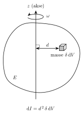

<!-- video: kommer (videoer/flervariabel-kalkulus/02-04-treghetsmoment) -->
{fig-alt="Video kommer"}

<!-- tillegg: Claude -->
Slipp en massiv kule og et tomt rør ned det samme skråplanet. De har samme masse og samme radius, men kula vinner hver gang. Grunnen er *hvor* massen sitter: I røret ligger all massen langt ute, og da skal det mye energi til for å få det til å rotere. Tallet som måler dette, er **treghetsmomentet**. Det er et trippelintegral, og på denne siden regner vi det ut for sylinderen, kula og jorda selv.

## Tyngdepunktet, kort

<!-- tillegg: Claude -->
Vi har sett under [trippelintegraler i kartesiske koordinater](01-trippelintegraler.qmd) at massen og tyngdepunktet til et legeme $E$ med tettheten $\delta(x, y, z)$ er
$$
m = \iiint_E \delta\,\mathrm{d}V, \qquad \bar x = \frac1m\iiint_E x\,\delta\,\mathrm{d}V, \qquad \bar y = \frac1m\iiint_E y\,\delta\,\mathrm{d}V, \qquad \bar z = \frac1m\iiint_E z\,\delta\,\mathrm{d}V
$$
Hver liten bit teller med sin masse $\delta\,\mathrm{d}V$, og tyngdepunktet er gjennomsnittet av posisjonene. Treghetsmomentet bygges på samme måte, men nå teller hver bit med *kvadratet av avstanden* til en akse. (Vi skriver tettheten $\delta$ på denne siden, fordi $\rho$ er avstanden i [kulekoordinater](03-kulekoordinater.qmd).)

## Hva er treghetsmomentet?

<!-- tillegg: Claude -->
Et legeme roterer om $z$-aksen med vinkelfarten $\omega$. En liten bit i avstanden $d$ fra aksen går i en sirkel med farten $v = d\,\omega$, så den har den kinetiske energien
$$
\tfrac12\,(\delta\,\mathrm{d}V)\,v^2 = \tfrac12\,\omega^2\,d^{\,2}\,\delta\,\mathrm{d}V
$$
Alle bitene har samme $\omega$. Summerer vi over hele legemet, får vi $E_k = \tfrac12 I\omega^2$, der

::: {.callout-important title="Treghetsmomentet om en akse"}
$$
I = \iiint_E d^{\,2}\,\delta\,\mathrm{d}V, \qquad\text{om } z\text{-aksen: } d^{\,2} = x^2 + y^2
$$
Her er $d$ avstanden fra punktet til **aksen** (ikke til origo). Om $x$-aksen er $d^{\,2} = y^2 + z^2$, og om $y$-aksen er $d^{\,2} = x^2 + z^2$.
:::

{.tikz-fig style="width:340px" fig-alt="Et legeme E som roterer om z-aksen. En liten terning dV med masse delta dV sitter i avstanden d fra aksen, målt vinkelrett på aksen. Bidraget til treghetsmomentet er d kvadrat ganger delta dV."}

<!-- tillegg: Claude -->
Sammenlikn med $E_k = \tfrac12 mv^2$: Treghetsmomentet spiller rollen som masse når legemet roterer. Kvadratet $d^{\,2}$ gjør at masse langt ute teller mye. Derfor taper røret mot kula.

Det er nyttig å skrive treghetsmomentet som $I = c\cdot mR^2$, der $R$ er en typisk radius. Tallet $c$ sier hvor langt ute massen sitter i gjennomsnitt: $c = 1$ når all massen ligger i avstanden $R$ (et tynt rør eller en ring), og mindre når noe av massen ligger nærmere aksen.

::: {.callout-tip title="Velg koordinater etter aksen"}
Om $z$-aksen er $d^{\,2} = x^2 + y^2 = r^2$ i sylinderkoordinater og $d^{\,2} = \rho^2\sin^2\varphi$ i kulekoordinater. Sylindre og kjegler regnes derfor i sylinderkoordinater, kuler i kulekoordinater, og klosser i kartesiske koordinater.
:::

## Sylinder og kule

::: {.eksempel}
<!-- tillegg: Claude -->
**Eksempel: Massiv sylinder.** En massiv sylinder har radius $R$, høyde $h$ og konstant tetthet $\delta$. Finn treghetsmomentet om symmetriaksen.

::: {.losning}
Legg aksen langs $z$-aksen. Sylinderen er $0 \le r \le R$, $0 \le \theta \le 2\pi$, $0 \le z \le h$, og $d^{\,2} = r^2$. Med $\mathrm{d}V = r\,\mathrm{d}z\,\mathrm{d}r\,\mathrm{d}\theta$:
$$
I = \int_0^{2\pi}\!\!\int_0^R\!\!\int_0^h r^2\,\delta\,r\,\mathrm{d}z\,\mathrm{d}r\,\mathrm{d}\theta = \delta\cdot2\pi\cdot h\cdot\frac{R^4}{4} = \frac{\pi\delta hR^4}{2}
$$
Massen er $m = \delta\,\pi R^2 h$, så
$$
I = \frac12\,\underbrace{\pi\delta R^2 h}_{m}\,R^2 = \underline{\underline{\tfrac12 mR^2}}
$$
Høyden forsvinner: En tynn skive og en lang stang med samme masse og radius har samme treghetsmoment om aksen. Tallet $c = \tfrac12$ er mindre enn $1$ fordi mye av massen ligger nær aksen.
:::
:::

::: {.eksempel}
<!-- tillegg: Claude -->
**Eksempel: Massiv kule.** Finn treghetsmomentet til en massiv kule med radius $R$ og konstant tetthet om en akse gjennom sentrum.

::: {.losning}
I kulekoordinater er avstanden til $z$-aksen $d = \rho\sin\varphi$, så $d^{\,2} = \rho^2\sin^2\varphi$. Med $\mathrm{d}V = \rho^2\sin\varphi\,\mathrm{d}\rho\,\mathrm{d}\varphi\,\mathrm{d}\theta$:
$$
I = \delta\int_0^{2\pi}\!\!\int_0^{\pi}\!\!\int_0^R \rho^2\sin^2\varphi\cdot\rho^2\sin\varphi\,\mathrm{d}\rho\,\mathrm{d}\varphi\,\mathrm{d}\theta = \delta\cdot2\pi\cdot\int_0^{\pi}\sin^3\varphi\,\mathrm{d}\varphi\cdot\frac{R^5}{5}
$$
Vinkelintegralet løser vi med $\sin^3\varphi = (1 - \cos^2\varphi)\sin\varphi$ og $u = \cos\varphi$:
$$
\int_0^{\pi}\sin^3\varphi\,\mathrm{d}\varphi = \int_{-1}^{1}(1 - u^2)\,\mathrm{d}u = 2 - \tfrac23 = \tfrac43
$$
Dermed er $I = \tfrac{8\pi}{15}\delta R^5$. Massen er $m = \tfrac43\pi R^3\delta$, så
$$
I = \frac{8\pi\delta R^5/15}{4\pi\delta R^3/3}\,mR^2 = \underline{\underline{\tfrac25 mR^2}}
$$
Kula har $c = \tfrac25$, mindre enn sylinderen. Det er rimelig: Kula har mye masse nær polene, og der er avstanden til aksen liten.
:::
:::

## Jorda: hvor er massen?

<!-- tillegg: Claude -->
Treghetsmomentet kan måles uten å bore i jorda, fra hvordan jordaksen vugger under trekket fra sola og månen. Målingen gir $I \approx 0.331\,MR^2$. For en kule med konstant tetthet ville tallet vært $0.400$. At det er mindre, forteller at jorda er tyngre inni enn ytterst. Vi kan teste en modell.

::: {.eksempel}
<!-- tillegg: Claude -->
**Eksempel: Treghetsmomentet til jorda.** Bruk modellen fra [kulekoordinater](03-kulekoordinater.qmd), der tettheten avtar lineært fra $\delta_{\text{s}} = 13.0\cdot10^3\ \mathrm{kg/m^3}$ i sentrum til $\delta_{\text{o}} = 3.0\cdot10^3\ \mathrm{kg/m^3}$ ved overflaten:
$$
\delta(\rho) = \delta_{\text{s}} - \big(\delta_{\text{s}} - \delta_{\text{o}}\big)\frac{\rho}{R}, \qquad R = 6.37\cdot10^6\ \mathrm{m}
$$
Finn $I$ om jordaksen og tallet $I/(MR^2)$. Massen fant vi før: $M = 5.95\cdot10^{24}\ \mathrm{kg}$.

::: {.losning}
Tettheten avhenger bare av $\rho$, så vinkelintegralene kan tas for seg. Fra kula over vet vi at $\int_0^{2\pi}\!\int_0^\pi\sin^3\varphi\,\mathrm{d}\varphi\,\mathrm{d}\theta = 2\pi\cdot\tfrac43 = \tfrac{8\pi}{3}$:
$$
I = \frac{8\pi}{3}\int_0^R \delta(\rho)\,\rho^4\,\mathrm{d}\rho = \frac{8\pi}{3}\Big[\delta_{\text{s}}\frac{R^5}{5} - \big(\delta_{\text{s}} - \delta_{\text{o}}\big)\frac{R^5}{6}\Big] = \frac{8\pi}{3}R^5\Big(\frac{\delta_{\text{s}}}{5} - \frac{\delta_{\text{s}} - \delta_{\text{o}}}{6}\Big)
$$
Parentesen er $(2600 - 1667)\ \mathrm{kg/m^3} = 933\ \mathrm{kg/m^3}$:
$$
I = \frac{8\pi}{3}\cdot\big(6.37\cdot10^6\ \mathrm{m}\big)^5\cdot933\ \mathrm{kg/m^3} = \underline{\underline{8.20\cdot10^{37}\ \mathrm{kg\,m^2}}}
$$
$$
\frac{I}{MR^2} = \frac{8.20\cdot10^{37}}{5.95\cdot10^{24}\cdot\big(6.37\cdot10^6\big)^2} = \underline{\underline{0.339}}
$$
Modellen treffer langt bedre enn konstant tetthet ($0.400$), men er fortsatt litt høy. Den virkelige jorda har enda mer av massen samlet i jernkjernen.
:::
:::

## Parallellakseteoremet (Steiners sats)

<!-- tillegg: Claude -->
Ofte kjenner vi treghetsmomentet $I_\text{tp}$ om en akse gjennom tyngdepunktet, men trenger det om en parallell akse i avstanden $a$. Legg tyngdepunktet i origo og den nye aksen gjennom $(a, 0)$, parallelt med $z$-aksen. Da er $d^{\,2} = (x - a)^2 + y^2$, og
$$
I = \iiint\big(x^2 + y^2\big)\delta\,\mathrm{d}V - 2a\iiint x\,\delta\,\mathrm{d}V + a^2\iiint\delta\,\mathrm{d}V
$$
Det midterste integralet er $m\bar x = 0$, fordi tyngdepunktet ligger i origo. Det gir

::: {.graa}
$$
I = I_\text{tp} + ma^2
$$
:::

Treghetsmomentet er alltid minst om en akse gjennom tyngdepunktet. Flytter vi aksen, kommer $ma^2$ i tillegg.

## Prøv selv

<!-- tillegg: Claude -->
Programmet regner ut massen og treghetsmomentet til jorda med `tplquad` i kulekoordinater. Endre tettheten, eller prøv modellen med en tung kjerne og en lettere mantel (kommentert ut). Klarer du å komme nær den målte verdien $0.331$?

```{.python .kjor}
import numpy as np
from scipy.integrate import tplquad

R = 6.37e6                  # jordradius i m
d_s, d_o = 13.0e3, 3.0e3    # tetthet i sentrum og ved overflaten, kg/m^3

def delta(rho):
    return d_s - (d_s - d_o) * rho / R
    # kjerne og mantel: return 11.0e3 if rho < 3.48e6 else 4.5e3

# integrand * volumelement; innerst rho, så phi, ytterst theta
def masse(rho, phi, th):
    return delta(rho) * rho**2 * np.sin(phi)

def treghet(rho, phi, th):
    d2 = (rho * np.sin(phi))**2          # avstand til aksen i andre
    return d2 * delta(rho) * rho**2 * np.sin(phi)

grenser = (0, 2 * np.pi, lambda th: 0, lambda th: np.pi,
           lambda th, phi: 0, lambda th, phi: R)
M, _ = tplquad(masse, *grenser)
I, _ = tplquad(treghet, *grenser)
print(f"M = {M:.3e} kg,  I = {I:.3e} kg m^2")
print(f"I/(M R^2) = {I / (M * R**2):.3f}   (målt: 0.331, konstant tetthet: 0.400)")
```

:::: {.oppgaver}

::: {.oppgave tittel="En kloss om to akser"}
<!-- tillegg: Claude -->
En massiv kloss har sidene $a = 0.40\ \mathrm{m}$, $b = 0.20\ \mathrm{m}$ og $c = 0.10\ \mathrm{m}$, konstant tetthet og massen $m = 8.0\ \mathrm{kg}$.

a) Vis at treghetsmomentet om aksen gjennom sentrum, parallell med kanten $c$, er $I = \tfrac{1}{12}m\big(a^2 + b^2\big)$, og regn det ut.

b) Finn treghetsmomentet om en av kantene med lengde $c$.

::: {.losning}
**a)** Legg sentrum i origo, med $-\tfrac a2 \le x \le \tfrac a2$, $-\tfrac b2 \le y \le \tfrac b2$, $-\tfrac c2 \le z \le \tfrac c2$. Aksen er $z$-aksen, så $d^{\,2} = x^2 + y^2$:
$$
I = \delta\iiint\big(x^2 + y^2\big)\,\mathrm{d}V = \delta\Big(bc\int_{-a/2}^{a/2}x^2\,\mathrm{d}x + ac\int_{-b/2}^{b/2}y^2\,\mathrm{d}y\Big) = \delta\Big(bc\,\frac{a^3}{12} + ac\,\frac{b^3}{12}\Big) = \frac{\delta abc}{12}\big(a^2 + b^2\big)
$$
Med $m = \delta abc$ er $I = \tfrac1{12}m\big(a^2 + b^2\big)$:
$$
I = \tfrac1{12}\cdot8.0\ \mathrm{kg}\cdot\big(0.16 + 0.040\big)\ \mathrm{m^2} = \underline{\underline{0.13\ \mathrm{kg\,m^2}}}
$$

**b)** Kanten ligger i avstanden $a_\text{k} = \sqrt{(a/2)^2 + (b/2)^2}$ fra aksen gjennom sentrum, så $a_\text{k}^2 = 0.040 + 0.010 = 0.050\ \mathrm{m^2}$. Parallellakseteoremet gir
$$
I_\text{kant} = 0.133\ \mathrm{kg\,m^2} + 8.0\ \mathrm{kg}\cdot0.050\ \mathrm{m^2} = \underline{\underline{0.53\ \mathrm{kg\,m^2}}}
$$
Det er fire ganger så mye som om sentrum: $\tfrac13 m(a^2 + b^2)$.
:::
:::

::: {.oppgave tittel="Kjeglen"}
<!-- tillegg: Claude -->
En massiv kjegle med konstant tetthet har radius $R$ i grunnflaten og høyden $h$. Vis at treghetsmomentet om symmetriaksen er $I = \tfrac{3}{10}mR^2$.

::: {.losning}
Legg spissen i origo og aksen langs $z$-aksen. Kjeglesiden er $z = \tfrac{h}{R}r$, så kjeglen er $0 \le r \le R$, $\tfrac hR r \le z \le h$, $0 \le \theta \le 2\pi$. Med $d^{\,2} = r^2$:
$$
I = \delta\int_0^{2\pi}\!\!\int_0^R\!\!\int_{hr/R}^{h} r^2\cdot r\,\mathrm{d}z\,\mathrm{d}r\,\mathrm{d}\theta = 2\pi\delta\int_0^R r^3\Big(h - \frac hR r\Big)\mathrm{d}r = 2\pi\delta h\Big(\frac{R^4}{4} - \frac{R^4}{5}\Big) = \frac{\pi\delta hR^4}{10}
$$
Massen er $m = \tfrac13\pi R^2h\,\delta$, så
$$
I = \frac{\pi\delta hR^4/10}{\pi\delta R^2h/3}\,m = \underline{\underline{\tfrac{3}{10}mR^2}}
$$
Kjeglen har mindre treghetsmoment enn sylinderen ($\tfrac12 mR^2$) fordi den er smal i den ene enden.
:::
:::

::: {.oppgave tittel="Kappløp ned skråplanet" niva="Middels"}
<!-- tillegg: Claude -->
En gjenstand med masse $m$, radius $R$ og treghetsmoment $I = c\,mR^2$ ruller uten å gli ned et skråplan og synker høyden $h$. Den potensielle energien blir til både bevegelsesenergi og rotasjonsenergi, og rulling betyr $v = R\omega$.

a) Vis at farten nederst er $v = \sqrt{\dfrac{2\mathrm{g}h}{1 + c}}$.

b) En massiv kule, en massiv sylinder og et tynt rør slippes fra $h = 1.0\ \mathrm{m}$. Finn farten til hver av dem nederst, og avgjør hvem som vinner.

Se også [kraftmoment og rulling på fysikkhjelp.no](https://fysikkhjelp.no/ingeniorfysikk/kapitler/06-rotasjon/03-kraftmoment-og-rulling.html).

::: {.losning}
**a)** Energibevaring med $\omega = v/R$:
$$
m\mathrm{g}h = \tfrac12 mv^2 + \tfrac12\,c\,mR^2\Big(\frac vR\Big)^2 = \tfrac12 mv^2(1 + c) \quad\Rightarrow\quad v = \sqrt{\frac{2\mathrm{g}h}{1 + c}}
$$
Massen og radien forsvinner. Bare *formen* ($c$) bestemmer farten.

**b)** Med $2\mathrm{g}h = 2\cdot9.81\ \mathrm{m/s^2}\cdot1.0\ \mathrm{m} = 19.6\ \mathrm{m^2/s^2}$:

| Gjenstand | $c$ | $v$ |
|---|---|---|
| massiv kule | $\tfrac25$ | $\sqrt{19.6/1.4}\ \mathrm{m/s} = 3.7\ \mathrm{m/s}$ |
| massiv sylinder | $\tfrac12$ | $\sqrt{19.6/1.5}\ \mathrm{m/s} = 3.6\ \mathrm{m/s}$ |
| tynt rør | $1$ | $\sqrt{19.6/2}\ \mathrm{m/s} = 3.1\ \mathrm{m/s}$ |

**Kula vinner**, fordi den har minst $c$: Minst av energien går med til rotasjon.
:::
:::

::: {.oppgave tittel="Det tykke kuleskallet" niva="Middels"}
<!-- tillegg: Claude -->
Et kuleskall med konstant tetthet har indre radius $R_1$ og ytre radius $R_2$.

a) Vis at treghetsmomentet om en akse gjennom sentrum er
$$
I = \frac25\,m\,\frac{R_2^5 - R_1^5}{R_2^3 - R_1^3}
$$

b) Kontroller svaret for $R_1 = 0$. Finn også grensen når skallet blir tynt, $R_1 \to R_2 = R$.

::: {.losning}
**a)** Som for den massive kula, men med $\rho$ fra $R_1$ til $R_2$:
$$
I = \delta\cdot\frac{8\pi}{3}\int_{R_1}^{R_2}\rho^4\,\mathrm{d}\rho = \frac{8\pi\delta}{15}\big(R_2^5 - R_1^5\big), \qquad m = \frac{4\pi\delta}{3}\big(R_2^3 - R_1^3\big)
$$
Deler vi, blir $I/m = \tfrac25\big(R_2^5 - R_1^5\big)/\big(R_2^3 - R_1^3\big)$, som er formelen.

**b)** For $R_1 = 0$ blir brøken $R_2^5/R_2^3 = R_2^2$, så $I = \tfrac25 mR_2^2$, som for den massive kula.

Når $R_1 \to R_2$, går både teller og nevner mot null. Faktoriser med $R_1 = R_2 = R$ i grensen:
$$
\frac{R_2^5 - R_1^5}{R_2^3 - R_1^3} = \frac{R_2^4 + R_2^3R_1 + R_2^2R_1^2 + R_2R_1^3 + R_1^4}{R_2^2 + R_2R_1 + R_1^2} \to \frac{5R^4}{3R^2} = \frac53R^2
$$
Altså er $I = \tfrac25\cdot\tfrac53\,mR^2 = \underline{\underline{\tfrac23 mR^2}}$ for et tynt kuleskall. Tallet $c = \tfrac23$ er mindre enn $1$, selv om all massen ligger i avstanden $R$ fra *sentrum*: Avstanden til *aksen* er $R\sin\varphi$, og den er liten nær polene.
:::
:::

::: {.oppgave tittel="Jorda med kjerne og mantel" niva="Utfordrende"}
<!-- tillegg: Claude -->
En annen enkel modell av jorda har en jernkjerne med radius $R_\text{k} = 3.48\cdot10^6\ \mathrm{m}$ og tettheten $\delta_\text{k} = 11.0\cdot10^3\ \mathrm{kg/m^3}$, og en mantel ut til $R = 6.37\cdot10^6\ \mathrm{m}$ med tettheten $\delta_\text{m} = 4.5\cdot10^3\ \mathrm{kg/m^3}$.

a) Finn massen $M$ og treghetsmomentet $I$ om jordaksen.

b) Regn ut $I/(MR^2)$ og sammenlikn med den målte verdien $0.331$ og med den lineære modellen.

::: {.losning}
**a)** Del integralene i kjernen og mantelen. Med $\int\!\int\sin\varphi\,\mathrm{d}\varphi\,\mathrm{d}\theta = 4\pi$ for massen og $\tfrac{8\pi}{3}$ for treghetsmomentet:
$$
M = \frac{4\pi}{3}\Big[\delta_\text{k}R_\text{k}^3 + \delta_\text{m}\big(R^3 - R_\text{k}^3\big)\Big], \qquad I = \frac{8\pi}{15}\Big[\delta_\text{k}R_\text{k}^5 + \delta_\text{m}\big(R^5 - R_\text{k}^5\big)\Big]
$$
Innsatt:
$$
M = \underline{\underline{6.02\cdot10^{24}\ \mathrm{kg}}}, \qquad I = \underline{\underline{8.46\cdot10^{37}\ \mathrm{kg\,m^2}}}
$$

**b)**
$$
\frac{I}{MR^2} = \frac{8.46\cdot10^{37}}{6.02\cdot10^{24}\cdot\big(6.37\cdot10^6\big)^2} = \underline{\underline{0.347}}
$$
Massen er nesten riktig, men treghetsmomentet blir for stort. Begge de enkle modellene ($0.347$ og $0.339$) ligger over den målte verdien $0.331$. I den virkelige jorda øker tettheten også innover i mantelen og i kjernen, så enda mer av massen sitter nær sentrum. Slik bruker geofysikere treghetsmomentet til å teste modeller av jordas indre.
:::
:::

::::
