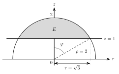

<!-- tillegg: Claude -->
Oppgavene blander alt om trippelintegraler: grenser i kartesiske koordinater, bytte av rekkefølge, sylinder- og kulekoordinater, masse, tyngdepunkt og treghetsmoment, og numerisk integrasjon. Det vanskeligste er ofte å velge koordinater. Lag en skisse, og se på både *området* og *integranden*:

::: {.kort}
- **Bokser, tetraedre og plan:** kartesiske koordinater, $\mathrm{d}V = \mathrm{d}x\,\mathrm{d}y\,\mathrm{d}z$.
- **Sylindre, paraboloider og $x^2 + y^2$:** sylinderkoordinater, $\mathrm{d}V = r\,\mathrm{d}z\,\mathrm{d}r\,\mathrm{d}\theta$.
- **Kuler, kjegler og $x^2 + y^2 + z^2$:** kulekoordinater, $\mathrm{d}V = \rho^2\sin\varphi\,\mathrm{d}\rho\,\mathrm{d}\varphi\,\mathrm{d}\theta$.
- **Kronglete område eller integrand:** numerisk, for eksempel Monte Carlo.
:::

Prøv selv før du åpner løsningen.

:::: {.oppgaver}

::: {.oppgave tittel="Hvilke koordinater?"}
<!-- tillegg: Claude -->
Du skal ikke regne ut integralene. Avgjør bare hvilke koordinater som passer best, og skriv opp grensene.

a) $\displaystyle\iiint_E z^2\,\mathrm{d}V$, der $E$ er kula $x^2 + y^2 + z^2 \le 4$.

b) $\displaystyle\iiint_E \sqrt{x^2 + y^2}\,\mathrm{d}V$, der $E$ ligger mellom paraboloiden $z = x^2 + y^2$ og planet $z = 4$.

c) $\displaystyle\iiint_E y\,\mathrm{d}V$, der $E$ er tetraederet avgrenset av koordinatplanene og planet $x + y + z = 1$.

::: {.losning}
**a)** **Kulekoordinater.** Kula er $0 \le \rho \le 2$, $0 \le \varphi \le \pi$, $0 \le \theta \le 2\pi$, og integranden er $\rho^2\cos^2\varphi$.

**b)** **Sylinderkoordinater.** Integranden er $r$, og området er $r^2 \le z \le 4$ over skiven $0 \le r \le 2$ (der paraboloiden når $z = 4$), $0 \le \theta \le 2\pi$. Husk den ekstra faktoren $r$ i $\mathrm{d}V$: Integranden blir $r\cdot r = r^2$.

**c)** **Kartesiske koordinater.** Alle sideflatene er plan: $0 \le x \le 1$, $0 \le y \le 1 - x$, $0 \le z \le 1 - x - y$.
:::
:::

::: {.oppgave tittel="Bytt rekkefølge"}
<!-- tillegg: Claude -->
Skriv integralet
$$
\int_0^1\!\!\int_0^x\!\!\int_0^y f(x, y, z)\,\mathrm{d}z\,\mathrm{d}y\,\mathrm{d}x
$$
med rekkefølgen $\mathrm{d}x\,\mathrm{d}y\,\mathrm{d}z$ (altså med $z$ ytterst). Kontroller ved å regne ut begge med $f = 1$.

::: {.losning}
Grensene sier $0 \le z \le y \le x \le 1$. Det er hele beskrivelsen av området, og den kan leses i hvilken rekkefølge vi vil. Med $z$ ytterst: $z$ går fra $0$ til $1$. For fast $z$ går $y$ fra $z$ til $1$, og for faste $y$ og $z$ går $x$ fra $y$ til $1$:
$$
\underline{\underline{\int_0^1\!\!\int_z^1\!\!\int_y^1 f(x, y, z)\,\mathrm{d}x\,\mathrm{d}y\,\mathrm{d}z}}
$$
Med $f = 1$ gir det opprinnelige integralet $\int_0^1\!\int_0^x y\,\mathrm{d}y\,\mathrm{d}x = \int_0^1 \tfrac12 x^2\,\mathrm{d}x = \tfrac16$. Det nye gir
$$
\int_0^1\!\!\int_z^1 (1 - y)\,\mathrm{d}y\,\mathrm{d}z = \int_0^1 \tfrac12(1 - z)^2\,\mathrm{d}z = \tfrac16
$$
Begge gir $\tfrac16$. Området er en av seks like store biter av enhetskuben: Det finnes seks måter å ordne $x$, $y$ og $z$ etter størrelse.
:::
:::

::: {.oppgave tittel="Tetraederet"}
<!-- tillegg: Claude -->
Tetraederet $E$ er avgrenset av koordinatplanene og planet $x + 2y + z = 2$.

a) Finn volumet.

b) Regn ut $\displaystyle\iiint_E x\,\mathrm{d}V$, og finn $\bar x$ for tyngdepunktet (konstant tetthet).

::: {.losning}
Hjørnene er origo, $(2, 0, 0)$, $(0, 1, 0)$ og $(0, 0, 2)$. Grensene: $0 \le x \le 2$, $0 \le y \le \tfrac{2 - x}{2}$, $0 \le z \le 2 - x - 2y$.

**a)** Volumet av et tetraeder med tre rette kanter langs aksene er $\tfrac16\cdot2\cdot1\cdot2 = \underline{\underline{\tfrac23}}$. (Integralet gir det samme.)

**b)** Det innerste integralet gir $2 - x - 2y$. Over $y$:
$$
\int_0^{(2 - x)/2} x(2 - x - 2y)\,\mathrm{d}y = x\Big[(2 - x)y - y^2\Big]_0^{(2 - x)/2} = x\Big(\frac{(2 - x)^2}{2} - \frac{(2 - x)^2}{4}\Big) = \frac{x(2 - x)^2}{4}
$$
Over $x$, med $u = 2 - x$:
$$
\int_0^2 \frac{x(2 - x)^2}{4}\,\mathrm{d}x = \frac14\int_0^2 (2 - u)u^2\,\mathrm{d}u = \frac14\Big(\frac{16}{3} - 4\Big) = \underline{\underline{\tfrac13}}
$$
$$
\bar x = \frac{1/3}{2/3} = \underline{\underline{\tfrac12}}
$$
Kontroll: Tyngdepunktet i et tetraeder er gjennomsnittet av hjørnene, $\bar x = \tfrac{0 + 2 + 0 + 0}{4} = \tfrac12$.
:::
:::

::: {.oppgave tittel="Skrått avkappet sylinder"}
<!-- tillegg: Claude -->
Finn volumet av legemet inni sylinderen $x^2 + y^2 \le 1$, over planet $z = 0$ og under planet $z = 2 - x$.

::: {.losning}
Sylinderkoordinater: $0 \le r \le 1$, $0 \le \theta \le 2\pi$, $0 \le z \le 2 - r\cos\theta$.
$$
V = \int_0^{2\pi}\!\!\int_0^1\!\!\int_0^{2 - r\cos\theta} r\,\mathrm{d}z\,\mathrm{d}r\,\mathrm{d}\theta = \int_0^{2\pi}\!\!\int_0^1 \big(2r - r^2\cos\theta\big)\,\mathrm{d}r\,\mathrm{d}\theta = \int_0^{2\pi}\Big(1 - \tfrac13\cos\theta\Big)\mathrm{d}\theta = \underline{\underline{2\pi}}
$$
Cosinusleddet blir null over en hel runde. Det er rimelig: Det skrå taket er like mye over høyden $2$ på den ene siden som under på den andre, så volumet er det samme som for en sylinder med høyde $2$, altså $\pi\cdot1^2\cdot2$.
:::
:::

::: {.oppgave tittel="Kulekalotten på to måter" niva="Middels"}
<!-- tillegg: Claude -->
Legemet $E$ er den delen av kula $x^2 + y^2 + z^2 \le 4$ som ligger over planet $z = 1$.

{.tikz-fig style="width:360px" fig-alt="Halvsirkel med radius 2 i et rz-plan. Den vannrette linja z = 1 kutter av en kalott E øverst. En stiplet radius rho = 2 går fra origo til skjæringspunktet, som ligger i avstanden r = rot 3 fra z-aksen. Vinkelen phi er markert mellom z-aksen og radien."}

a) Finn volumet med sylinderkoordinater.

b) Sett opp volumet i kulekoordinater, og forklar hvorfor grensene for $\rho$ ikke er konstanter.

::: {.losning}
**a)** Planet skjærer kula der $r^2 + 1 = 4$, altså $r = \sqrt3$. Over hvert punkt i skiven går $z$ fra $1$ til $\sqrt{4 - r^2}$:
$$
V = \int_0^{2\pi}\!\!\int_0^{\sqrt3} \Big(\sqrt{4 - r^2} - 1\Big)\,r\,\mathrm{d}r\,\mathrm{d}\theta = 2\pi\Big[-\tfrac13\big(4 - r^2\big)^{3/2} - \tfrac12 r^2\Big]_0^{\sqrt3}
$$
$$
V = 2\pi\Big(-\tfrac13 - \tfrac32 + \tfrac83\Big) = 2\pi\cdot\tfrac56 = \underline{\underline{\tfrac{5\pi}{3}}} \approx 5.24
$$

**b)** Planet $z = 1$ er $\rho\cos\varphi = 1$, altså $\rho = 1/\cos\varphi$. Skjæringssirkelen ligger der $\cos\varphi = \tfrac12$, altså $\varphi = \tfrac{\pi}{3}$:
$$
V = \int_0^{2\pi}\!\!\int_0^{\pi/3}\!\!\int_{1/\cos\varphi}^{2}\rho^2\sin\varphi\,\mathrm{d}\rho\,\mathrm{d}\varphi\,\mathrm{d}\theta
$$
Planet er ikke en «kuleflate», så avstanden fra origo til planet avhenger av retningen. (Integralet gir også $\tfrac{5\pi}{3}$, men sylinderkoordinatene er enklere her.)
:::
:::

::: {.oppgave tittel="Tyngdepunktet i en tung kjegle" niva="Middels"}
<!-- tillegg: Claude -->
Et legeme fyller området mellom kjeglen $z = \sqrt{x^2 + y^2}$ og planet $z = 1$. Tettheten øker oppover: $\delta = z$. Finn massen og tyngdepunktet.

::: {.losning}
I sylinderkoordinater er området $0 \le r \le 1$, $r \le z \le 1$, $0 \le \theta \le 2\pi$.
$$
m = \int_0^{2\pi}\!\!\int_0^1\!\!\int_r^1 z\,r\,\mathrm{d}z\,\mathrm{d}r\,\mathrm{d}\theta = 2\pi\int_0^1 \frac{1 - r^2}{2}\,r\,\mathrm{d}r = \pi\Big(\frac12 - \frac14\Big) = \underline{\underline{\tfrac{\pi}{4}}}
$$
Av symmetri er $\bar x = \bar y = 0$. Momentet om $xy$-planet:
$$
\iiint z\,\delta\,\mathrm{d}V = 2\pi\int_0^1\!\!\int_r^1 z^2\,r\,\mathrm{d}z\,\mathrm{d}r = 2\pi\int_0^1 \frac{1 - r^3}{3}\,r\,\mathrm{d}r = \frac{2\pi}{3}\Big(\frac12 - \frac15\Big) = \frac{\pi}{5}
$$
$$
\bar z = \frac{\pi/5}{\pi/4} = \underline{\underline{\tfrac45}}
$$
Med konstant tetthet ville $\bar z$ vært $\tfrac34$. Den tunge toppen trekker tyngdepunktet litt opp.
:::
:::

::: {.oppgave tittel="Røret" niva="Middels"}
<!-- tillegg: Claude -->
Et rør med konstant tetthet har indre radius $R_1$, ytre radius $R_2$ og lengden $h$. Vis at treghetsmomentet om røraksen er $I = \tfrac12 m\big(R_1^2 + R_2^2\big)$. Kontroller svaret for $R_1 = 0$ og for $R_1 \to R_2$.

::: {.losning}
Legg aksen langs $z$-aksen. Med $d^{\,2} = r^2$:
$$
I = \delta\int_0^{2\pi}\!\!\int_{R_1}^{R_2}\!\!\int_0^h r^2\cdot r\,\mathrm{d}z\,\mathrm{d}r\,\mathrm{d}\theta = 2\pi\delta h\,\frac{R_2^4 - R_1^4}{4}
$$
Massen er $m = \pi\delta h\big(R_2^2 - R_1^2\big)$. Med $R_2^4 - R_1^4 = \big(R_2^2 - R_1^2\big)\big(R_2^2 + R_1^2\big)$:
$$
I = \frac{\pi\delta h\big(R_2^2 - R_1^2\big)\big(R_2^2 + R_1^2\big)}{2} = \underline{\underline{\tfrac12 m\big(R_1^2 + R_2^2\big)}}
$$
For $R_1 = 0$ får vi den massive sylinderen, $\tfrac12 mR_2^2$. For et tynt rør, $R_1 \to R_2 = R$, får vi $mR^2$: All massen ligger i avstanden $R$ fra aksen.
:::
:::

::: {.oppgave tittel="Gauss-integralet i tre dimensjoner" niva="Utfordrende"}
<!-- tillegg: Claude -->
La $J = \displaystyle\int_{-\infty}^{\infty}\mathrm{e}^{-x^2}\,\mathrm{d}x$. Funksjonen $\mathrm{e}^{-x^2}$ har ingen antiderivert med vanlige funksjoner, men vi kan likevel finne $J$.

a) Forklar hvorfor $\displaystyle J^3 = \iiint_{\mathbb{R}^3}\mathrm{e}^{-(x^2 + y^2 + z^2)}\,\mathrm{d}V$.

b) Regn ut trippelintegralet i kulekoordinater. Bruk delvis integrasjon og at $\int_0^\infty\mathrm{e}^{-\rho^2}\,\mathrm{d}\rho = \tfrac12 J$.

c) Vis at $J = \sqrt{\pi}$.

::: {.losning}
**a)** $\mathrm{e}^{-(x^2 + y^2 + z^2)} = \mathrm{e}^{-x^2}\mathrm{e}^{-y^2}\mathrm{e}^{-z^2}$, og grensene er konstanter ($-\infty$ til $\infty$ i alle retninger). Da deler integralet seg i tre like faktorer: $J\cdot J\cdot J$.

**b)** Integranden er $\mathrm{e}^{-\rho^2}$, og vinkelintegralene gir $4\pi$:
$$
J^3 = 4\pi\int_0^\infty \rho^2\mathrm{e}^{-\rho^2}\,\mathrm{d}\rho
$$
Delvis integrasjon med $u = \rho$ og $v' = \rho\,\mathrm{e}^{-\rho^2}$, så $v = -\tfrac12\mathrm{e}^{-\rho^2}$:
$$
\int_0^\infty \rho\cdot\rho\,\mathrm{e}^{-\rho^2}\,\mathrm{d}\rho = \Big[-\tfrac12\rho\,\mathrm{e}^{-\rho^2}\Big]_0^\infty + \tfrac12\int_0^\infty\mathrm{e}^{-\rho^2}\,\mathrm{d}\rho = 0 + \tfrac12\cdot\tfrac12 J = \tfrac14 J
$$
Altså er $J^3 = 4\pi\cdot\tfrac14 J = \pi J$.

**c)** $J > 0$, så vi kan dele på $J$: $J^2 = \pi$, og $\underline{\underline{J = \sqrt\pi}}$. Integralet er grunnlaget for normalfordelingen i statistikken.
:::
:::

::: {.oppgave tittel="Tre sylindre som krysser hverandre" niva="Utfordrende"}
<!-- tillegg: Claude -->
Tre sylindre med radius $1$ ligger langs hver sin akse: $x^2 + y^2 \le 1$, $y^2 + z^2 \le 1$ og $x^2 + z^2 \le 1$. Felles del er et rundt legeme som er vanskelig å sette grenser for. Bruk Monte Carlo-integrasjon til å anslå volumet, og sammenlikn med den eksakte verdien $8\big(2 - \sqrt2\big)$.

::: {.losning}
Legemet ligger inni kuben $[-1, 1]^3$, som har volum $8$. Vi trekker tilfeldige punkter i kuben, og volumet er $8$ ganger andelen som ligger inni alle tre sylindrene:

```{.python .kjor}
import numpy as np
rng = np.random.default_rng()
N = 1_000_000
x, y, z = rng.uniform(-1, 1, size=(3, N))
inni = (x**2 + y**2 <= 1) & (y**2 + z**2 <= 1) & (x**2 + z**2 <= 1)
V = 8 * inni.mean()
feil = 8 * np.sqrt(inni.mean() * (1 - inni.mean()) / N)
print(f"Monte Carlo: {V:.3f} ± {feil:.3f}")
print(f"Eksakt:      {8 * (2 - np.sqrt(2)):.3f}")
```

Med en million punkter får vi omtrent $4.69 \pm 0.004$, og den eksakte verdien er $8\big(2 - \sqrt2\big) = \underline{\underline{4.686}}$. Omtrent $59\ \%$ av kuben er med. Til sammenlikning har enhetskula volumet $4.19$, så legemet er litt større enn kula som passer inni det.
:::
:::

::::
