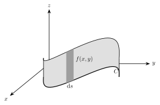

<!-- video: kommer (videoer/flervariabel-kalkulus/03-01-linjeintegraler) -->
{fig-alt="Video kommer"}

<!-- tillegg: Claude -->
Et gjerde følger en svingete sti, og høyden på gjerdet varierer langs stien. Hvor mange kvadratmeter maling trenger du? Eller: En kobbertråd er bøyd i en bue og er tykkere noen steder enn andre. Hvor tung er den? I begge tilfellene skal vi summere noe *langs en kurve*: høyde ganger lengde, eller tetthet ganger lengde. Det er et **linjeintegral av en funksjon**. Nøkkelen er å beskrive kurven med en parameter, slik at integralet blir et helt vanlig integral over et intervall.

## Kurver med en parameter

<!-- tillegg: Claude -->
En kurve $C$ i rommet beskrives med en **parametrisering**
$$
\vec r(t) = \big[x(t),\ y(t),\ z(t)\big], \qquad a \le t \le b
$$
Tenk på $t$ som tiden og $\vec r(t)$ som posisjonen til en maur som går langs kurven. Da er den deriverte
$$
\vec r\,'(t) = \big[x'(t),\ y'(t),\ z'(t)\big]
$$
**fartsvektoren** til mauren. Den er en **tangentvektor**: Den peker langs kurven. Lengden $|\vec r\,'(t)|$ er farten. I planet sløyfer vi bare $z$.

::: {.eksempel}
<!-- tillegg: Claude -->
**Eksempel: Sirkel og skruelinje.** Sirkelen med radius $R$ om origo kan skrives
$$
\vec r(t) = \big[R\cos t,\ R\sin t\big], \qquad 0 \le t \le 2\pi
$$
Tangentvektoren er $\vec r\,'(t) = \big[-R\sin t,\ R\cos t\big]$, med lengden $\sqrt{R^2\sin^2 t + R^2\cos^2 t} = R$. Mauren går altså med konstant fart $R$.

Legger vi til en høyde som øker jevnt, får vi en **skruelinje**, som håndlisten i en vindeltrapp:
$$
\vec r(t) = \big[R\cos t,\ R\sin t,\ ct\big]
$$
Nå er $\vec r\,'(t) = \big[-R\sin t,\ R\cos t,\ c\big]$ og $|\vec r\,'(t)| = \sqrt{R^2 + c^2}$.
:::

## Buelengde

<!-- tillegg: Claude -->
Går mauren med farten $|\vec r\,'(t)|$ i den lille tiden $\mathrm{d}t$, flytter den seg strekningen
$$
\mathrm{d}s = |\vec r\,'(t)|\,\mathrm{d}t
$$
Det er **buelengdeelementet**. Summerer vi alle de små strekningene, får vi lengden av kurven:

::: {.graa}
$$
L = \int_C \mathrm{d}s = \int_a^b |\vec r\,'(t)|\,\mathrm{d}t = \int_a^b \sqrt{x'(t)^2 + y'(t)^2 + z'(t)^2}\,\mathrm{d}t
$$
:::

For sirkelen er $L = \int_0^{2\pi} R\,\mathrm{d}t = 2\pi R$, som det skal være.

::: {.eksempel}
<!-- tillegg: Claude -->
**Eksempel: Håndlisten i vindeltrappa.** En vindeltrapp har radius $1.5\ \mathrm{m}$ og stiger $3.0\ \mathrm{m}$ på én hel runde. Hvor lang er håndlisten for én runde?

::: {.losning}
Høyden skal øke med $3.0\ \mathrm{m}$ når $t$ øker med $2\pi$, så $c = \dfrac{3.0\ \mathrm{m}}{2\pi}$. Farten er konstant:
$$
|\vec r\,'(t)| = \sqrt{R^2 + c^2} = \sqrt{(1.5\ \mathrm{m})^2 + \Big(\frac{3.0\ \mathrm{m}}{2\pi}\Big)^2} = 1.574\ \mathrm{m}
$$
$$
L = \int_0^{2\pi} 1.574\ \mathrm{m}\,\mathrm{d}t = 2\pi\cdot1.574\ \mathrm{m} = \underline{\underline{9.89\ \mathrm{m}}}
$$
**Kontroll:** Brett ut trappa i tankene, slik at sylinderen blir et flatt ark. Da blir håndlisten hypotenusen i en trekant med grunnlinje $2\pi\cdot1.5\ \mathrm{m} = 9.42\ \mathrm{m}$ (omkretsen) og høyde $3.0\ \mathrm{m}$: $\sqrt{9.42^2 + 3.0^2}\ \mathrm{m} = 9.89\ \mathrm{m}$.
:::
:::

## Linjeintegralet av en funksjon

<!-- tillegg: Claude -->
Nå lar vi en funksjon $f$ ha en verdi i hvert punkt på kurven: høyden på gjerdet, eller tettheten til tråden. Vi deler kurven i små biter med lengde $\mathrm{d}s$. Hver bit bidrar med $f\,\mathrm{d}s$: arealet av en smal stripe av gjerdet, eller massen av en kort bit av tråden.

{.tikz-fig style="width:420px" fig-alt="En svingete kurve C i xy-planet. Over kurven står et gjerde, en loddrett flate med høyden f(x, y), som varierer langs kurven. En smal stripe av gjerdet er uthevet. Den har bredden ds langs kurven og høyden f(x, y)."}

::: {.callout-important title="Linjeintegral av en funksjon"}
$$
\int_C f\,\mathrm{d}s = \int_a^b f\big(\vec r(t)\big)\,|\vec r\,'(t)|\,\mathrm{d}t
$$
:::

<!-- tillegg: Claude -->
Oppskriften er alltid den samme:

::: {.steg}
<!-- tillegg: Claude -->
1. Parametriser kurven: $\vec r(t)$, $a \le t \le b$.
2. Deriver og finn farten $|\vec r\,'(t)|$.
3. Sett $x(t)$, $y(t)$ og $z(t)$ inn i $f$.
4. Integrer $f\big(\vec r(t)\big)\,|\vec r\,'(t)|$ fra $a$ til $b$.
:::

::: {.callout-tip title="Retningen spiller ingen rolle"}
Lengden $\mathrm{d}s$ er alltid positiv, uansett hvilken vei vi går langs kurven og hvor fort. Derfor gir alle parametriseringer av samme kurve samme svar, og det spiller ingen rolle om vi går fra $A$ til $B$ eller fra $B$ til $A$. (Linjeintegraler av *vektorfelt*, der vi summerer arbeid langs en vei, er annerledes. Der bytter svaret fortegn når vi snur.)
:::

::: {.eksempel}
<!-- tillegg: Claude -->
**Eksempel: En buet tråd.** En tynn tråd er bøyd i en halvsirkel, $x^2 + y^2 = 1$ med $y \ge 0$ (lengder i dm). Tråden er tykkest på toppen, og massen per lengde er $\lambda(x, y) = y$ (i kg/dm). Finn massen og tyngdepunktet.

::: {.losning}
Parametriser med $\vec r(t) = [\cos t,\ \sin t]$, $0 \le t \le \pi$. Farten er $|\vec r\,'(t)| = 1$, og $\lambda = y = \sin t$:
$$
m = \int_C \lambda\,\mathrm{d}s = \int_0^{\pi}\sin t\cdot1\,\mathrm{d}t = \Big[-\cos t\Big]_0^\pi = \underline{\underline{2\ \mathrm{kg}}}
$$
Av symmetri er $\bar x = 0$. Tyngdepunktet finner vi som for plater, men med $\mathrm{d}s$:
$$
\bar y = \frac1m\int_C y\,\lambda\,\mathrm{d}s = \frac12\int_0^\pi \sin^2 t\,\mathrm{d}t = \frac12\cdot\frac{\pi}{2} = \underline{\underline{\tfrac{\pi}{4}\ \mathrm{dm}}} \approx 0.79\ \mathrm{dm}
$$
For en jevn tråd ville $\bar y$ vært $2/\pi \approx 0.64\ \mathrm{dm}$. Den tunge toppen løfter tyngdepunktet. Legg merke til at tyngdepunktet ligger *utenfor* tråden, inni halvsirkelen.
:::
:::

## Kurver i flere biter

<!-- tillegg: Claude -->
En kurve som har knekker, for eksempel sidene i en trekant, er **stykkevis glatt**. Vi parametriserer hver glatte bit for seg og legger sammen:
$$
\int_C f\,\mathrm{d}s = \int_{C_1} f\,\mathrm{d}s + \int_{C_2} f\,\mathrm{d}s + \dots
$$

::: {.eksempel}
<!-- tillegg: Claude -->
**Eksempel: Rundt en trekant.** Regn ut $\displaystyle\int_C (x + y)\,\mathrm{d}s$, der $C$ er omkretsen av trekanten med hjørner i $(0, 0)$, $(1, 0)$ og $(0, 1)$.

::: {.losning}
**$C_1$:** Langs $x$-aksen, $\vec r(t) = [t,\ 0]$, $0 \le t \le 1$, fart $1$:
$$
\int_{C_1}(x + y)\,\mathrm{d}s = \int_0^1 t\,\mathrm{d}t = \tfrac12
$$
**$C_2$:** Fra $(1, 0)$ til $(0, 1)$, $\vec r(t) = [1 - t,\ t]$, fart $|[-1,\ 1]| = \sqrt2$. Her er $x + y = 1$ hele veien:
$$
\int_{C_2}(x + y)\,\mathrm{d}s = \int_0^1 1\cdot\sqrt2\,\mathrm{d}t = \sqrt2
$$
**$C_3$:** Langs $y$-aksen, samme som $C_1$ med $y$ i stedet for $x$: $\tfrac12$.

Til sammen:
$$
\int_C (x + y)\,\mathrm{d}s = \tfrac12 + \sqrt2 + \tfrac12 = \underline{\underline{1 + \sqrt2}} \approx 2.41
$$
Midt-biten er lengst ($\sqrt2$), og der er også $f$ størst, så den bidrar mest.
:::
:::

## Prøv selv: omkretsen av en ellipse

<!-- tillegg: Claude -->
Omkretsen av en sirkel er $2\pi R$, men for en ellipse finnes det *ingen* formel med vanlige funksjoner. Integralet er likevel lett å sette opp: $\vec r(t) = [a\cos t,\ b\sin t]$ gir
$$
L = \int_0^{2\pi}\sqrt{a^2\sin^2 t + b^2\cos^2 t}\,\mathrm{d}t
$$
Programmet regner det ut numerisk og sammenlikner med en kjent tilnærmingsformel. Endre halvaksene `a` og `b`. Hva skjer når de er like?

```{.python .kjor}
import numpy as np
from scipy.integrate import quad
import matplotlib.pyplot as plt

a, b = 2.0, 1.0          # halvakser

fart = lambda t: np.sqrt(a**2 * np.sin(t)**2 + b**2 * np.cos(t)**2)
L, _ = quad(fart, 0, 2 * np.pi)

h = ((a - b) / (a + b))**2                     # Ramanujans tilnærming
L_R = np.pi * (a + b) * (1 + 3*h / (10 + np.sqrt(4 - 3*h)))
print(f"Buelengde, numerisk: {L:.6f}")
print(f"Ramanujans formel:   {L_R:.6f}")

t = np.linspace(0, 2 * np.pi, 400)
plt.plot(a * np.cos(t), b * np.sin(t))
plt.axis("equal"); plt.grid(); plt.title(f"Omkrets {L:.3f}"); plt.show()
```

:::: {.oppgaver}

::: {.oppgave tittel="Langs et linjestykke"}
<!-- tillegg: Claude -->
Regn ut $\displaystyle\int_C xy\,\mathrm{d}s$, der $C$ er linjestykket fra $(0, 0)$ til $(3, 4)$.

::: {.fasit}
$20$
:::
:::

::: {.oppgave tittel="Buelengden til en kurve"}
<!-- tillegg: Claude -->
Finn lengden av kurven $\vec r(t) = \big[t^2,\ t^3\big]$ for $0 \le t \le 1$.

::: {.fasit}
$\frac{13\sqrt{13} - 8}{27}$
:::
:::

::: {.oppgave tittel="Samme kurve, annen fart" niva="Middels"}
<!-- tillegg: Claude -->
Den øvre halvdelen av enhetssirkelen kan parametriseres med $\vec r_1(t) = [\cos t,\ \sin t]$, $0 \le t \le \pi$, eller med $\vec r_2(u) = [\cos 2u,\ \sin 2u]$, $0 \le u \le \tfrac{\pi}{2}$.

a) Regn ut $\displaystyle\int_C y^2\,\mathrm{d}s$ med begge parametriseringene.

b) Regn det ut med $\vec r_3(t) = [-\cos t,\ \sin t]$, som går motsatt vei.

::: {.fasit}
$\tfrac{\pi}{2}$
:::
:::

::: {.oppgave tittel="Skruelinjen" niva="Middels"}
<!-- tillegg: Claude -->
Skruelinjen $\vec r(t) = [\cos t,\ \sin t,\ t]$, $0 \le t \le 2\pi$, er en fjær med én vinding.

a) Finn lengden.

b) Massen per lengde øker med høyden: $\lambda = z$. Finn massen.

c) Finn høyden $\bar z$ til tyngdepunktet.

::: {.fasit}
$8.89$ · $2\sqrt2\,\pi^2$ · $\tfrac{4\pi}{3}$
:::
:::

::: {.oppgave tittel="Malingen på gjerdet" niva="Utfordrende"}
<!-- tillegg: Claude -->
Et gjerde står langs kvartsirkelen $x^2 + y^2 = 9$ i første kvadrant (lengder i meter). Høyden på gjerdet er $h(x, y) = 1 + \tfrac{xy}{9}$ meter, så det er høyest midt på.

a) Finn arealet av den ene siden av gjerdet.

b) Én liter maling dekker $8.0\ \mathrm{m^2}$. Gjerdet skal males på begge sider, to strøk. Hvor mange liter går med?

::: {.fasit}
a) $6.2\ \mathrm{m^2}$ · b) $3.1\ \mathrm{L}$
:::
:::

::::
