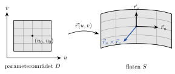

<!-- video: kommer (videoer/flervariabel-kalkulus/03-02-parametriske-flater) -->
{fig-alt="Video kommer"}

<!-- tillegg: Claude -->
Et kart over jorda er et flatt rektangel med lengdegrader og breddegrader. Hvert punkt på kartet svarer til et punkt på den runde jordkula. Akkurat slik beskriver vi en krum flate i rommet: med **to parametere** som varierer over et flatt område. En kurve trengte én parameter, fordi en maur på en kurve bare kan gå fram og tilbake. På en flate kan mauren gå i to retninger, så vi trenger to. Parametriseringen er nøkkelen til å regne ut arealer og flateintegraler, og den gir oss tangentplanet nesten gratis.

## To parametere

<!-- tillegg: Claude -->
En **parametrisk flate** $S$ er gitt ved en vektorfunksjon av to variabler:
$$
\vec r(u, v) = \big[x(u, v),\ y(u, v),\ z(u, v)\big], \qquad (u, v) \in D
$$
Området $D$ i $uv$-planet er «kartet». Hvert punkt $(u, v)$ i kartet sendes til et punkt $\vec r(u, v)$ på flaten. Rette linjer i kartet blir kurver på flaten: Holder vi $v$ fast og lar $u$ variere, går vi langs en **$u$-kurve**. Holder vi $u$ fast, går vi langs en **$v$-kurve**. Sammen danner de et rutenett på flaten.

{.tikz-fig style="width:560px" fig-alt="Til venstre et rektangel D i uv-planet med et rutenett og et merket punkt u0, v0. En pil merket r(u, v) peker mot høyre, til en buet flate S med et tilsvarende buet rutenett. I bildepunktet er tangentvektorene r u langs den ene rutelinjen og r v langs den andre tegnet, og normalvektoren r u kryss r v står ut av flaten."}

<!-- tillegg: Claude -->
Mange flater har en naturlig parametrisering fra koordinatsystemene vi allerede kjenner. Vi lar én av koordinatene være konstant og bruker de to andre som parametere:

| Flate | Parametere | $\vec r$ |
|---|---|---|
| Sylinder $x^2 + y^2 = a^2$ | $\theta$, $z$ | $\big[a\cos\theta,\ a\sin\theta,\ z\big]$ |
| Kule $x^2 + y^2 + z^2 = a^2$ | $\varphi$, $\theta$ | $\big[a\sin\varphi\cos\theta,\ a\sin\varphi\sin\theta,\ a\cos\varphi\big]$ |
| Graf $z = g(x, y)$ | $x$, $y$ | $\big[x,\ y,\ g(x, y)\big]$ |
| Plan gjennom $P$ utspent av $\vec a$ og $\vec b$ | $u$, $v$ | $\vec P + u\,\vec a + v\,\vec b$ |

For kula er parameterne nettopp vinklene fra [kulekoordinater](../02-trippelintegraler/03-kulekoordinater.qmd) med $\rho = a$ fast, og for sylinderen er de sylinderkoordinatene med $r = a$ fast. En graf er det enkleste tilfellet: Vi bruker $x$ og $y$ selv som parametere.

::: {.eksempel}
<!-- tillegg: Claude -->
**Eksempel: Omdreiningsflater.** Vi dreier kurven $y = f(x)$, $a \le x \le b$, en hel runde om $x$-aksen. Finn en parametrisering av flaten som oppstår.

::: {.losning}
Et punkt på kurven med førstekoordinat $x$ ligger i avstanden $f(x)$ fra $x$-aksen. Når det dreies, går det i en sirkel med radius $f(x)$ i et plan vinkelrett på $x$-aksen. Med vinkelen $\theta$ rundt aksen som andre parameter:
$$
\vec r(x, \theta) = \big[x,\ f(x)\cos\theta,\ f(x)\sin\theta\big], \qquad a \le x \le b,\quad 0 \le \theta \le 2\pi
$$
Med $f(x) = \sqrt x$ får vi for eksempel en skål (en paraboloide som ligger på siden), og med $f(x) = R$ konstant en sylinder om $x$-aksen. Vaser, lyspærer og flaskehalser kan alle beskrives slik.
:::
:::

## Tangentvektorer og normalvektor

<!-- tillegg: Claude -->
Går vi langs $u$-kurven gjennom et punkt, er fartsvektoren den partielle deriverte med hensyn på $u$. Tilsvarende for $v$:
$$
\vec r_u = \frac{\partial\vec r}{\partial u} = \Big[\frac{\partial x}{\partial u},\ \frac{\partial y}{\partial u},\ \frac{\partial z}{\partial u}\Big], \qquad \vec r_v = \frac{\partial\vec r}{\partial v} = \Big[\frac{\partial x}{\partial v},\ \frac{\partial y}{\partial v},\ \frac{\partial z}{\partial v}\Big]
$$
Begge ligger i flaten, i hver sin retning. To vektorer i et plan gir oss en normal med kryssproduktet:

::: {.callout-important title="Normalvektor og tangentplan"}
$$
\vec n = \vec r_u \times \vec r_v
$$
står vinkelrett på flaten i punktet $\vec r(u_0, v_0)$. Tangentplanet er planet gjennom punktet med normalen $\vec n$:
$$
\vec n\cdot\big[x - x_0,\ y - y_0,\ z - z_0\big] = 0
$$
Det virker når $\vec n \ne \vec 0$, altså når $\vec r_u$ og $\vec r_v$ ikke er parallelle.
:::

<!-- tillegg: Claude -->
Lengden $|\vec r_u \times \vec r_v|$ er arealet av parallellogrammet utspent av $\vec r_u$ og $\vec r_v$. En liten rute $\Delta u\times\Delta v$ i kartet blir derfor en flatebit med arealet omtrent $|\vec r_u\times\vec r_v|\,\Delta u\,\Delta v$. Det er den samme idéen som ga jacobideterminanten ved [variabelbytte](../01-dobbeltintegraler/04-variabelbytte.qmd), og den gir oss arealet av krumme flater under [flateintegraler](03-flateintegraler.qmd).

::: {.eksempel}
<!-- tillegg: Claude -->
**Eksempel: Normalen på en kule.** Finn $\vec r_\varphi\times\vec r_\theta$ for kula med radius $a$, og tolk svaret.

::: {.losning}
Med $\vec r = \big[a\sin\varphi\cos\theta,\ a\sin\varphi\sin\theta,\ a\cos\varphi\big]$:
$$
\vec r_\varphi = a\big[\cos\varphi\cos\theta,\ \cos\varphi\sin\theta,\ -\sin\varphi\big], \qquad \vec r_\theta = a\big[-\sin\varphi\sin\theta,\ \sin\varphi\cos\theta,\ 0\big]
$$
Kryssproduktet, komponent for komponent:
$$
\begin{aligned}
x&: \ a^2\big(\cos\varphi\sin\theta\cdot0 - (-\sin\varphi)\sin\varphi\cos\theta\big) = a^2\sin^2\varphi\cos\theta \\
y&: \ a^2\big(-\sin\varphi\cdot(-\sin\varphi\sin\theta) - \cos\varphi\cos\theta\cdot0\big) = a^2\sin^2\varphi\sin\theta \\
z&: \ a^2\big(\cos\varphi\cos\theta\sin\varphi\cos\theta + \cos\varphi\sin\theta\sin\varphi\sin\theta\big) = a^2\sin\varphi\cos\varphi
\end{aligned}
$$
Vi kan trekke ut $a\sin\varphi$:
$$
\vec r_\varphi\times\vec r_\theta = a\sin\varphi\cdot\big[a\sin\varphi\cos\theta,\ a\sin\varphi\sin\theta,\ a\cos\varphi\big] = \underline{\underline{a\sin\varphi\,\vec r}}
$$
Normalen er parallell med $\vec r$, altså retningen rett ut fra sentrum, slik vi venter for en kule. Lengden er $a\sin\varphi\cdot a = a^2\sin\varphi$. Det er faktoren fra volumelementet i kulekoordinater med $\rho = a$, og den forteller at rutene er små nær polene.
:::
:::

## Grafer og tangentplan

<!-- tillegg: Claude -->
For en graf $z = g(x, y)$ med parametriseringen $\vec r(x, y) = \big[x,\ y,\ g(x, y)\big]$ er
$$
\vec r_x = \big[1,\ 0,\ g_x\big], \qquad \vec r_y = \big[0,\ 1,\ g_y\big], \qquad \vec r_x\times\vec r_y = \big[-g_x,\ -g_y,\ 1\big]
$$
Tangentplanet i $(x_0, y_0, z_0)$ blir $-g_x(x - x_0) - g_y(y - y_0) + (z - z_0) = 0$, eller

::: {.graa}
$$
z = z_0 + g_x(x_0, y_0)\,(x - x_0) + g_y(x_0, y_0)\,(y - y_0)
$$
:::

Dette er den samme formen som tangentlinjen $y = f(x_0) + f'(x_0)(x - x_0)$ fra [tangenter og normaler](../00-verktoy/05-tangenter-og-normaler.qmd), bare med ett ledd for hver retning.

::: {.eksempel}
<!-- tillegg: Claude -->
**Eksempel: Tangentplan til en paraboloide.** Finn tangentplanet til $z = x^2 + y^2$ i punktet $(1, 1, 2)$.

::: {.losning}
$g_x = 2x$ og $g_y = 2y$, som begge er $2$ i punktet. Normalen er $\vec n = [-2,\ -2,\ 1]$, og
$$
z = 2 + 2(x - 1) + 2(y - 1) \quad\Longleftrightarrow\quad \underline{\underline{z = 2x + 2y - 2}}
$$
Kontroll: Punktet $(1, 1)$ gir $z = 2 + 2 - 2 = 2$. Nær punktet ligger paraboloiden litt over tangentplanet: I $(1.1,\ 1)$ er $z = 2.21$ på flaten og $2.20$ i planet.
:::
:::

## Prøv selv: en smultring

<!-- tillegg: Claude -->
En **torus** (smultringform) får vi ved å dreie en sirkel med radius $a$ rundt en akse i avstanden $R$ fra sentrum av sirkelen. Med vinkelen $u$ rundt den store aksen og vinkelen $v$ rundt det lille røret:
$$
\vec r(u, v) = \big[(R + a\cos v)\cos u,\ (R + a\cos v)\sin u,\ a\sin v\big], \qquad 0 \le u, v \le 2\pi
$$
Programmet tegner flaten med rutenettet fra parametriseringen. Endre `R` og `a`, eller bytt ut formlene med kula eller en omdreiningsflate fra tabellen. Hva skjer når `a` er større enn `R`?

```{.python .kjor}
import numpy as np
import matplotlib.pyplot as plt

R, a = 3.0, 1.0
u, v = np.meshgrid(np.linspace(0, 2 * np.pi, 40), np.linspace(0, 2 * np.pi, 20))

x = (R + a * np.cos(v)) * np.cos(u)
y = (R + a * np.cos(v)) * np.sin(u)
z = a * np.sin(v)

ax = plt.figure().add_subplot(projection="3d")
ax.plot_surface(x, y, z, cmap="viridis", edgecolor="k", linewidth=0.3, alpha=0.9)
ax.set_box_aspect((1, 1, a / (R + a)))
ax.set_xlabel("x"); ax.set_ylabel("y"); ax.set_zlabel("z")
plt.show()
```

:::: {.oppgaver}

::: {.oppgave tittel="Hvilken flate?"}
<!-- tillegg: Claude -->
Beskriv flatene med ord, og finn en likning i $x$, $y$ og $z$ for hver av dem.

a) $\vec r(u, v) = [2\cos v,\ u,\ 2\sin v]$, $0 \le v \le 2\pi$, $0 \le u \le 5$

b) $\vec r(u, v) = [u\cos v,\ u\sin v,\ u^2]$, $u \ge 0$, $0 \le v \le 2\pi$

c) $\vec r(u, v) = [u,\ v,\ 1 - u - v]$

::: {.fasit}
a) $x^2 + z^2 = 4$ · b) $z = x^2 + y^2$ · c) $x + y + z = 1$
:::
:::

::: {.oppgave tittel="Trekanten"}
<!-- tillegg: Claude -->
En trekant har hjørnene $P = (1, 0, 0)$, $Q = (0, 2, 0)$ og $R = (0, 0, 3)$.

a) Parametriser trekanten med $\vec r(u, v) = \vec P + u(\vec Q - \vec P) + v(\vec R - \vec P)$, og angi parameterområdet.

b) Finn normalvektoren og likningen for planet trekanten ligger i.

c) Finn arealet av trekanten.

::: {.fasit}
a) $6x + 3y + 2z = 6$ · c) $\tfrac72$
:::
:::

::: {.oppgave tittel="Kjeglen" niva="Middels"}
<!-- tillegg: Claude -->
Kjeglen $z = \sqrt{x^2 + y^2}$, $0 \le z \le 2$, kan parametriseres med $\vec r(r, \theta) = [r\cos\theta,\ r\sin\theta,\ r]$.

a) Finn $\vec r_r\times\vec r_\theta$ og lengden av den.

b) Hvor er normalvektoren null, og hvorfor er det rimelig?

::: {.fasit}
$\big[-r\cos\theta,\ -r\sin\theta,\ r\big]$ · $\sqrt2\,r$
:::
:::

::: {.oppgave tittel="Tangentplan til en kule" niva="Middels"}
<!-- tillegg: Claude -->
Punktet $(1, 2, 2)$ ligger på kula $x^2 + y^2 + z^2 = 9$. Finn tangentplanet i punktet på to måter:

a) med normalen fra eksempelet om kula ($\vec n$ parallell med $\vec r$),

b) ved å skrive den øvre halvkula som en graf $z = g(x, y)$.

::: {.fasit}
$x + 2y + 2z = 9$
:::
:::

::: {.oppgave tittel="Arealelementet på torusen" niva="Utfordrende"}
<!-- tillegg: Claude -->
Bruk parametriseringen av torusen fra «Prøv selv».

a) Vis at $\vec r_u\times\vec r_v = a(R + a\cos v)\big[\cos u\cos v,\ \sin u\cos v,\ \sin v\big]$.

b) Hvor på torusen er rutene i rutenettet størst, og hvor er de minst? Forklar med figuren fra programmet.

:::

::::
