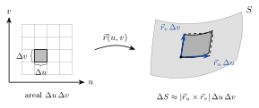

<!-- video: kommer (videoer/flervariabel-kalkulus/03-03-flateintegraler) -->
{fig-alt="Video kommer"}

<!-- tillegg: Claude -->
Hvor mye maling trengs til en parabolantenne? Hvor tung er en kuppel der betongen er tykkere nederst enn øverst? Begge spørsmålene handler om å legge sammen noe over en **krum flate**. Med [linjeintegraler](01-linjeintegraler.qmd) la vi sammen langs en kurve ved å måle små biter av buelengden, $\mathrm{d}s$. Nå gjør vi det samme over en flate, med små biter av areal, $\mathrm{d}S$. Parametriseringen fra [parametriske flater](02-parametriske-flater.qmd) gjør jobben: Den gjør integralet over flaten om til et vanlig dobbeltintegral over et flatt område.

## Arealelementet

<!-- tillegg: Claude -->
La flaten $S$ være gitt ved $\vec r(u, v)$ med $(u, v)$ i området $D$. Del $D$ i små rektangler med sider $\Delta u$ og $\Delta v$. Hvert rektangel blir sendt til en liten, litt krum flatebit på $S$.

Når vi går $\Delta u$ i $u$-retning, flytter punktet på flaten seg omtrent $\vec r_u\,\Delta u$. Går vi $\Delta v$, flytter det seg omtrent $\vec r_v\,\Delta v$. Flatebiten ligner derfor på parallellogrammet utspent av disse to vektorene, og arealet av et parallellogram er lengden av kryssproduktet.

{.tikz-fig style="width:560px" fig-alt="Til venstre et rutenett i uv-planet der én rute med sidene delta u og delta v er skyggelagt. En pil merket r(u, v) peker til høyre, mot en krum flate S. På flaten er den tilsvarende flatebiten skyggelagt, og to vektorer fra hjørnet, r u delta u og r v delta v, spenner ut et stiplet parallellogram som nesten dekker flatebiten. Under står Delta S omtrent lik lengden av r u kryss r v ganger delta u delta v."}

::: {.callout-important title="Arealelementet på en parametrisk flate"}
<!-- tillegg: Claude -->
$$
\mathrm{d}S = |\vec r_u\times\vec r_v|\,\mathrm{d}u\,\mathrm{d}v
$$
Faktoren $|\vec r_u\times\vec r_v|$ forteller hvor mye parametriseringen strekker arealet: Et lite rektangel med areal $\mathrm{d}u\,\mathrm{d}v$ i kartet blir en flatebit med areal $|\vec r_u\times\vec r_v|\,\mathrm{d}u\,\mathrm{d}v$.
:::

<!-- tillegg: Claude -->
Dette er samme idé som jacobideterminanten ved [variabelbytte](../01-dobbeltintegraler/04-variabelbytte.qmd). Der ble et rektangel i $uv$-planet til et parallellogram i $xy$-planet. Nå blir det til et parallellogram som står skrått i rommet.

For en graf $z = g(x, y)$ fant vi $\vec r_x\times\vec r_y = [-g_x,\ -g_y,\ 1]$ under parametriske flater. Lengden gir en formel vi bruker ofte:

::: {.graa}
$$
\mathrm{d}S = \sqrt{1 + g_x^2 + g_y^2}\;\mathrm{d}A
$$
:::

<!-- tillegg: Claude -->
Er flaten vannrett ($g_x = g_y = 0$), er $\mathrm{d}S = \mathrm{d}A$, som det skal være. Jo brattere flaten er, desto større blir roten: En bratt flatebit er større enn skyggen den kaster ned på $xy$-planet.

## Arealet av en krum flate

<!-- tillegg: Claude -->
Legger vi sammen alle flatebitene, får vi arealet:
$$
\text{Areal}(S) = \iint_S \mathrm{d}S = \iint_D |\vec r_u\times\vec r_v|\,\mathrm{d}u\,\mathrm{d}v
$$

::: {.eksempel}
<!-- tillegg: Claude -->
**Eksempel: Overflaten av en kule.** Vis at kula med radius $a$ har overflaten $4\pi a^2$.

::: {.losning}
Under parametriske flater fant vi at $|\vec r_\varphi\times\vec r_\theta| = a^2\sin\varphi$ for parametriseringen med kulekoordinatene $\varphi \in [0, \pi]$ og $\theta \in [0, 2\pi]$. Da er
$$
\text{Areal} = \int_0^{2\pi}\!\!\int_0^{\pi} a^2\sin\varphi\;\mathrm{d}\varphi\,\mathrm{d}\theta = a^2\cdot2\pi\cdot\Big[-\cos\varphi\Big]_0^{\pi} = a^2\cdot2\pi\cdot2 = \underline{\underline{4\pi a^2}}
$$
Faktoren $\sin\varphi$ er liten nær polene, der lengdegradene møtes og rutene i rutenettet krymper.
:::
:::

::: {.eksempel}
<!-- tillegg: Claude -->
**Eksempel: Parabolantennen.** En antenne har form som paraboloiden $z = x^2 + y^2$ for $z \le 1$ (lengder i meter). Hvor stort er arealet som skal males?

::: {.losning}
Flaten er en graf med $g_x = 2x$ og $g_y = 2y$, så
$$
\mathrm{d}S = \sqrt{1 + 4x^2 + 4y^2}\;\mathrm{d}A
$$
Skyggen $D$ på $xy$-planet er sirkelskiva $x^2 + y^2 \le 1$. Det roper på [polarkoordinater](../01-dobbeltintegraler/03-polarkoordinater.qmd): $x^2 + y^2 = r^2$ og $\mathrm{d}A = r\,\mathrm{d}r\,\mathrm{d}\theta$.
$$
\text{Areal} = \int_0^{2\pi}\!\!\int_0^1 \sqrt{1 + 4r^2}\;r\,\mathrm{d}r\,\mathrm{d}\theta
$$
Med $w = 1 + 4r^2$ er $\mathrm{d}w = 8r\,\mathrm{d}r$:
$$
\int_0^1 \sqrt{1 + 4r^2}\;r\,\mathrm{d}r = \frac18\int_1^5 \sqrt w\;\mathrm{d}w = \frac18\cdot\frac23\Big[w^{3/2}\Big]_1^5 = \frac{5\sqrt5 - 1}{12}
$$
$$
\text{Areal} = 2\pi\cdot\frac{5\sqrt5 - 1}{12} = \frac{\pi}{6}\big(5\sqrt5 - 1\big) = \underline{\underline{5.33\ \mathrm{m^2}}}
$$
Til sammenligning har skyggen arealet $\pi = 3.14\ \mathrm{m^2}$. Antennen er størst ute ved kanten, der den er brattest.
:::
:::

## Flateintegral av en funksjon

<!-- tillegg: Claude -->
Er $f(x, y, z)$ en funksjon som er definert på flaten, for eksempel massen per areal i et tynt skall, ganger vi hver flatebit med verdien av $f$ der og legger sammen:

::: {.callout-note title="Definisjon: Flateintegral av en funksjon"}
<!-- tillegg: Claude -->
$$
\iint_S f\;\mathrm{d}S = \iint_D f\big(\vec r(u, v)\big)\,|\vec r_u\times\vec r_v|\;\mathrm{d}u\,\mathrm{d}v
$$
:::

<!-- tillegg: Claude -->
Oppskriften er den samme som for linjeintegraler:

::: {.steg}
1. Parametriser flaten: $\vec r(u, v)$ med $(u, v) \in D$.
2. Regn ut $\vec r_u$, $\vec r_v$ og lengden $|\vec r_u\times\vec r_v|$.
3. Sett $\vec r(u, v)$ inn i $f$, gang med $|\vec r_u\times\vec r_v|$, og integrer over $D$.
:::

<!-- tillegg: Claude -->
Tolkningene er de samme som for [masse og tyngdepunkt](../01-dobbeltintegraler/05-anvendelser.qmd) i planet: Er $f = \delta$ massen per areal, gir integralet massen. Deler vi $\iint_S f\,\mathrm{d}S$ på arealet, får vi middelverdien av $f$ på flaten. Og middelverdien av $z$ er $z$-koordinaten til tyngdepunktet.

Integralet avhenger ikke av hvilken parametrisering vi velger, så lenge den dekker flaten én gang. Akkurat som et linjeintegral av en funksjon avhenger det heller ikke av retningen på normalen.

::: {.eksempel}
<!-- tillegg: Claude -->
**Eksempel: Kuppelen.** En kuppel har form som den øvre halvkula $x^2 + y^2 + z^2 = a^2$, $z \ge 0$.

a) Kuppelen er et tynt skall der massen per areal øker oppover: $\delta = k z$. Finn massen.

b) Et skall med jevn tykkelse: Hvor ligger tyngdepunktet?

::: {.losning}
Vi bruker kulekoordinatene med $\varphi \in [0, \pi/2]$ (bare øvre halvdel) og $\theta \in [0, 2\pi]$. Da er $z = a\cos\varphi$ og $\mathrm{d}S = a^2\sin\varphi\,\mathrm{d}\varphi\,\mathrm{d}\theta$.

**a)**
$$
M = \iint_S kz\;\mathrm{d}S = \int_0^{2\pi}\!\!\int_0^{\pi/2} k\,a\cos\varphi\cdot a^2\sin\varphi\;\mathrm{d}\varphi\,\mathrm{d}\theta = k a^3\cdot2\pi\cdot\Big[\tfrac12\sin^2\varphi\Big]_0^{\pi/2} = \underline{\underline{\pi k a^3}}
$$

**b)** Med jevn tykkelse er tyngdepunktet middelverdien av $z$ over flaten. Integralet av $z$ er det samme som i a) uten $k$, altså $\pi a^3$, og arealet av halvkula er $2\pi a^2$:
$$
\bar z = \frac{\iint_S z\;\mathrm{d}S}{\text{Areal}} = \frac{\pi a^3}{2\pi a^2} = \underline{\underline{\frac a2}}
$$
Av symmetri er $\bar x = \bar y = 0$. Tyngdepunktet ligger midt mellom bunnen og toppen. Til sammenligning ligger tyngdepunktet til en *massiv* halvkule lavere, i $3a/8$, fordi mer av massen er nær bunnen.
:::
:::

## Prøv selv: areal med datamaskinen

<!-- tillegg: Claude -->
Arealelementet kan regnes ut numerisk: Vi legger et rutenett i parameterområdet, finner $\vec r_u$ og $\vec r_v$ med differanser, og legger sammen $|\vec r_u\times\vec r_v|\,\Delta u\,\Delta v$. Programmet gjør det for parabolantennen og sammenligner med det eksakte svaret. Prøv flere ruter (`n`), eller bytt flate, for eksempel torusen fra parametriske flater (eksakt areal $4\pi^2 Ra$).

```{.python .kjor}
import numpy as np

def r(u, v):                     # parabolantennen med u = radius, v = vinkel
    return np.array([u * np.cos(v), u * np.sin(v), u**2])

u0, u1, v0, v1 = 0, 1, 0, 2 * np.pi
n = 200                          # antall ruter i hver retning
du, dv = (u1 - u0) / n, (v1 - v0) / n
u, v = np.meshgrid(u0 + (np.arange(n) + 0.5) * du, v0 + (np.arange(n) + 0.5) * dv)

h = 1e-6
ru = (r(u + h, v) - r(u - h, v)) / (2 * h)
rv = (r(u, v + h) - r(u, v - h)) / (2 * h)
lengde = np.linalg.norm(np.cross(ru, rv, axis=0), axis=0)

print("Numerisk areal:", (lengde * du * dv).sum())
print("Eksakt areal:  ", np.pi / 6 * (5 * np.sqrt(5) - 1))
```

:::: {.oppgaver}

::: {.oppgave tittel="Sylinderen"}
<!-- tillegg: Claude -->
Bruk parametriseringen $\vec r(\theta, z) = [a\cos\theta,\ a\sin\theta,\ z]$, $0 \le \theta \le 2\pi$, $0 \le z \le h$, til å finne arealet av sideflaten til en sylinder.

::: {.losning}
$$
\vec r_\theta = [-a\sin\theta,\ a\cos\theta,\ 0], \qquad \vec r_z = [0,\ 0,\ 1]
$$
$$
\vec r_\theta\times\vec r_z = [a\cos\theta,\ a\sin\theta,\ 0], \qquad |\vec r_\theta\times\vec r_z| = a
$$
$$
\text{Areal} = \int_0^{h}\!\!\int_0^{2\pi} a\;\mathrm{d}\theta\,\mathrm{d}z = \underline{\underline{2\pi a h}}
$$
Det er omkretsen ganger høyden, akkurat som når vi bretter ut sideflaten til et rektangel.
:::
:::

::: {.oppgave tittel="Det skrå planet"}
<!-- tillegg: Claude -->
Finn arealet av den delen av planet $x + y + z = 1$ som ligger i første oktant ($x, y, z \ge 0$). Bruk formelen for en graf.

::: {.losning}
Planet er grafen til $g(x, y) = 1 - x - y$, med $g_x = g_y = -1$:
$$
\mathrm{d}S = \sqrt{1 + 1 + 1}\;\mathrm{d}A = \sqrt3\;\mathrm{d}A
$$
Skyggen er trekanten $x, y \ge 0$, $x + y \le 1$ med areal $\tfrac12$. Roten er konstant, så
$$
\text{Areal} = \sqrt3\cdot\tfrac12 = \underline{\underline{\frac{\sqrt3}{2} \approx 0.866}}
$$
Kontroll: Flaten er en likesidet trekant med hjørner $(1, 0, 0)$, $(0, 1, 0)$ og $(0, 0, 1)$ og sidelengde $\sqrt2$. Arealet er $\tfrac{\sqrt3}{4}(\sqrt2)^2 = \tfrac{\sqrt3}{2}$.
:::
:::

::: {.oppgave tittel="Kjeglen" niva="Middels"}
<!-- tillegg: Claude -->
Finn arealet av kjeglen $z = \sqrt{x^2 + y^2}$, $0 \le z \le 2$. Sammenlign med formelen $\pi R s$ for sideflaten til en kjegle med grunnflateradius $R$ og sidekant $s$.

::: {.losning}
Under parametriske flater fant vi $|\vec r_r\times\vec r_\theta| = \sqrt2\,r$ for $\vec r(r, \theta) = [r\cos\theta,\ r\sin\theta,\ r]$. Toppen $z = 2$ gir $0 \le r \le 2$:
$$
\text{Areal} = \int_0^{2\pi}\!\!\int_0^2 \sqrt2\,r\;\mathrm{d}r\,\mathrm{d}\theta = \sqrt2\cdot2\pi\cdot\Big[\tfrac12r^2\Big]_0^2 = \underline{\underline{4\sqrt2\,\pi \approx 17.8}}
$$
Kjeglen har $R = 2$ og sidekant $s = \sqrt{2^2 + 2^2} = 2\sqrt2$, så $\pi R s = \pi\cdot2\cdot2\sqrt2 = 4\sqrt2\,\pi$. Det stemmer.
:::
:::

::: {.oppgave tittel="Treghetsmomentet til et kuleskall" niva="Middels"}
<!-- tillegg: Claude -->
Et tynt kuleskall med radius $a$ har jevn masse per areal $\delta$. Treghetsmomentet om $z$-aksen er $I = \iint_S \delta\,(x^2 + y^2)\;\mathrm{d}S$.

a) Regn ut $I$.

b) Uttrykk svaret med massen $M$ til skallet.

::: {.losning}
**a)** På kula er $x^2 + y^2 = a^2\sin^2\varphi$ (avstanden til $z$-aksen i annen), og $\mathrm{d}S = a^2\sin\varphi\,\mathrm{d}\varphi\,\mathrm{d}\theta$:
$$
I = \delta\int_0^{2\pi}\!\!\int_0^{\pi} a^2\sin^2\varphi\cdot a^2\sin\varphi\;\mathrm{d}\varphi\,\mathrm{d}\theta = 2\pi\delta a^4\int_0^{\pi}\sin^3\varphi\;\mathrm{d}\varphi
$$
Med $\sin^3\varphi = (1 - \cos^2\varphi)\sin\varphi$ og $w = \cos\varphi$:
$$
\int_0^{\pi}\sin^3\varphi\;\mathrm{d}\varphi = \int_{-1}^{1}(1 - w^2)\;\mathrm{d}w = 2 - \tfrac23 = \tfrac43
$$
$$
I = \underline{\underline{\frac{8\pi}{3}\,\delta a^4}}
$$

**b)** Massen er $M = \delta\cdot4\pi a^2$, så $\delta = \dfrac{M}{4\pi a^2}$ og
$$
I = \frac{8\pi}{3}\cdot\frac{M}{4\pi a^2}\cdot a^4 = \underline{\underline{\frac23 M a^2}}
$$
En massiv kule har $I = \tfrac25 Ma^2$ (se [treghetsmoment](../02-trippelintegraler/04-treghetsmoment.qmd)). Skallet har større treghetsmoment fordi all massen ligger langt ute. Derfor ruller en hul ball tregere ned et skråplan enn en massiv.
:::
:::

::: {.oppgave tittel="Sadelflaten" niva="Utfordrende"}
<!-- tillegg: Claude -->
Finn arealet av den delen av sadelflaten $z = xy$ som ligger over sirkelskiva $x^2 + y^2 \le 1$.

::: {.losning}
$g_x = y$ og $g_y = x$, så
$$
\mathrm{d}S = \sqrt{1 + x^2 + y^2}\;\mathrm{d}A = \sqrt{1 + r^2}\;r\,\mathrm{d}r\,\mathrm{d}\theta
$$
i polarkoordinater. Med $w = 1 + r^2$ og $\mathrm{d}w = 2r\,\mathrm{d}r$:
$$
\int_0^1 \sqrt{1 + r^2}\;r\,\mathrm{d}r = \frac12\int_1^2 \sqrt w\;\mathrm{d}w = \frac13\Big[w^{3/2}\Big]_1^2 = \frac{2\sqrt2 - 1}{3}
$$
$$
\text{Areal} = 2\pi\cdot\frac{2\sqrt2 - 1}{3} = \underline{\underline{\frac{2\pi}{3}\big(2\sqrt2 - 1\big) \approx 3.83}}
$$
Skyggen har arealet $\pi \approx 3.14$. Sadelflaten er litt større fordi den heller mer og mer jo lenger ut vi kommer.
:::
:::

::::
