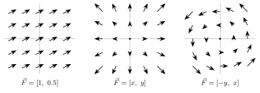

<!-- video: kommer (videoer/flervariabel-kalkulus/04-01-vektorfelt) -->
{fig-alt="Video kommer"}

<!-- tillegg: Claude -->
Et vindkart på værmeldingen viser små piler over hele landet: I hvert punkt har vinden en retning og en styrke. Det er et **vektorfelt**: en regel som gir en vektor i hvert punkt. Vektorfelt er overalt i fysikk og teknikk. Farten til vann i en elv, tyngdekraften rundt jorda, det elektriske feltet rundt en ladning og varmestrømmen i en vegg er alle vektorfelt. I resten av kapitlet regner vi med dem: Vi måler kilder og virvler, og vi regner ut arbeidet et felt gjør. Her lærer vi å tegne og lese dem.

## Hva er et vektorfelt?

::: {.callout-note title="Definisjon: Vektorfelt"}
<!-- tillegg: Claude -->
Et **vektorfelt** i planet er en funksjon som gir en vektor i hvert punkt $(x, y)$:
$$
\vec F(x, y) = \big[P(x, y),\ Q(x, y)\big]
$$
I rommet har feltet tre komponenter: $\vec F(x, y, z) = \big[P,\ Q,\ R\big]$, der hver komponent er en funksjon av $x$, $y$ og $z$.
:::

<!-- tillegg: Claude -->
Vi tegner et vektorfelt ved å velge noen punkter, regne ut $\vec F$ i hvert av dem, og tegne vektoren med foten i punktet. Ofte er vektorene så lange at de krysser hverandre. Da skalerer vi alle like mye, slik at retningene og forholdet mellom lengdene blir riktige.

{.tikz-fig style="width:620px" fig-alt="Tre ruter med piler i et 5 ganger 5 rutenett. Første rute: alle pilene er like og peker skrått opp til høyre, merket F lik 1, 0.5. Andre rute: pilene peker rett ut fra origo og blir lengre jo lenger ut de sitter, merket F lik x, y. Tredje rute: pilene står på tvers av retningen ut fra origo, slik at de går rundt origo mot klokka, og blir lengre lenger ut, merket F lik minus y, x."}

::: {.eksempel}
<!-- tillegg: Claude -->
**Eksempel: Rotasjonsfeltet.** Beskriv feltet $\vec F(x, y) = [-y,\ x]$. Regn ut $\vec F$ i punktene $(1, 0)$, $(0, 1)$, $(-1, 0)$ og $(1, 1)$, og vis at feltet alltid står vinkelrett på posisjonsvektoren.

::: {.losning}
$$
\vec F(1, 0) = [0,\ 1], \qquad \vec F(0, 1) = [-1,\ 0], \qquad \vec F(-1, 0) = [0,\ -1], \qquad \vec F(1, 1) = [-1,\ 1]
$$
I $(1, 0)$ peker feltet opp, i $(0, 1)$ mot venstre, i $(-1, 0)$ ned. Det går rundt origo mot klokka.

Med $\vec r = [x,\ y]$ er
$$
\vec F\cdot\vec r = -yx + xy = \underline{\underline{0}}
$$
så feltet står alltid vinkelrett på linja ut fra origo. Lengden er $|\vec F| = \sqrt{y^2 + x^2} = |\vec r|$: Pilene blir lengre jo lenger ut vi kommer. Slik er fartsfeltet til en plate som roterer: Punkter langt ute går fortere enn punkter nær sentrum.
:::
:::

<!-- tillegg: Claude -->
Et viktig felt i rommet er **tyngdefeltet** rundt en planet med masse $M$ i origo. Kraften på en masse $m$ i punktet $\vec r$ peker mot origo og avtar med kvadratet av avstanden:
$$
\vec F(\vec r) = -\frac{\mathrm{G}Mm}{|\vec r|^3}\,\vec r
$$
Vektoren $\vec r/|\vec r|$ har lengde $1$, så lengden av $\vec F$ er $\mathrm{G}Mm/|\vec r|^2$. Det elektriske feltet rundt en punktladning har nøyaktig samme form.

## Nabla og gradientfelt

<!-- tillegg: Claude -->
Den enkleste måten å lage et vektorfelt på er å ta gradienten til en funksjon. Vi skriver gradienten med **nabla-operatoren**
$$
\nabla = \Big[\frac{\partial}{\partial x},\ \frac{\partial}{\partial y},\ \frac{\partial}{\partial z}\Big]
$$
Den er ikke en vektor i seg selv, men en «vektor av deriverte» som venter på en funksjon å virke på. Brukt på en skalar funksjon $f$ gir den gradienten:
$$
\nabla f = \Big[\frac{\partial f}{\partial x},\ \frac{\partial f}{\partial y},\ \frac{\partial f}{\partial z}\Big]
$$
Med nabla kan vi også skrive divergens og curl kort (se [divergens og curl](02-divergens-og-curl.qmd)).

::: {.callout-note title="Definisjon: Gradientfelt"}
<!-- tillegg: Claude -->
Et vektorfelt $\vec F$ er et **gradientfelt** hvis det finnes en funksjon $f$ slik at $\vec F = \nabla f$. Funksjonen $f$ kalles et **potensial** for $\vec F$.
:::

<!-- tillegg: Claude -->
Fra [nivåkurver og gradient](../00-verktoy/04-nivakurver-og-gradient.qmd) vet vi to ting om gradienten, og de gir et bilde av hele gradientfeltet:

::: {.kort}
- **Retning:** $\nabla f$ peker dit $f$ øker raskest, altså rett opp bakken.
- **Vinkelrett på nivåkurvene:** $\nabla f$ står vinkelrett på nivåkurven gjennom punktet. Tett mellom nivåkurvene betyr bratt og lange piler.
:::

<!-- tillegg: Claude -->
Tenk på et turkart med høydekurver. Gradientfeltet til høyden peker overalt rett opp bakken, på tvers av høydekurvene. Vann renner den motsatte veien, langs $-\nabla f$.

::: {.eksempel}
<!-- tillegg: Claude -->
**Eksempel: To gradientfelt.** Finn gradientfeltet til

a) $f(x, y) = \tfrac12(x^2 + y^2)$,

b) $U(x, y, z) = m\mathrm{g}z$, den potensielle energien i et konstant tyngdefelt.

::: {.losning}
**a)** $\nabla f = [x,\ y]$. Det er det radielle feltet fra figuren. Nivåkurvene er sirkler om origo, og pilene står vinkelrett på dem, rett utover.

**b)** $\nabla U = [0,\ 0,\ m\mathrm{g}]$. Tyngdekraften er $[0,\ 0,\ -m\mathrm{g}]$, altså
$$
\underline{\underline{\vec G = -\nabla U}}
$$
I fysikken skriver vi gjerne kraften som *minus* gradienten til den potensielle energien: Kraften drar mot lavere energi, nedover bakken. Matematisk er det bare et fortegn: $\vec G$ er gradientfeltet til $-U$.
:::
:::

<!-- tillegg: Claude -->
Ikke alle vektorfelt er gradientfelt. Rotasjonsfeltet $[-y,\ x]$ er det ikke (se oppgavene). Gradientfelt har en spesiell egenskap: Arbeidet de gjør, avhenger bare av start- og sluttpunktet. Det kommer vi tilbake til under [konservative felt](04-konservative-felt.qmd).

## Strømlinjer

<!-- tillegg: Claude -->
Slipper vi en liten kork i en elv, følger den strømmen. Banen den tegner, er en **strømlinje** (eller **feltlinje**): en kurve som overalt har feltet som tangent.

::: {.callout-note title="Definisjon: Strømlinje"}
<!-- tillegg: Claude -->
En kurve $\vec r(t)$ er en **strømlinje** for feltet $\vec F$ hvis
$$
\vec r\,'(t) = \vec F\big(\vec r(t)\big)
$$
I planet betyr det to differensiallikninger: $x'(t) = P(x, y)$ og $y'(t) = Q(x, y)$.
:::

::: {.eksempel}
<!-- tillegg: Claude -->
**Eksempel: Strømlinjene til $[-y,\ x]$ og $[x,\ -y]$.**

a) Vis at sirkelen $\vec r(t) = [R\cos t,\ R\sin t]$ er en strømlinje for rotasjonsfeltet $\vec F = [-y,\ x]$.

b) Finn strømlinjene til $\vec F = [x,\ -y]$.

::: {.losning}
**a)** $\vec r\,'(t) = [-R\sin t,\ R\cos t]$. Feltet i punktet $\vec r(t)$ er $\big[-y,\ x\big] = [-R\sin t,\ R\cos t]$. De er like, så sirkelen er en strømlinje. Korken går rundt og rundt med vinkelfarten $1$.

**b)** Likningene $x' = x$ og $y' = -y$ er hver for seg eksponentielle:
$$
x(t) = x_0\,\mathrm{e}^{t}, \qquad y(t) = y_0\,\mathrm{e}^{-t}
$$
Produktet er konstant: $x(t)\,y(t) = x_0 y_0$. Strømlinjene ligger altså på hyperblene $\underline{\underline{xy = c}}$. Vannet strømmer inn langs $y$-aksen og ut langs $x$-aksen, som når to strømmer møtes og deler seg.
:::
:::

![Strømlinjene til $\vec F = [x,\ -y]$ er hyperbler $xy = c$. Strømmen kommer inn langs $y$-aksen og går ut langs $x$-aksen.](../../bilder/figurer/stromlinjer-hyperbel.svg){.tikz-fig style="width:340px" fig-alt="Koordinatsystem med fire familier av hyperbler, én i hver kvadrant, som bøyer seg rundt origo. Piler på kurvene viser at strømmen kommer inn ovenfra og nedenfra langs y-aksen og går ut til høyre og venstre langs x-aksen. Små grå feltpiler i rutenettet peker i samme retning som kurvene."}

<!-- tillegg: Claude -->
For et gradientfelt står strømlinjene vinkelrett på nivåkurvene til potensialet. Feltlinjene rundt en ladning står vinkelrett på flatene med samme elektriske potensial.

## Prøv selv: tegn et felt

<!-- tillegg: Claude -->
Programmet tegner feltet med piler (`quiver`) og strømlinjer (`streamplot`). Endre `P` og `Q`. Prøv for eksempel det radielle feltet `P = X, Q = Y`, rotasjonsfeltet `P = -Y, Q = X`, eller et virvelfelt som trekkes inn mot sentrum: `P = -Y - 0.3*X, Q = X - 0.3*Y`.

```{.python .kjor}
import numpy as np
import matplotlib.pyplot as plt

X, Y = np.meshgrid(np.linspace(-3, 3, 15), np.linspace(-3, 3, 15))
P = X            # x-komponenten
Q = -Y           # y-komponenten

fig, ax = plt.subplots(figsize=(5, 5))
ax.streamplot(X, Y, P, Q, color="tab:blue", density=1.0)
ax.quiver(X, Y, P, Q, color="gray", alpha=0.6)
ax.set_aspect("equal"); ax.set_xlabel("x"); ax.set_ylabel("y")
plt.show()
```

:::: {.oppgaver}

::: {.oppgave tittel="Et skjærfelt"}
<!-- tillegg: Claude -->
Regn ut $\vec F(x, y) = [y,\ 0]$ i punktene $(0, 1)$, $(2, 1)$, $(0, -1)$ og $(1, 0)$. Skisser feltet, og beskriv strømlinjene.

:::

::: {.oppgave tittel="Finn gradientfeltet"}
<!-- tillegg: Claude -->
Finn $\nabla f$ for $f(x, y, z) = xy^2 + z$, og regn ut feltet i punktet $(1, 2, 0)$.

::: {.fasit}
$\big[y^2,\ 2xy,\ 1\big]$
:::
:::

::: {.oppgave tittel="Gradient og nivåkurve" niva="Middels"}
<!-- tillegg: Claude -->
La $f(x, y) = x^2 + 4y^2$.

a) Finn $\nabla f$ i punktet $(2, 1)$.

b) Finn en retningsvektor for tangenten til nivåkurven gjennom $(2, 1)$, og kontroller at den står vinkelrett på gradienten.

c) Hvilken retning ville vann rent hvis $f$ var høyden i et landskap?

::: {.fasit}
a) $[4,\ 8]$ · b) $[2,\ -1]$ · c) $[-1,\ -2]$
:::
:::

::: {.oppgave tittel="Strømlinjer for det radielle feltet" niva="Middels"}
<!-- tillegg: Claude -->
Finn strømlinjene til $\vec F(x, y) = [x,\ y]$. Hvilken form har de?

:::

::: {.oppgave tittel="Gradientfelt eller ikke?" niva="Middels"}
<!-- tillegg: Claude -->
a) Finn en funksjon $f$ slik at $\nabla f = [y,\ x]$.

b) Vis at det ikke finnes noen funksjon $f$ med $\nabla f = [-y,\ x]$.

::: {.fasit}
$f(x, y) = xy$
:::
:::

::: {.oppgave tittel="Tyngdefeltet har et potensial" niva="Utfordrende"}
<!-- tillegg: Claude -->
Vis at tyngdefeltet $\vec F = -\dfrac{\mathrm{G}Mm}{|\vec r|^3}\,\vec r$ er gradientfeltet til
$$
f(x, y, z) = \frac{\mathrm{G}Mm}{\sqrt{x^2 + y^2 + z^2}}
$$
Hvordan ser nivåflatene til $f$ ut, og hvordan står feltet i forhold til dem?

:::

::::
