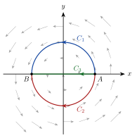

<!-- tillegg: Claude -->
Oppgavene blander alt om vektorfelt: gradientfelt, divergens og curl, [linjeintegraler av vektorfelt](03-linjeintegraler-av-vektorfelt.qmd) og [konservative felt](04-konservative-felt.qmd). Når du skal regne ut et arbeid eller en sirkulasjon $\int_C \vec F\cdot\mathrm{d}\vec r$, lønner det seg å stille ett spørsmål først:

::: {.steg}
1. **Er feltet konservativt?** Sjekk curl. Er $\nabla\times\vec F = \vec 0$ i et område uten hull, finnes det et potensial.
2. **Ja: finn potensialet** $f$ med $\nabla f = \vec F$, og regn ut $\int_C \vec F\cdot\mathrm{d}\vec r = f(B) - f(A)$. Veien spiller ingen rolle, og rundt en lukket kurve blir svaret $0$.
3. **Nei: parametriser** kurven med $\vec r(t)$, $a \le t \le b$, og regn ut $\int_a^b \vec F(\vec r(t))\cdot\vec r\,'(t)\,\mathrm{d}t$. Pass på retningen.
:::

Prøv selv før du åpner løsningen.

:::: {.oppgaver}

::: {.oppgave tittel="Arbeid langs to veier" krever="vektorfelt/linjeintegraler"}
<!-- tillegg: Claude -->
La $\vec F(x, y) = [2x,\ xy]$.

a) Regn ut $\int_C \vec F\cdot\mathrm{d}\vec r$ når $C$ er linjestykket fra $(0, 0)$ til $(1, 2)$.

b) Hva blir svaret hvis vi går den andre veien, fra $(1, 2)$ til $(0, 0)$?

c) Regn ut integralet langs parabelen $y = 2x^2$ fra $(0, 0)$ til $(1, 2)$.

d) Hva forteller svarene om feltet? Kontroller med curl.

::: {.losning}
**a)** $\vec r(t) = [t,\ 2t]$, $0 \le t \le 1$, gir $\vec r\,'(t) = [1,\ 2]$ og $\vec F(\vec r(t)) = [2t,\ 2t^2]$:
$$
\int_C \vec F\cdot\mathrm{d}\vec r = \int_0^1 \big(2t\cdot1 + 2t^2\cdot2\big)\,\mathrm{d}t = \Big[t^2 + \tfrac43t^3\Big]_0^1 = \underline{\underline{\tfrac73}}
$$

**b)** Å snu retningen snur tangentvektoren, så integralet skifter fortegn: $\underline{\underline{-\tfrac73}}$.

**c)** $\vec r(t) = [t,\ 2t^2]$ gir $\vec r\,'(t) = [1,\ 4t]$ og $\vec F(\vec r(t)) = [2t,\ 2t^3]$:
$$
\int_C \vec F\cdot\mathrm{d}\vec r = \int_0^1 \big(2t + 8t^4\big)\,\mathrm{d}t = 1 + \tfrac85 = \underline{\underline{\tfrac{13}{5}}}
$$

**d)** To veier mellom de samme punktene gir forskjellig svar, så integralet avhenger av veien, og feltet er **ikke konservativt**. Det stemmer med curl: $Q_x - P_y = y - 0 = y$, som ikke er null.
:::
:::

::: {.oppgave tittel="Tre veier i rotasjonsfeltet" krever="vektorfelt/linjeintegraler"}
<!-- tillegg: Claude -->
Rotasjonsfeltet $\vec F = [-y,\ x]$ og tre veier fra $A = (1, 0)$ til $B = (-1, 0)$: $C_1$ er den øvre halvdelen av enhetssirkelen, $C_2$ den nedre, og $C_3$ er linjestykket langs $x$-aksen.

{.tikz-fig style="width:360px" fig-alt="Koordinatsystem med små piler som går rundt origo mot klokka. Punktene A i (1, 0) og B i (-1, 0) er forbundet med tre veier: C1 er den øvre halvdelen av enhetssirkelen, C2 den nedre halvdelen, og C3 er linjestykket langs x-aksen. Alle tre veiene har en pil fra A mot B."}

a) Regn ut $\int \vec F\cdot\mathrm{d}\vec r$ langs alle tre veiene.

b) Forklar fortegnene ut fra figuren.

::: {.losning}
**a)** $C_1$: $\vec r(t) = [\cos t,\ \sin t]$, $0 \le t \le \pi$. Da er $\vec F\cdot\vec r\,' = (-\sin t)(-\sin t) + \cos t\cos t = 1$, så integralet er $\underline{\underline{\pi}}$.

$C_2$: $\vec r(t) = [\cos t,\ -\sin t]$, $0 \le t \le \pi$, med $\vec r\,'(t) = [-\sin t,\ -\cos t]$. Da er $\vec F\cdot\vec r\,' = (\sin t)(-\sin t) + \cos t\,(-\cos t) = -1$, så integralet er $\underline{\underline{-\pi}}$.

$C_3$: På $x$-aksen er $y = 0$, så $\vec F = [0,\ x]$ peker loddrett, mens veien går vannrett. Prikkproduktet er null hele veien, og integralet er $\underline{\underline{0}}$.

**b)** Feltet går rundt origo mot klokka. På $C_1$ går vi samme vei som feltet og får positivt arbeid. På $C_2$ går vi med klokka, mot feltet, og får negativt arbeid. På $C_3$ står feltet vinkelrett på veien. Tre forskjellige svar viser at feltet ikke er konservativt, slik curl $= 2$ også sier.
:::
:::

::: {.oppgave tittel="Hvilke felt er konservative?" krever="vektorfelt/konservative"}
<!-- tillegg: Claude -->
Avgjør om feltene er konservative i hele rommet. Finn et potensial der det finnes.

a) $\vec F = [yz,\ xz,\ xy]$

b) $\vec G = [2xy,\ x^2 + z,\ y]$

c) $\vec H = [y,\ -x,\ z]$

::: {.losning}
Hele rommet har ingen hull, så curl $= \vec 0$ betyr at det finnes et potensial.

**a)** $\nabla\times\vec F = [x - x,\ y - y,\ z - z] = \vec 0$. Konservativt. $f_x = yz$ gir $f = xyz + g(y, z)$, og $f_y = xz + g_y$ skal være $xz$, så $g_y = 0$. Tilsvarende $g_z = 0$: $\underline{\underline{f = xyz}}$.

**b)** $\nabla\times\vec G = [1 - 1,\ 0 - 0,\ 2x - 2x] = \vec 0$. Konservativt. $f_x = 2xy$ gir $f = x^2y + g(y, z)$. Da er $f_y = x^2 + g_y = x^2 + z$, så $g = yz + h(z)$, og $f_z = y + h'(z) = y$ gir $h' = 0$: $\underline{\underline{f = x^2y + yz}}$.

**c)** $\nabla\times\vec H = [0 - 0,\ 0 - 0,\ -1 - 1] = [0,\ 0,\ -2] \ne \vec 0$. **Ikke konservativt.** Feltet går rundt $z$-aksen med klokka (sett ovenfra) og strekker seg samtidig ut langs $z$.
:::
:::

::: {.oppgave tittel="Arbeidet til en fjær i planet" krever="vektorfelt/linjeintegraler, vektorfelt/konservative"}
<!-- tillegg: Claude -->
En kule ligger på et glatt bord og er festet til en fjær med stivhet $k = 50\ \mathrm{N/m}$. Fjæra er festet i origo og har null lengde i hvile, så kraften på kula er $\vec F = -k\,[x,\ y]$. Kula flyttes fra $A = (0.10,\ 0)\ \mathrm{m}$ til $B = (0,\ 0.20)\ \mathrm{m}$.

a) Vis at $f(x, y) = -\tfrac12k\,(x^2 + y^2)$ er et potensial for $\vec F$.

b) Finn arbeidet fjærkraften gjør. Spiller det noen rolle hvilken vei kula følger?

::: {.losning}
**a)** $f_x = -kx$ og $f_y = -ky$, så $\nabla f = -k\,[x,\ y] = \vec F$.

**b)** Feltet er konservativt, så arbeidet er potensialforskjellen, uansett vei:
$$
W = f(B) - f(A) = -\tfrac12k\big(r_B^2 - r_A^2\big) = -\tfrac12\cdot50\ \mathrm{N/m}\cdot\big(0.040 - 0.010\big)\ \mathrm{m^2} = \underline{\underline{-0.75\ \mathrm{J}}}
$$
Arbeidet er negativt fordi kula ender lenger fra origo, og fjæra strekkes mer. Potensialet $f$ er minus den potensielle energien $\tfrac12kr^2$, så $W = -\Delta E_\mathrm{p}$.
:::
:::

::: {.oppgave tittel="Potensial sparer regning" niva="Middels" krever="vektorfelt/konservative"}
<!-- tillegg: Claude -->
La $\vec F(x, y) = [y\cos x,\ \sin x + 2y]$.

a) Vis at $\vec F$ er konservativt, og finn et potensial.

b) Regn ut $\int_C \vec F\cdot\mathrm{d}\vec r$ langs kurven $\vec r(t) = \big[\tfrac\pi2t,\ t^3\big]$, $0 \le t \le 1$.

::: {.losning}
**a)** $Q_x - P_y = \cos x - \cos x = 0$ i hele planet, så feltet er konservativt. $f_x = y\cos x$ gir $f = y\sin x + g(y)$, og $f_y = \sin x + g'(y) = \sin x + 2y$ gir $g = y^2$:
$$
\underline{\underline{f(x, y) = y\sin x + y^2}}
$$

**b)** Kurven går fra $\vec r(0) = (0, 0)$ til $\vec r(1) = (\tfrac\pi2, 1)$. Med potensialet slipper vi å sette inn kurven:
$$
\int_C \vec F\cdot\mathrm{d}\vec r = f\big(\tfrac\pi2, 1\big) - f(0, 0) = 1\cdot\sin\tfrac\pi2 + 1^2 - 0 = \underline{\underline{2}}
$$
Å sette inn parametriseringen direkte gir integralet av $\tfrac\pi2t^3\cos\tfrac{\pi t}{2} + 3t^2\big(\sin\tfrac{\pi t}{2} + 2t^3\big)$, som er mye tyngre, men gir det samme.
:::
:::

::: {.oppgave tittel="Sirkulasjon i en spiral" niva="Middels" krever="vektorfelt/divergens-og-curl, vektorfelt/linjeintegraler"}
<!-- tillegg: Claude -->
Feltet $\vec F = [x - y,\ x + y]$ har curl $2$ overalt. Regn ut sirkulasjonen $\oint_C \vec F\cdot\mathrm{d}\vec r$ rundt enhetssirkelen mot klokka, og sammenlikn med curl ganger arealet av sirkelskiva.

::: {.losning}
$\vec r(t) = [\cos t,\ \sin t]$, $0 \le t \le 2\pi$, og $\vec r\,'(t) = [-\sin t,\ \cos t]$:
$$
\vec F\cdot\vec r\,' = (\cos t - \sin t)(-\sin t) + (\cos t + \sin t)\cos t = \sin^2 t + \cos^2 t = 1
$$
så
$$
\oint_C \vec F\cdot\mathrm{d}\vec r = \int_0^{2\pi} 1\,\mathrm{d}t = \underline{\underline{2\pi}}
$$
Curl ganger areal er $2\cdot\pi\cdot1^2 = 2\pi$, det samme. Den radielle delen $[x,\ y]$ står vinkelrett på sirkelen og bidrar ikke. Bare rotasjonsdelen gir sirkulasjon. At sirkulasjonen er summen av all curl inni, er [Greens teorem](../05-integralsetninger/02-greens-teorem.qmd).
:::
:::

::: {.oppgave tittel="Sirkulasjon i et skjærfelt" niva="Middels" krever="vektorfelt/divergens-og-curl, vektorfelt/linjeintegraler"}
<!-- tillegg: Claude -->
Vann mellom to plater har fartsfeltet $\vec v = [y,\ 0]$ (skjærfeltet). Regn ut sirkulasjonen rundt kvadratet med hjørner $(0, 0)$, $(1, 0)$, $(1, 1)$ og $(0, 1)$, gjennomløpt mot klokka. Sammenlikn med curl.

::: {.losning}
Vi tar én side om gangen:

- Nedre side, $y = 0$, mot høyre: $\vec v = \vec 0$, bidrag $0$.
- Høyre side, $x = 1$, oppover: $\vec v$ er vannrett, veien loddrett, bidrag $0$.
- Øvre side, $y = 1$, mot venstre: $\vec v = [1,\ 0]$ og $\mathrm{d}\vec r = [-1,\ 0]\,\mathrm{d}t$ over lengden $1$, bidrag $-1$.
- Venstre side, $x = 0$, nedover: loddrett vei, bidrag $0$.

Sirkulasjonen er $\underline{\underline{-1}}$. Curl er $Q_x - P_y = 0 - 1 = -1$, og ganget med arealet $1$ blir det $-1$, det samme. Negativt fortegn betyr at vannet vil dreie et padlehjul med klokka: Vannet på oversiden går fortere enn på undersiden.
:::
:::

::: {.oppgave tittel="Finn konstanten" niva="Utfordrende" krever="vektorfelt/konservative"}
<!-- tillegg: Claude -->
La $\vec F = \big[2xy + z^3,\ x^2 + az,\ 3xz^2 + y\big]$, der $a$ er en konstant.

a) Finn $a$ slik at $\vec F$ er konservativt.

b) Finn et potensial for denne verdien av $a$.

c) Finn arbeidet langs kurven $\vec r(t) = [t,\ 2t^2,\ t^3]$, $0 \le t \le 1$.

::: {.losning}
**a)**
$$
\nabla\times\vec F = \big[R_y - Q_z,\ P_z - R_x,\ Q_x - P_y\big] = \big[1 - a,\ 3z^2 - 3z^2,\ 2x - 2x\big] = [1 - a,\ 0,\ 0]
$$
Curl er null når $\underline{\underline{a = 1}}$.

**b)** $f_x = 2xy + z^3$ gir $f = x^2y + xz^3 + g(y, z)$. Da er $f_y = x^2 + g_y = x^2 + z$, så $g = yz + h(z)$. Til slutt $f_z = 3xz^2 + y + h'(z) = 3xz^2 + y$, så $h' = 0$:
$$
\underline{\underline{f(x, y, z) = x^2y + xz^3 + yz}}
$$

**c)** Kurven går fra $(0, 0, 0)$ til $(1, 2, 1)$:
$$
W = f(1, 2, 1) - f(0, 0, 0) = 2 + 1 + 2 = \underline{\underline{5}}
$$
:::
:::

::: {.oppgave tittel="Virvelen og hullet i origo" niva="Utfordrende" krever="vektorfelt/konservative, vektorfelt/divergens-og-curl"}
<!-- tillegg: Claude -->
Virvelen
$$
\vec F(x, y) = \left[\frac{-y}{x^2 + y^2},\ \frac{x}{x^2 + y^2}\right]
$$
har $\nabla\times\vec F = 0$ overalt der den er definert, altså overalt unntatt i origo.

a) Regn ut sirkulasjonen rundt sirkelen med radius $2$ om origo, mot klokka.

b) Vis at $\theta(x, y) = \arctan(y/x)$ er et potensial for $\vec F$ i halvplanet $x > 0$. Hva blir da sirkulasjonen rundt sirkelen med sentrum $(3, 0)$ og radius $1$?

c) Hvorfor strider ikke svaret i a) mot at curl er null?

::: {.losning}
**a)** $\vec r(t) = [2\cos t,\ 2\sin t]$ gir $x^2 + y^2 = 4$, $\vec F = \tfrac14[-2\sin t,\ 2\cos t]$ og $\vec r\,' = [-2\sin t,\ 2\cos t]$:
$$
\vec F\cdot\vec r\,' = \tfrac14\big(4\sin^2 t + 4\cos^2 t\big) = 1, \qquad \oint_C \vec F\cdot\mathrm{d}\vec r = \int_0^{2\pi}1\,\mathrm{d}t = \underline{\underline{2\pi}}
$$
Svaret er $2\pi$ for alle radier: Feltet er svakere langt ute ($1/r$), men sirkelen er lengre ($2\pi r$).

**b)** Med $u = y/x$ er
$$
\theta_x = \frac{1}{1 + u^2}\cdot\Big(-\frac{y}{x^2}\Big) = \frac{-y}{x^2 + y^2}, \qquad \theta_y = \frac{1}{1 + u^2}\cdot\frac1x = \frac{x}{x^2 + y^2}
$$
så $\nabla\theta = \vec F$. Sirkelen med sentrum $(3, 0)$ og radius $1$ ligger helt i $x > 0$, der feltet har et potensial. Sirkulasjonen rundt en lukket kurve er da $\theta(\text{slutt}) - \theta(\text{start}) = \underline{\underline{0}}$.

**c)** Curl $= 0$ gir et potensial bare i et område **uten hull** (enkeltsammenhengende). Planet uten origo har et hull, og sirkelen i a) går rundt det. Potensialet $\theta$ er vinkelen til punktet, og den øker med $2\pi$ for hver runde: Den kan ikke defineres som én sammenhengende funksjon hele veien rundt origo. Derfor blir sirkulasjonen $2\pi$ og ikke $0$. Sirkelen i b) går ikke rundt hullet, og der virker potensialet.
:::
:::

::::
