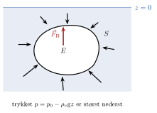

<!-- video: kommer (videoer/flervariabel-kalkulus/05-04-divergenssetningen) -->
{fig-alt="Video kommer"}

<!-- tillegg: Claude -->
Blås opp en ballong, og hold den under vann. Hvor mye luft strømmer ut gjennom et lite hull? Det må være like mye som det luften inni krymper med. Mer generelt: Det som strømmer ut gjennom overflaten av et område, må komme fra kilder inni området. **Divergenssetningen** (også kalt Gauss' setning) sier dette presist: Fluksen ut av en lukket flate er lik integralet av divergensen over volumet inni. Det er det samme som [fluksformen av Greens teorem](02-greens-teorem.qmd), bare i rommet. Setningen er grunnlaget for alle bevaringslover i fysikken, for Gauss' lov i elektromagnetismen og for endelig volum-metoden. Og den forklarer hvorfor oppdriften på en stein er lik tyngden av vannet steinen fortrenger.

## Ideen: små bokser

<!-- tillegg: Claude -->
Del området $E$ i mange små bokser. Det som strømmer ut av én boks gjennom en indre sideflate, strømmer rett inn i naboboksen. Når vi legger sammen fluksen ut av alle boksene, opphever bidragene fra de indre sideflatene hverandre, og igjen står bare fluksen ut gjennom den ytre randen $S$.

Hvor mye strømmer ut av én liten boks $[x,\ x + \Delta x]\times[y,\ y + \Delta y]\times[z,\ z + \Delta z]$? Gjennom de to sideflatene som står vinkelrett på $x$-aksen, teller bare $P$. Ut gjennom høyre side går $P(x + \Delta x, y, z)\,\Delta y\,\Delta z$, og inn gjennom venstre side kommer $P(x, y, z)\,\Delta y\,\Delta z$. Netto ut er
$$
\big[P(x + \Delta x, y, z) - P(x, y, z)\big]\,\Delta y\,\Delta z \approx \frac{\partial P}{\partial x}\,\Delta x\,\Delta y\,\Delta z
$$
De to andre parene av sideflater gir $\dfrac{\partial Q}{\partial y}\,\Delta V$ og $\dfrac{\partial R}{\partial z}\,\Delta V$. Til sammen strømmer det omtrent $(\nabla\cdot\vec F)\,\Delta V$ ut av boksen. Det er nettopp det [divergensen](../04-vektorfelt/02-divergens-og-curl.qmd) er: kildestyrke per volum.

::: {.callout-important title="Divergenssetningen"}
<!-- tillegg: Claude -->
La $E$ være et begrenset område i rommet med en lukket, stykkevis glatt randflate $S$, og la $\vec n$ være utovernormalen. Har $\vec F$ kontinuerlige partielle deriverte i et åpent område som inneholder hele $E$, er
$$
\iint_S \vec F\cdot\vec n\,\mathrm{d}S = \iiint_E \nabla\cdot\vec F\,\mathrm{d}V
$$
Venstre side er fluksen ut av $E$, høyre side er summen av alle kildene og slukene inni.
:::

<!-- tillegg: Claude -->
Setningen kan brukes begge veier. Ofte er et volumintegral av divergensen mye enklere enn et flateintegral over en flate med mange deler, og noen ganger er det omvendt.

::: {.eksempel}
<!-- tillegg: Claude -->
**Eksempel: Fluks ut av en kube, to veier.** Finn fluksen til $\vec F = [x^2,\ y^2,\ z^2]$ ut av kuben $0 \le x, y, z \le 1$, både direkte og med divergenssetningen.

::: {.losning}
**Direkte:** På sideflaten $x = 1$ er $\vec n = [1,\ 0,\ 0]$ og $\vec F\cdot\vec n = x^2 = 1$, så fluksen er $1$. På $x = 0$ er $\vec n = [-1,\ 0,\ 0]$ og $\vec F\cdot\vec n = -x^2 = 0$. Det samme skjer i $y$- og $z$-retning, så fluksen ut er $1 + 1 + 1 = 3$.

**Med divergenssetningen:** $\nabla\cdot\vec F = 2x + 2y + 2z$, og
$$
\iiint_E (2x + 2y + 2z)\,\mathrm{d}V = 3\int_0^1\!\!\int_0^1\!\!\int_0^1 2x\,\mathrm{d}x\,\mathrm{d}y\,\mathrm{d}z = 3\cdot1 = \underline{\underline{3}}
$$
(De tre leddene gir like mye på grunn av symmetrien.)
:::
:::

::: {.eksempel}
<!-- tillegg: Claude -->
**Eksempel: Fluks ut av en kule.** Finn fluksen til $\vec F = [x^3 + y\sin z,\ y^3 + \mathrm{e}^{x}z,\ z^3]$ ut av kula med radius $a$ om origo.

::: {.losning}
Direkte ville dette vært tungt. Men divergensen er enkel, fordi $y\sin z$ ikke avhenger av $x$ og $\mathrm{e}^x z$ ikke avhenger av $y$:
$$
\nabla\cdot\vec F = 3x^2 + 3y^2 + 3z^2 = 3\rho^2
$$
I [kulekoordinater](../02-trippelintegraler/03-kulekoordinater.qmd) er $\mathrm{d}V = \rho^2\sin\varphi\,\mathrm{d}\rho\,\mathrm{d}\varphi\,\mathrm{d}\theta$:
$$
\iiint_E 3\rho^2\,\mathrm{d}V = \int_0^{2\pi}\!\!\int_0^{\pi}\!\!\int_0^a 3\rho^4\sin\varphi\,\mathrm{d}\rho\,\mathrm{d}\varphi\,\mathrm{d}\theta = 2\pi\cdot2\cdot\frac{3a^5}{5} = \underline{\underline{\frac{12\pi a^5}{5}}}
$$
:::
:::

::: {.eksempel}
<!-- tillegg: Claude -->
**Eksempel: Fluks gjennom en åpen flate ved å lukke den.** Finn fluksen til $\vec F = [x,\ y,\ z + 1]$ oppover gjennom halvkula $S_1$: $x^2 + y^2 + z^2 = 1$, $z \ge 0$.

::: {.losning}
Halvkula er ikke lukket, men vi kan lukke den med bunnen $S_2$, disken $x^2 + y^2 \le 1$ i planet $z = 0$. Da omslutter $S_1$ og $S_2$ den halve kula $E$, og divergenssetningen gir
$$
\Phi_1 + \Phi_2 = \iiint_E \nabla\cdot\vec F\,\mathrm{d}V = \iiint_E 3\,\mathrm{d}V = 3\cdot\frac{2\pi}{3} = 2\pi
$$
der $\tfrac{2\pi}{3}$ er volumet av en halv kule med radius $1$. På bunnen peker utovernormalen ned, $\vec n = [0,\ 0,\ -1]$, så $\vec F\cdot\vec n = -(z + 1) = -1$ og $\Phi_2 = -1\cdot\pi = -\pi$. Altså er
$$
\Phi_1 = 2\pi - (-\pi) = \underline{\underline{3\pi}}
$$
Kontroll direkte: På halvkula er $\vec n = [x,\ y,\ z]$, så $\vec F\cdot\vec n = x^2 + y^2 + z^2 + z = 1 + z$. Arealet er $2\pi$, og $\iint_{S_1} z\,\mathrm{d}S = \pi$, så fluksen er $2\pi + \pi = 3\pi$.
:::
:::

## Bevaring: det som går ut, må komme fra et sted

<!-- tillegg: Claude -->
La $\rho$ være massetettheten til en gass eller væske, og $\vec v$ farten. Da er $\rho\vec v$ massefluksen, massen som går gjennom en flate per areal og tid. Massen inni et fast område $E$ kan bare endre seg ved at noe strømmer inn eller ut gjennom randen:
$$
\frac{\mathrm{d}}{\mathrm{d}t}\iiint_E \rho\,\mathrm{d}V = -\iint_S \rho\vec v\cdot\vec n\,\mathrm{d}S = -\iiint_E \nabla\cdot(\rho\vec v)\,\mathrm{d}V
$$
Det siste likhetstegnet er divergenssetningen. Siden dette gjelder for *alle* områder, også bitte små, må integrandene være like i hvert punkt:

::: {.graa}
$$
\frac{\partial\rho}{\partial t} + \nabla\cdot(\rho\vec v) = 0
$$
:::

<!-- tillegg: Claude -->
Dette er **kontinuitetslikningen**. Den samme oppskriften gir bevaringslover for energi, ladning og stoffmengde, og den brukes baklengs i [endelig volum-metoden](../08-endelig-volum/01-kontrollvolum-og-bevaring.qmd): Der integrerer vi likningen over hver lille celle og fører regnskap med fluksene gjennom celleflatene.

## Gauss' lov

<!-- tillegg: Claude -->
Under [fluks gjennom en flate](03-fluks-i-rommet.qmd) fant vi at den elektriske fluksen ut av en kule rundt en punktladning $q$ er $q/\varepsilon_0$, uansett radius. Med divergenssetningen kan vi vise at det gjelder for **enhver** lukket flate rundt ladningen, ikke bare kuler.

Feltet $\vec E = \mathrm{k_e}\,q\,\hat{\vec r}/\rho^2$ har divergens null overalt unntatt i origo. La $S$ være en lukket flate rundt origo, og legg en liten kule $S_\varepsilon$ om origo inni $S$. I området mellom dem er feltet glatt og divergensfritt, så divergenssetningen gir null netto fluks ut av dette området. Randen består av $S$ (normal ut) og kula $S_\varepsilon$ (normal inn mot origo, altså ut av området mellom). Fluksen ut gjennom $S$ er derfor lik fluksen ut gjennom den lille kula, som er $q/\varepsilon_0$. Ligger ladningen utenfor $S$, er feltet glatt og divergensfritt inni $S$, og fluksen er null.

::: {.callout-important title="Gauss' lov"}
<!-- tillegg: Claude -->
For enhver lukket flate $S$ er den elektriske fluksen ut lik ladningen $Q_\text{inni}$ som flaten omslutter, delt på $\varepsilon_0$:
$$
\iint_S \vec E\cdot\vec n\,\mathrm{d}S = \frac{Q_\text{inni}}{\varepsilon_0}
$$
Ladninger utenfor flaten bidrar ikke til fluksen, selv om de påvirker feltet på flaten.
:::

<!-- tillegg: Claude -->
Med mange ladninger, eller en ladningstetthet $\varrho$, legger vi sammen bidragene. Divergenssetningen brukt på et lite område gir da Gauss' lov på differensialform, $\nabla\cdot\vec E = \varrho/\varepsilon_0$, som er en av Maxwells likninger.

::: {.eksempel}
<!-- tillegg: Claude -->
**Eksempel: En ladning midt i en terning.** En punktladning $q = 3.0\ \mathrm{nC}$ sitter i sentrum av en terning. Finn den elektriske fluksen ut av hele terningen, og ut gjennom én av sideflatene.

::: {.losning}
Gauss' lov gir fluksen ut av hele terningen:
$$
\Phi_E = \frac{q}{\varepsilon_0} = \frac{3.0\cdot10^{-9}\ \mathrm{C}}{8.854\cdot10^{-12}\ \mathrm{C^2/(N\,m^2)}} = 339\ \mathrm{N\,m^2/C} \approx \underline{\underline{3.4\cdot10^2\ \mathrm{N\,m^2/C}}}
$$
Ladningen sitter i sentrum, så alle de seks sideflatene ser den på samme måte og får like mye. Gjennom én sideflate går
$$
\frac{339\ \mathrm{N\,m^2/C}}{6} = \underline{\underline{56\ \mathrm{N\,m^2/C}}}
$$
Å regne ut fluksen gjennom én sideflate direkte er et vanskelig integral. Symmetrien og Gauss' lov gjør det i én linje.
:::
:::

## Arkimedes' lov

<!-- tillegg: Claude -->
Et legeme $E$ med overflaten $S$ er helt omgitt av en væske med massetettheten $\rho_v$. Vi legger $z$-aksen oppover med vannflaten i $z = 0$. Trykket i dybden $-z$ er $p = p_0 - \rho_v\mathrm{g}z$, der $p_0$ er lufttrykket. Trykket dytter vinkelrett inn på overflaten, så kraften på en liten flatebit er $-p\,\vec n\,\mathrm{d}S$, der $\vec n$ er utovernormalen. Den samlede kraften fra væsken er
$$
\vec F_\mathrm{B} = -\iint_S p\,\vec n\,\mathrm{d}S
$$

{.tikz-fig style="width:440px" fig-alt="Et legeme E med uregelmessig form ligger helt under en vannflate merket z lik null. Rundt legemet peker åtte piler inn mot overflaten S fra alle kanter, og pilene nederst er lengre enn pilene øverst. En tykk pil merket F B peker rett opp fra midten av legemet. Teksten under sier at trykket p lik p null minus rho v g z er størst nederst."}

<!-- tillegg: Claude -->
Se på $z$-komponenten. Den er $-\iint_S p\,n_z\,\mathrm{d}S$, og $p\,n_z$ er normalkomponenten til vektorfeltet $[0,\ 0,\ p]$. Divergenssetningen gir
$$
F_{\mathrm{B},z} = -\iint_S [0,\ 0,\ p]\cdot\vec n\,\mathrm{d}S = -\iiint_E \frac{\partial p}{\partial z}\,\mathrm{d}V = -\iiint_E \big(-\rho_v\mathrm{g}\big)\,\mathrm{d}V = \rho_v\mathrm{g}V
$$
På samme måte er $x$-komponenten $-\iiint_E \dfrac{\partial p}{\partial x}\,\mathrm{d}V = 0$, fordi trykket ikke endrer seg sidelengs, og det samme gjelder $y$-komponenten. Oppdriften peker altså rett opp og er lik **tyngden av væsken legemet fortrenger**, uansett hvilken form legemet har. Lufttrykket $p_0$ er konstant og forsvinner når vi deriverer: Det presser like mye fra alle kanter.

::: {.eksempel}
<!-- tillegg: Claude -->
**Eksempel: Oppdrift på en stein.** En stein med volumet $2.50\ \mathrm{L}$ ligger på bunnen av et vann. Hvor stor er oppdriften? Vann har massetettheten $1.00\cdot10^3\ \mathrm{kg/m^3}$.

::: {.losning}
$V = 2.50\ \mathrm{L} = 2.50\cdot10^{-3}\ \mathrm{m^3}$, og
$$
F_\mathrm{B} = \rho_v\mathrm{g}V = 1.00\cdot10^3\ \mathrm{kg/m^3}\cdot9.81\ \mathrm{m/s^2}\cdot2.50\cdot10^{-3}\ \mathrm{m^3} = \underline{\underline{24.5\ \mathrm{N}}}
$$
Formen på steinen spiller ingen rolle, bare volumet.
:::
:::

## Prøv selv: sjekk setningen numerisk

<!-- tillegg: Claude -->
Programmet regner ut begge sider av divergenssetningen for en boks: fluksen ut gjennom de seks sideflatene, og volumintegralet av divergensen. Begge regnes med midtpunktsummer. Endre feltet `F` og boksen, og trykk **Kjør**.

```{.python .kjor}
import numpy as np

def F(x, y, z):
    return x**2, y**2, z**2

x0, x1 = 0.0, 1.0                 # boksen
y0, y1 = 0.0, 2.0
z0, z1 = 0.0, 0.5
n = 200

def midt(a, b):
    return a + (np.arange(n) + 0.5)*(b - a)/n

xs, ys, zs = midt(x0, x1), midt(y0, y1), midt(z0, z1)
dx, dy, dz = (x1 - x0)/n, (y1 - y0)/n, (z1 - z0)/n

def Fi(i, x, y, z):                # komponent i, som tabell
    return np.broadcast_to(F(x, y, z)[i], np.broadcast(x, y, z).shape)

# Fluks ut gjennom de seks sideflatene
Y, Z = np.meshgrid(ys, zs); X, Z2 = np.meshgrid(xs, zs); X2, Y2 = np.meshgrid(xs, ys)
fluks  = np.sum(Fi(0, x1, Y, Z) - Fi(0, x0, Y, Z))*dy*dz
fluks += np.sum(Fi(1, X, y1, Z2) - Fi(1, X, y0, Z2))*dx*dz
fluks += np.sum(Fi(2, X2, Y2, z1) - Fi(2, X2, Y2, z0))*dx*dy

# Volumintegralet av divergensen
X, Y, Z = np.meshgrid(xs, ys, zs, indexing="ij")
h = 1e-5
div = ((Fi(0, X + h, Y, Z) - Fi(0, X - h, Y, Z))
     + (Fi(1, X, Y + h, Z) - Fi(1, X, Y - h, Z))
     + (Fi(2, X, Y, Z + h) - Fi(2, X, Y, Z - h)))/(2*h)
volum = np.sum(div)*dx*dy*dz

print("fluks ut av boksen:   ", round(fluks, 5))
print("integralet av div F:  ", round(volum, 5))
```

:::: {.oppgaver}

::: {.oppgave tittel="Ut av en kule"}
<!-- tillegg: Claude -->
Finn fluksen til $\vec F = [2x,\ -y,\ 3z]$ ut av kula med radius $2$ om origo.

::: {.fasit}
$\frac{128\pi}{3} \approx 134$
:::
:::

::: {.oppgave tittel="Ut av en terning"}
<!-- tillegg: Claude -->
Finn fluksen til $\vec F = [xy,\ yz,\ zx]$ ut av terningen $0 \le x, y, z \le 1$.

::: {.fasit}
$\frac32$
:::
:::

::: {.oppgave tittel="Ut av en sylinder" niva="Middels"}
<!-- tillegg: Claude -->
Finn fluksen til $\vec F = [x^3,\ y^3,\ z]$ ut av den lukkede sylinderen $x^2 + y^2 \le 1$, $0 \le z \le 3$.

::: {.fasit}
$\frac{15\pi}{2} \approx 23.6$
:::
:::

::: {.oppgave tittel="Lukk flaten" niva="Middels"}
<!-- tillegg: Claude -->
Finn fluksen til $\vec F = [y,\ -x,\ z]$ oppover gjennom paraboloiden $z = 1 - x^2 - y^2$, $z \ge 0$, ved å lukke flaten med en bunn og bruke divergenssetningen. Kontroller med grafformelen for fluks.

::: {.fasit}
$\pi/2$
:::
:::

::: {.oppgave tittel="Ladning inni og utenfor" niva="Middels"}
<!-- tillegg: Claude -->
En ladning $q_1 = 4.0\ \mathrm{nC}$ sitter inni en lukket flate $S$, og en ladning $q_2 = -6.0\ \mathrm{nC}$ sitter utenfor. Finn den elektriske fluksen ut av $S$. Endrer svaret seg hvis $q_2$ flyttes nærmere $S$ (men fortsatt utenfor)?

::: {.fasit}
$4.5\cdot10^2\ \mathrm{N\,m^2/C}$
:::
:::

::: {.oppgave tittel="Kvadratloven og et vilkårlig skall" niva="Utfordrende"}
<!-- tillegg: Claude -->
La $\vec F = \vec r/\rho^3$, der $\vec r = [x,\ y,\ z]$ og $\rho = |\vec r|$.

a) Vis at fluksen ut av kula med radius $a$ om origo er $4\pi$.

b) Feltet er divergensfritt utenfor origo (vist under [divergens og curl](../04-vektorfelt/02-divergens-og-curl.qmd)). Hva er fluksen ut av terningen $-1 \le x, y, z \le 1$? Og ut av terningen $1 \le x, y, z \le 3$?

c) Hvorfor kan du ikke bruke divergenssetningen direkte på den første terningen?

::: {.fasit}
a) $4\pi$ · b) $4\pi$ · b) $0$
:::
:::

::::
