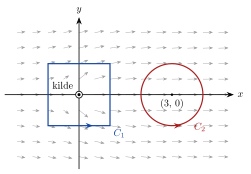

<!-- tillegg: Claude -->
Oppgavene blander alt om integralsetningene: [fluks gjennom en kurve](01-fluks-i-planet.qmd), [Greens teorem](02-greens-teorem.qmd), [fluks gjennom en flate](03-fluks-i-rommet.qmd), [divergenssetningen](04-divergenssetningen.qmd) og [Stokes' teorem](05-stokes-teorem.qmd). Det meste av arbeidet er å velge riktig vei. Still disse spørsmålene før du begynner å regne:

::: {.steg}
1. **Er kurven eller flaten lukket?** En lukket kurve i planet gir Greens teorem: curl inni for sirkulasjon, divergens inni for fluks. En lukket flate gir divergenssetningen.
2. **Er den åpen?** Lukk den med en enkel flate eller et linjestykke, bruk setningen på det lukkede området, og trekk fra bidraget fra lokket.
3. **Er det en sirkulasjon rundt en kurve i rommet?** Bruk Stokes' teorem, og velg den enkleste flaten med kurven som rand. Er curl null, er feltet konservativt, og potensialet gir svaret.
4. **Er integranden enkel inni, men tung på randen (eller omvendt)?** Gå dit regningen er lettest. Pass på orienteringen: mot klokka, normal ut, høyrehåndsregelen.
:::

Prøv selv før du åpner løsningen.

:::: {.oppgaver}

::: {.oppgave tittel="Rundt en ellipse to ganger" krever="integralsetninger/green, integralsetninger/fluks"}
<!-- tillegg: Claude -->
La $C$ være ellipsen $\dfrac{x^2}{4} + y^2 = 1$, gjennomløpt mot klokka.

a) Regn ut sirkulasjonen
$$
\oint_C \big(2y + \mathrm{e}^{x^2}\big)\,\mathrm{d}x + \big(5x + \ln(1 + y^2)\big)\,\mathrm{d}y
$$

b) Regn ut fluksen til $\vec G = [x + \sin y,\ y + \cos x]$ ut av ellipsen.

::: {.fasit}
a) $6\pi$ · b) $4\pi$
:::
:::

::: {.oppgave tittel="To veier ut av en sylinder" krever="integralsetninger/fluks, integralsetninger/gauss, trippelintegraler/sylinderkoordinater"}
<!-- tillegg: Claude -->
La $E$ være den lukkede sylinderen $x^2 + y^2 \le 4$, $0 \le z \le 3$, og la $\vec F = [xz,\ yz,\ z^2]$.

a) Finn fluksen ut av hele randen til $E$ med divergenssetningen.

b) Finn fluksen ut gjennom sideflaten, toppen og bunnen hver for seg, og kontroller svaret i a).

::: {.fasit}
$72\pi$
:::
:::

::: {.oppgave tittel="Ett felt, tre spørsmål" niva="Middels" krever="vektorfelt/konservative, integralsetninger/gauss, integralsetninger/stokes"}
<!-- tillegg: Claude -->
La $\vec F = \big[y + z,\ x + z,\ x + y + z^2\big]$.

a) Vis at $\vec F$ er konservativt, og finn arbeidet langs en vilkårlig kurve fra $(0, 0, 0)$ til $(1, 2, 3)$.

b) Hva er sirkulasjonen $\oint_C \vec F\cdot\mathrm{d}\vec r$ rundt en lukket kurve $C$? Begrunn svaret med Stokes' teorem.

c) Finn fluksen ut av enhetsterningen $0 \le x, y, z \le 1$. Hvilke sideflater bidrar?

::: {.fasit}
a) $20$ · b) $0$ · c) $1$
:::
:::

::: {.oppgave tittel="Lukk paraboloiden" niva="Middels" krever="integralsetninger/fluks, integralsetninger/gauss, trippelintegraler/sylinderkoordinater"}
<!-- tillegg: Claude -->
La $S$ være paraboloiden $z = 4 - x^2 - y^2$, $z \ge 0$, med normalen oppover, og la
$$
\vec F = \big[x + \sin(y^2),\ y + \mathrm{e}^{xz},\ z + 1\big]
$$

a) Skriv opp det direkte fluksintegralet over $S$. Hvorfor er det tungt å regne ut?

b) Finn fluksen gjennom $S$ ved å lukke flaten.

::: {.fasit}
$28\pi \approx 88.0$
:::
:::

::: {.oppgave tittel="Gauss' lov for en ladet kule" niva="Middels" krever="integralsetninger/gauss, integralsetninger/fluks, geometri/romfigurer"}
<!-- tillegg: Claude -->
En kule med radius $R = 5.0\ \mathrm{cm}$ har ladningen $Q = 2.0\ \mathrm{nC}$, jevnt fordelt i hele volumet. Bruk $\varepsilon_0 = 8.854\cdot10^{-12}\ \mathrm{C^2/(N\,m^2)}$.

a) Finn den elektriske fluksen ut av en terning med sidekant $20\ \mathrm{cm}$ som har samme sentrum som kula.

b) Finn fluksen ut av en kuleflate med radius $r = 3.0\ \mathrm{cm}$ og samme sentrum.

c) Bruk symmetri og svaret i b) til å finne feltstyrken $E$ i avstanden $3.0\ \mathrm{cm}$ fra sentrum. Finn også $E$ i avstanden $10\ \mathrm{cm}$.

::: {.fasit}
a) $2.3\cdot10^2\ \mathrm{N\,m^2/C}$ · b) $49\ \mathrm{N\,m^2/C}$ · c) $4.3\ \mathrm{kN/C}$ · c) $1.8\ \mathrm{kN/C}$
:::
:::

::: {.oppgave tittel="Rundt sadelen" niva="Middels" krever="integralsetninger/stokes, integralsetninger/fluks, vektorfelt/divergens-og-curl, vektorfelt/linjeintegraler"}
<!-- tillegg: Claude -->
Kurven $C$ er skjæringen mellom sylinderen $x^2 + y^2 = 1$ og sadelflaten $z = xy$, gjennomløpt mot klokka sett ovenfra. Den ligger ikke i noe plan. La $\vec F = [y^2,\ x,\ z^2]$.

a) Regn ut $\oint_C \vec F\cdot\mathrm{d}\vec r$ direkte.

b) Regn ut det samme med Stokes' teorem, med den delen av sadelflaten som ligger innenfor sylinderen som flate.

c) Forklar hvorfor svaret blir det samme som for sirkulasjonen til $[y^2,\ x]$ rundt enhetssirkelen i planet.

::: {.fasit}
$\pi$
:::
:::

::: {.oppgave tittel="Kilden i elva" niva="Utfordrende" krever="integralsetninger/fluks, integralsetninger/green, vektorfelt/divergens-og-curl"}
<!-- tillegg: Claude -->
Et rør munner ut i bunnen av en grunn elv med jevn dybde $h = 0.30\ \mathrm{m}$. Vi legger origo ved røret og ser på vannet ovenfra. Fartsfeltet er
$$
\vec v(x, y) = \left[U + \frac{kx}{x^2 + y^2},\ \frac{ky}{x^2 + y^2}\right]
$$
med elvefarten $U = 0.50\ \mathrm{m/s}$ og kildestyrken $k = 0.20\ \mathrm{m^2/s}$. Koordinatene er i meter.

{.tikz-fig style="width:520px" fig-alt="Koordinatsystem med små piler som peker mot høyre over hele bildet, med strømmen i elva. Nær origo, der kilden er merket med en ring, bøyer pilene seg ut fra kilden. Et kvadrat C1 med hjørner i pluss minus 1, pluss minus 1 ligger rundt kilden, og en sirkel C2 med sentrum i (3, 0) og radius 1 ligger til høyre for den. Begge kurvene har en pil mot klokka."}

a) Vis at $\nabla\cdot\vec v = 0$ overalt unntatt i origo.

b) Regn ut fluksen ut av sirkelen med radius $R$ om origo direkte. Avhenger svaret av $R$ eller $U$?

c) Finn fluksen ut av kvadratet $C_1$ og ut av sirkelen $C_2$ i figuren uten å regne ut flere linjeintegraler.

d) Hvor mange kubikkmeter vann per sekund kommer ut av røret?

::: {.fasit}
b) $1.3\ \mathrm{m^2/s}$ · c) $1.3\ \mathrm{m^2/s}$ · c) $0$ · d) $0.38\ \mathrm{m^3/s}$
:::
:::

::: {.oppgave tittel="Hvorfor en tredjedel?" niva="Utfordrende" krever="integralsetninger/gauss, integralsetninger/green, integralsetninger/fluks"}
<!-- tillegg: Claude -->
En kjegle (eller pyramide) har spissen i origo og en plan grunnflate $B$ med areal $A$. Planet til grunnflaten ligger i avstanden $h$ fra origo. Grunnflaten kan ha hvilken som helst form, og sideflaten består av alle linjestykkene fra spissen til randen av $B$.

a) Bruk divergenssetningen med feltet $\vec r = [x,\ y,\ z]$ til å vise at volumet av et område $E$ med randen $S$ er
$$
V = \frac13\iint_S \vec r\cdot\vec n\,\mathrm{d}S
$$

b) Vis at $\vec r\cdot\vec n = 0$ på sideflaten av kjeglen, og at $\vec r\cdot\vec n = h$ på grunnflaten. Hva blir volumet?

c) Vis på samme måte med Greens teorem at arealet av en trekant er halvparten av grunnlinja ganger høyden.

::: {.fasit}
b) $\frac13\,hA$ · c) $\frac12\,bh$
:::
:::

::::
