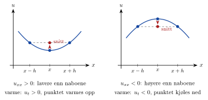
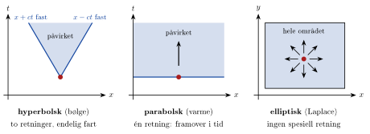

<!-- video: kommer (videoer/flervariabel-kalkulus/06-01-hva-er-en-pde) -->
{fig-alt="Video kommer"}

<!-- tillegg: Claude -->
En kopp kaffe blir kald. En gitarstreng svinger. En metallplate med varme og kalde kanter får etter hvert en temperatur som ikke endrer seg mer. Tre helt ulike fenomener, men alle beskrives av **partielle differensiallikninger** (PDE-er). Her ser vi hva en PDE er, hvordan vi sorterer dem, og hva de klassiske likningene i fysikken betyr.

## En ukjent funksjon av flere variabler

I en **ordinær** differensiallikning (ODE) er den ukjente en funksjon av *én* variabel, for eksempel $y(t)$. Temperaturen i en stav avhenger derimot både av *hvor* og *når* vi måler: $u = u(x, t)$. Da kan $u$ endre seg på to måter, og vi får to [partiellderiverte](../00-verktoy/03-partiellderiverte.qmd):
$$
u_t = \frac{\partial u}{\partial t} \quad \text{(bare } t \text{ endres)}, \qquad u_x = \frac{\partial u}{\partial x}, \quad u_{xx} = \frac{\partial^2 u}{\partial x^2} \quad \text{(bare } x \text{ endres)}
$$
Her er $x$ og $t$ de **uavhengige variablene**, og $u$ er den **avhengige variabelen**.

::: {.callout-note title="Definisjon: Partiell differensiallikning"}
En **partiell differensiallikning** er en likning mellom en ukjent funksjon $u$ av to eller flere variabler og de partiellderiverte til $u$:
$$
F(x, y, \dots, u, u_x, u_y, \dots, u_{xx}, u_{xy}, u_{yy}, \dots) = 0
$$
En **løsning** er en funksjon som gjør likningen oppfylt i hvert punkt av et område.
:::

Hva slags fysikk likningen beskriver, avgjøres av *hvilke* deriverte som er med, og hvordan de er satt sammen. Derfor sorterer vi PDE-er etter noen få egenskaper.

## Orden, linearitet og homogenitet

::: {.callout-note title="Definisjon: Orden"}
**Ordenen** til en PDE er ordenen til den høyeste deriverte som er med.
:::

Varmelikningen $u_t = \alpha u_{xx}$ inneholder $u_t$ (første orden) og $u_{xx}$ (andre orden), så den er av andre orden. Bølgelikningen $u_{tt} = c^2u_{xx}$ er også av andre orden. De fleste viktige likningene i fysikken er av andre orden.

### Lineær, kvasilineær og ikke-lineær

Skriv venstresiden som en **operator** $L$ som virker på $u$. For varmelikningen er $Lu = u_t - \alpha u_{xx}$.

::: {.callout-note title="Definisjon: Lineær og kvasilineær"}
- En PDE er **lineær** hvis $u$ og alle de deriverte bare står i første potens, ganget med koeffisienter som avhenger av de uavhengige variablene alene. Ingen $u^2$, ingen $u\,u_x$, ingen $\sin u$. Da er
$$
L(c_1u_1 + c_2u_2) = c_1\,Lu_1 + c_2\,Lu_2
$$
for alle konstanter $c_1$, $c_2$.
- En PDE er **kvasilineær** hvis den er lineær i de *høyeste* deriverte, men koeffisientene foran dem kan avhenge av $u$ og lavere deriverte.
- Ellers er den **ikke-lineær**.
:::

Hvorfor bryr vi oss? I en lineær likning **legges virkninger sammen**. To varmeovner i et rom gir til sammen summen av det hver av dem gir alene. Det gjør lineære likninger mye enklere å løse: Vi kan bygge opp kompliserte løsninger av enkle biter.

### Homogen eller med kilde

En lineær PDE kan skrives $Lu = f$, der alt som inneholder $u$, står i $Lu$. Er $f = 0$, er likningen **homogen**. Er $f \ne 0$, er den **inhomogen**, og $f$ er en **kilde**, for eksempel en varmeovn: $u_t = \alpha u_{xx} + f(x, t)$.

::: {.callout-important title="Superposisjonsprinsippet"}
Er likningen **lineær og homogen**, og $u_1$ og $u_2$ er løsninger, så er også
$$
c_1u_1 + c_2u_2
$$
en løsning for alle konstanter $c_1$ og $c_2$. Bevis: $L(c_1u_1 + c_2u_2) = c_1\cdot 0 + c_2\cdot 0 = 0$.

For en **inhomogen** lineær likning $Lu = f$ er alle løsninger på formen $u = u_p + u_h$, der $u_p$ er én løsning av $Lu_p = f$, og $u_h$ løser den homogene likningen $Lu_h = 0$.
:::

Superposisjon er grunnen til at en gitarstreng kan klinge med grunntone og overtoner samtidig: Hver tone er en løsning av bølgelikningen, og summen er også en løsning.

::: {.eksempel}
**Eksempel: Klassifiser likningene.** Finn orden, og avgjør om likningen er lineær, kvasilineær eller ikke-lineær. Er den lineær, avgjør om den er homogen.

(a) $u_t = 0.5\,u_{xx} + \sin x$ (b) $u_{xx} + u_{yy} = x^2u$ (c) $u_t + u\,u_x = 0$ (d) $u_{xx} + u\,u_{yy} = u_x^2$ (e) $u_x^2 + u_y^2 = 1$

::: {.losning}
Flytt alt som inneholder $u$, til venstre, og se på hvert ledd.

(a) Høyeste deriverte er $u_{xx}$: **andre orden**. Leddene $u_t$ og $0.5\,u_{xx}$ er lineære. På formen $u_t - 0.5\,u_{xx} = \sin x$ står det en funksjon av $x$ alene til høyre, så likningen er **lineær og inhomogen** (en kilde som varierer langs staven).

(b) $u_{xx} + u_{yy} - x^2u = 0$. **Andre orden**. Koeffisienten $x^2$ avhenger bare av $x$, så likningen er **lineær og homogen**.

(c) **Første orden**. Leddet $u\,u_x$ er et produkt av $u$ og en derivert, så likningen er ikke lineær. Men den er lineær i de høyeste deriverte $u_t$ og $u_x$ (koeffisientene $1$ og $u$), så den er **kvasilineær**. Den beskriver en bølge der hver bit beveger seg med fart $u$, og raske biter tar igjen de langsomme.

(d) **Andre orden**. De høyeste deriverte $u_{xx}$ og $u_{yy}$ står i første potens, med koeffisientene $1$ og $u$. Leddet $u_x^2$ er ikke-lineært, men av lavere orden. Likningen er derfor **kvasilineær**.

(e) **Første orden**. Her er de høyeste deriverte selv kvadrert, så likningen er **ikke-lineær** (heller ikke kvasilineær).
:::
:::

## Generell løsning: vilkårlige funksjoner

Løsningen av ODE-en $y' = 0$ er $y = C$, med en vilkårlig *konstant*. Løsningen av PDE-en $u_x = 0$ for $u(x, y)$ er
$$
u = f(y)
$$
med en vilkårlig *funksjon* $f$: Står $y$ fast, kan $u$ ikke endre seg med $x$, men den kan godt være forskjellig fra linje til linje.

Integrerer vi $u_{xy} = 0$ først med hensyn på $y$, får vi $u_x = h(x)$, og så med hensyn på $x$:
$$
u = f(x) + g(y)
$$
der $f$ er en antiderivert av $h$. I den **generelle løsningen** av en PDE står det altså vilkårlige funksjoner, ikke bare konstanter. En PDE har derfor enormt mange løsninger. Det som plukker ut den ene som beskriver en bestemt situasjon, er rand- og initialbetingelsene (se *Rand- og initialbetingelser*).

::: {.eksempel}
**Eksempel: Bølger som går hver sin vei.** Vis at
$$
u(x, t) = f(x - ct) + g(x + ct)
$$
løser bølgelikningen $u_{tt} = c^2u_{xx}$ for alle to ganger deriverbare funksjoner $f$ og $g$. Hva betyr de to leddene? Bruk dette til å skrive den stående bølgen $u = \sin(\pi x)\cos(\pi ct)$ som to vandrende bølger.

::: {.losning}
Kjerneregelen med $\xi = x - ct$ gir $\frac{\partial}{\partial t}f(x - ct) = -c\,f'(\xi)$ og $\frac{\partial}{\partial x}f(x - ct) = f'(\xi)$. Tilsvarende for $g$ med $+c$:
$$
u_t = -c\,f'(x - ct) + c\,g'(x + ct), \qquad u_{tt} = c^2f''(x - ct) + c^2g''(x + ct)
$$
$$
u_x = f'(x - ct) + g'(x + ct), \qquad u_{xx} = f''(x - ct) + g''(x + ct)
$$
Altså er $u_{tt} = c^2u_{xx}$ for alle $f$ og $g$.

Tolkning: $f(x - ct)$ har samme verdi overalt der $x - ct$ er det samme, altså i punktet $x = x_0 + ct$. Formen $f$ flytter seg mot høyre med fart $c$. Tilsvarende flytter $g(x + ct)$ seg mot venstre.

Med formelen $\sin A\cos B = \frac12\big[\sin(A - B) + \sin(A + B)\big]$:
$$
\sin(\pi x)\cos(\pi ct) = \underline{\underline{\tfrac12\sin\big(\pi(x - ct)\big) + \tfrac12\sin\big(\pi(x + ct)\big)}}
$$
Den stående bølgen er summen av to like sinusbølger som går hver sin vei, med $f(s) = g(s) = \frac12\sin(\pi s)$.
:::
:::

## De klassiske likningene

Nesten alle de klassiske likningene inneholder [Laplace-operatoren](../04-vektorfelt/02-divergens-og-curl.qmd)
$$
\nabla^2u = u_{xx} + u_{yy} + u_{zz}
$$
(i én dimensjon bare $u_{xx}$, i to $u_{xx} + u_{yy}$). Nøkkelen til å forstå dem er hva $\nabla^2u$ betyr. Differanseformelen for den andrederiverte gir i én dimensjon
$$
u_{xx} \approx \frac{u(x - h) + u(x + h) - 2u(x)}{h^2} = \frac{2}{h^2}\Big(\underbrace{\tfrac12\big[u(x - h) + u(x + h)\big]}_{\text{snittet av naboene}} - u(x)\Big)
$$
$\nabla^2u$ måler altså **hvor mye snittet rundt et punkt ligger over verdien i punktet**.

{.tikz-fig style="width:620px" fig-alt="To grafer av u mot x med tre punkter x minus h, x og x pluss h. Til venstre er grafen en dal: Snittet av de to naboene ligger over verdien i midten, så u x x er positiv, og i varmelikningen varmes punktet opp. Til høyre er grafen en topp: Snittet ligger under, u x x er negativ, og punktet kjøles ned."}

Med det bildet kan vi lese de klassiske likningene nesten som setninger:

::: {.kort}
- **Varmelikningen** $u_t = \alpha\nabla^2u$, $\alpha > 0$. Temperaturen endrer seg i takt med hvor mye kaldere eller varmere punktet er enn omgivelsene. Daler fylles opp og topper jevnes ut. Samme likning beskriver diffusjon av stoff (blekk i vann). Se også [varmelikningen og stabilitet](../07-endelige-differanser/06-varmelikningen.qmd).
- **Bølgelikningen** $u_{tt} = c^2\nabla^2u$. Nå er det *akselerasjonen* som er proporsjonal med avviket fra naboene. Et punkt som stikker ut, trekkes tilbake, skyter over og svinger. Forstyrrelser går med farten $c$. Se [bølgelikningen og leapfrog-metoden](../07-endelige-differanser/07-bolgelikningen-leapfrog.qmd).
- **Laplace-likningen** $\nabla^2u = 0$. Hvert punkt er lik snittet av omgivelsene. Det er tilstanden etter lang tid, når $u_t = 0$ i varmelikningen: stasjonær temperatur, elektrisk potensial i et område uten ladning. Løsningene kalles **harmoniske** og har ingen topper eller daler inne i området.
- **Poisson-likningen** $\nabla^2u = f$. Laplace med en kilde. Eksempler: stasjonær temperatur med varmeproduksjon, og gravitasjonspotensialet $\nabla^2\varphi = 4\pi\mathrm{G}\rho$ rundt en massefordeling. Se [Laplace- og Poisson-likningen i 2D](../07-endelige-differanser/05-laplace-og-poisson.qmd).
- **Helmholtz-likningen** $\nabla^2U + k^2U = 0$. Amplituden til en svingning med én fast frekvens: en trommehinne som svinger i en egensvingning, eller lyd med én tone i et rom.
:::

Helmholtz-likningen kommer rett ut av bølgelikningen. Prøv $u = U(x, y, z)\cos(\omega t)$. Da er $u_{tt} = -\omega^2U\cos(\omega t)$, og bølgelikningen gir $-\omega^2U = c^2\nabla^2U$, altså
$$
\nabla^2U + k^2U = 0, \qquad k = \frac{\omega}{c}
$$

::: {.eksempel}
**Eksempel: En løsning av varmelikningen.** Vis at $u(x, t) = \mathrm{e}^{-\alpha k^2t}\sin(kx)$ løser $u_t = \alpha u_{xx}$ for alle $k$. Hva betyr faktoren $k^2$? Bruk superposisjon til å finne en løsning med startverdi $u(x, 0) = \sin(\pi x) + 0.5\sin(3\pi x)$.

::: {.losning}
Deriver:
$$
u_t = -\alpha k^2\,\mathrm{e}^{-\alpha k^2t}\sin(kx), \qquad u_x = k\,\mathrm{e}^{-\alpha k^2t}\cos(kx), \qquad u_{xx} = -k^2\,\mathrm{e}^{-\alpha k^2t}\sin(kx)
$$
Altså er $\alpha u_{xx} = -\alpha k^2\,\mathrm{e}^{-\alpha k^2t}\sin(kx) = u_t$.

En sinus med stor $k$ har korte bølger og skarpe topper. Den dør ut med raten $\alpha k^2$: Dobbelt så korte bølger dør ut fire ganger så fort. Det stemmer med bildet over: Skarpe topper ligger langt over snittet av naboene og jevnes ut raskt.

Likningen er lineær og homogen, så summen av løsningen med $k = \pi$ og $0.5$ ganger løsningen med $k = 3\pi$ er en løsning:
$$
\underline{\underline{u(x, t) = \mathrm{e}^{-\alpha\pi^2t}\sin(\pi x) + 0.5\,\mathrm{e}^{-9\alpha\pi^2t}\sin(3\pi x)}}
$$
Ved $t = 0$ blir den $\sin(\pi x) + 0.5\sin(3\pi x)$, som ønsket. Det andre leddet dør ut ni ganger så fort som det første. Slik bygger vi løsninger med *separasjon av variabler*.
:::
:::

## Prøv selv: sjekk en løsning

Koden sjekker numerisk om en funksjon løser varmelikningen. Den regner ut $u_t - \alpha u_{xx}$ med differanser i mange tilfeldige punkter, og tegner løsningen ved noen tider. Bytt ut `u` med $\sin(kx)$ uten eksponentialfaktor, eller med $\mathrm{e}^{-\alpha t}\sin(2x)$, og se at restleddet ikke lenger blir null.

```{.python .kjor}
import numpy as np
import matplotlib.pyplot as plt

alfa = 0.1
def u(x, t):
    return (np.exp(-alfa*np.pi**2*t)*np.sin(np.pi*x)
            + 0.5*np.exp(-9*alfa*np.pi**2*t)*np.sin(3*np.pi*x))

h = 1e-3
x = np.random.uniform(0, 1, 1000); t = np.random.uniform(0, 2, 1000)
u_t  = (u(x, t + h) - u(x, t - h))/(2*h)
u_xx = (u(x + h, t) - 2*u(x, t) + u(x - h, t))/h**2
print("Største |u_t - alfa*u_xx|:", np.abs(u_t - alfa*u_xx).max())

xs = np.linspace(0, 1, 200)
for tid in [0, 0.1, 0.3, 1.0, 2.0]:
    plt.plot(xs, u(xs, tid), label=f't = {tid}')
plt.xlabel('x'); plt.ylabel('u'); plt.legend(); plt.show()
```

Restleddet blir av størrelsesorden $10^{-4}$ eller mindre. Det er bare feilen i differanseformlene, og den krymper når `h` gjøres mindre. Legg merke til at de to toppene ved $t = 0$ smelter sammen til én bue lenge før buen selv har sunket mye.

## Tre typer: elliptisk, parabolsk og hyperbolsk

Varme, bølger og likevekt oppfører seg helt forskjellig. Det kan vi lese ut av likningen. En lineær andreordens PDE i to variabler kan skrives
$$
A\,u_{xx} + B\,u_{xy} + C\,u_{yy} + (\text{ledd av lavere orden}) = 0
$$
der $A$, $B$ og $C$ kan avhenge av $x$ og $y$. Bare andreordensleddene bestemmer typen.

::: {.callout-important title="Klassifisering av andreordens PDE-er"}
$$
B^2 - 4AC \;\begin{cases} < 0 & \text{elliptisk} \\ = 0 & \text{parabolsk} \\ > 0 & \text{hyperbolsk} \end{cases}
$$
Avhenger $A$, $B$ og $C$ av $x$ og $y$, kan typen være forskjellig i ulike deler av planet.
:::

Navnene kommer fra kjeglesnittene: $Ax^2 + Bxy + Cy^2 = 1$ er en ellipse, en parabel eller en hyperbel etter det samme kriteriet. Grunnen er den samme i begge tilfellene. Andreordensleddene kan skrives med den symmetriske matrisen
$$
\begin{bmatrix} A & B/2 \\ B/2 & C \end{bmatrix}, \qquad \det = AC - \frac{B^2}{4} = -\frac{B^2 - 4AC}{4}
$$
Dreier vi koordinatsystemet langs egenvektorene til matrisen, forsvinner blandingsleddet, og igjen står $\lambda_1u_{\xi\xi} + \lambda_2u_{\eta\eta}$. Produktet av egenverdiene er determinanten. Egenverdier med likt fortegn gir $\det > 0$ (elliptisk), én egenverdi lik null gir $\det = 0$ (parabolsk), og motsatte fortegn gir $\det < 0$ (hyperbolsk). (Er $A = 1$, er kriteriet $a^2 - 4b$ for $u_{xx} + a\,u_{xy} + b\,u_{yy}$ det samme.)

Typen forteller hvordan **informasjon** beveger seg:

{.tikz-fig style="width:720px" fig-alt="Tre panel. Hyperbolsk, bølge: I et x t-diagram påvirker en forstyrrelse i ett punkt bare en kile over punktet, avgrenset av to linjer der x minus c t og x pluss c t er faste. Parabolsk, varme: Forstyrrelsen påvirker hele stripen over punktet, alle x, men bare senere tider. Elliptisk, Laplace: I et x y-område påvirker punktet hele området i alle retninger."}

::: {.kort}
- **Hyperbolsk (bølge).** To spesielle retninger, langs linjene der $x - ct$ og $x + ct$ er faste. En forstyrrelse går med endelig fart, og den deler seg i to som går hver sin vei.
- **Parabolsk (varme).** Én spesiell retning: framover i tid. En forstyrrelse merkes straks langs hele staven, men svakt, og den virker bare framover i tid.
- **Elliptisk (Laplace, Poisson).** Ingen spesiell retning og ingen tid. Hvert punkt avhenger av hele området rundt, også av hele randen.
:::

Typen avgjør også hvilke betingelser som trengs: Varme og bølger marsjerer fram i tid fra en starttilstand og trenger initialbetingelser, mens elliptiske likninger trenger betingelser langs hele randen. Det ser vi nærmere på under *Rand- og initialbetingelser*.

::: {.eksempel}
**Eksempel: Hvilken type?** Klassifiser (a) Laplace-likningen $u_{xx} + u_{yy} = 0$, (b) varmelikningen $u_t = \alpha u_{xx}$, (c) bølgelikningen $u_{tt} = c^2u_{xx}$, (d) $u_{xx} + 4u_{xy} + 3u_{yy} = 0$ og (e) Tricomi-likningen $y\,u_{xx} + u_{yy} = 0$.

::: {.losning}
Bruk de to uavhengige variablene i rekkefølgen $(x, y)$ eller $(x, t)$, og les av $A$, $B$ og $C$.

(a) $A = 1$, $B = 0$, $C = 1$: $B^2 - 4AC = -4 < 0$, **elliptisk**.

(b) $\alpha u_{xx} - u_t = 0$. Det eneste andreordensleddet er $\alpha u_{xx}$, så $A = \alpha$, $B = C = 0$: $B^2 - 4AC = 0$, **parabolsk**. Leddet $u_t$ er av første orden og teller ikke.

(c) $c^2u_{xx} - u_{tt} = 0$: $A = c^2$, $B = 0$, $C = -1$, så $B^2 - 4AC = 4c^2 > 0$, **hyperbolsk**.

(d) $A = 1$, $B = 4$, $C = 3$: $B^2 - 4AC = 16 - 12 = 4 > 0$, **hyperbolsk**. Selv om alle koeffisientene er positive, er likningen en bølgelikning i forkledning. Med $\xi = y - 3x$ og $\eta = y - x$ blir den $u_{\xi\eta} = 0$, med løsningen $u = f(y - 3x) + g(y - x)$.

(e) $A = y$, $B = 0$, $C = 1$: $B^2 - 4AC = -4y$. Likningen er **elliptisk for $y > 0$, parabolsk på linjen $y = 0$ og hyperbolsk for $y < 0$**. Den brukes for strømning rundt en vinge nær lydfarten, der strømningen går fra under til over lydfart.
:::
:::

:::: {.oppgaver}

::: {.oppgave tittel="Sorter likningene"}
Finn orden, og avgjør om likningen er lineær, kvasilineær eller ikke-lineær. Er den lineær, avgjør om den er homogen.

(a) $u_t = u_{xx} + u_{yy} + \mathrm{e}^{-t}$ (b) $u_{tt} - u_{xx} + u = 0$ (c) $u_x\,u_{xx} + u_y = 0$ (d) $u_{xx}u_{yy} - u_{xy}^2 = 0$

::: {.fasit}
a) $\text{lineær og inhomogen}$ · b) $\text{lineær og homogen}$ · c) $\text{kvasilineær}$ · d) $\text{ikke-lineær}$
:::
:::

::: {.oppgave tittel="Generell løsning"}
Finn den generelle løsningen $u(x, y)$ av (a) $u_y = \cos x$ og (b) $u_{xx} = 0$. Sjekk svarene.

::: {.fasit}
a) $u = y\cos x + f(x)$ · b) $u = x\,f(y) + g(y)$
:::
:::

::: {.oppgave tittel="Harmonisk funksjon"}
Vis at $u(x, y) = \ln(x^2 + y^2)$ løser Laplace-likningen $u_{xx} + u_{yy} = 0$ for $(x, y) \ne (0, 0)$.

::: {.fasit}
$0$
:::
:::

::: {.oppgave tittel="Varme fra et punkt" niva="Middels"}
Vis at
$$
u(x, t) = \frac{1}{\sqrt{t}}\,\mathrm{e}^{-x^2/(4\alpha t)}, \qquad t > 0
$$
løser varmelikningen $u_t = \alpha u_{xx}$. Beskriv hvordan løsningen ser ut når $t$ øker.

:::

::: {.oppgave tittel="Kilde og superposisjon" niva="Middels"}
Se på $u_t = u_{xx} + 2$.

(a) Vis at både $u_1 = 2t$ og $u_2 = -x^2$ er løsninger.

(b) Er $u_1 + u_2$ en løsning? Er $u_1 - u_2$ en løsning av noe?

(c) Skriv opp alle løsningene ved hjelp av løsningene av $u_t = u_{xx}$.

::: {.fasit}
$u = 2t + u_h, \quad \text{der } (u_h)_t = (u_h)_{xx}$
:::
:::

::: {.oppgave tittel="Type og Helmholtz" niva="Utfordrende"}
(a) Klassifiser $u_{xx} - 6u_{xy} + 9u_{yy} = 0$, $2u_{xx} + u_{xy} + u_{yy} = 0$ og $u_{xy} = u_x$.

(b) Hvor i planet er $u_{xx} + 2y\,u_{xy} + u_{yy} = 0$ elliptisk, parabolsk og hyperbolsk?

(c) Finn $k > 0$ slik at $U(x, y) = \sin(3x)\cos(4y)$ løser Helmholtz-likningen $\nabla^2U + k^2U = 0$. Er Helmholtz-likningen elliptisk, parabolsk eller hyperbolsk?

::: {.fasit}
b) $\text{elliptisk for } |y| < 1, \quad \text{parabolsk for } |y| = 1, \quad \text{hyperbolsk for } |y| > 1$ · c) $k = 5$
:::
:::

::::
