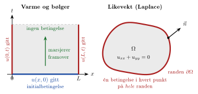
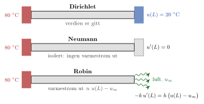

<!-- video: kommer (videoer/flervariabel-kalkulus/06-02-rand-og-initialbetingelser) -->
{fig-alt="Video kommer"}

<!-- tillegg: Claude -->
En partiell differensiallikning har nesten alltid uendelig mange løsninger. Varmelikningen $u_t = u_{xx}$ er oppfylt av $u = 0$, av $u = 5$, av $u = \mathrm{e}^{-t}\sin x$ og av $u = \mathrm{e}^{-4t}\sin 2x$, og av alle summer av slike. Bølgelikningen $u_{tt} = c^2u_{xx}$ er oppfylt av $u = f(x - ct) + g(x + ct)$ for *alle* deriverbare funksjoner $f$ og $g$.

Likningen alene sier altså bare hvordan løsningen henger sammen fra punkt til punkt. Hvilken av løsningene som beskriver *akkurat din* stav, streng eller plate, avgjøres av **betingelsene**: hvordan alt er ved start, og hva som skjer på kanten.

## Initial- og randbetingelser

::: {.callout-note title="Definisjon: Initial- og randbetingelser"}
En **initialbetingelse** gir tilstanden ved starttidspunktet, for eksempel $u(x, 0) = f(x)$.

En **randbetingelse** gir informasjon om $u$ på **randen** $\partial\Omega$ til området $\Omega$ der likningen gjelder, for eksempel $u(0, t) = 0$.
:::

Hvor mange betingelser vi trenger, og hvor, følger av likningen:

::: {.kort}
- **Varmelikningen** $u_t = \alpha u_{xx}$ er av første orden i tid. Den trenger *én* initialbetingelse, $u(x, 0)$, og én randbetingelse i hver ende av staven.
- **Bølgelikningen** $u_{tt} = c^2u_{xx}$ er av andre orden i tid. Den trenger *to* initialbetingelser, startformen $u(x, 0)$ og startfarten $u_t(x, 0)$, og én randbetingelse i hver ende.
- **Laplace-likningen** $u_{xx} + u_{yy} = 0$ har ingen tid. Den beskriver en likevekt og trenger én betingelse i *hvert* punkt på hele randen.
:::

Dette henger sammen med typen til likningen (parabolsk, hyperbolsk eller elliptisk). Varme og bølger **marsjerer** framover i tid fra en kjent starttilstand, mens løsningen av Laplace-likningen i et punkt avhenger av hele randen på en gang.

{.tikz-fig style="width:640px" fig-alt="Til venstre et rektangel i x t-planet for varme- og bølgelikningen. Nederste kant, t lik null, har initialbetingelsen u av x og null gitt. De to loddrette sidekantene x lik null og x lik L har randbetingelser. Øverste kant har ingen betingelse, og en pil oppover viser at løsningen marsjerer framover i tid. Til høyre et avrundet område Omega der Laplace-likningen gjelder. Hele randkurven er markert, og en utadrettet normalvektor n står på randen. Teksten sier at det trengs én betingelse i hvert punkt på hele randen."}

Problemene får navn etter hvilke betingelser de har:

::: {.kort}
- **Initialverdiproblem** Bare initialbetingelser, for eksempel varmelikningen på hele tallinja med $u(x, 0) = f(x)$. Ingen rand.
- **Randverdiproblem** Bare randbetingelser. Typisk for likevektsproblemer som Laplace-likningen, og for stasjonære problemer der ingenting endrer seg i tid.
- **Blandet problem** Både initial- og randbetingelser (initial-randverdiproblem). Det vanligste i praksis: en stav som avkjøles, en streng som svinger.
:::

## Tre typer randbetingelser

På randen kan vi kjenne verdien av $u$, hvor mye som strømmer ut, eller en sammenheng mellom de to. Det som strømmer ut, er bestemt av den deriverte *på tvers av* randen, altså **normalderiverte**.

::: {.callout-note title="Definisjon: Normalderivert"}
La $\vec n$ være enhetsnormalen på randen, rettet **ut** av området. Den **normalderiverte** av $u$ er den retningsderiverte i retning $\vec n$:
$$
\frac{\partial u}{\partial n} = \nabla u \cdot \vec n
$$
:::

På et intervall $[0, L]$ peker normalen mot høyre i $x = L$ og mot venstre i $x = 0$. Derfor er
$$
\frac{\partial u}{\partial n} = u_x(L) \quad\text{i høyre ende}, \qquad \frac{\partial u}{\partial n} = -u_x(0) \quad\text{i venstre ende}
$$
Fortegnet i venstre ende er lett å glemme. (Gradienten er forklart under [nivåkurver og gradient](../00-verktoy/04-nivakurver-og-gradient.qmd).)

::: {.callout-note title="Definisjon: Dirichlet-, Neumann- og Robin-betingelser"}
Med en kjent funksjon $g$ på randen:

| Navn | Betingelse | Hva er gitt |
|---|---|---|
| **Dirichlet** | $u = g$ | verdien |
| **Neumann** | $\dfrac{\partial u}{\partial n} = g$ | den normalderiverte, altså strømmen ut |
| **Robin** | $\alpha u + \beta\dfrac{\partial u}{\partial n} = g$ | en kombinasjon av de to |

Betingelsen er **homogen** når $g = 0$.
:::

Den fysiske tolkningen er lettest å se for temperatur $u$. Etter **Fouriers lov** er varmestrømmen ut gjennom randen (effekt per areal)
$$
q = -k\,\frac{\partial u}{\partial n}
$$
der $k$ er varmeledningsevnen. Varmen strømmer fra varmt til kaldt, derfor minustegnet.

{.tikz-fig style="width:620px" fig-alt="Tre staver med venstre ende holdt på 80 grader celsius. Den første, Dirichlet, har høyre ende i et bad med fast temperatur u av L lik 20 grader: verdien er gitt. Den andre, Neumann, har høyre ende pakket inn i isolasjon: u derivert i L er null, ingen varmestrøm ut. Den tredje, Robin, avgir varme til lufta med temperatur u uendelig gjennom høyre ende: varmestrømmen ut er proporsjonal med u av L minus u uendelig, altså minus k u derivert av L lik h ganger u av L minus u uendelig."}

::: {.kort}
- **Dirichlet: fast temperatur** Enden står i et stort bad av isvann eller kokende vann, så $u = 0\ \mathrm{°C}$ eller $u = 100\ \mathrm{°C}$ der.
- **Neumann: kjent varmestrøm** En isolert ende slipper ingen varme gjennom: $\frac{\partial u}{\partial n} = 0$. Et varmeelement som leverer en kjent effekt per areal, gir en inhomogen Neumann-betingelse.
- **Robin: varmeovergang** Enden avgir varme til luft med temperatur $u_\infty$. Etter **Newtons avkjølingslov** er varmestrømmen ut proporsjonal med temperaturforskjellen: $-k\frac{\partial u}{\partial n} = h\,(u - u_\infty)$, der $h$ er varmeovergangstallet.
:::

Robin-betingelsen kan skrives $h\,u + k\frac{\partial u}{\partial n} = h\,u_\infty$, altså $\alpha = h$, $\beta = k$ og $g = hu_\infty$. Den ligger mellom de andre: Stor $h$ (god kontakt) gir $u \approx u_\infty$ på randen, som er Dirichlet. Liten $h$ gir $\frac{\partial u}{\partial n} \approx 0$, som er isolert Neumann.

Ulike deler av randen kan godt ha ulike typer betingelser, slik som stavene i figuren: fast temperatur til venstre og noe annet til høyre.

::: {.callout-note title="Definisjon: Cauchy-betingelser"}
**Cauchy-betingelser** gir *både* $u$ og $\dfrac{\partial u}{\partial n}$ på samme del av randen.
:::

Initialbetingelsene til bølgelikningen er Cauchy-betingelser på linja $t = 0$: Vi kjenner både $u(x, 0)$ og den deriverte på tvers av linja, $u_t(x, 0)$. For bølgelikningen er det akkurat riktig. For Laplace-likningen går det galt, som vi skal se nedenfor.

::: {.eksempel}
**Eksempel: Stasjonær temperatur i en stav.** En stav med lengde $L = 1.0\ \mathrm{m}$ har nådd likevekt, så temperaturen oppfyller $u'' = 0$ (varmelikningen med $u_t = 0$). Venstre ende holdes på $u(0) = 80\ \mathrm{°C}$. Finn temperaturen når høyre ende

a) holdes på $20\ \mathrm{°C}$,

b) er isolert,

c) avgir varme til luft på $20\ \mathrm{°C}$ med $\frac{h}{k} = 2.0\ \mathrm{m^{-1}}$.

::: {.losning}
Den generelle løsningen av $u'' = 0$ er en rett linje, $u = C + Ax$. Betingelsen i venstre ende gir $C = 80\ \mathrm{°C}$ i alle tre tilfellene, så bare stigningstallet $A$ gjenstår.

a) **Dirichlet:** $u(1) = 80 + A = 20$ gir $A = -60\ \mathrm{°C/m}$ og
$$
\underline{\underline{u(x) = 80 - 60x}}
$$

b) **Neumann:** $u'(1) = A = 0$ gir
$$
\underline{\underline{u(x) = 80}}
$$
Uten varmetap i høyre ende blir hele staven like varm som venstre ende.

c) **Robin:** I høyre ende er $\frac{\partial u}{\partial n} = u'(1) = A$, så $-kA = h\,\big(u(1) - 20\big)$, eller
$$
-A = 2.0\cdot(80 + A - 20) \quad\Longrightarrow\quad 3A = -120 \quad\Longrightarrow\quad A = -40\ \mathrm{°C/m}
$$
$$
\underline{\underline{u(x) = 80 - 40x}}
$$
Enden får $u(1) = 40\ \mathrm{°C}$, mellom de to andre tilfellene: Lufta kjøler, men ikke så godt som et bad på $20\ \mathrm{°C}$.

I alle tre tilfellene er løsningen **entydig**. Har vi to løsninger $u_1$ og $u_2$, oppfyller differansen $w = u_1 - u_2$ samme likning med homogene betingelser, for eksempel $w'' = 0$, $w(0) = 0$ og $w(1) = 0$ i a). Da er $w = 0$, så $u_1 = u_2$.
:::
:::

::: {.eksempel}
**Eksempel: Isolert i begge ender.** Finn den stasjonære temperaturen i staven når *begge* ender er isolert: $u'' = 0$, $u'(0) = 0$ og $u'(1) = 0$. Hva skjer om vi i stedet krever $u'(0) = 0$ og $u'(1) = -5\ \mathrm{°C/m}$?

::: {.losning}
Med $u = C + Ax$ gir begge betingelsene $A = 0$. Løsningen er
$$
\underline{\underline{u(x) = C}}
$$
for *hvilken som helst* konstant $C$. Betingelsene bestemmer ikke løsningen entydig. Fysisk er det rimelig: En stav som er isolert overalt, beholder all varmen sin og ender på en jevn temperatur. *Hvilken* temperatur avhenger av hvor mye varme den inneholdt, og det sier verken likningen eller betingelsene noe om. Vi trenger én opplysning til, for eksempel middeltemperaturen.

Med $u'(1) = -5\ \mathrm{°C/m}$ gir betingelsene $A = 0$ og $A = -5$ samtidig, og det er umulig: **Det finnes ingen løsning.** Fysisk strømmer det varme ut i høyre ende, men ingen inn noe sted. Da kan ikke staven være i likevekt.

Rene Neumann-betingelser gir altså enten ingen løsning eller uendelig mange. Det finnes løsning bare når varmen som strømmer inn, er lik varmen som strømmer ut (en **forenlighetsbetingelse**). Numerisk viser det seg som en singulær matrise, se [Neumann-betingelser og fiktiv rand](../07-endelige-differanser/04-neumann-og-fiktiv-rand.qmd).
:::
:::

## Velstilte problemer

Hva krever vi egentlig av et godt matematisk problem? Den franske matematikeren Jacques Hadamard formulerte tre krav.

::: {.callout-note title="Definisjon: Velstilt problem (Hadamard)"}
Et problem (likning + betingelser) er **velstilt** når

1. det finnes en løsning (**eksistens**),
2. det finnes bare én løsning (**entydighet**),
3. løsningen endrer seg lite når betingelsene endres lite (**stabilitet**, eller kontinuerlig avhengighet av dataene).

Et problem som ikke oppfyller alle tre, er **illestilt**.
:::

De to første kravene så vi i eksemplene over. Det tredje er like viktig i praksis: Startverdier og randverdier er *målinger* med usikkerhet, og en datamaskin regner med avrundingsfeil. Er problemet ustabilt, kan en feil på sjette desimal i dataene gi en helt meningsløs løsning, uansett hvor god den numeriske metoden er.

### Hvorfor betingelsene gir én løsning

For varmelikningen kan vi vise entydighet med et **energiargument**. La $u_1$ og $u_2$ være to løsninger av $u_t = u_{xx}$ på $[0, L]$ med samme initial- og randbetingelser. Differansen $w = u_1 - u_2$ oppfyller da $w_t = w_{xx}$ med $w(x, 0) = 0$ og homogene randbetingelser. Se på
$$
E(t) = \int_0^L w^2\,\mathrm{d}x \ge 0
$$
Vi deriverer, bruker likningen og delvis integrasjon:
$$
E'(t) = \int_0^L 2w\,w_t\,\mathrm{d}x = \int_0^L 2w\,w_{xx}\,\mathrm{d}x = \Big[2w\,w_x\Big]_0^L - 2\int_0^L w_x^2\,\mathrm{d}x
$$
Det siste leddet er aldri positivt. Randleddet er null for homogene Dirichlet-betingelser ($w = 0$) og for homogene Neumann-betingelser ($w_x = 0$). For en Robin-betingelse $-k\,w_x(L) = h\,w(L)$ blir bidraget fra høyre ende $-2\frac{h}{k}w(L)^2 \le 0$. I alle tilfellene er $E'(t) \le 0$. Siden $E(0) = 0$ og $E \ge 0$, må $E(t) = 0$ for alle $t$, altså $w = 0$ og $u_1 = u_2$.

Argumentet viser også *hvorfor* fortegnet i Robin-betingelsen betyr noe: Med $h > 0$ går varme ut når enden er varmere enn lufta. Med feil fortegn ville randen pumpe inn mer varme jo varmere den ble, og argumentet faller.

### Et problem som ikke er velstilt

::: {.eksempel}
**Eksempel: Hadamards eksempel.** Se på Laplace-likningen i øvre halvplan $y > 0$ med Cauchy-betingelser på $x$-aksen:
$$
u_{xx} + u_{yy} = 0, \qquad u(x, 0) = 0, \qquad u_y(x, 0) = \frac{\sin nx}{n}
$$
der $n$ er et positivt heltall.

a) Vis at $u_n(x, y) = \dfrac{\sin(nx)\,\sinh(ny)}{n^2}$ er en løsning.

b) Hvor store er dataene, og hvor stor er løsningen ved $y = 1$, når $n = 10$, $20$ og $50$?

c) Er problemet velstilt?

::: {.losning}
a) Vi deriverer: $\frac{\partial^2 u_n}{\partial x^2} = -n^2\cdot\frac{\sin(nx)\sinh(ny)}{n^2}$ og $\frac{\partial^2 u_n}{\partial y^2} = +n^2\cdot\frac{\sin(nx)\sinh(ny)}{n^2}$, så summen er null. Betingelsene: $\sinh 0 = 0$ gir $u_n(x, 0) = 0$, og $\frac{\partial u_n}{\partial y} = \frac{\sin(nx)\cosh(ny)}{n}$ gir $u_y(x, 0) = \frac{\sin nx}{n}$, fordi $\cosh 0 = 1$.

b) Dataene er aldri større enn $\frac1n$. Ved $y = 1$ er den største verdien av løsningen $\frac{\sinh n}{n^2}$:

| $n$ | $10$ | $20$ | $50$ |
|---|---|---|---|
| største $\lvert u_y(x, 0)\rvert = \frac1n$ | $0.10$ | $0.050$ | $0.020$ |
| største $\lvert u_n(x, 1)\rvert = \frac{\sinh n}{n^2}$ | $110$ | $6.1\cdot 10^5$ | $1.0\cdot 10^{18}$ |

c) Med dataene $u = 0$ og $u_y = 0$ er løsningen $u = 0$. Når $n$ vokser, går dataene mot null, men løsningen ved $y = 1$ vokser over alle grenser, fordi $\sinh(ny)$ vokser som $\frac12\mathrm{e}^{ny}$. En vilkårlig liten endring i dataene gir en vilkårlig stor endring i løsningen. Problemet har løsning og den er entydig, men det er **ikke stabilt**, og derfor
$$
\underline{\underline{\text{ikke velstilt}}}
$$
Det er ikke likningen det er noe galt med, men betingelsene: Laplace-likningen beskriver likevekt og vil ha *én* betingelse på *hele* randen, ikke to betingelser på en del av den.
:::
:::

Sammenlign med bølgelikningen $u_{tt} = u_{xx}$ med de samme Cauchy-betingelsene, $u(x, 0) = 0$ og $u_t(x, 0) = \frac{\sin nx}{n}$. Løsningen er $u_n = \frac{\sin(nx)\,\sin(nt)}{n^2}$, og den er aldri større enn $\frac{1}{n^2}$. Små data gir liten løsning. Fortegnsskiftet fra $+u_{yy}$ til $-u_{tt}$ gjør $\sinh$ om til $\sin$, og et illestilt problem om til et velstilt.

::: {.callout-important title="Betingelser som gir velstilte problemer"}
| Likning | Initialbetingelser | Randbetingelser |
|---|---|---|
| Varme, $u_t = \alpha u_{xx}$ | $u(x, 0)$ | én i hver ende (Dirichlet, Neumann eller Robin) |
| Bølge, $u_{tt} = c^2u_{xx}$ | $u(x, 0)$ og $u_t(x, 0)$ (Cauchy) | én i hver ende |
| Laplace og Poisson | ingen | én i hvert punkt på hele randen |

Rene Neumann-betingelser for Laplace eller Poisson gir løsning bare når forenlighetsbetingelsen er oppfylt, og da bare opp til en konstant.
:::

Løsningen $u_n$ i Hadamards eksempel er et produkt av en funksjon av $x$ og en funksjon av $y$. Slike produktløsninger er utgangspunktet for metoden *separasjon av variabler*. Hvordan betingelsene behandles numerisk, står under [randverdiproblemer med Dirichlet-betingelser](../07-endelige-differanser/02-randverdiproblem.qmd) og [Neumann-betingelser og fiktiv rand](../07-endelige-differanser/04-neumann-og-fiktiv-rand.qmd).

## Prøv selv

Koden sammenligner Hadamards eksempel for Laplace-likningen med de samme dataene for bølgelikningen. Prøv større $n$, eller en annen høyde $y$.

```{.python .kjor}
import numpy as np
import matplotlib.pyplot as plt

x = np.linspace(0, 2*np.pi, 400)
y = 1.0                                      # høyden (eller tiden) vi ser på
for n in [2, 5, 10]:
    data    = np.sin(n*x)/n                  # u_y(x, 0): små når n er stor
    laplace = np.sin(n*x)*np.sinh(n*y)/n**2  # u_xx + u_yy = 0
    bolge   = np.sin(n*x)*np.sin(n*y)/n**2   # u_tt = u_xx
    print(f"n = {n:2d}: data {abs(data).max():.3f}, "
          f"Laplace {abs(laplace).max():.3g}, bølge {abs(bolge).max():.3g}")

fig, ax = plt.subplots(1, 2, figsize=(10, 3.5))
for n in [2, 5, 10]:
    ax[0].plot(x, np.sin(n*x)/n, label=f'n = {n}')
    ax[1].plot(x, np.sin(n*x)*np.sinh(n*y)/n**2, label=f'n = {n}')
ax[0].set_title('dataene $u_y(x, 0)$'); ax[1].set_title(f'Laplace: $u(x, {y})$')
for a in ax: a.set_xlabel('x'); a.legend()
plt.tight_layout(); plt.show()
```

::: {.callout-tip title="Til ettertanke"}
Initialbetingelsene til bølgelikningen er Cauchy-betingelser på linja $t = 0$, og det gir et velstilt problem. Hvorfor ville det likevel være illestilt å gi *både* $u$ og $u_x$ i enden $x = 0$ av en stav og så regne ut temperaturen i resten av staven fra varmelikningen? (Hint: Bytt om rollene til $x$ og $t$, og tenk på hva som skjer med høye frekvenser.)
:::

:::: {.oppgaver}

::: {.oppgave tittel="Hvilken type betingelse?"}
Skriv en randbetingelse for hver situasjon, og si om den er Dirichlet, Neumann eller Robin.

a) Enden $x = 0$ av en metallstav står i isvann.

b) En vegg (med utadrettet normal $\vec n$) får inn en varmestrøm på $300\ \mathrm{W/m^2}$ fra sola. Varmeledningsevnen er $k$.

c) En vindusrute avgir varme til uteluft på $-5\ \mathrm{°C}$.

d) En gitarstreng med lengde $L$ er festet i begge ender.

::: {.losning}
a) Temperaturen er kjent: $u(0, t) = 0\ \mathrm{°C}$. **Dirichlet** (homogen).

b) Varmestrømmen *ut* er $-k\frac{\partial u}{\partial n}$, og den er $-300\ \mathrm{W/m^2}$, fordi varmen går inn. Altså $k\frac{\partial u}{\partial n} = 300\ \mathrm{W/m^2}$. **Neumann** (inhomogen).

c) Etter Newtons avkjølingslov er $-k\frac{\partial u}{\partial n} = h\,\big(u - (-5\ \mathrm{°C})\big)$, der $h$ er varmeovergangstallet. **Robin**.

d) Utslaget er null i endene: $u(0, t) = 0$ og $u(L, t) = 0$. **Dirichlet** (homogen). I tillegg trengs to initialbetingelser, startformen $u(x, 0)$ og startfarten $u_t(x, 0)$.
:::
:::

::: {.oppgave tittel="Normalderivert på et rektangel" niva="Middels"}
La $u(x, y) = x^2y$ på rektangelet $0 \le x \le 2$, $0 \le y \le 1$. Finn den normalderiverte $\frac{\partial u}{\partial n}$ på hver av de fire sidene.

::: {.losning}
Gradienten er $\nabla u = [2xy,\ x^2]$. Utadrettede normaler og $\frac{\partial u}{\partial n} = \nabla u \cdot \vec n$:

| Side | $\vec n$ | $\frac{\partial u}{\partial n}$ |
|---|---|---|
| høyre, $x = 2$ | $[1, 0]$ | $u_x(2, y) = \underline{\underline{4y}}$ |
| venstre, $x = 0$ | $[-1, 0]$ | $-u_x(0, y) = \underline{\underline{0}}$ |
| øverst, $y = 1$ | $[0, 1]$ | $u_y(x, 1) = \underline{\underline{x^2}}$ |
| nederst, $y = 0$ | $[0, -1]$ | $-u_y(x, 0) = \underline{\underline{-x^2}}$ |

Legg merke til fortegnet på de to sidene der normalen peker i negativ retning.
:::
:::

::: {.oppgave tittel="Stav som kjøles av luft" niva="Middels"}
En stav av rustfritt stål med lengde $L = 0.30\ \mathrm{m}$ og varmeledningsevne $k = 15\ \mathrm{W/(m\cdot K)}$ er isolert langs sidene. Den ene enden holdes på $100\ \mathrm{°C}$, og den andre avgir varme til luft på $20\ \mathrm{°C}$ med varmeovergangstall $h = 50\ \mathrm{W/(m^2\cdot K)}$. Finn den stasjonære temperaturen i den kjølte enden og varmestrømmen gjennom staven.

::: {.losning}
Stasjonært er $u'' = 0$, så $u = 100 + Ax$ (i °C, $x$ i meter). Robin-betingelsen i $x = L$, der $\frac{\partial u}{\partial n} = u'(L) = A$:
$$
-kA = h\,\big(100 + AL - 20\big) \quad\Longrightarrow\quad A = -\frac{80h}{k + hL} = -\frac{80\cdot 50}{15 + 50\cdot 0.30}\ \mathrm{K/m} = -133.3\ \mathrm{K/m}
$$
Temperaturen i enden:
$$
u(L) = 100 - 133.3\cdot 0.30 = \underline{\underline{60\ \mathrm{°C}}}
$$
Varmestrømmen etter Fouriers lov:
$$
q = -kA = 15\cdot 133.3\ \mathrm{W/m^2} = \underline{\underline{2.0\ \mathrm{kW/m^2}}}
$$
Kontroll: $h\,(u(L) - 20) = 50\cdot 40\ \mathrm{W/m^2} = 2.0\ \mathrm{kW/m^2}$. Det som ledes gjennom staven, går ut i lufta.
:::
:::

::: {.oppgave tittel="Når har Neumann-problemet løsning?" niva="Middels"}
En stav med lengde $1$ har en varmekilde slik at den stasjonære temperaturen oppfyller $u'' = -6x$. Venstre ende er isolert, $u'(0) = 0$, og i høyre ende er $u'(1) = b$.

a) For hvilken verdi av $b$ har problemet løsning?

b) Finn alle løsningene for denne $b$. Er løsningen entydig?

::: {.losning}
a) Integrer likningen fra $0$ til $1$:
$$
u'(1) - u'(0) = \int_0^1 (-6x)\,\mathrm{d}x = -3
$$
Med $u'(0) = 0$ må $\underline{\underline{b = -3}}$. Fysisk: Kilden produserer varme, og i likevekt må all den varmen strømme ut gjennom høyre ende. Negativ $u'(1)$ betyr at temperaturen faller utover, så varmen strømmer ut.

b) Integrer to ganger: $u' = -3x^2 + C_1$, og $u'(0) = 0$ gir $C_1 = 0$. Så
$$
\underline{\underline{u(x) = -x^3 + C}}
$$
Da er $u'(1) = -3$ for alle $C$. Løsningen er ikke entydig: Konstanten $C$ kan ikke bestemmes av Neumann-betingelsene.
:::
:::

::: {.oppgave tittel="To initialbetingelser for bølgelikningen" niva="Middels"}
Vis at $u(x, t) = \sin(\pi x)\,\big(\cos(\pi t) + B\sin(\pi t)\big)$ oppfyller $u_{tt} = u_{xx}$, $u(0, t) = u(1, t) = 0$ og $u(x, 0) = \sin(\pi x)$ for *alle* konstanter $B$. Finn $B$ når i tillegg $u_t(x, 0) = \pi\sin(\pi x)$.

::: {.losning}
To ganger derivert med hensyn på $t$ gir faktoren $-\pi^2$, og to ganger med hensyn på $x$ gir også $-\pi^2$: $u_{tt} = -\pi^2u = u_{xx}$. Randbetingelsene holder fordi $\sin 0 = \sin\pi = 0$. Ved $t = 0$ er $\cos 0 + B\sin 0 = 1$, så $u(x, 0) = \sin(\pi x)$ uansett $B$.

Startformen bestemmer altså ikke løsningen. Startfarten gjør det:
$$
u_t(x, 0) = \sin(\pi x)\,\big(-\pi\sin 0 + B\pi\cos 0\big) = B\pi\sin(\pi x) = \pi\sin(\pi x)
$$
som gir $\underline{\underline{B = 1}}$. Derfor trenger bølgelikningen to initialbetingelser.
:::
:::

::: {.oppgave tittel="Varmelikningen baklengs" niva="Utfordrende"}
Se på $u_t = u_{xx}$ for $0 < x < \pi$ med $u(0, t) = u(\pi, t) = 0$.

a) Vis at $u = a\,\mathrm{e}^{-n^2t}\sin(nx)$ er en løsning for alle heltall $n \ge 1$ og konstanter $a$.

b) Ved $t = 0$ har startverdiene en feil $\varepsilon\sin(5x)$. Hvor stor er feilen ved $t = 1$?

c) Vi måler temperaturen ved $t = 1$ og vil regne *baklengs* for å finne starttemperaturen. Målingen har en feil $1.0\cdot 10^{-6}\sin(5x)$. Hvor stor feil gir det i starttemperaturen? Er problemet velstilt?

::: {.losning}
a) $u_t = -n^2a\,\mathrm{e}^{-n^2t}\sin(nx)$ og $u_{xx} = -n^2a\,\mathrm{e}^{-n^2t}\sin(nx)$, så $u_t = u_{xx}$. Randbetingelsene holder fordi $\sin 0 = \sin(n\pi) = 0$.

b) Problemet er lineært, så feilen utvikler seg selv som en løsning, med $n = 5$ og $a = \varepsilon$. Ved $t = 1$ er amplituden
$$
\varepsilon\,\mathrm{e}^{-25} = \underline{\underline{1.4\cdot 10^{-11}\,\varepsilon}}
$$
Feilen dempes kraftig. Framover i tid er varmelikningen stabil.

c) Starttemperaturen som gir feilen $1.0\cdot 10^{-6}\sin(5x)$ ved $t = 1$, har amplituden $a$ der $a\,\mathrm{e}^{-25} = 1.0\cdot 10^{-6}$:
$$
a = 1.0\cdot 10^{-6}\cdot\mathrm{e}^{25} = \underline{\underline{7.2\cdot 10^4}}
$$
En nesten umerkelig målefeil gir en enorm feil i svaret, og for $\sin(10x)$ blir forsterkningen $\mathrm{e}^{100} \approx 2.7\cdot 10^{43}$. Problemet er **ikke stabilt** og derfor ikke velstilt. Varmen jevner ut detaljer, og når de først er jevnet ut, kan de ikke regnes tilbake.
:::
:::

::::
