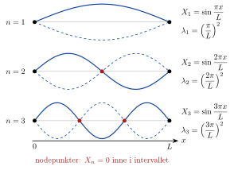

<!-- video: kommer (videoer/flervariabel-kalkulus/06-03-separasjon-av-variabler) -->
{fig-alt="Video kommer"}

<!-- tillegg: Claude -->
Slå an en gitarstreng, og den svinger i et mønster som står stille i rommet og bare vokser og krymper i takt: en **stående bølge**. Varm opp en metallstav og legg endene i isvann, og temperaturprofilen krymper på samme måte, uten å endre form. I begge tilfellene er løsningen en *form i rommet* ganget med en *funksjon av tiden*. Den observasjonen er hele idéen bak **separasjon av variabler**: Vi gjetter en slik produktløsning og gjør én partiell differensiallikning om til to vanlige.

Metoden virker bare for enkle problemer (lineære likninger, enkle områder), så her tar vi den til orientering. Men den gir eksakte løsninger som forklarer mye av fysikken, og som vi kan bruke til å sjekke numeriske metoder.

## Problemet: en stav som kjøles ned

En tynn stav med lengde $L$ har temperaturen $u(x, t)$. Endene holdes på $0$, og ved start er temperaturen $f(x)$:
$$
u_t = \alpha\,u_{xx}, \quad 0 < x < L, \qquad u(0, t) = u(L, t) = 0, \qquad u(x, 0) = f(x)
$$
Her er $\alpha$ varmeledningstallet (temperaturledningsevnen) i $\mathrm{m^2/s}$.

## Steg 1: Gjett et produkt

Vi leter etter løsninger av formen
$$
u(x, t) = X(x)\,T(t)
$$
Da er $u_t = X\,T'$ og $u_{xx} = X''\,T$. Innsatt i varmelikningen:
$$
X\,T' = \alpha\,X''\,T \qquad\Longrightarrow\qquad \frac{T'(t)}{\alpha\,T(t)} = \frac{X''(x)}{X(x)}
$$
Nå kommer hovedpoenget. Venstresiden avhenger bare av $t$, høyresiden bare av $x$. Hold $t$ fast og varier $x$: Venstresiden endrer seg ikke, så høyresiden kan heller ikke endre seg. Begge sider må altså være lik **samme konstant**. Vi kaller den $-\lambda$ (minustegnet gjør regningen penere):
$$
\frac{T'}{\alpha\,T} = \frac{X''}{X} = -\lambda
$$

::: {.callout-note title="Definisjon: Separasjonskonstant"}
Konstanten $\lambda$ som begge sidene må være lik etter at variablene er skilt, kalles **separasjonskonstanten**. Den gjør PDE-en om til to vanlige differensiallikninger:
$$
X'' + \lambda X = 0 \qquad \text{og} \qquad T' = -\alpha\lambda\,T
$$
:::

## Steg 2: Randbetingelsene gir et egenverdiproblem

Randbetingelsene $u(0, t) = X(0)\,T(t) = 0$ for alle $t$ gir $X(0) = 0$ (ellers er $T = 0$ og $u = 0$). Tilsvarende $X(L) = 0$. Romdelen er derfor
$$
X'' + \lambda X = 0, \qquad X(0) = 0, \qquad X(L) = 0
$$
Den har alltid løsningen $X = 0$, men den er uinteressant. Spørsmålet er: **For hvilke $\lambda$ finnes det andre løsninger?** Et slikt problem kalles et **egenverdiproblem**.

- **$\lambda < 0$**, skriv $\lambda = -k^2$: $X = A\cosh kx + B\sinh kx$. $X(0) = 0$ gir $A = 0$, og $X(L) = B\sinh kL = 0$ gir $B = 0$. Bare nulløsningen.
- **$\lambda = 0$**: $X = A + Bx$, og begge betingelsene gir $A = B = 0$.
- **$\lambda > 0$**, skriv $\lambda = k^2$: $X = A\cos kx + B\sin kx$. $X(0) = 0$ gir $A = 0$. Så må $X(L) = B\sin kL = 0$. Med $B \ne 0$ betyr det $\sin kL = 0$, altså $kL = n\pi$.

::: {.callout-important title="Egenverdier og egenfunksjoner (faste ender)"}
$$
\lambda_n = \Big(\frac{n\pi}{L}\Big)^2, \qquad X_n(x) = \sin\frac{n\pi x}{L}, \qquad n = 1, 2, 3, \dots
$$
Randbetingelsene tillater bare de sinusformene som passer et helt antall halve bølgelengder inn i staven.
:::

{.tikz-fig style="width:560px" fig-alt="De tre første egenfunksjonene sinus n pi x over L på intervallet fra 0 til L, tegnet over hverandre for n lik 1, 2 og 3. Hver kurve er null i endene. Modus 2 har ett nodepunkt midt på, modus 3 har to. Stiplet er den speilvendte kurven, som viser at en stående bølge svinger mellom de to formene."}

Tidsdelen $T' = -\alpha\lambda_n T$ har løsningen $T_n(t) = \mathrm{e}^{-\alpha\lambda_n t}$. Hver $n$ gir altså en produktløsning, en **modus**:
$$
u_n(x, t) = \mathrm{e}^{-\alpha(n\pi/L)^2 t}\,\sin\frac{n\pi x}{L}
$$

## Steg 3: Superposisjon

Én enkelt modus passer bare hvis startprofilen $f$ tilfeldigvis er en ren sinus. Men varmelikningen er **lineær og homogen**, og randbetingelsene er også homogene ($u = 0$). Da er en sum av løsninger også en løsning: Deriver leddvis, og hvert ledd oppfyller likningen og er null i endene. Det kalles **superposisjonsprinsippet**. Den generelle løsningen er
$$
u(x, t) = \sum_{n=1}^{\infty} b_n\,\mathrm{e}^{-\alpha(n\pi/L)^2 t}\,\sin\frac{n\pi x}{L}
$$
Koeffisientene $b_n$ bestemmes av initialbetingelsen. Ved $t = 0$ er alle eksponentialfaktorene 1:
$$
f(x) = \sum_{n=1}^{\infty} b_n \sin\frac{n\pi x}{L}
$$
Er $f$ en sum av noen få slike sinuser, kan vi lese av $b_n$ direkte. For en vilkårlig $f$ (for eksempel konstant temperatur) trengs en **Fourier-sinusrekke**, med $b_n = \frac{2}{L}\int_0^L f(x)\sin\frac{n\pi x}{L}\,\mathrm{d}x$. Den teorien hører hjemme et annet sted. Idéen er den samme: Vi skriver startprofilen som en sum av moder og lar hver modus utvikle seg for seg.

::: {.steg}
1. **Gjett** $u = X(x)\,T(t)$, sett inn og del, slik at hver side bare avhenger av én variabel.
2. **Sett begge sider lik** en separasjonskonstant $-\lambda$. Det gir to vanlige differensiallikninger.
3. **Løs egenverdiproblemet** for $X$ med randbetingelsene. Det gir de tillatte $\lambda_n$ og $X_n$.
4. **Løs tidslikningen** for hver $\lambda_n$.
5. **Summer** modene (superposisjon), og tilpass koeffisientene til initialbetingelsen.
:::

::: {.eksempel}
**Eksempel: Avkjøling av en aluminiumsstav.** En aluminiumsstav har lengde $L = 0.50\ \mathrm{m}$ og $\alpha = 9.7\cdot 10^{-5}\ \mathrm{m^2/s}$. Endene står i isvann og holdes på $0\ \mathrm{^\circ C}$. Ved start er temperaturen
$$
f(x) = 40\ \mathrm{^\circ C}\cdot\sin\frac{\pi x}{L} + 10\ \mathrm{^\circ C}\cdot\sin\frac{3\pi x}{L}
$$
Finn $u(x, t)$, og regn ut temperaturen midt på staven etter $60\ \mathrm{s}$ og $300\ \mathrm{s}$.

::: {.losning}
Startprofilen er allerede en sum av to moder, $n = 1$ og $n = 3$, så $b_1 = 40\ \mathrm{^\circ C}$, $b_3 = 10\ \mathrm{^\circ C}$ og alle andre $b_n = 0$. Med superposisjon:
$$
u(x, t) = 40\ \mathrm{^\circ C}\cdot\mathrm{e}^{-t/\tau_1}\sin\frac{\pi x}{L} + 10\ \mathrm{^\circ C}\cdot\mathrm{e}^{-t/\tau_3}\sin\frac{3\pi x}{L}, \qquad \tau_n = \frac{L^2}{\alpha n^2\pi^2}
$$
Tidskonstantene er
$$
\tau_1 = \frac{(0.50\ \mathrm{m})^2}{9.7\cdot 10^{-5}\ \mathrm{m^2/s}\cdot\pi^2} = 261\ \mathrm{s}, \qquad \tau_3 = \frac{\tau_1}{9} = 29.0\ \mathrm{s}
$$
Midt på staven er $\sin\frac{\pi}{2} = 1$ og $\sin\frac{3\pi}{2} = -1$:
$$
u\big(\tfrac{L}{2}, 60\ \mathrm{s}\big) = 40\ \mathrm{^\circ C}\cdot\mathrm{e}^{-60/261} - 10\ \mathrm{^\circ C}\cdot\mathrm{e}^{-60/29.0} = 31.8\ \mathrm{^\circ C} - 1.3\ \mathrm{^\circ C} = \underline{\underline{31\ \mathrm{^\circ C}}}
$$
$$
u\big(\tfrac{L}{2}, 300\ \mathrm{s}\big) = 40\ \mathrm{^\circ C}\cdot\mathrm{e}^{-300/261} - 10\ \mathrm{^\circ C}\cdot\mathrm{e}^{-300/29.0} = 12.7\ \mathrm{^\circ C} - 0.0003\ \mathrm{^\circ C} = \underline{\underline{13\ \mathrm{^\circ C}}}
$$
Etter fem minutter er modus 3 helt borte, og staven har den rene sinusformen til modus 1.
:::
:::

## Hvorfor dør de høye modene raskere?

Modus $n$ avtar med faktoren $\mathrm{e}^{-\alpha n^2\pi^2 t/L^2}$. Modus 3 dør altså $3^2 = 9$ ganger så raskt som modus 1, og modus 10 hundre ganger så raskt. Det er to måter å se det på:

::: {.kort}
- **Krumning** Varmelikningen sier at temperaturen endres i takt med krumningen $u_{xx}$. For en modus er $u_{xx} = -(n\pi/L)^2\,u$: Smale topper og daler er mye krumme og jevnes ut fort.
- **Avstand** I modus $n$ må varmen bare flytte seg en halv bølgelengde, $L/n$, fra en varm topp til en kald dal. Diffusjon bruker tid proporsjonal med *avstanden i andre*, så tiden blir $n^2$ ganger kortere.
:::

Derfor glattes enhver startprofil ut: De takkete detaljene forsvinner først, og til slutt ser alle staver med faste endetemperaturer ut som én sinusbue som synker mot null.

## Stående bølger på en streng

En streng med faste ender følger bølgelikningen:
$$
u_{tt} = c^2 u_{xx}, \qquad u(0, t) = u(L, t) = 0, \qquad u(x, 0) = f(x), \qquad u_t(x, 0) = g(x)
$$
Her er $c$ bølgefarten langs strengen. Samme gjetning, $u = X(x)\,T(t)$, gir
$$
\frac{T''}{c^2\,T} = \frac{X''}{X} = -\lambda
$$
Romdelen er *nøyaktig det samme* egenverdiproblemet som for staven, så $X_n = \sin\frac{n\pi x}{L}$ og $\lambda_n = (n\pi/L)^2$. Forskjellen er tidsdelen: $T'' = -c^2\lambda_n T$ er en harmonisk svingning, ikke en eksponentiell nedgang:
$$
T_n(t) = A_n\cos\omega_n t + B_n\sin\omega_n t, \qquad \omega_n = \frac{n\pi c}{L}
$$
Hver modus er en stående bølge: formen $\sin\frac{n\pi x}{L}$ står stille, og utslaget svinger fram og tilbake mellom kurven og speilbildet i figuren. Nodepunktene beveger seg aldri.

::: {.callout-important title="Egenfrekvensene til en streng"}
$$
f_n = \frac{\omega_n}{2\pi} = \frac{n\,c}{2L}, \qquad n = 1, 2, 3, \dots
$$
Grunntonen er $f_1 = \frac{c}{2L}$, og overtonene er hele multipler av den: $f_n = n f_1$.
:::

At overtonene er hele multipler av grunntonen, er grunnen til at en streng gir en klar tone. En trommehinne har egenfrekvenser som *ikke* er hele multipler, og låter derfor mindre tonalt.

::: {.eksempel}
**Eksempel: Gitarstreng.** En gitarstreng har svingende lengde $L = 0.650\ \mathrm{m}$ og bølgefart $c = 429\ \mathrm{m/s}$. Strengen trekkes ut og slippes fra ro med formen
$$
f(x) = 2.0\ \mathrm{mm}\cdot\sin\frac{\pi x}{L} + 0.50\ \mathrm{mm}\cdot\sin\frac{2\pi x}{L}
$$
a) Finn de tre laveste egenfrekvensene.
b) Finn $u(x, t)$.
c) Hvor lang tid går det før strengen har samme form som ved start?

::: {.losning}
a) $f_1 = \dfrac{c}{2L} = \dfrac{429\ \mathrm{m/s}}{2\cdot 0.650\ \mathrm{m}} = \underline{\underline{330\ \mathrm{Hz}}}$, $\quad f_2 = 2f_1 = \underline{\underline{660\ \mathrm{Hz}}}$, $\quad f_3 = 3f_1 = \underline{\underline{990\ \mathrm{Hz}}}$.

b) Fra ro betyr $u_t(x, 0) = 0$. For hver modus er $T_n'(0) = \omega_n B_n = 0$, så $B_n = 0$ og bare cosinusleddene blir igjen. Ved $t = 0$ skal summen være lik $f$, så $A_1 = 2.0\ \mathrm{mm}$ og $A_2 = 0.50\ \mathrm{mm}$:
$$
\underline{\underline{u(x, t) = 2.0\ \mathrm{mm}\cdot\sin\frac{\pi x}{L}\cos(2\pi f_1 t) + 0.50\ \mathrm{mm}\cdot\sin\frac{2\pi x}{L}\cos(2\pi f_2 t)}}
$$
med $f_1 = 330\ \mathrm{Hz}$ og $f_2 = 660\ \mathrm{Hz}$.

c) Modus 1 er tilbake etter perioden $1/f_1$, og modus 2 etter $1/f_2 = \frac{1}{2f_1}$, altså to ganger i samme tidsrom. Begge er tilbake samtidig etter
$$
\frac{1}{f_1} = \frac{2L}{c} = \frac{2\cdot 0.650\ \mathrm{m}}{429\ \mathrm{m/s}} = \underline{\underline{3.03\ \mathrm{ms}}}
$$
Det er tiden en bølge bruker på å gå fram og tilbake langs strengen. Hele bevegelsen gjentar seg med grunntonens periode.
:::
:::

## Sammenlign med numerikken

Løsningen $u = \mathrm{e}^{-\pi^2 t}\sin(\pi x) + 0.5\,\mathrm{e}^{-9\pi^2 t}\sin(3\pi x)$, som brukes som fasit på siden om [varmelikningen og stabilitet](../07-endelige-differanser/06-varmelikningen.qmd), er nettopp en slik sum av to moder (med $L = 1$ og $\alpha = 1$). Tilsvarende er fasiten i pianohammer-eksempelet om [bølgelikningen og leapfrog-metoden](../07-endelige-differanser/07-bolgelikningen-leapfrog.qmd) én enkelt stående bølge. Separasjon gir eksakte løsninger for enkle tilfeller. De numeriske metodene klarer også de tilfellene der separasjon ikke virker: ujevne staver, kompliserte områder og ikke-lineære likninger.

Koden under tegner den eksakte løsningen for aluminiumsstaven ved noen tider og sammenligner med eksplisitt Euler. Endre `b3` til `-10` eller legg til en modus 5, og se hvor fort de takkete delene forsvinner.

```{.python .kjor}
import numpy as np
import matplotlib.pyplot as plt

L, alfa = 0.50, 9.7e-5            # m, m^2/s
b1, b3 = 40.0, 10.0               # grader C
def u(x, t):
    return (b1*np.exp(-alfa*(np.pi/L)**2*t)*np.sin(np.pi*x/L)
            + b3*np.exp(-alfa*(3*np.pi/L)**2*t)*np.sin(3*np.pi*x/L))

# Eksplisitt Euler til sammenligning
M, r = 20, 0.4
dx = L/M; dt = r*dx**2/alfa
xg = np.linspace(0, L, M + 1)
U = u(xg, 0)
x = np.linspace(0, L, 200)
tider = [0, 30, 60, 120, 300]     # s
t, n = 0.0, 0
for T in tider:
    while t < T - 1e-9:
        U[1:-1] = U[1:-1] + r*(U[2:] - 2*U[1:-1] + U[:-2])
        n += 1; t = n*dt
    linje, = plt.plot(x, u(x, t), label=f't = {t:.0f} s')
    plt.plot(xg, U, 'o', ms=3, color=linje.get_color())
    print(f"t = {t:5.0f} s: midten {u(L/2, t):5.1f} grader C, største avvik Euler {abs(U - u(xg, t)).max():.3f}")
plt.xlabel('x (m)'); plt.ylabel('u (grader C)'); plt.legend()
plt.title('Eksakt (linjer) og eksplisitt Euler (prikker)'); plt.show()
```

Den neste koden viser gitarstrengen fra eksempelet over én periode. Se at formen endrer seg underveis (modus 2 svinger dobbelt så fort), men er tilbake etter $3.03\ \mathrm{ms}$.

```{.python .kjor}
import numpy as np
import matplotlib.pyplot as plt

L, c = 0.650, 429.0               # m, m/s
f1 = c/(2*L)
x = np.linspace(0, L, 300)
def u(x, t):                      # i mm
    return (2.0*np.sin(np.pi*x/L)*np.cos(2*np.pi*f1*t)
            + 0.50*np.sin(2*np.pi*x/L)*np.cos(2*np.pi*2*f1*t))

for andel in [0, 0.125, 0.25, 0.5, 1.0]:
    t = andel/f1
    plt.plot(x, u(x, t), label=f't = {1000*t:.2f} ms')
plt.xlabel('x (m)'); plt.ylabel('utslag (mm)'); plt.legend(); plt.show()
```

:::: {.oppgaver}

::: {.oppgave tittel="Sjekk en løsning"}
Vis at $u(x, t) = \mathrm{e}^{-4\pi^2 t}\sin(2\pi x)$ løser $u_t = u_{xx}$ med $u(0, t) = u(1, t) = 0$. Hvilken modus er det, og hva er startprofilen?

::: {.losning}
$u_t = -4\pi^2\,\mathrm{e}^{-4\pi^2 t}\sin(2\pi x)$. $\quad u_x = 2\pi\,\mathrm{e}^{-4\pi^2 t}\cos(2\pi x)$, $\quad u_{xx} = -4\pi^2\,\mathrm{e}^{-4\pi^2 t}\sin(2\pi x)$.

Altså er $u_t = u_{xx}$. I endene er $\sin 0 = 0$ og $\sin 2\pi = 0$, så randbetingelsene er oppfylt.

Med $L = 1$ og $\alpha = 1$ er dette modus $\underline{\underline{n = 2}}$, med $\lambda_2 = (2\pi)^2 = 4\pi^2$. Startprofilen er $\underline{\underline{u(x, 0) = \sin(2\pi x)}}$, med et nodepunkt midt på.
:::
:::

::: {.oppgave tittel="Halveringstid for en kobberstav"}
En kobberstav har lengde $1.00\ \mathrm{m}$ og $\alpha = 1.11\cdot 10^{-4}\ \mathrm{m^2/s}$, med endene holdt på $0\ \mathrm{^\circ C}$. Hvor lang tid tar det før amplituden til modus 1 er halvert? Og for modus 2?

::: {.losning}
Modus $n$ har amplituden $b_n\,\mathrm{e}^{-\alpha(n\pi/L)^2 t}$. Den er halvert når $\alpha(n\pi/L)^2 t = \ln 2$:
$$
t_{1/2,\,n} = \frac{\ln 2\cdot L^2}{\alpha\,n^2\pi^2}
$$
Modus 1:
$$
t_{1/2,\,1} = \frac{0.6931\cdot(1.00\ \mathrm{m})^2}{1.11\cdot 10^{-4}\ \mathrm{m^2/s}\cdot\pi^2} = 633\ \mathrm{s} = \underline{\underline{10.5\ \mathrm{min}}}
$$
Modus 2 dør $2^2 = 4$ ganger så raskt: $t_{1/2,\,2} = 633\ \mathrm{s}/4 = \underline{\underline{158\ \mathrm{s}}}$.
:::
:::

::: {.oppgave tittel="Startprofil med sinus i tredje" niva="Middels"}
Løs $u_t = u_{xx}$ for $0 < x < 1$ med $u(0, t) = u(1, t) = 0$ og $u(x, 0) = \sin^3(\pi x)$. Bruk identiteten $\sin^3\theta = \frac34\sin\theta - \frac14\sin 3\theta$. Regn ut $u(0.5,\ 0.1)$.

::: {.losning}
Startprofilen er en sum av to moder:
$$
u(x, 0) = \tfrac34\sin(\pi x) - \tfrac14\sin(3\pi x)
$$
så $b_1 = \frac34$, $b_3 = -\frac14$, og resten er null. Med $L = 1$ og $\alpha = 1$ avtar modus $n$ som $\mathrm{e}^{-n^2\pi^2 t}$:
$$
\underline{\underline{u(x, t) = \tfrac34\,\mathrm{e}^{-\pi^2 t}\sin(\pi x) - \tfrac14\,\mathrm{e}^{-9\pi^2 t}\sin(3\pi x)}}
$$
I $x = 0.5$ er $\sin\frac{\pi}{2} = 1$ og $\sin\frac{3\pi}{2} = -1$:
$$
u(0.5,\ 0.1) = \tfrac34\,\mathrm{e}^{-0.98696} + \tfrac14\,\mathrm{e}^{-8.8826} = 0.27953 + 0.00003 = \underline{\underline{0.280}}
$$
Modus 3 er nesten borte allerede ved $t = 0.1$.
:::
:::

::: {.oppgave tittel="Fasiten til pianohammeren" niva="Middels"}
En streng med $L = 1$ og $c = 1$ ligger rett, $u(x, 0) = 0$, og får farten $u_t(x, 0) = \sin(\pi x)$ av et slag. Bruk separasjon av variabler til å vise at $u(x, t) = \frac{1}{\pi}\sin(\pi x)\sin(\pi t)$.

::: {.losning}
Separasjon gir modene $\sin(n\pi x)\big(A_n\cos(n\pi t) + B_n\sin(n\pi t)\big)$, siden $\omega_n = n\pi c/L = n\pi$. Summen er
$$
u(x, t) = \sum_{n=1}^{\infty}\sin(n\pi x)\big(A_n\cos(n\pi t) + B_n\sin(n\pi t)\big)
$$
Startposisjonen: $u(x, 0) = \sum A_n\sin(n\pi x) = 0$, så alle $A_n = 0$.

Startfarten: $u_t(x, 0) = \sum n\pi B_n\sin(n\pi x) = \sin(\pi x)$. Sammenlign leddene: $\pi B_1 = 1$, og $B_n = 0$ for $n \ge 2$. Altså er $B_1 = \frac1\pi$ og
$$
\underline{\underline{u(x, t) = \frac{1}{\pi}\sin(\pi x)\sin(\pi t)}}
$$
Sjekk: $u_{tt} = -\pi\sin(\pi x)\sin(\pi t) = u_{xx}$, $u = 0$ i endene, $u(x, 0) = 0$ og $u_t(x, 0) = \sin(\pi x)$.
:::
:::

::: {.oppgave tittel="Bass-streng og bånd" niva="Middels"}
Den dypeste strengen på en gitar har lengde $L = 0.650\ \mathrm{m}$ og grunntone $82.4\ \mathrm{Hz}$ (E).

a) Hva er bølgefarten i strengen?
b) Gitaristen presser strengen ned mot et bånd for å spille A, $110\ \mathrm{Hz}$. Hvor lang må den svingende delen være, og hvor langt fra den øvre enden (sadelen) ligger båndet?

::: {.losning}
a) Fra $f_1 = \frac{c}{2L}$:
$$
c = 2Lf_1 = 2\cdot 0.650\ \mathrm{m}\cdot 82.4\ \mathrm{Hz} = \underline{\underline{107\ \mathrm{m/s}}}
$$
b) Bølgefarten er den samme (samme streng og stramming), men lengden endres:
$$
L' = \frac{c}{2f_1'} = \frac{107.1\ \mathrm{m/s}}{2\cdot 110\ \mathrm{Hz}} = \underline{\underline{0.487\ \mathrm{m}}}
$$
Båndet ligger $0.650\ \mathrm{m} - 0.487\ \mathrm{m} = \underline{\underline{0.163\ \mathrm{m}}}$ fra sadelen. Kortere streng gir høyere tone, fordi en halv bølgelengde da tar kortere tid å gå over strengen.
:::
:::

::: {.oppgave tittel="Isolerte ender" niva="Utfordrende"}
En stav med lengde $L$ er isolert i begge endene, så ingen varme slipper ut: $u_x(0, t) = u_x(L, t) = 0$. Startprofilen er $u(x, 0) = 20\ \mathrm{^\circ C} + 5\ \mathrm{^\circ C}\cdot\cos\frac{\pi x}{L}$.

a) Vis at egenfunksjonene nå er $X_n = \cos\frac{n\pi x}{L}$ med $n = 0, 1, 2, \dots$
b) Finn $u(x, t)$, og hva temperaturen blir etter lang tid. Tolk svaret.

::: {.losning}
a) Romlikningen er fortsatt $X'' + \lambda X = 0$, nå med $X'(0) = X'(L) = 0$.

- $\lambda = 0$: $X = A + Bx$, $X' = B = 0$. Konstanten $X_0 = 1$ er en løsning.
- $\lambda = k^2 > 0$: $X = A\cos kx + B\sin kx$, $X' = -Ak\sin kx + Bk\cos kx$. $X'(0) = Bk = 0$ gir $B = 0$. $X'(L) = -Ak\sin kL = 0$ gir $kL = n\pi$.
- $\lambda < 0$ gir bare nulløsningen, som med faste ender.

Altså $X_n = \cos\frac{n\pi x}{L}$ og $\lambda_n = (n\pi/L)^2$ for $n = 0, 1, 2, \dots$ Nytt er modus $n = 0$ med $\lambda_0 = 0$.

b) Startprofilen er modus 0 med $b_0 = 20\ \mathrm{^\circ C}$ og modus 1 med $b_1 = 5\ \mathrm{^\circ C}$. Modus 0 har $T_0 = \mathrm{e}^{0} = 1$ og avtar aldri:
$$
\underline{\underline{u(x, t) = 20\ \mathrm{^\circ C} + 5\ \mathrm{^\circ C}\cdot\mathrm{e}^{-\alpha(\pi/L)^2 t}\cos\frac{\pi x}{L}}}
$$
Etter lang tid går leddet med $\mathrm{e}^{-\alpha(\pi/L)^2 t}$ mot null, og $u \to \underline{\underline{20\ \mathrm{^\circ C}}}$ overalt.

Tolkning: Ingen varme slipper ut, så den totale varmemengden er bevart. Temperaturen jevner seg ut til gjennomsnittet av startprofilen. Cosinusleddet har gjennomsnitt null over staven, så gjennomsnittet er nettopp $20\ \mathrm{^\circ C}$.
:::
:::

::::
