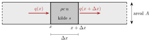
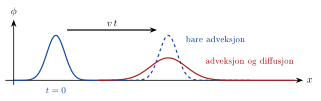

<!-- video: kommer (videoer/flervariabel-kalkulus/06-04-bevaringslover) -->
{fig-alt="Video kommer"}

<!-- tillegg: Claude -->
Hvor kommer varmelikningen $u_t = \alpha u_{xx}$ fra? Den er ikke en lov vi må pugge. Den følger av to ting alle kjenner fra hverdagen:

::: {.kort}
- **Energi forsvinner ikke.** Blir en bit av en stav varmere, må energien ha kommet inn fra naboene eller blitt produsert der.
- **Varme går fra varmt til kaldt.** Jo brattere temperaturen faller, jo mer varme strømmer det.
:::

Den første er en **bevaringslov**, den andre er en **materiallov** (Fouriers lov). Setter vi dem sammen, får vi en partiell differensiallikning. Samme oppskrift gir likningene for stoff som sprer seg i vann, forurensning som føres med en elv, og strømning i rør. Den er også grunnlaget for [endelig volum-metoden](../08-endelig-volum/01-kontrollvolum-og-bevaring.qmd).

## Energi i et volum

Varm opp en kilo vann med én kelvin, og du har brukt $4.2\ \mathrm{kJ}$. Det er den spesifikke varmekapasiteten $c$. I en PDE er det mer naturlig å regne per volum enn per kilo.

::: {.callout-note title="Definisjon: Varmekapasitet per volum"}
Et stoff med massetetthet $\rho$ (i $\mathrm{kg/m^3}$) og spesifikk varmekapasitet $c$ (i $\mathrm{J/(kg\cdot K)}$) har **varmekapasitet per volum** $\rho c$ (i $\mathrm{J/(m^3\cdot K)}$). Har stoffet temperaturen $u(x, t)$, er den indre energien per volum (målt fra et fast nullpunkt)
$$
e = \rho c\,u
$$
:::

Energien i et lite volum $\Delta V$ er da $\rho c\,u\,\Delta V$, og den endrer seg med raten $\rho c\,u_t\,\Delta V$.

## Fouriers lov: hvor mye varme strømmer?

Varme som strømmer, beskrives med **varmefluksen** $\vec q$: effekten som går gjennom en flate per areal, i $\mathrm{W/m^2}$, i den retningen varmen går. Det er en vektor, fordi varmen har en retning.

::: {.callout-important title="Fouriers lov"}
$$
\vec q = -k\,\nabla u \qquad \text{(i én dimensjon: } q = -k\,u_x\text{)}
$$
Her er $k$ **varmeledningsevnen** i $\mathrm{W/(m\cdot K)}$. Minustegnet sier at varmen går *nedover* i temperatur: motsatt vei av gradienten.
:::

Loven er en erfaringslov, ikke et matematisk resultat. Den stemmer godt i faste stoffer og i væsker i ro. Varmeledningsevnen varierer enormt: Kobber har $k \approx 400\ \mathrm{W/(m\cdot K)}$, glass $0.8$, mineralull $0.04$. Mange bøker skriver $\kappa$ eller $\lambda$ for $k$.

::: {.eksempel}
**Eksempel: Varmetap gjennom en vegg.** En vegg har $20\ \mathrm{cm}$ mineralull med $k = 0.037\ \mathrm{W/(m\cdot K)}$. Inne er det $21\ \mathrm{^\circ C}$, ute $-9\ \mathrm{^\circ C}$, og temperaturen faller lineært gjennom isolasjonen. Finn varmefluksen, og varmetapet gjennom $12\ \mathrm{m^2}$ vegg.

::: {.losning}
La $x$ gå fra innsiden ($x = 0$) og ut. Lineært fall gir en konstant derivert:
$$
u_x = \frac{-9\ \mathrm{^\circ C} - 21\ \mathrm{^\circ C}}{0.20\ \mathrm{m}} = -150\ \mathrm{K/m}
$$
Fouriers lov:
$$
q = -k\,u_x = -0.037\ \mathrm{W/(m\cdot K)}\cdot(-150\ \mathrm{K/m}) = \underline{\underline{5.6\ \mathrm{W/m^2}}}
$$
Positiv $q$ betyr at varmen går i positiv $x$-retning, altså ut. Gjennom $12\ \mathrm{m^2}$ blir tapet $5.55\ \mathrm{W/m^2}\cdot 12\ \mathrm{m^2} = \underline{\underline{67\ \mathrm{W}}}$.

Hvorfor faller temperaturen lineært? Fordi veggen er i ro (stasjonær): Like mye varme må gå inn på den ene siden som ut på den andre, i hvert lag. Da er $q$ den samme overalt, og med konstant $k$ er også $u_x$ konstant. Det er en bevaringslov i miniatyr, og vi gjør det samme generelt under.
:::
:::

## Varmelikningen fra et energiregnskap

Se på en tynn stav med tverrsnitt $A$, isolert langs sidene, slik at varmen bare går langs $x$. Vi setter opp et regnskap for skiva mellom $x$ og $x + \Delta x$: et **kontrollvolum**.

{.tikz-fig style="width:560px" fig-alt="En stav med tverrsnittsareal A. En skive mellom x og x pluss delta x er markert. Inne i skiva står energitettheten rho c u og en kilde s. En pil inn fra venstre er merket q av x, og en pil ut til høyre er merket q av x pluss delta x."}

I et lite tidsrom endrer energien i skiva seg på tre måter:

$$
\underbrace{\rho c\,u_t\,A\,\Delta x}_{\text{økning}} = \underbrace{q(x)\,A}_{\text{inn til venstre}} - \underbrace{q(x + \Delta x)\,A}_{\text{ut til høyre}} + \underbrace{s\,A\,\Delta x}_{\text{produsert}}
$$

Her er $s$ en **kilde**: effekt produsert per volum, i $\mathrm{W/m^3}$ (strøm i en ledning, kjemiske reaksjoner, radioaktivitet). Del på $A\,\Delta x$:
$$
\rho c\,u_t = -\frac{q(x + \Delta x) - q(x)}{\Delta x} + s
$$
La $\Delta x \to 0$. Brøken blir den deriverte $q_x$:
$$
\rho c\,u_t + q_x = s
$$
Dette er **bevaringsloven på differensialform**. Den sier: Øker energien et sted, er det fordi det strømmer mer inn enn ut ($q_x < 0$), eller fordi det produseres energi der. Den er sann for alle stoffer. Først når vi setter inn Fouriers lov, $q = -k\,u_x$, får vi en likning for $u$ alene:
$$
\rho c\,u_t = (k\,u_x)_x + s
$$
Med konstant $k$ er $(k u_x)_x = k\,u_{xx}$. Del på $\rho c$:

::: {.callout-important title="Varmelikningen med kilde"}
$$
u_t = \alpha\,u_{xx} + \frac{s}{\rho c}, \qquad \alpha = \frac{k}{\rho c}
$$
$\alpha$ er **varmeledningstallet** (temperaturledningsevnen) i $\mathrm{m^2/s}$. Uten kilde er dette varmelikningen $u_t = \alpha u_{xx}$.
:::

Nå ser vi hva $\alpha$ betyr: Varmen sprer seg raskt når stoffet leder godt (stor $k$) *og* trenger lite energi for å bli varmt (liten $\rho c$). Aluminium har $k = 237\ \mathrm{W/(m\cdot K)}$, $\rho = 2700\ \mathrm{kg/m^3}$ og $c = 900\ \mathrm{J/(kg\cdot K)}$, så
$$
\alpha = \frac{237}{2700\cdot 900}\ \mathrm{m^2/s} = 9.75\cdot 10^{-5}\ \mathrm{m^2/s}
$$
Det er verdien vi brukte for aluminiumsstaven under [separasjon av variabler](03-separasjon-av-variabler.qmd) og i [varmelikningen og stabilitet](../07-endelige-differanser/06-varmelikningen.qmd).

::: {.callout-tip title="Tidsskalaen for diffusjon"}
Enheten til $\alpha$ forteller hvor lang tid varmen bruker på en strekning $L$: omtrent $L^2/\alpha$. For en aluminiumsstav på $0.50\ \mathrm{m}$ er det $(0.50\ \mathrm{m})^2/(9.7\cdot10^{-5}\ \mathrm{m^2/s}) \approx 43\ \mathrm{min}$. Dobbelt så lang stav tar fire ganger så lang tid. Det er samme $n^2$-regel som får de høye modene til å dø ut fort.
:::

::: {.eksempel}
**Eksempel: Varme i en plate med varmeproduksjon.** En $10\ \mathrm{mm}$ tykk plate i en battericelle produserer $s = 1.5\cdot 10^5\ \mathrm{W/m^3}$ jevnt fordelt. Varmeledningsevnen er $k = 0.90\ \mathrm{W/(m\cdot K)}$, og begge sideflatene kjøles til $u_0 = 25\ \mathrm{^\circ C}$. Finn den stasjonære temperaturen inne i platen, hvor varm den blir på midten, og varmefluksen ut gjennom hver side.

::: {.losning}
La $x = 0$ være midten, så platen går fra $x = -L$ til $x = L$ med $L = 5.0\ \mathrm{mm}$. Stasjonært betyr $u_t = 0$, så
$$
k\,u'' + s = 0 \qquad\Longrightarrow\qquad u'' = -\frac{s}{k}
$$
Integrer to ganger: $u = -\frac{s}{2k}x^2 + Cx + D$. Symmetri (eller randbetingelsene $u(\pm L) = u_0$) gir $C = 0$ og
$$
u(x) = u_0 + \frac{s}{2k}\big(L^2 - x^2\big)
$$
En parabel med toppen på midten. Temperaturøkningen der er
$$
\frac{s L^2}{2k} = \frac{1.5\cdot 10^5\ \mathrm{W/m^3}\cdot(5.0\cdot 10^{-3}\ \mathrm{m})^2}{2\cdot 0.90\ \mathrm{W/(m\cdot K)}} = 2.1\ \mathrm{K}
$$
så midten holder $u(0) = \underline{\underline{27\ \mathrm{^\circ C}}}$.

Varmefluksen på høyre side: $q = -k\,u'(L) = -k\cdot\big(-\frac{s}{k}L\big) = sL = 1.5\cdot10^5\ \mathrm{W/m^3}\cdot 5.0\cdot10^{-3}\ \mathrm{m} = \underline{\underline{7.5\cdot 10^2\ \mathrm{W/m^2}}}$.

Kontroll med bevaringsloven: Platen produserer $s\cdot 2L = 1.5\cdot10^3\ \mathrm{W}$ per kvadratmeter, og det går ut $7.5\cdot10^2\ \mathrm{W/m^2}$ på hver av de to sidene. Regnskapet går opp.
:::
:::

## I tre dimensjoner: divergenssetningen gjør jobben

I rommet er kontrollvolumet et vilkårlig område $V$ med overflate $\partial V$ og utadrettet normal $\vec n$. Regnskapet er det samme som for skiva, men varmen kan gå ut gjennom hele overflaten:
$$
\frac{\mathrm{d}}{\mathrm{d}t}\iiint_V \rho c\,u\,\mathrm{d}V = -\iint_{\partial V}\vec q\cdot\vec n\,\mathrm{d}S + \iiint_V s\,\mathrm{d}V
$$
Dette er **bevaringsloven på integralform**. Flateintegralet er netto varmestrøm *ut*, derfor minustegnet. Med [divergenssetningen](../05-integralsetninger/04-divergenssetningen.qmd) blir det et volumintegral:
$$
\iiint_V \big(\rho c\,u_t + \nabla\cdot\vec q - s\big)\,\mathrm{d}V = 0
$$
Dette gjelder for *alle* kontrollvolumer, hvor små de enn er. Da må integranden være null i hvert punkt (var den positiv et sted, kunne vi valgt et lite volum rundt punktet og fått et positivt integral). Med Fouriers lov og konstant $k$ er $\nabla\cdot\vec q = -k\nabla^2u$, og vi får

$$
\rho c\,u_t + \nabla\cdot\vec q = s \qquad\Longrightarrow\qquad u_t = \alpha\nabla^2 u + \frac{s}{\rho c}
$$

Én dimensjon var et spesialtilfelle: Der er $\nabla\cdot\vec q = q_x$.

::: {.callout-note title="Definisjon: Bevaringslov"}
En størrelse med tetthet $\phi$ (mengde per volum), fluks $\vec J$ og kilde $\sigma$ (produsert mengde per volum og tid) er **bevart** når
$$
\frac{\mathrm{d}}{\mathrm{d}t}\iiint_V \phi\,\mathrm{d}V = -\iint_{\partial V}\vec J\cdot\vec n\,\mathrm{d}S + \iiint_V \sigma\,\mathrm{d}V
\qquad\text{for alle } V,
$$
eller på differensialform $\phi_t + \nabla\cdot\vec J = \sigma$. Bevaringsloven alene gir ikke en løsbar likning. Vi trenger også en **materiallov** som sier hvordan $\vec J$ avhenger av $\phi$.
:::

Hva som er bevart, og hvilken materiallov som gjelder, varierer:

| Bevart størrelse | Tetthet $\phi$ | Materiallov for fluksen $\vec J$ | Likning |
|---|---|---|---|
| Energi (varme) | $\rho c\,u$ | Fourier: $-k\nabla u$ | varmelikningen |
| Oppløst stoff | konsentrasjon $C$ | Fick: $-D\nabla C$ | diffusjonslikningen |
| Stoff i en strøm | konsentrasjon $C$ | ført med: $C\,\vec v$ | adveksjonslikningen |
| Masse i en væske | $\rho$ | ført med: $\rho\,\vec v$ | kontinuitetslikningen |

## Transportlikningen: ført med og spredt

Slipp en dråpe fargestoff i en elv. To ting skjer: Flekken **føres med** strømmen (adveksjon), og den **sprer seg** (diffusjon). Fluksen er summen av de to:
$$
\vec J = C\,\vec v - D\nabla C
$$
der $\vec v$ er strømfarten og $D$ diffusjonskoeffisienten i $\mathrm{m^2/s}$. Med konstant $\vec v$ og $D$ gir bevaringsloven $C_t + \nabla\cdot\vec J = \sigma$:

::: {.callout-important title="Transportlikningen (adveksjon–diffusjon)"}
$$
C_t + \vec v\cdot\nabla C = D\,\nabla^2 C + \sigma
$$
I én dimensjon: $C_t + v\,C_x = D\,C_{xx} + \sigma$.
:::

Under [endelig volum-metoden](../08-endelig-volum/01-kontrollvolum-og-bevaring.qmd) skrives den samme likningen med en generell størrelse $\phi$ og diffusjonskoeffisient $\Gamma$. Uten strømning ($v = 0$) er den varmelikningen (diffusjonslikningen). Uten diffusjon ($D = 0$) er den den rene **adveksjonslikningen**
$$
C_t + v\,C_x = 0
$$
som har løsningen $C(x, t) = f(x - vt)$ for *enhver* deriverbar $f$. Sjekk: $C_t = -v f'$ og $C_x = f'$, så $C_t + vC_x = 0$. Løsningen er startprofilen $f(x)$ flyttet en strekning $vt$ mot høyre, uten å endre form.

{.tikz-fig style="width:560px" fig-alt="En klokkeformet konsentrasjonsprofil ved tiden null til venstre. Til høyre, flyttet en strekning v t, står den samme profilen stiplet (bare adveksjon), og en lavere og bredere profil med samme areal (adveksjon og diffusjon)."}

Adveksjonslikningen er av første orden og har en helt annen karakter enn varmelikningen: Informasjon går med farten $v$ i én retning, og ingenting glattes ut. Det gjør den vanskelig å løse numerisk, fordi skarpe kanter skal bevares. Med diffusjon i tillegg flyttes flekken *og* blir lavere og bredere, men arealet under kurven (den totale mengden stoff) er det samme. Det er bevaringsloven.

::: {.eksempel}
**Eksempel: Utslipp i en elv.** Et utslipp skjer i en elv som renner med $v = 0.40\ \mathrm{m/s}$. Et vannverk ligger $2.0\ \mathrm{km}$ nedstrøms. Den effektive diffusjonskoeffisienten langs elva (blanding fra virvler) er $D = 0.50\ \mathrm{m^2/s}$.

a) Når kommer forurensningen fram til vannverket?
b) Omtrent hvor lang er flekken blitt da, hvis den var kort ved utslippet?

::: {.losning}
a) Uten diffusjon er løsningen $f(x - vt)$: Flekken går med farten $v$. Midten når vannverket etter
$$
t = \frac{2.0\cdot 10^3\ \mathrm{m}}{0.40\ \mathrm{m/s}} = 5.0\cdot 10^3\ \mathrm{s} = \underline{\underline{83\ \mathrm{min}}}
$$
Diffusjonen endrer ikke når *midten* kommer, bare hvor spredt flekken er.

b) Diffusjon over tiden $t$ sprer flekken over en lengde av størrelsesorden $\sqrt{2Dt}$ (samme tidsskala som $L^2/\alpha$ for varme):
$$
\sqrt{2\cdot 0.50\ \mathrm{m^2/s}\cdot 5.0\cdot10^3\ \mathrm{s}} \approx \underline{\underline{71\ \mathrm{m}}}
$$
Forurensningen kommer altså ikke på én gang, men passerer vannverket i løpet av noen minutter: $71\ \mathrm{m}/(0.40\ \mathrm{m/s}) \approx 3\ \mathrm{min}$ på hver side av midten.
:::
:::

## Prøv selv: adveksjon og diffusjon

Koden løser transportlikningen $C_t + vC_x = DC_{xx}$ for en klokkeformet flekk. Den eksakte løsningen er en gaussisk kurve som flytter seg med farten $v$ og blir bredere, og koden sjekker at den totale mengden $\int C\,\mathrm{d}x$ ikke endrer seg. Sett `D = 0` og se at formen blir den samme, eller `v = 0` og se ren diffusjon.

```{.python .kjor}
import numpy as np
import matplotlib.pyplot as plt

v = 0.40      # strømfart (m/s)
D = 0.50      # diffusjonskoeffisient (m^2/s)
w = 20.0      # startbredde (m)

def C(x, t):
    b2 = w**2 + 4*D*t                     # bredden i andre vokser lineært med t
    return np.sqrt(w**2/b2) * np.exp(-(x - v*t)**2 / b2)

x = np.linspace(-100, 2500, 4000)
for t in [0, 1500, 3000, 5000]:           # s
    mengde = np.sum(C(x, t))*(x[1] - x[0])
    plt.plot(x, C(x, t), label=f't = {t} s')
    print(f"t = {t:4d} s: midten ved x = {v*t:6.0f} m, mengde = {mengde:.2f}")
plt.xlabel('x (m)'); plt.ylabel('C (relativ)'); plt.legend(); plt.show()
```

## Sammenhengen med resten

::: {.kort}
- **[Hva er en PDE?](01-hva-er-en-pde.qmd)** Varmelikningen er parabolsk. Nå vet vi hvorfor den har akkurat ett tidsderivert ledd: Energien endrer seg i takt med netto fluks inn.
- **[Rand- og initialbetingelser](02-rand-og-initialbetingelser.qmd)** En Neumann-betingelse er en gitt fluks gjennom randen. Isolert rand betyr $\vec q\cdot\vec n = 0$.
- **[Endelig volum-metoden](../08-endelig-volum/01-kontrollvolum-og-bevaring.qmd)** Bruker integralformen direkte på små celler, så regnskapet går opp i hver celle også i den numeriske løsningen.
:::

:::: {.oppgaver}

::: {.oppgave tittel="Varmetap gjennom et vindu"}
En glassrute er $4.0\ \mathrm{mm}$ tykk og har $k = 0.80\ \mathrm{W/(m\cdot K)}$. Temperaturen er $2.0\ \mathrm{K}$ lavere på yttersiden av glasset enn på innersiden. Finn varmefluksen gjennom glasset og varmetapet gjennom en rute på $1.5\ \mathrm{m^2}$.

::: {.fasit}
$4.0\cdot 10^2\ \mathrm{W/m^2}$ · $6.0\cdot 10^2\ \mathrm{W}$
:::
:::

::: {.oppgave tittel="Diffusjonstid i stål"}
Stål har $k = 50\ \mathrm{W/(m\cdot K)}$, $\rho = 7800\ \mathrm{kg/m^3}$ og $c = 460\ \mathrm{J/(kg\cdot K)}$.

a) Finn varmeledningstallet $\alpha$.
b) Bruk tidsskalaen $L^2/\alpha$ til å anslå hvor lang tid varmen bruker gjennom en stålplate på $2.0\ \mathrm{cm}$.

::: {.fasit}
a) $1.4\cdot 10^{-5}\ \mathrm{m^2/s}$ · b) ca. $29\ \mathrm{s}$
:::
:::

::: {.oppgave tittel="Les kilden av temperaturen" niva="Middels"}
I en plate med $k = 1.2\ \mathrm{W/(m\cdot K)}$ er den stasjonære temperaturen
$$
u(x) = 60\ \mathrm{^\circ C} - 2.0\cdot 10^4\ \mathrm{K/m^2}\cdot x^2
$$
a) Hvor stor er varmeproduksjonen $s$ per volum?
b) Finn varmefluksen $q$ ved $x = 1.0\ \mathrm{cm}$. Hvilken vei går varmen?

::: {.fasit}
a) $4.8\cdot 10^4\ \mathrm{W/m^3}$ · b) $4.8\cdot 10^2\ \mathrm{W/m^2}$, i positiv $x$-retning (bort fra midten)
:::
:::

::: {.oppgave tittel="Flekken i elva" niva="Middels"}
a) Vis at $C(x, t) = f(x - vt)$ løser $C_t + vC_x = 0$ for enhver deriverbar funksjon $f$.
b) En elv renner med $0.50\ \mathrm{m/s}$. Hvor lang tid bruker en flekk fargestoff på $3.0\ \mathrm{km}$?
c) Vis at den totale mengden $\int_{-\infty}^{\infty} C\,\mathrm{d}x$ er konstant i tid, både for $C = f(x - vt)$ og for transportlikningen $C_t + vC_x = DC_{xx}$, når $C$ og $C_x$ går mot null langt unna.

::: {.fasit}
b) $6.0\cdot 10^3\ \mathrm{s} = 1.7\ \mathrm{h}$
:::
:::

::: {.oppgave tittel="Kompostbingen" niva="Utfordrende"}
En kuleformet kompostbinge med radius $R = 0.50\ \mathrm{m}$ produserer $s = 30\ \mathrm{W/m^3}$ jevnt fordelt. Varmeledningsevnen er $k = 0.20\ \mathrm{W/(m\cdot K)}$, og overflaten holder $u_R = 10\ \mathrm{^\circ C}$. Situasjonen er stasjonær, og temperaturen avhenger bare av avstanden $r$ fra sentrum.

a) Bruk bevaringsloven på integralform for kula med radius $r$ til å vise at varmefluksen ut er $q(r) = sr/3$. (Du trenger ikke løse noen differensiallikning.)
b) Bruk Fouriers lov, $q = -k\,u'(r)$, til å finne $u(r)$ og temperaturen i sentrum.
c) Hvor stor effekt går ut gjennom overflaten?

::: {.fasit}
b) $u(r) = u_R + \dfrac{s}{6k}\big(R^2 - r^2\big)$ · $16\ \mathrm{^\circ C}$ · c) $16\ \mathrm{W}$
:::
:::

::::
