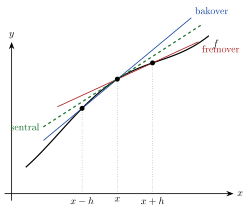

<!-- video: kommer (videoer/flervariabel-kalkulus/07-01-differanser-for-deriverte) -->
{fig-alt="Video kommer"}

<!-- tillegg: Claude -->
En datamaskin kan ikke ta grenseverdier. Den kan bare legge sammen, trekke fra, gange og dele. Vil vi løse differensiallikninger på datamaskin, må vi derfor bytte ut de deriverte med noe den kan regne ut: **differanser** av funksjonsverdier i punkter som ligger tett. Det er grunnideen i alle **endelige differansemetoder**.

## Tre differanser for den deriverte

Definisjonen av den deriverte er $f'(x) = \lim_{h\to 0}\frac{f(x + h) - f(x)}{h}$. Stopper vi før grensen, med en liten men endelig $h$, får vi en tilnærming. Vi kan se forover, bakover eller til begge sider:

::: {.callout-note title="Definisjon: Differanseformler for den førstederiverte"}
$$
\begin{aligned}
f'(x) &\approx \frac{f(x + h) - f(x)}{h} && \text{fremoverdifferanse} \\
f'(x) &\approx \frac{f(x) - f(x - h)}{h} && \text{bakoverdifferanse} \\
f'(x) &\approx \frac{f(x + h) - f(x - h)}{2h} && \text{sentraldifferanse}
\end{aligned}
$$
:::

Geometrisk er hver formel stigningstallet til en sekant. Sentraldifferansen bruker sekanten gjennom punktene på hver side av $x$, og den ligger nesten parallelt med tangenten:

{.tikz-fig style="width:480px" fig-alt="En krum graf f med tre punkter i x minus h, x og x pluss h. Fremoversekanten går gjennom x og x pluss h, bakoversekanten gjennom x minus h og x, og sentralsekanten (stiplet) gjennom x minus h og x pluss h. Sentralsekanten er nesten parallell med tangenten i x."}

## Hvor store er feilene?

Taylorutvikling rundt $x$ svarer på det:
$$
f(x \pm h) = f(x) \pm hf'(x) + \frac{h^2}{2}f''(x) \pm \frac{h^3}{6}f'''(x) + \dots
$$

Setter vi inn i fremoverdifferansen, får vi $\frac{f(x + h) - f(x)}{h} = f'(x) + \frac{h}{2}f''(x) + \dots$, så feilen er proporsjonal med $h$. I sentraldifferansen kansellerer leddene med $h^2$:
$$
\frac{f(x + h) - f(x - h)}{2h} = f'(x) + \frac{h^2}{6}f'''(x) + \dots
$$

::: {.kort}
- **Første orden, $O(h)$** Fremover- og bakoverdifferansen. Halverer vi $h$, halveres feilen.
- **Andre orden, $O(h^2)$** Sentraldifferansen. Halverer vi $h$, blir feilen fire ganger mindre.
:::

## Den andrederiverte

Legger vi sammen Taylorrekkene for $f(x + h)$ og $f(x - h)$, faller alle odde ledd bort:
$$
f(x + h) + f(x - h) = 2f(x) + h^2f''(x) + \frac{h^4}{12}f^{(4)}(x) + \dots
$$

::: {.callout-note title="Definisjon: Differanseformel for den andrederiverte"}
$$
f''(x) \approx \frac{f(x + h) - 2f(x) + f(x - h)}{h^2}
$$
Feilen er $O(h^2)$. Formelen er sentraldifferansen av sentraldifferanser med halvt steg.
:::

Mønsteret $1, -2, 1$ kommer igjen i resten av kapitlet. Det er hjertet i differansemetodene for varme-, bølge- og Laplace-likningen.

::: {.eksempel}
**Eksempel: Sammenlign formlene.** La $f(x) = \sin x$. Tilnærm $f'(1)$ og $f''(1)$ med $h = 0.1$ og $h = 0.05$. De eksakte verdiene er $\cos 1 = 0.540302$ og $-\sin 1 = -0.841471$.

::: {.losning}
| $h$ | fremover | feil | sentral | feil | $f''$ | feil |
|---|---|---|---|---|---|---|
| $0.1$ | $0.497364$ | $-4.3\cdot 10^{-2}$ | $0.539402$ | $-9.0\cdot 10^{-4}$ | $-0.840770$ | $7.0\cdot 10^{-4}$ |
| $0.05$ | $0.519045$ | $-2.1\cdot 10^{-2}$ | $0.540077$ | $-2.3\cdot 10^{-4}$ | $-0.841296$ | $1.8\cdot 10^{-4}$ |

Halvert $h$ halverer feilen i fremoverdifferansen, men deler feilen i sentraldifferansen og i formelen for $f''$ på fire. Sentraldifferansen er dessuten nesten 50 ganger mer nøyaktig enn fremoverdifferansen med samme $h$.
:::
:::

## Prøv selv: konvergensorden i et log-log-plott

Plotter vi feilen mot $h$ med logaritmiske akser, blir $\text{feil} \approx Ch^p$ en rett linje med stigningstall $p$. Det er den vanligste måten å sjekke en numerisk metode på.

```{.python .kjor}
import numpy as np
import matplotlib.pyplot as plt

f, df, x = np.sin, np.cos, 1.0
h = np.logspace(-4, 0, 20)
feil_frem = abs((f(x + h) - f(x))/h - df(x))
feil_sent = abs((f(x + h) - f(x - h))/(2*h) - df(x))

plt.loglog(h, feil_frem, 'o-', label='fremover')
plt.loglog(h, feil_sent, 's-', label='sentral')
plt.xlabel('h'); plt.ylabel('feil'); plt.legend(); plt.grid(True)
plt.show()

p_frem = np.polyfit(np.log(h), np.log(feil_frem), 1)[0]
p_sent = np.polyfit(np.log(h[5:]), np.log(feil_sent[5:]), 1)[0]
print(f"Målt orden: fremover {p_frem:.2f}, sentral {p_sent:.2f}")
```

::: {.callout-tip title="Ikke for liten h"}
Gjør du $h$ mye mindre enn $10^{-8}$, blir feilen *større* igjen. Da trekker vi fra to nesten like tall, og avrundingsfeilene i datamaskinen dominerer. Prøv `h = np.logspace(-14, 0, 40)` i koden.
:::

:::: {.oppgaver}

::: {.oppgave tittel="Regn for hånd"}
La $f(x) = x^3$. Regn ut fremover- og sentraldifferansen for $f'(2)$ med $h = 0.1$, og sammenlign med den eksakte verdien.

::: {.losning}
$f'(2) = 12$. Fremover: $\frac{2.1^3 - 8}{0.1} = \frac{9.261 - 8}{0.1} = \underline{\underline{12.61}}$ (feil $0.61$).

Sentral: $\frac{2.1^3 - 1.9^3}{0.2} = \frac{9.261 - 6.859}{0.2} = \underline{\underline{12.01}}$ (feil $0.01 = h^2$, siden $\frac{h^2}{6}f''' = \frac{0.01}{6}\cdot 6$).
:::
:::

::: {.oppgave tittel="Andrederivert"}
Bruk differanseformelen for $f''$ med $h = 0.1$ på $f(x) = \mathrm{e}^{x}$ i $x = 0$. Hva er feilen?

::: {.losning}
$\frac{\mathrm{e}^{0.1} - 2 + \mathrm{e}^{-0.1}}{0.01} = \frac{1.105171 - 2 + 0.904837}{0.01} = \underline{\underline{1.000834}}$. Feilen er $8.3\cdot 10^{-4} \approx \frac{h^2}{12}$, som Taylorrekka sier.
:::
:::

::: {.oppgave tittel="Fra målinger" niva="Middels"}
En bil er målt på posisjonene $s = 0,\ 12.0,\ 27.0,\ 45.0\ \mathrm{m}$ ved $t = 0,\ 1.0,\ 2.0,\ 3.0\ \mathrm{s}$. Tilnærm farten og akselerasjonen ved $t = 1.0\ \mathrm{s}$ og $t = 2.0\ \mathrm{s}$.

::: {.losning}
Sentraldifferanser med $h = 1.0\ \mathrm{s}$:

$v(1.0) \approx \frac{27.0 - 0}{2.0} = \underline{\underline{13.5\ \mathrm{m/s}}}$, $\quad v(2.0) \approx \frac{45.0 - 12.0}{2.0} = \underline{\underline{16.5\ \mathrm{m/s}}}$

$a(1.0) \approx \frac{27.0 - 2\cdot 12.0 + 0}{1.0^2} = \underline{\underline{3.0\ \mathrm{m/s^2}}}$, $\quad a(2.0) \approx \frac{45.0 - 2\cdot 27.0 + 12.0}{1.0^2} = \underline{\underline{3.0\ \mathrm{m/s^2}}}$
:::
:::

::: {.oppgave tittel="Ensidig andre orden" niva="Utfordrende"}
I et randpunkt har vi bare naboer på én side. Vis med Taylorrekker at
$$
f'(x) \approx \frac{-3f(x) + 4f(x + h) - f(x + 2h)}{2h}
$$
har feil av orden $h^2$.

::: {.losning}
$4f(x + h) = 4f + 4hf' + 2h^2f'' + \frac{2h^3}{3}f''' + \dots$ og $f(x + 2h) = f + 2hf' + 2h^2f'' + \frac{4h^3}{3}f''' + \dots$

Da er $-3f + 4f(x + h) - f(x + 2h) = 2hf' - \frac{2h^3}{3}f''' + \dots$ Leddene med $h^2$ kansellerer. Deler vi på $2h$, blir feilen $-\frac{h^2}{3}f'''$, altså $O(h^2)$.
:::
:::

::::
