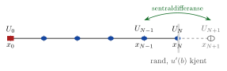

<!-- video: kommer (videoer/flervariabel-kalkulus/07-04-neumann-og-fiktiv-rand) -->
{fig-alt="Video kommer"}

<!-- tillegg: Claude -->
Ofte kjenner vi ikke verdien på randen, men hvor mye som strømmer gjennom den. Enden av en kjøleribbe er isolert, så ingen varme går ut der. Det betyr at temperaturgradienten er null: $u'(b) = 0$. En slik betingelse på den deriverte kalles en **Neumann-betingelse**. Nå er randverdien $U_N$ en ukjent, og vi trenger én likning til.

## Den naive måten

Det enkleste er å bytte ut $u'(b)$ med en bakoverdifferanse:
$$
\frac{U_N - U_{N-1}}{h} = u'_b
$$
Det virker, men bakoverdifferansen er bare av første orden. Feilen i dette ene punktet sprer seg gjennom hele likningssystemet, og hele løsningen blir av første orden.

## Fiktiv rand

Et bedre triks: Tenk deg at løsningen fortsetter ett steg utenfor randen, til et **fiktivt punkt** $x_{N+1} = b + h$ med verdien $U_{N+1}$.

{.tikz-fig style="width:540px" fig-alt="Rutenett fra x null til x N, der x N er randen med kjent derivert. Ett ekstra, fiktivt punkt x N pluss 1 ligger utenfor randen. En sentraldifferanse mellom x N minus 1 og x N pluss 1 tilnærmer den deriverte i randen."}

Nå kan vi bruke *sentraldifferanser* også i randpunktet:

::: {.steg}
1. Skriv differanselikningen i randpunktet $x_N$ som om det var et indre punkt. Den inneholder $U_{N+1}$.
2. Skriv randbetingelsen med en sentraldifferanse: $\dfrac{U_{N+1} - U_{N-1}}{2h} = u'_b$, altså $U_{N+1} = U_{N-1} + 2hu'_b$.
3. Sett dette inn i likningen fra steg 1. Da forsvinner det fiktive punktet.
:::

For $u'' + qu = r$ blir likningen i randpunktet
$$
U_{N-1} + d_NU_N + \big(U_{N-1} + 2hu'_b\big) = h^2r_N
\quad\Longrightarrow\quad
\boxed{2U_{N-1} + d_NU_N = h^2r_N - 2hu'_b}
$$
Bare den siste raden i matrisen endres, og den er fortsatt tridiagonal. Siden alle differansene er sentrale, er metoden fortsatt av **andre orden**. (Har likningen også et ledd $pu'$, får det med seg $p_Nu'_b$ på samme måte.)

::: {.eksempel}
**Eksempel: Kjøleribbe med isolert tupp.** Temperaturoverskuddet $\theta(x)$ (relativt til lufta) i en ribbe med lengde 1 oppfyller
$$
\theta'' - 4\theta = 0, \qquad \theta(0) = 1, \quad \theta'(1) = 0
$$
Den eksakte løsningen er $\theta(x) = \frac{\cosh(2(1 - x))}{\cosh 2}$. Løs med $N = 4$, både med fiktiv rand og med den naive bakoverdifferansen.

::: {.losning}
$h = 0.25$ og $d = -2 - 4h^2 = -2.25$. Indre likninger: $U_{i-1} - 2.25U_i + U_{i+1} = 0$. Randen:

- **Fiktiv rand:** $2U_3 - 2.25U_4 = 0$
- **Naiv:** $U_4 - U_3 = 0$

| $x_i$ | $0.25$ | $0.50$ | $0.75$ | $1.00$ |
|---|---|---|---|---|
| fiktiv rand | $0.6289$ | $0.4150$ | $0.3049$ | $0.2710$ |
| naiv | $0.6409$ | $0.4420$ | $0.3536$ | $0.3536$ |
| eksakt | $0.6253$ | $0.4102$ | $0.2997$ | $0.2658$ |

Fiktiv rand gir største feil $5.2\cdot 10^{-3}$, den naive metoden $8.8\cdot 10^{-2}$, altså 17 ganger større.
:::
:::

## Lønner det seg?

| $N$ | $4$ | $8$ | $16$ | $32$ | $64$ |
|---|---|---|---|---|---|
| fiktiv rand | $5.2\cdot 10^{-3}$ | $1.3\cdot 10^{-3}$ | $3.3\cdot 10^{-4}$ | $8.3\cdot 10^{-5}$ | $2.1\cdot 10^{-5}$ |
| naiv | $8.8\cdot 10^{-2}$ | $3.8\cdot 10^{-2}$ | $1.7\cdot 10^{-2}$ | $8.3\cdot 10^{-3}$ | $4.1\cdot 10^{-3}$ |

Med fiktiv rand deles feilen på fire når $N$ dobles (andre orden). Med den naive metoden halveres den bare (første orden). For å få feil under $10^{-4}$ trenger den naive metoden over tusen punkter, mens fiktiv rand klarer seg med 32.

::: {.callout-important title="Ett punkt bestemmer nøyaktigheten"}
En unøyaktig formel i ett eneste randpunkt ødelegger nøyaktigheten i *hele* løsningen. Behandle randene med samme orden som resten.
:::

## Prøv selv

```{.python .kjor}
import numpy as np
import matplotlib.pyplot as plt

def ribbe(N, metode):
    h = 1/N; x = np.linspace(0, 1, N + 1); d = -2 - 4*h**2
    A = np.zeros((N + 1, N + 1)); F = np.zeros(N + 1)
    A[0, 0] = 1; F[0] = 1                       # θ(0) = 1
    for i in range(1, N):
        A[i, i-1], A[i, i], A[i, i+1] = 1, d, 1
    if metode == 'fiktiv':
        A[N, N-1], A[N, N] = 2, d               # 2U_{N-1} + d U_N = 0
    else:
        A[N, N-1], A[N, N] = -1, 1              # U_N - U_{N-1} = 0
    return x, np.linalg.solve(A, F)

eksakt = lambda x: np.cosh(2*(1 - x))/np.cosh(2)
Ns = [4, 8, 16, 32, 64, 128]
for metode in ['fiktiv', 'naiv']:
    feil = [abs(ribbe(N, metode)[1] - eksakt(ribbe(N, metode)[0])).max() for N in Ns]
    plt.loglog([1/N for N in Ns], feil, 'o-', label=metode)
plt.xlabel('h'); plt.ylabel('største feil'); plt.legend(); plt.grid(True); plt.show()
```

:::: {.oppgaver}

::: {.oppgave tittel="Venstre rand"}
Vis at en Neumann-betingelse $u'(a) = u'_a$ i *venstre* ende gir likningen $d_0U_0 + 2U_1 = h^2r_0 + 2hu'_a$ for $u'' + qu = r$.

::: {.losning}
Fiktivt punkt $x_{-1}$: $\frac{U_1 - U_{-1}}{2h} = u'_a$, så $U_{-1} = U_1 - 2hu'_a$. Likningen i $x_0$: $U_{-1} + d_0U_0 + U_1 = h^2r_0$. Innsatt: $d_0U_0 + 2U_1 - 2hu'_a = h^2r_0$, som gir $\underline{\underline{d_0U_0 + 2U_1 = h^2r_0 + 2hu'_a}}$.
:::
:::

::: {.oppgave tittel="Kjent fluks i enden" niva="Middels"}
Løs $u'' = 0$, $u(0) = 10$, $u'(1) = -5$ med fiktiv rand og $N = 2$. Hva er den eksakte løsningen?

::: {.losning}
$h = 0.5$, $d = -2$. Randlikningen er $2U_1 - 2U_2 = h^2\cdot 0 - 2\cdot 0.5\cdot(-5) = 5$, og den indre likningen er $U_0 - 2U_1 + U_2 = 0$ med $U_0 = 10$.

Fra den indre likningen er $U_2 = 2U_1 - 10$. Innsatt: $2U_1 - 4U_1 + 20 = 5$, så $\underline{\underline{U_1 = 7.5,\ U_2 = 5}}$.

Eksakt løsning: $u = 10 - 5x$. Den numeriske løsningen er eksakt, fordi løsningen er en rett linje.
:::
:::

::: {.oppgave tittel="To Neumann-betingelser?" niva="Utfordrende"}
Hva skjer om vi har $u'' = 0$ med $u'(0) = 0$ og $u'(1) = 0$? Hvorfor blir likningssystemet singulært?

::: {.losning}
Alle konstante funksjoner $u = C$ oppfyller både likningen og randbetingelsene, så løsningen er ikke entydig. Matrisen får da en nullvektor $(1, 1, \dots, 1)$ og er singulær. Fysisk: En stav med isolerte ender beholder den temperaturen den har. Vi må vite hvor mye varme den inneholder for å bestemme nivået.
:::
:::

::::
