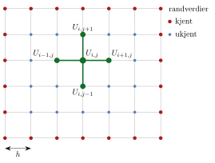

<!-- video: kommer (videoer/flervariabel-kalkulus/07-05-laplace-og-poisson) -->
{fig-alt="Video kommer"}

<!-- tillegg: Claude -->
En metallplate der kantene holdes på faste temperaturer, får etter en stund en temperatur som ikke lenger endrer seg. Denne stasjonære temperaturen oppfyller **Laplace-likningen**. Har platen en varmekilde, for eksempel en strømførende leder, blir det **Poisson-likningen**. Nå tar vi metodene fra én dimensjon med oss til to.

## Problemet

$$
\Delta u = u_{xx} + u_{yy} = f(x, y) \quad \text{i et rektangel } D, \qquad u = g \quad \text{på randen}
$$
Med $f = 0$ er dette Laplace-likningen, ellers Poisson-likningen. Randverdiene $g$ er gitt og kan variere langs kantene.

## Fempunktsformelen

Lag et rutenett med samme steglengde $h$ i begge retninger, $x_i = a + ih$ og $y_j = c + jh$, og la $U_{i,j} \approx u(x_i, y_j)$. Differanseformelen for den andrederiverte i hver retning gir
$$
\frac{U_{i-1,j} - 2U_{i,j} + U_{i+1,j}}{h^2} + \frac{U_{i,j-1} - 2U_{i,j} + U_{i,j+1}}{h^2} = f_{i,j}
$$

::: {.callout-important title="Fempunktsformelen"}
$$
U_{i-1,j} + U_{i+1,j} + U_{i,j-1} + U_{i,j+1} - 4U_{i,j} = h^2f_{i,j}
$$
Hvert indre punkt er koblet til de fire nærmeste naboene.
:::

{.tikz-fig style="width:480px" fig-alt="Et rektangulært rutenett. Punktene på kanten er røde og har kjente randverdier, de indre punktene er blå og ukjente. Ett indre punkt U i j er markert sammen med sine fire naboer til venstre, høyre, over og under."}

Løst for midtpunktet sier formelen noe vakkert: For Laplace-likningen er hver verdi **gjennomsnittet av de fire naboene**,
$$
U_{i,j} = \frac14\Big(U_{i-1,j} + U_{i+1,j} + U_{i,j-1} + U_{i,j+1} - h^2f_{i,j}\Big)
$$
Dette er nettopp oppdateringsformelen for Jacobi- og Gauss–Seidel-iterasjon. Randpunktene holdes fast, og bare de indre punktene oppdateres.

::: {.eksempel}
**Eksempel: Fire ukjente for hånd.** En kvadratisk plate har temperaturen $100\ \mathrm{°C}$ langs den øverste kanten og $0\ \mathrm{°C}$ langs de tre andre. Bruk $h = \frac13$ av sidelengden, som gir fire indre punkter. Finn temperaturene.

::: {.losning}
Symmetrien gir to ukjente: $a$ i de to øverste punktene og $b$ i de to nederste. Gjennomsnittsregelen:
$$
\begin{aligned}
a &= \tfrac14(100 + a + b + 0) \quad\Rightarrow\quad 3a - b = 100 \\
b &= \tfrac14(a + b + 0 + 0) \quad\Rightarrow\quad 3b = a
\end{aligned}
$$
Innsatt: $9b - b = 100$, så $\underline{\underline{b = 12.5\ \mathrm{°C}}}$ og $\underline{\underline{a = 37.5\ \mathrm{°C}}}$.

Kontroll: Gjennomsnittet av alle fire er $25\ \mathrm{°C}$, en fjerdedel av $100\ \mathrm{°C}$. Det stemmer med at én av fire kanter er varm.
:::
:::

## Hvorfor iterere?

Vi *kan* samle alle $U_{i,j}$ i én lang vektor og løse $A\mathbf{U} = \mathbf{b}$ som før. Men med $100 \times 100$ indre punkter er $A$ en $10000 \times 10000$-matrise, og det krever nøye bokføring å fylle den. Iterasjon trenger ingen matrise, bare formelen over, og randverdiene kan variere fritt langs kantene.

::: {.eksempel}
**Eksempel: Sjekk mot eksakt løsning.** På enhetskvadratet er $u = 0$ på tre kanter og $u = \sin(\pi x)$ langs $y = 1$. Den eksakte løsningen er
$$
u(x, y) = \frac{\sin(\pi x)\sinh(\pi y)}{\sinh\pi}
$$
Hvor nøyaktig blir fempunktsformelen?

::: {.losning}
| $M$ (intervaller per side) | $8$ | $16$ | $32$ |
|---|---|---|---|
| største feil | $4.3\cdot 10^{-3}$ | $1.1\cdot 10^{-3}$ | $2.8\cdot 10^{-4}$ |

Feilen deles på fire når $h$ halveres: andre orden, som i én dimensjon.
:::
:::

## Prøv selv

Koden bruker Jacobi skrevet med NumPy-utsnitt, så hele rutenettet oppdateres på én linje.

```{.python .kjor}
import numpy as np
import matplotlib.pyplot as plt

M = 40; h = 1/M
x = np.linspace(0, 1, M + 1)
U = np.zeros((M + 1, M + 1))          # U[i, j] ≈ u(x_i, y_j)

# Randverdier (kan variere langs kantene)
U[0, :]  = 50*x                       # venstre kant: fra 0 til 50 °C
U[:, 0]  = 0;  U[-1, :] = 0           # nederst og til høyre: 0 °C
U[:, -1] = 100                        # øverst: 100 °C (settes sist, så hjørnene får 100)

for m in range(20000):
    G = U.copy()
    U[1:-1, 1:-1] = 0.25*(G[:-2, 1:-1] + G[2:, 1:-1] + G[1:-1, :-2] + G[1:-1, 2:])
    if abs(U - G).max() < 1e-6:
        break
print("Jacobi-iterasjoner:", m)

plt.contourf(x, x, U.T, 30, cmap='inferno'); plt.colorbar(label='°C')
plt.contour(x, x, U.T, 10, colors='w', linewidths=0.5)
plt.gca().set_aspect('equal'); plt.title('Stasjonær temperatur'); plt.show()
```

::: {.callout-tip title="Til ettertanke"}
Hvorfor kan Laplace-likningen aldri ha et maksimum inne i platen? Tenk på gjennomsnittsregelen: Kan et punkt være større enn alle de fire naboene og samtidig være gjennomsnittet av dem?
:::

:::: {.oppgaver}

::: {.oppgave tittel="Én ukjent"}
Et kvadrat deles med $h = \frac12$ av sidelengden, så det er ett indre punkt. Kantene har temperaturene $20$, $40$, $60$ og $80\ \mathrm{°C}$. Hva blir temperaturen i midten?

::: {.losning}
Gjennomsnittet av de fire naboene: $\frac14(20 + 40 + 60 + 80) = \underline{\underline{50\ \mathrm{°C}}}$.
:::
:::

::: {.oppgave tittel="Poisson for hånd" niva="Middels"}
Løs $\Delta u = -2$ på enhetskvadratet med $u = 0$ på randen og $h = \frac12$. Sammenlign med den eksakte verdien $u(0.5, 0.5) = 0.1473$.

::: {.losning}
Ett indre punkt, alle naboer er 0: $0 - 4U = h^2\cdot(-2) = -0.5$, så $\underline{\underline{U = 0.125}}$. Det er 15 % for lite med så grovt rutenett. Med $h = \frac{1}{32}$ blir verdien $0.1472$.
:::
:::

::: {.oppgave tittel="Gauss–Seidel" niva="Middels"}
Gjør om koden til Gauss–Seidel med to løkker over $i$ og $j$. Hvor mange iterasjoner trengs nå for $M = 40$?

::: {.losning}
Gauss–Seidel trenger omtrent $\underline{\underline{2100}}$ iterasjoner mot omtrent 3900 for Jacobi, altså rundt halvparten, akkurat som i én dimensjon. Løkkene i Python er derimot mye tregere per iterasjon enn NumPy-utsnittene, så den totale tiden kan bli lengre.
:::
:::

::: {.oppgave tittel="Ulike steglengder" niva="Utfordrende"}
Utled oppdateringsformelen for Laplace-likningen når steglengdene er $\Delta x$ og $\Delta y$.

::: {.losning}
$\frac{U_{i-1,j} - 2U_{i,j} + U_{i+1,j}}{\Delta x^2} + \frac{U_{i,j-1} - 2U_{i,j} + U_{i,j+1}}{\Delta y^2} = 0$ gir
$$
\underline{\underline{U_{i,j} = \frac{\Delta y^2(U_{i-1,j} + U_{i+1,j}) + \Delta x^2(U_{i,j-1} + U_{i,j+1})}{2(\Delta x^2 + \Delta y^2)}}}
$$
Et vektet gjennomsnitt, der naboene som ligger nærmest, teller mest.
:::
:::

::::
