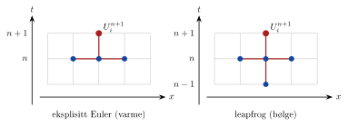

<!-- video: kommer (videoer/flervariabel-kalkulus/07-06-varmelikningen) -->
{fig-alt="Video kommer"}

<!-- tillegg: Claude -->
Så langt har vi løst randverdiproblemer: Betingelsene står på hele randen, og vi finner alle de ukjente samtidig. Varmelikningen $u_t = u_{xx}$ har i tillegg **tid**. Vi kjenner temperaturen nå, ved $t = 0$, men ikke i framtiden. Da må vi **marsjere** framover, ett tidssteg om gangen. Det gir en ny utfordring: **stabilitet**.

## Problemet

$$
u_t = u_{xx}, \quad 0 \le x \le 1, \qquad u(0, t) = g_0(t), \quad u(1, t) = g_1(t), \qquad u(x, 0) = f(x)
$$
Dette er et **initial-randverdiproblem**: et randverdiproblem i $x$ (betingelser i begge ender) og et initialverdiproblem i $t$ (betingelse bare ved start).

## Semidiskretisering

::: {.steg}
1. **Diskretiser i rom.** Velg $M$, sett $\Delta x = \frac1M$ og $x_i = i\Delta x$. I hvert punkt er $u(x_i, t)$ en funksjon av $t$ alene.
2. **Bytt ut $u_{xx}$** med differanseformelen. Da får vi ett system av vanlige differensiallikninger:
$$
U_i'(t) = \frac{U_{i+1}(t) - 2U_i(t) + U_{i-1}(t)}{\Delta x^2}, \qquad i = 1, \dots, M - 1
$$
med $U_0 = g_0$, $U_M = g_1$ og startverdier $U_i(0) = f(x_i)$.
3. **Løs systemet i tid** med en metode for vanlige differensiallikninger, for eksempel eksplisitt Euler.
:::

Med eksplisitt Euler, tidssteg $\Delta t$ og $U_i^n \approx u(x_i, t_n)$ (tidsindeksen skrives oppe):

::: {.callout-important title="Eksplisitt Euler for varmelikningen"}
$$
U_i^{n+1} = U_i^n + r\big(U_{i+1}^n - 2U_i^n + U_{i-1}^n\big), \qquad r = \frac{\Delta t}{\Delta x^2}
$$
Høyresiden inneholder bare verdier vi allerede kjenner. Hver ny verdi regnes rett ut, uten likningssystem. Derfor heter metoden **eksplisitt**.
:::

{.tikz-fig style="width:520px" fig-alt="To rutenett med x vannrett og t loddrett. Til venstre eksplisitt Euler: Den nye verdien på tidsnivå n pluss 1 regnes ut fra tre naboverdier på tidsnivå n. Til høyre leapfrog: Den nye verdien bruker tre verdier på nivå n og én på nivå n minus 1."}

Feilen er $O(\Delta t) + O(\Delta x^2)$: første orden i tid og andre orden i rom.

::: {.eksempel}
**Eksempel: Ett tidssteg for hånd.** Startfordelingen er $f(x) = \sin(\pi x) + 0.5\sin(3\pi x)$, og endene holdes på 0. Ta ett steg med $\Delta x = 0.25$ og $r = 0.25$. Den eksakte løsningen er
$$
u(x, t) = \mathrm{e}^{-\pi^2t}\sin(\pi x) + 0.5\,\mathrm{e}^{-9\pi^2t}\sin(3\pi x)
$$

::: {.losning}
$\Delta t = r\Delta x^2 = 0.015625$. Startverdier: $U^0 = (0,\ 1.0607,\ 0.5000,\ 1.0607,\ 0)$.

$U_1^1 = 1.0607 + 0.25(0.5000 - 2\cdot 1.0607 + 0) = \underline{\underline{0.6553}}$

$U_2^1 = 0.5000 + 0.25(1.0607 - 2\cdot 0.5000 + 1.0607) = \underline{\underline{0.7803}}$

$U_3^1 = 0.6553$ (symmetri). Eksakt: $u(0.25, \Delta t) = 0.6943$ og $u(0.5, \Delta t) = 0.7323$. Det grove rutenettet gir merkbar feil, men toppene og bunnen jevnes ut, som de skal.
:::
:::

## Stabilitet

Prøv å gjøre $\Delta t$ litt større for å komme raskere fram. Plutselig eksploderer løsningen i et sagtannmønster. Hvorfor?

Når vi marsjerer, er hvert steg utgangspunktet for det neste. En liten feil som ganges med en faktor $G$ per steg, er etter $n$ steg ganget med $G^n$. Er $|G| > 1$, vokser den eksponentielt, uansett hvor liten den var.

Det verste tilfellet er den mest takkete feilen rutenettet kan ha: en sagtann $e_i = (-1)^i\varepsilon$. Da er $e_{i\pm1} = -e_i$, og Euler-formelen gir
$$
e_i^{n+1} = e_i^n + r(-e_i^n - 2e_i^n - e_i^n) = (1 - 4r)\,e_i^n
$$

::: {.callout-important title="Stabilitetskravet"}
$|1 - 4r| \le 1$ gir
$$
r = \frac{\Delta t}{\Delta x^2} \le \frac12
$$
Med varmeledningstallet $\alpha$, altså $u_t = \alpha u_{xx}$, blir kravet $\dfrac{\alpha\Delta t}{\Delta x^2} \le \dfrac12$.
:::

Kravet er strengt: Halverer vi $\Delta x$, må $\Delta t$ deles på *fire*. Et slikt krav mellom tidssteg og romsteg kalles en **CFL-betingelse** (etter Courant, Friedrichs og Lewy).

::: {.eksempel}
**Eksempel: Aluminiumsstav.** Aluminium har $\alpha = 9.7\cdot 10^{-5}\ \mathrm{m^2/s}$. Hvor stort tidssteg tåler eksplisitt Euler med $\Delta x = 1.0\ \mathrm{cm}$?

::: {.losning}
$$
\Delta t \le \frac{\Delta x^2}{2\alpha} = \frac{(0.010\ \mathrm{m})^2}{2\cdot 9.7\cdot 10^{-5}\ \mathrm{m^2/s}} = \underline{\underline{0.52\ \mathrm{s}}}
$$
Med $\Delta x = 1.0\ \mathrm{mm}$ må tidssteget ned til $5.2\ \mathrm{ms}$.
:::
:::

## Prøv selv

Kjør med `r = 0.4`, `r = 0.5` og `r = 0.6`. Med $r = 0.6$ blåser sagtannmønsteret opp på kort tid.

```{.python .kjor}
import numpy as np
import matplotlib.pyplot as plt

r = 0.4                     # prøv 0.5 og 0.6
M = 20; dx = 1/M; dt = r*dx**2
x = np.linspace(0, 1, M + 1)
U = np.sin(np.pi*x) + 0.5*np.sin(3*np.pi*x)
u_eksakt = lambda x, t: (np.exp(-np.pi**2*t)*np.sin(np.pi*x)
                         + 0.5*np.exp(-9*np.pi**2*t)*np.sin(3*np.pi*x))

t = 0
for n in range(1, int(0.2/dt) + 1):
    U[1:-1] = U[1:-1] + r*(U[2:] - 2*U[1:-1] + U[:-2])   # randene står i ro (0)
    t = n*dt
    if n % int(0.04/dt) == 0:
        plt.plot(x, U, 'o-', ms=3, label=f't = {t:.2f}')
print("Største feil ved t =", round(t, 3), ":", abs(U - u_eksakt(x, t)).max())
plt.legend(); plt.xlabel('x'); plt.ylabel('u'); plt.show()
```

## To romdimensjoner

I 2D bytter vi $u_{xx}$ ut med fempunktsformelen. Med $\Delta x = \Delta y = h$ og $r = \frac{\Delta t}{h^2}$:
$$
U_{i,j}^{n+1} = U_{i,j}^n + r\Big(U_{i-1,j}^n + U_{i+1,j}^n + U_{i,j-1}^n + U_{i,j+1}^n - 4U_{i,j}^n\Big)
$$
Nå har hvert punkt fire naboer. Et sjakkbrettmønster $(-1)^{i+j}\varepsilon$ gir $G = 1 - 8r$, så kravet blir strengere:
$$
r = \frac{\Delta t}{h^2} \le \frac14
$$

::: {.callout-tip title="Til ettertanke: Jacobi er varmelikningen"}
Sett $r = \frac14$ i 2D-formelen. Da forsvinner $U_{i,j}^n$, og vi står igjen med $U_{i,j}^{n+1} = \frac14(\text{summen av de fire naboene})$. Det er nøyaktig Jacobi-iterasjonen for Laplace-likningen! Hver Jacobi-iterasjon er altså ett tidssteg der varmen sprer seg mot likevekt, og likevekten er den stasjonære temperaturen.
:::

:::: {.oppgaver}

::: {.oppgave tittel="Tillatt tidssteg"}
Hvor stort kan $\Delta t$ være for $u_t = u_{xx}$ med $\Delta x = 0.05$? Hvor mange tidssteg trengs for å nå $t = 1$?

::: {.losning}
$\Delta t \le \frac12\cdot 0.05^2 = \underline{\underline{1.25\cdot 10^{-3}}}$, altså minst $\underline{\underline{800}}$ tidssteg.
:::
:::

::: {.oppgave tittel="Konvergens" niva="Middels"}
Kjør koden med $r = 0.4$ fast og $M = 10,\ 20,\ 40$ til $t = 0.1$. Hvordan endrer feilen seg? Hvorfor ser du andre orden selv om Euler er av første orden i tid?

::: {.losning}
Feilen blir omtrent $4.2\cdot 10^{-3}$, $1.0\cdot 10^{-3}$ og $2.6\cdot 10^{-4}$, altså fire ganger mindre for hver dobling av $M$. Med $r$ fast er $\Delta t = r\Delta x^2$, så feilen $O(\Delta t) + O(\Delta x^2) = O(\Delta x^2)$.
:::
:::

::: {.oppgave tittel="Ett steg i 2D" niva="Middels"}
I et 2D-rutenett er $U_{i,j}^n = 20$, og naboene er $30$, $30$, $10$ og $20$. Regn ut $U_{i,j}^{n+1}$ med $r = 0.2$. Er tidssteget stabilt?

::: {.losning}
$U^{n+1} = 20 + 0.2(30 + 30 + 10 + 20 - 80) = \underline{\underline{22}}$. Stabilt, siden $0.2 \le 0.25$.
:::
:::

::: {.oppgave tittel="Implisitt Euler" niva="Utfordrende"}
I *implisitt* Euler tas høyresiden på det nye tidsnivået: $U_i^{n+1} = U_i^n + r(U_{i+1}^{n+1} - 2U_i^{n+1} + U_{i-1}^{n+1})$. Vis med sagtann-argumentet at forsterkningsfaktoren er $G = \frac{1}{1 + 4r}$. Hva betyr det for stabiliteten, og hva er prisen?

::: {.losning}
Med $e_i^{n+1} = Ge_i^n$ og sagtann: $Ge = e + r(-Ge - 2Ge - Ge) = e - 4rGe$, så $G(1 + 4r) = 1$ og $G = \frac{1}{1 + 4r}$. Siden $0 < G < 1$ for alle $r > 0$, er metoden **stabil for alle tidssteg**. Prisen er at vi må løse et (tridiagonalt) likningssystem i hvert tidssteg.
:::
:::

::::
