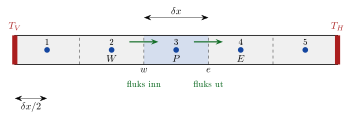

<!-- video: kommer (videoer/flervariabel-kalkulus/08-01-kontrollvolum-og-bevaring) -->
{fig-alt="Video kommer"}

<!-- tillegg: Claude -->
Endelige differanser tar utgangspunkt i *differensiallikningen* og bytter ut de deriverte. **Endelig volum-metoden** tar utgangspunkt i noe enda mer grunnleggende: *bevaringsloven*. Vi deler området i små celler, **kontrollvolumer**, og krever at regnskapet går opp i hver eneste celle:

> Det som strømmer inn, minus det som strømmer ut, pluss det som produseres inne i cellen, er lik økningen i cellen.

Det er derfor metoden brukes i nesten alle programmer for strømnings- og varmeberegninger (CFD).

## Hvorfor endelig volum?

::: {.kort}
- **Bevaring er innebygd.** Fluksen ut av én celle er nøyaktig fluksen inn i naboen. Energi og masse kan ikke «lekke» i beregningen, uansett hvor grovt rutenettet er.
- **Vilkårlig geometri.** Cellene kan være trekanter, firkanter eller vilkårlige mangekanter. Endelige differanser krever i praksis et rektangulært rutenett.
- **Hopp i materialet.** Integralformen gir mening der to materialer møtes og den deriverte ikke finnes. Det gjør ikke differensialformen.
- **Fysisk tolkning.** Alle ledd er flukser gjennom flater eller kilder i celler, så både metoden og randbetingelsene er lette å forstå.
:::

## Bevaringsloven på integralform

La $\phi$ være en størrelse vi vil holde regnskap med, for eksempel temperatur eller konsentrasjon. Se på et fast kontrollvolum $V$ med overflate $\partial V$ og utadrettet enhetsnormal $\hat{\mathbf{n}}$. Mengden i volumet kan endre seg på tre måter:

::: {.kort}
- **Konveksjon** $\phi$ blir ført med en strøm med fart $\mathbf{u}$. Fluksen er $\rho\phi\,\mathbf{u}$.
- **Diffusjon** $\phi$ sprer seg fra høye mot lave verdier. Fluksen er $-\Gamma\nabla\phi$, der $\Gamma$ er diffusjonskoeffisienten. For varme er dette Fouriers lov.
- **Kilder** $\phi$ produseres med en rate $S$ per volumenhet.
:::

Regnskapet for volumet blir
$$
\frac{\mathrm{d}}{\mathrm{d}t}\iiint_V \rho\phi\,\mathrm{d}V
+ \iint_{\partial V}\hat{\mathbf{n}}\cdot(\rho\phi\,\mathbf{u})\,\mathrm{d}S
= \iint_{\partial V}\hat{\mathbf{n}}\cdot(\Gamma\nabla\phi)\,\mathrm{d}S
+ \iiint_V S\,\mathrm{d}V
$$
Økning pluss netto konveksjon ut er lik netto diffusjon inn pluss produksjon.

## Fra integral til differensiallikning, og tilbake

Med divergenssetningen blir flateintegralene volumintegraler av divergenser. Siden likningen gjelder for *alle* kontrollvolumer, hvor små de enn er, må integranden være null. Det gir **transportlikningen**:

::: {.callout-important title="Transportlikningen"}
$$
\frac{\partial(\rho\phi)}{\partial t} + \nabla\cdot(\rho\phi\,\mathbf{u}) = \nabla\cdot(\Gamma\nabla\phi) + S
$$
:::

Med passende valg av $\phi$, $\Gamma$ og $S$ blir dette massebevaring, Navier–Stokes-likningene for strømning, energilikningen eller varmelikningen. Uten strømning ($\mathbf{u} = \mathbf{0}$), med $\phi = T$ og konstante stoffegenskaper, er det varmelikningen $\rho c\,T_t = \nabla\cdot(\kappa\nabla T) + S$.

Endelig volum-metoden går **motsatt vei**: Den integrerer transportlikningen over hver celle og bruker divergenssetningen til å få flukser gjennom celleflatene. Da er vi tilbake ved bevaringsloven, nå for én celle om gangen.

## Stasjonær diffusjon i én dimensjon

Vi starter med det enkleste tilfellet: ingen tid og ingen strømning. Da er
$$
\frac{\mathrm{d}}{\mathrm{d}x}\left(\Gamma\frac{\mathrm{d}\phi}{\mathrm{d}x}\right) + S = 0
$$
Integrer over cellen rundt node $P$, fra flaten $w$ (vest) til flaten $e$ (øst), med tverrsnittsareal $A$:
$$
\left(\Gamma A\frac{\mathrm{d}\phi}{\mathrm{d}x}\right)_e - \left(\Gamma A\frac{\mathrm{d}\phi}{\mathrm{d}x}\right)_w + \bar{S}\,A\,\delta x = 0
$$
Fluks ut gjennom $e$ minus fluks inn gjennom $w$ er lik produksjonen. Dette er helt eksakt. Tilnærmingen kommer først når vi skal uttrykke fluksene med nodeverdiene.

{.tikz-fig style="width:560px" fig-alt="En stav delt i fem like celler med en node midt i hver. Cellen rundt node P er markert, med naboene W til venstre og E til høyre og celleflatene w og e mellom nodene. Piler viser fluks inn gjennom w og ut gjennom e. Randverdiene T V og T H står i endene, og avstanden fra randen til første node er en halv cellebredde."}

::: {.callout-note title="Definisjon: Notasjon i endelig volum-metoden"}
Noden i cellen kalles $P$, naboene $W$ (vest) og $E$ (øst), og flatene mellom dem $w$ og $e$. Nodene ligger midt i cellene, og randen faller sammen med en celleflate. I 2D kommer $S$ (sør) og $N$ (nord) i tillegg.
:::

:::: {.oppgaver}

::: {.oppgave tittel="Regnskap"}
En celle får $40\ \mathrm{W}$ inn gjennom vestflaten og gir $65\ \mathrm{W}$ ut gjennom østflaten. Situasjonen er stasjonær. Hvor stor er varmeproduksjonen i cellen?

::: {.losning}
Ut minus inn er produksjon: $65 - 40 = \underline{\underline{25\ \mathrm{W}}}$.
:::
:::

::: {.oppgave tittel="Velg phi" niva="Middels"}
Hva er $\phi$, $\Gamma$ og $S$ når transportlikningen skal beskrive massebevaring for en væske?

::: {.losning}
$\phi = 1$, så $\rho\phi = \rho$. Masse diffunderer ikke og produseres ikke: $\Gamma = 0$ og $S = 0$. Likningen blir $\frac{\partial\rho}{\partial t} + \nabla\cdot(\rho\mathbf{u}) = 0$, kontinuitetslikningen.
:::
:::

::: {.oppgave tittel="Lekker energien?" niva="Utfordrende"}
Forklar hvorfor summen av alle cellelikningene i endelig volum-metoden gir energibalansen for hele staven, uansett hvor mange celler vi bruker.

::: {.losning}
Når vi legger sammen likningene, opptrer fluksen gjennom hver indre flate to ganger: som «ut» for cellen til venstre og som «inn» for cellen til høyre, med nøyaktig samme uttrykk. De kansellerer. Igjen står bare fluksene gjennom de to endeflatene og summen av alle kildene: total fluks ut av staven er lik total produksjon. Det gjelder eksakt for den diskrete løsningen.
:::
:::

::::
