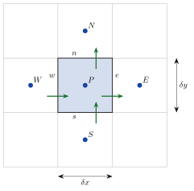

<!-- video: kommer (videoer/flervariabel-kalkulus/08-04-diffusjon-i-to-dimensjoner) -->
{fig-alt="Video kommer"}

<!-- tillegg: Claude -->
I to dimensjoner er cellene rektangler, og hver celle har fire naboer: vest, øst, sør og nord. Ellers er alt som før: Regnskapet for hver celle sier at summen av fluksene ut gjennom de fire flatene er lik produksjonen.

## Den diskrete likningen

{.tikz-fig style="width:380px" fig-alt="Et rutenett av kvadratiske celler. Cellen rundt node P er markert, med nabonodene W, E, S og N og flatene w, e, s og n mellom dem. Piler viser fluksene gjennom de fire flatene. Cellebredden er delta x og cellehøyden delta y."}

Stasjonær diffusjon er $\nabla\cdot(\Gamma\nabla\phi) + S = 0$. Integrer over cellen og bruk divergenssetningen. Med dybde 1 er flatearealene $A_w = A_e = \delta y$ og $A_s = A_n = \delta x$, og fluksene tilnærmes med rette linjer som i 1D:

::: {.callout-important title="Endelig volum i 2D"}
$$
a_P\phi_P = a_W\phi_W + a_E\phi_E + a_S\phi_S + a_N\phi_N + S_u
$$
med
$$
a_W = \frac{\Gamma_w\,\delta y}{\delta x}, \quad a_E = \frac{\Gamma_e\,\delta y}{\delta x}, \quad a_S = \frac{\Gamma_s\,\delta x}{\delta y}, \quad a_N = \frac{\Gamma_n\,\delta x}{\delta y}
$$
og $a_P = a_W + a_E + a_S + a_N - S_P$.
:::

Med kvadratiske celler, $\delta x = \delta y$, og konstant $\Gamma$ er alle $a$-ene like, og en indre celle uten kilde gir
$$
\phi_P = \frac14(\phi_W + \phi_E + \phi_S + \phi_N)
$$
Det er nøyaktig fempunktsformelen for Laplace-likningen. I det indre gir altså endelig volum og endelige differanser de samme likningene. Forskjellen ligger ved randen, der nodene ligger en halv celle fra veggen.

## Randceller og hjørneceller

En celle langs en vegg med kjent temperatur får samme behandling som i 1D, bare for den siden som vender mot veggen: Koblingen kuttes, og veggen legges inn med $S_P \mathrel{-}= 2a$ og $S_u \mathrel{+}= 2a\,T_{\text{vegg}}$. En **hjørnecelle** har to vegger og får to slike bidrag.

::: {.eksempel}
**Eksempel: Plate med én varm vegg.** En kvadratisk plate deles i $3 \times 3$ like celler. Venstre vegg holdes på $100\ \mathrm{°C}$, de tre andre på $20\ \mathrm{°C}$. Med kvadratiske celler er $a = \kappa$ for alle naboer, og vi setter $\kappa = 1\ \mathrm{W/(m\,K)}$. Finn temperaturene og kontroller energibalansen.

::: {.losning}
Tre typer celler:

| celle | naboer | $S_P$ | $S_u$ | $a_P$ |
|---|---|---|---|---|
| hjørne nede til venstre | $E$, $N$ | $-2 - 2$ | $2\cdot 100 + 2\cdot 20 = 240$ | $6$ |
| midt på nederste rad | $W$, $E$, $N$ | $-2$ | $2\cdot 20 = 40$ | $5$ |
| midten | alle fire | $0$ | $0$ | $4$ |

De ni likningene gir (øverste rad øverst):

| | venstre | midt | høyre |
|---|---|---|---|
| øverst | $57.1$ | $32.0$ | $22.9$ |
| midt | $70.9$ | $40.0$ | $25.1$ |
| nederst | $57.1$ | $32.0$ | $22.9$ |

**Energibalanse:** Inn gjennom den varme veggen går $\sum 2(100 - T_P) = 2(42.9 + 29.1 + 42.9) = 229.7\ \mathrm{W}$ per meter dybde. Summerer vi fluksene ut gjennom de tre kalde veggene, får vi også nøyaktig $229.7\ \mathrm{W}$. Metoden bevarer energien eksakt, også med bare ni celler.
:::
:::

## Prøv selv

Løseren bruker Gauss–Seidel over cellene. Randbidragene legges til automatisk for celler som mangler en nabo. Prøv å legge inn en isolerende innsats med lav $\kappa$ midt i platen.

```{.python .kjor}
import numpy as np
import matplotlib.pyplot as plt

n = 20                                    # n x n celler, kvadratiske
kappa = np.ones((n, n))                   # kappa[i, j], i = x, j = y
# kappa[7:13, 7:13] = 0.05              # isolerende innsats: fjern # for å prøve
vegg = {'V': 100, 'H': 20, 'S': 20, 'N': 20}
T = np.full((n, n), 20.0)

def harm(a, b): return 2*a*b/(a + b)

for it in range(5000):
    endring = 0
    for i in range(n):
        for j in range(n):
            aP = 0; sum_nb = 0
            for di, dj, side in [(-1, 0, 'V'), (1, 0, 'H'), (0, -1, 'S'), (0, 1, 'N')]:
                ii, jj = i + di, j + dj
                if 0 <= ii < n and 0 <= jj < n:
                    a = harm(kappa[i, j], kappa[ii, jj])
                    sum_nb += a*T[ii, jj]
                else:
                    a = 2*kappa[i, j]          # halv celle til veggen
                    sum_nb += a*vegg[side]
                aP += a
            ny = sum_nb/aP
            endring = max(endring, abs(ny - T[i, j])); T[i, j] = ny
    if endring < 1e-6:
        break
print("Gauss–Seidel-iterasjoner:", it)

x = (np.arange(n) + 0.5)/n
plt.contourf(x, x, T.T, 30, cmap='inferno'); plt.colorbar(label='°C')
plt.gca().set_aspect('equal'); plt.show()
```

:::: {.oppgaver}

::: {.oppgave tittel="Koeffisientene"}
En celle har $\delta x = 0.020\ \mathrm{m}$, $\delta y = 0.010\ \mathrm{m}$ og $\kappa = 5.0\ \mathrm{W/(m\,K)}$ (dybde $1\ \mathrm{m}$). Finn $a_W$, $a_E$, $a_S$ og $a_N$ for en indre celle.

::: {.losning}
$a_W = a_E = \frac{\kappa\,\delta y}{\delta x} = \frac{5.0\cdot 0.010}{0.020} = \underline{\underline{2.5\ \mathrm{W/K}}}$ og $a_S = a_N = \frac{\kappa\,\delta x}{\delta y} = \underline{\underline{10\ \mathrm{W/K}}}$. Naboene i $y$-retning er tettere koblet fordi de ligger nærmere og flaten mellom dem er større.
:::
:::

::: {.oppgave tittel="Isolert vegg" niva="Middels"}
Hvordan endres likningen for en randcelle når veggen er isolert? Hva skjer med temperaturene i eksempelet hvis den øverste veggen isoleres?

::: {.losning}
For en isolert vegg kuttes koblingen uten noe bidrag til $S_u$ eller $S_P$. I eksempelet blir platen varmere, fordi varmen bare kan slippe ut gjennom to kalde vegger. Med $3 \times 3$ celler blir midtcellen $\underline{\underline{48.8\ \mathrm{°C}}}$ i stedet for $40.0\ \mathrm{°C}$.
:::
:::

::: {.oppgave tittel="Symmetri" niva="Utfordrende"}
Forklar hvorfor midtcellen i eksempelet ble nøyaktig $40\ \mathrm{°C}$. (Hint: Legg sammen fire løsninger der hver av de fire veggene er varm etter tur.)

::: {.losning}
Problemet er lineært. Gir vi hver vegg sin tur som den varme ($100\ \mathrm{°C}$) og summerer de fire løsningene, blir resultatet det samme som med alle fire veggene på $100 + 3\cdot 20 = 160\ \mathrm{°C}$, altså $160\ \mathrm{°C}$ overalt. Av symmetri bidrar hver av de fire løsningene like mye i midtcellen: $160/4 = \underline{\underline{40\ \mathrm{°C}}}$.
:::
:::

::::
